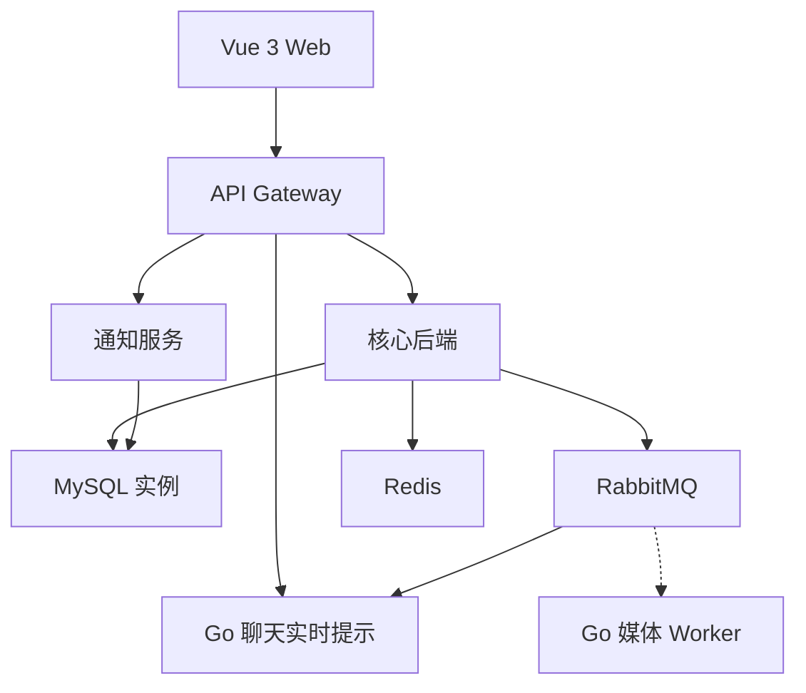

# 同频在线社区系统总体架构

**架构设计复核 · 2026-11-23**

现状以仓库 `HEAD 6b08b93` 和当前工作区的源码、迁移、运行配置与测试为依据。工作区包含尚未提交的实现。文档中的能力状态指代码和配置已具备的行为，运行验收以对应版本的执行报告为准。

首轮保持 Java 核心的模块化部署，通知继续独立运行。聊天业务在默认部署中由核心处理，当前工作区已有可选的独立 Java 进程和专库。Go `chat-realtime` 承担 WebSocket 连接和变化提示。已有聊天数据时，启用独立进程需要完成停写、数据对账和回退演练。[工作区分库配置](../../docker-compose.chat.yml) · [聊天首次分库演练](03-数据库归属与迁移.md#聊天首次分库演练)

## 现状与目标

| 能力 | 仓库现状 | 首轮设计 |
| --- | --- | --- |
| Web 与接入 | Vue 3 经 Gateway 访问核心后端与通知服务。工作区网关额外将聊天 WebSocket 路由到 Go 进程 | 保持公开接口兼容。网关统一入口和边缘流量控制，应用验证身份并执行资源授权 |
| 论坛核心 | 身份、分区、主题、回复、点赞、收藏、关注、搜索与社区治理都在 `backend` | 通过 owner 的模块接口协作，先处理跨域查询和共享事务 |
| 站内通知 | 独立 `notification-service`，核心通知 Outbox 经 HTTP 投递，收件箱支持 SSE 补拉 | 保持可靠投递，优先落实数据库账号隔离 |
| 搜索和媒体 | 已有可选 Elasticsearch 适配与重建流程、Java 媒体登记及可选 Go worker | 沿用既有契约补齐验收，独立搜索或媒体 API 由实际负载决定 |
| 好友、私信与群聊 | 互关派生好友。会话、历史、配额和权限由 Java 处理。Go 经 RabbitMQ 接收账号级提示，浏览器再走 REST 读消息 | 先验收默认部署中的权限、轮询和重连，再用已有独立聊天配置进行切流演练 |
| 持久化与异步 | 已提交基线 32 张表。工作区默认部署 41 张，叠加聊天专库后为 48 张物理表，含核心库的五张冻结旧表 | MySQL 持久化，Redis 提供缓存、认证临时状态和限流，RabbitMQ 用于异步处理。中间件替换按独立试点评估 |

| 核对项 | 源码定位 |
| --- | --- |
| 构建边界与前端 | 根 POM 定义三个 Java 模块，Vue 构建由前端包声明定义。[根 POM](../../pom.xml) · [前端依赖声明](../../frontend/package.json) |
| 网关与通知 | 网关路由和请求关联过滤器，核心 HTTP 客户端与独立通知接收入口。[网关路由](../../gateway/src/main/resources/application-local.yml) · [请求关联过滤器](../../gateway/src/main/java/com/example/gateway/RequestCorrelationGlobalFilter.java) · [通知 HTTP 客户端](../../backend/src/main/java/com/example/demo/notifications/service/remote/RemoteNotificationService.java) · [通知 Controller](../../notification-service/src/main/java/com/example/notification/controller/NotificationsController.java) |
| 搜索与媒体 | `ThreadSearchService.list` 包含索引候选回查和数据库回退。Java 处理媒体任务，Go 通过私有 HTTP 客户端执行协议。[搜索入口](../../backend/src/main/java/com/example/demo/search/service/ThreadSearchService.java) · [媒体任务](../../backend/src/main/java/com/example/demo/storage/service/MediaJobService.java) · [媒体 Worker 客户端](../../services/media-service/internal/coreclient/client.go) |
| 工作区聊天 | Java 写入会话和消息，Go 验证连接并发出刷新提示。[ChatService](../../chat-domain/src/main/java/com/example/demo/chat/service/ChatService.java) · [Go WebSocket](../../services/chat-realtime/socket.go) · [逐表盘点](03-数据库归属与迁移.md) |

## 默认部署拓扑

完整 Compose 声明 Go 实时进程。Go 不可用时，浏览器可以通过 REST 轮询。媒体 worker 使用可选扩展。核心和通知在主 MySQL 实例内使用不同数据库，可配置独立的通知运行和迁移账号。叠加聊天扩展后，网关把会话业务转向连接专库的独立 Java 进程。Go 向核心核验登录，独立聊天进程向核心读取公开资料和联系资格。[默认 Compose](../../docker-compose.yml) · [聊天扩展](../../docker-compose.chat.yml) · [数据库账号与迁移](03-数据库归属与迁移.md)

## 架构决策

| 决策 | 首轮意见 | 进入下一步的条件 |
| --- | --- | --- |
| 业务模块与部署 | 核心域继续同进程。保留网关与通知服务，聊天先作为核心模块 | 公共契约稳定，跨域 SQL 和行锁已处理，有独立恢复演练，以及可量化的独立发布或连接容量需求 |
| 私信与群聊 | 共用会话、成员、消息顺序和已读模型 | 单聊授权、群成员资格与历史可见性均有独立用例 |
| 好友 | 推荐用互相关注实时派生好友关系 | 产品确认互关、取关、拉黑以及历史会话行为后冻结 |
| 互动与治理 | 点赞、收藏划给互动域。治理持有规则、范围和审计，内容持有可见性及分区实体 | 先通过同进程 owner 入口收敛交叉读写，保留现有排序和同事务约束 |
| 技术替换 | 按单服务和单链路推进。优先验证通知库切到 PostgreSQL、内容搜索链路切到 Kafka 的可行性 | 压测或运维需求给出替换理由，各自具备数据核对、故障演练和回退方案 |

### 技术选型

| 层次 | 采用方案 |
| --- | --- |
| 前端与应用 | Vue 3、Java 21、Spring Boot 4.0 系列和仓库现有 Spring Cloud 版本 |
| 服务入口 | Spring Cloud Gateway，公开 REST 路径维持兼容 |
| 同步调用 | 同进程应用接口优先。跨进程使用 REST 和独立 DTO，新的 Java 客户端优先复用现有 HTTP 封装或采用 Spring HTTP Service Clients |
| 实时交付 | REST 提交和补拉，工作区 Go WebSocket 发变化提示，Vue 按序号补拉并保留轮询。持续验证连接与故障恢复，通知服务使用 SSE |
| 关系数据与基础设施 | MySQL 8.0、Flyway、Redis、RabbitMQ、Docker Compose。搜索复用可选 Elasticsearch，媒体复用 Go worker |
| 工程化 | 复用现有 Actuator、仓库检查和 CI。按独立部署需求推进 Prometheus、Grafana、OpenTelemetry 与日志聚合 |

[Java 版本配置](../../pom.xml) · [Go 实时服务依赖](../../services/chat-realtime/go.mod) · [浏览器实时客户端](../../frontend/src/pages/messages/realtime.ts) · [通知流 Controller](../../notification-service/src/main/java/com/example/notification/controller/NotificationStreamController.java)

按职责独立评估语言。论坛与聊天业务首先验证授权、事务、审计和迁移，首轮用 Java 承载应用用例。连接进程侧重并发连接、心跳、扇出和背压，采用 Go 并独立测量连接容量与内存。媒体 Go worker 的交付点是按任务协议处理对象，Java 负责资源归属、租约和结果确认。聊天业务将来可单独评估 Go，候选实现须通过同一套 HTTP 契约、并发权限、迁移和回退测试。语言选择的依据包括交付复杂度、团队维护成本和实测收益。[即时通讯实现参考](06-即时通讯系统设计.md#公开实现参考) · [媒体任务协议](04-服务间通信规范.md#rest-契约与身份)

## 接口与数据边界

| 入口或状态 | 权威位置与规则 |
| --- | --- |
| `/api/v1/auth/**`、用户、主题、回复、收藏、治理 | 网关转核心后端，应用按现有 owner 校验账号、角色和内容状态 |
| `/api/v1/notifications`、`/{id}/read`、`/stream`、`/events` | 网关转通知服务。收件人仅能读取自己的通知、游标和变更 |
| 聊天会话、私信、群聊及设置 REST | 默认路由到核心，可选分库路由到独立聊天进程。公开路径和客户端契约沿用同一组定义 |
| `/api/v1/chat/friends`、`/api/v1/chat/blocks` 与 `/api/v1/chat/realtime` | 好友和拉黑留在核心社交模块。精确的实时路径转发至 Go，Go 向核心直连核验会话 |
| 权威数据 | 领域写入和同源 Outbox 共用提交边界。分库时只迁五张聊天业务表，已有核心副本冻结。社交规则和审核决定由核心持有，审核执行回执由聊天专库持有 |
| 派生及临时数据 | 搜索索引可从权威内容重建。Redis 缓存、在线租约、连接路由和 broker 记录有各自的用途，授权和历史读取回到 owner |

## 故障和降级

- 通知服务或 RabbitMQ 停机时，已成功写入 Outbox 的核心请求保留业务提交。投递恢复后按原标识重试。Outbox 写入异常时，对应业务事务回滚。
- 搜索索引不可用时，按现有公开查询能力走权威库降级。返回的候选仍通过当前可见性判断。
- 聊天推送中断时，页面通过已授权的 REST 接口按序号补拉。成员权限或联系资格无法判定时拒绝相关操作。
- 服务切流前排空相应的在途写入和消费者。目标产生新写入后，回退需先对账并补齐该段数据。

## 实施顺序与验收

| 阶段 | 评审交付与退出条件 |
| --- | --- |
| 一 · 核心模块化 | 冻结表与模块 owner，梳理历史 SQL、外键和锁。新跨域写入须经过 owner，现有论坛主流程保持兼容 |
| 二 · 通知自治 | 分离运行账号与迁移权限。验证收件人隔离、接收端停机恢复、幂等和 SSE 补拉 |
| 三 · 社交与聊天 | 先确认互关与额度口径。私信及群聊依次灰度，完成并发、越权、断线和回退验收后再评估分库 |
| 四 · 搜索与媒体 | 优先验收既有的搜索重建、隐藏版本和媒体租约。独立部署需求由延迟、积压或资源消耗的数据支持 |
| 五 · 部署与治理 | 固化 CI、告警、隔离账号和恢复演练。具备对应门槛后逐项验证 Kafka 或 PostgreSQL |

第一阶段从收藏入口着手。收藏状态查询和创建已接入内容域的可见性检查，收藏列表的跨域投影留在后续分库验收范围。[第一批实施记录](02-微服务拆分与职责.md)

分区操作和论坛举报的目标查询已通过内容域接口交互。通知账号隔离、停机补投和 SSE 补拉均有隔离演练记录。独立聊天配置已用于验证五张表迁移、单一写入端和目标已写入后的回退。生产切换依据独立发布或容量需求、产品规则评审和对应版本的验收报告。中间件试点各用一次独立变更窗口。[阶段门禁与验收证据](08-部署与运维设计.md#实施批次与退出条件) · [聊天分库演练](03-数据库归属与迁移.md#聊天首次分库演练)

已确定互关与接受申请均能建立好友关系，以及发送人可在两分钟内撤回自己的私信和群聊消息。陌生私信额度及默认接收设置、群历史范围和留存期限仍按现有实现与后续使用数据评审。消息与通知的实时服务容量、生产 SLO 和中间件迁移窗口以试运行数据确定。

## 文档导航

| 文档 | 评审内容 |
| --- | --- |
| [02 微服务拆分与职责](02-微服务拆分与职责.md) | owner、现有依赖、服务拆分条件 |
| [03 数据库归属与迁移](03-数据库归属与迁移.md) | 32 张基线表逐表归属、工作区新增表、聊天分库和对账回退 |
| [04 服务间通信规范](04-服务间通信规范.md) | 本地接口、REST、队列、SSE 和 WebSocket |
| [05 社交关系设计](05-社交关系设计.md) | 互关、拉黑、联系资格与发布条件 |
| [06 即时通讯系统设计](06-即时通讯系统设计.md) | 会话模型、配额、权限、重连与群聊 |
| [07 消息事件与 Outbox 设计](07-消息事件与Outbox设计.md) | 可靠投递、事件契约与 Kafka 切换 |
| [08 部署与运维设计](08-部署与运维设计.md) | 拓扑、可观测性、切流与交付验收 |
| [09 工程规范与决策](09-工程规范与决策.md) | 分层依赖、适配器验收和架构决策记录 |
