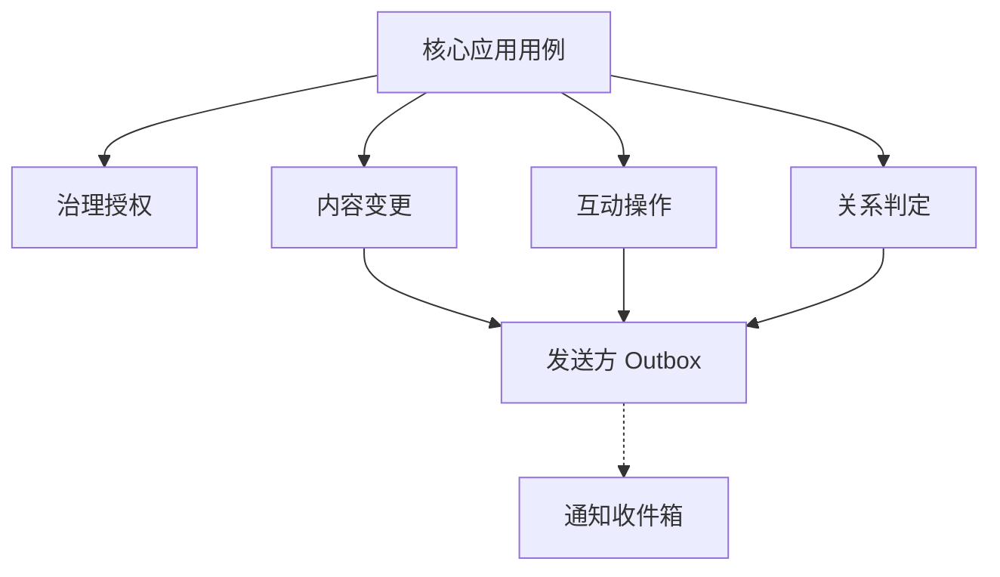

# 微服务拆分与职责

同频同时承担公共论坛、账号治理与私密聊天。按业务对象明确唯一写入方，再根据用例和事务划分部署单元。工作区将聊天长连接交给 Go。默认由核心 Java 应用处理聊天业务和写入，分库配置由独立 Java 进程接管同一契约。[聊天扩展](../../docker-compose.chat.yml)

## 域到部署单元

| 业务域 | 负责与对外能力 | 当前代码及部署 | 首轮安排 |
| --- | --- | --- | --- |
| 身份 | 账号、认证、公开资料、绑定账号、用户通知偏好 | `auth`、`user`，核心后端 | 提供身份与资料批量读取。社区角色、版主范围与发帖限制由治理持有 |
| 内容 | 分区实体、主题及正文、回复、标签、可见性、内容版本 | `sections`、`threads`、`posts`、`tags`，核心后端 | 内容 owner 执行发布、编辑、隐藏和恢复，输出公共及内部投影 |
| 互动 | 点赞、取消点赞、收藏及与用户相关的互动状态 | 点赞位于 `threads`、`posts`，收藏位于 `bookmarks` | 先确定互动逻辑 owner 并通过模块接口交互，保留当前库与排行榜行为 |
| 社交关系 | 关注、粉丝、互关好友、联系级拉黑规则 | 关注位于 `user`，`social` 提供联系策略并持有 `chat_blocks` | 保持同进程授权和锁顺序，分库前评审授权时点 |
| 治理 | 角色、版主范围、发帖限制、举报流程、原因与审计 | `governance`、`moderation`、`admin`，核心后端 | 治理做决策，内容与聊天各自执行可见性变更 |
| 聊天业务 | 单聊、消息请求、群聊、成员、历史、已读和额度 | 默认核心 `demo/chat` 模块，扩展模式走 `chatprocess` 和专库 | 先验收同库行为。独立进程用于隔离切流演练，正式启用依赖发布、容量或故障隔离需求 |
| 聊天实时提示 | WebSocket 连接、会话核验和账号级变化提示 | 工作区 `services/chat-realtime`，Go 独立进程。通过 Java 核验 token，从 RabbitMQ 消费变化提示 | 保持传输边界，聊天业务 owner 继续控制消息读取和持久化 |
| 通知 | 收件箱及已读、投递去重、账号内 SSE 事件日志 | 独立 `notification-service`。发送方 Outbox 在核心 `notifications` | 保持 HTTP 可靠投递，优先拆数据库凭证 |
| 媒体 | 资源登记、归属、对象访问、任务、租约和结果验收 | `storage` 持有业务数据，可选 Go worker 负责图片处理 | Go 按私有 HTTP 协议领取、续租和提交结果。需要独立伸缩时先扩 worker |
| 搜索 | 搜索查询、投影索引、重建和别名控制 | `search`、MySQL 回退及可选 Elasticsearch | 保持显式查询能力与权限边界，消费积压或独立运维需求明确后再抽取 |
| AI 摘要 | 版本化任务、预算、执行与尝试账本 | `ai` 和内容版本关联，核心后端 | 继续复用现有异步任务与条件写回，内容 owner 持有展示结果 |

分区治理由 `GovernanceService` 判定权限、校验规则并记录审计，由内容域的 `SectionAdministration` 执行查询、加锁和状态变更。发帖先锁作者再取得分区共享锁，更新分区使用排他锁。分区变更与治理审计在同一事务提交，列表缓存的版本在提交后更新。[治理用例](../../backend/src/main/java/com/example/demo/governance/service/GovernanceService.java) · [分区命令](../../backend/src/main/java/com/example/demo/sections/service/SectionAdministration.java)

## 接口草案

同进程接口由 owner 暴露，采用稳定的 ID、值对象和 DTO。下列名称用于架构评审，现有公开 REST 路径沿用。依赖移动按一个用例一组灰度处理。

| owner 接口 | 调用者与返回 | 一致性 |
| --- | --- | --- |
| 身份 `PublicProfiles.findByIds(ids)` | 内容、聊天、收藏和关系列表批量获取昵称及头像 | 可用于展示缓存。未找到使用已定义的占位态 |
| 内容 `ContentQueries.findVisible(ids, viewer)` | 收藏、排行榜聚合、搜索与内容导航返回校验过的当前投影 | 按当前读权限及内容版本检查。调用失败时隐藏未核验数据 |
| 内容 `ContentReportTargets` 与主题、回复的审核命令 | 治理确认目标可举报、取得锁定后的分区、要求隐藏或恢复 | 内容读取目标与父主题，检查可见性，持有主题锁并负责版本及事件。治理根据锁定后的分区校验审核范围 |
| 内容 `SectionAdministration` | 治理查询分区、验证版主范围、创建和更新分区 | 内容持有分区实体、仓储和行锁。治理通过分区值对象取得结果，与审计共用核心事务 |
| 治理 `CommunityPolicy.checkPosting(actor, sectionId)` | 内容发布、移动分区和恢复等用例 | 授权读取当前角色、限制和目标分区状态 |
| 社交 `ContactPolicy.evaluate(actor, peer)` | 聊天发送与邀请获得互关和是否允许联系 | 服务端权威查询，聊天继续校验会话、接收设置和额度 |
| 聊天 `MessageModeration.inspect(target, caseId)` | 举报创建校验申请者可见性，授权审核员读取限定证据 | 证据按单条消息和具体案件授权。隐藏与恢复由聊天命令处理 |
| 媒体 `AssetAccess.resolve(assetId, actor)` | 内容关联资源，worker 使用专门任务 API | 权威记录控制归属与版本，短期读取链接遵守对象权限 |

## 数据依赖与拆分工作

| 当前耦合 | 首轮处理 | 达到物理拆分条件 |
| --- | --- | --- |
| 内容、点赞、收藏、关注及治理多表外键指向 `users` | 保留同库约束，明确引用、账号停用和清理策略 | 跨库引用以 ID、owner API 与幂等清理表达。同服务外键继续保留 |
| 关注动态 JPQL 读取 `user_follows`，排行榜与回复读取点赞计数，收藏连接主题及可见性 | 先保留现有排序语义与精确白名单，为 owner 读取补批量查询入口 | 关注动态大规模分库时用投影保持分页、过滤、删帖和取关语义。禁止迁为逐条远程调用 |
| 治理用例锁用户和分区，持有角色与限制，内容变更又需要治理授权 | 保持核心本地事务，列清锁顺序、权限检查点和唯一写入入口 | 分库前写出在途发帖、归档或撤权竞态的可验收语义，并处理版主范围关联分区的外键 |
| 摘要锁及版本条件同时约束内容和任务／账本 | 沿用当前版本化任务、预算与条件写回 | 远程执行器只执行已发放任务，写回由 owner 比对版本与租约 |
| 聊天资料与联系授权来自核心 | 同库模式经过批量 DTO 与社交 owner 的事务锁 | 分库模式通过核心私有接口取得展示资料和短时联系判定，聊天 JDBC 仅访问聊天专库 |
| 通知 Outbox 引用用户、参与内容或关系事务 | 保留生产者本地写入。消费端只管理通知、去重和流日志 | 核心或聊天进一步拆分时，由各生产者持有自己的投递记录 |

| 当前实现核对项 | 源码定位 |
| --- | --- |
| 身份、关系与治理 | `UserFollowService` 写关注并提供成对用户锁。`GovernanceService` 校验角色和分区，`ContentReportService` 接入聊天举报。[关注服务](../../backend/src/main/java/com/example/demo/user/service/UserFollowService.java) · [治理服务](../../backend/src/main/java/com/example/demo/governance/service/GovernanceService.java) · [举报服务](../../backend/src/main/java/com/example/demo/moderation/service/ContentReportService.java) |
| 内容与互动查询 | `ThreadRepository` 的关注动态引用 `UserFollow`，帖子与回复读取点赞计数，收藏仓储连接主题。[主题查询](../../backend/src/main/java/com/example/demo/threads/repo/ThreadRepository.java) · [回复查询](../../backend/src/main/java/com/example/demo/posts/repo/PostRepository.java) · [收藏查询](../../backend/src/main/java/com/example/demo/bookmarks/repo/ThreadBookmarkRepository.java) |
| 聊天依赖与实时进程 | `ChatRepository` 查询聊天表。`ChatService` 同库时通过 owner 接口取得资料和关系，分库时由远程目录调用核心。Go 通过核心的 HTTP 接口核验会话，通过 RabbitMQ 接收变化提示。[聊天查询](../../backend/src/main/java/com/example/demo/chat/repo/ChatRepository.java) · [远程目录](../../backend/src/main/java/com/example/demo/chat/remote/RemoteChatDirectory.java) · [实时进程入口](../../services/chat-realtime/main.go) · [Go 订阅](../../services/chat-realtime/broker.go) |
| 域检查和异步职责 | Java 域映射和静态检查定义现有依赖约束。摘要恢复、搜索回查、媒体租约与通知发送可定位到各自实现。[域映射](../../config/java-domain-couplings.json) · [静态检查](../../scripts/Check-JavaArchitecture.mjs) · [摘要恢复](../../backend/src/main/java/com/example/demo/ai/summary/service/SummaryTaskRecovery.java) · [搜索查询](../../backend/src/main/java/com/example/demo/search/service/ThreadSearchService.java) · [媒体租约](../../backend/src/main/java/com/example/demo/storage/service/MediaJobService.java) · [通知配送](../../backend/src/main/java/com/example/demo/notifications/outbox/NotificationOutboxDispatcher.java) |

### 第一批 · 收藏与内容可见性

收藏状态与创建入口通过 `ThreadService.requireNormalThread` 验证目标主题。内容域使用已有的主题状态查询，收藏服务仅持有收藏仓储。历史依赖清单移除了收藏服务对主题实体和仓储的两条例外。[收藏应用服务](../../backend/src/main/java/com/example/demo/bookmarks/service/ThreadBookmarkService.java) · [主题应用服务](../../backend/src/main/java/com/example/demo/threads/service/ThreadService.java) · [依赖清单](../../config/java-domain-couplings.json)

收藏列表仍是同库读模型，查询先过滤不可见主题，再计数和分页。分库前需准备可见性投影，并验证隐藏、恢复、排序和总数。[收藏列表查询](../../backend/src/main/java/com/example/demo/bookmarks/repo/ThreadBookmarkRepository.java) · [收藏集成测试](../../backend/src/test/java/com/example/demo/bookmarks/ThreadBookmarkControllerIT.java)

本批在 2026-11-20 通过仓库结构及 Java 架构检查。收藏集成测试 4 项、主题服务测试 9 项全部通过。收藏集成测试覆盖账号隔离、重复创建、隐藏和删除过滤、公开接口的认证与分页。[主题服务测试](../../backend/src/test/java/com/example/demo/threads/service/ThreadServiceTest.java)

### 聊天的三个外域依赖

同库进程通过以下接口保持原事务与公开接口。分库进程用 `RemoteChatDirectory` 访问核心，`ChatProcessConfiguration` 只装配聊天所需组件。下表列出正式启用前需验证的行为。[独立进程装配](../../backend/src/main/java/com/example/chatprocess/ChatProcessConfiguration.java)

| 源码耦合 | 同进程替代设计 | 分库准入 |
| --- | --- | --- |
| 原聊天 SQL 在消息、会话摘要、成员与拉黑列表中连接 `users` 和 `user_profiles` | 先完成聊天权限判断和分页，再调用 `UserProfileService.getUserSummaries` 批量补显示名。按昵称、用户名、占位名回退。拉黑名单由社交提供 | 确认列表排序、总数和隐藏规则一致，并验证远程资料依赖失联时不会扩大可见范围 |
| 原 `ChatService` 跨域锁用户，再分别读取互关与 `chat_blocks` | `ContactPolicy` 提供联系判定、拉黑名单和事务内锁入口，社交仓储独占拉黑读写。聊天校验成员、接收设置和额度。批量建群按账号 ID 顺序获取参与者锁 | 联系授权时点获产品确认，截止时间、超时重试及并发拉黑均有测试。未确认时保持同库锁边界 |
| `ContentReportService` 在审核事务内调用聊天隐藏并更新案件 | 治理负责案件、审核授权和审计。通过 `ChatMessageModeration` 读取单条证据并更新消息可见性。消息变更加入治理的原事务 | 核心持久化审核决定，独立聊天按 `decisionId` 和消息版本执行并落回执，核心确认后更新案件和审计。验收覆盖停机、重复和逆序，以及隐藏后历史修订 |

[聊天 SQL](../../backend/src/main/java/com/example/demo/chat/repo/ChatRepository.java) · [联系策略](../../backend/src/main/java/com/example/demo/social/service/ContactPolicy.java) · [集中用户行锁](../../backend/src/main/java/com/example/demo/user/service/UserFollowService.java) · [聊天审核接口](../../backend/src/main/java/com/example/demo/chat/service/ChatMessageModeration.java) · [举报决议事务](../../backend/src/main/java/com/example/demo/moderation/service/ContentReportService.java) · [联系授权语义](05-社交关系设计.md#并发配额和失败)

聊天域已纳入 Java 跨域依赖检查。聊天资料回归覆盖昵称更新、用户名回退、历史账号缺失和长拉黑列表。[用户资料批量接口](../../backend/src/main/java/com/example/demo/user/service/UserProfileService.java) · [聊天集成测试](../../backend/src/test/java/com/example/demo/chat/ChatIntegrationTest.java) · [架构依赖配置](../../config/java-domain-couplings.json)

## 故障与部署判断

- 展示资料依赖失败时，已通过权限验证的列表可降级显示占位昵称。授权、聊天保存和治理决策遇到权威依赖不可判定时返回可重试错误。
- 同库治理使用本地事务。分库模式先在核心持久化待应用的审核决定，聊天按稳定的 `decisionId` 幂等处理并保存回执，核心收到确认后更新案件和审计。
- 抽取聊天前验证路由切换、专用库账号、独立扩缩容和恢复。搜索可以先将查询和索引管理留在核心，同时独立切换索引执行链路。
- 业务域拆分以独立变更频率、数据访问边界、故障隔离或资源伸缩收益作为评审依据。部署目录、开发语言和数据库产品属于各 owner 的实现选择。

## 验收标准

1. 从现有入口走通注册、登录、主题与回复、点赞排行榜、收藏、关注动态、举报和通知，接口和权限行为符合基线。
2. 通过仓库架构检查并审查原生 SQL、JPQL、行锁和 Flyway 外键。新代码通过 owner 接口访问外域数据。历史白名单逐步缩小。
3. 跨进程故障演练验证通知不可用时的核心写入、聊天关系不可用时的拒绝策略、搜索降级和媒体恢复。
4. 物理抽取前提交一份无越权 SQL 的实际数据库权限报告，以及同库依赖解除、替代契约和回退演练证据。
