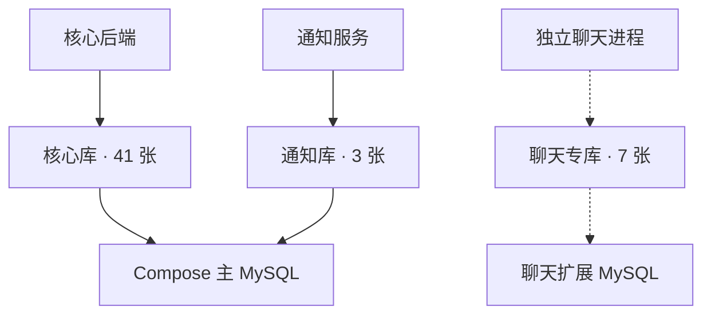

# 数据库归属与迁移

**源码复核 · 2026-11-23**。依据各进程实际加载的 Flyway 目录，分别在 `HEAD 6b08b93` 和当前工作区按版本累加建表与删表。以下表数来自正向迁移，Flyway 历史表、回退脚本及手工开发脚本均在统计范围之外。部署验收另行核对目标库的迁移记录和实际数据。[核心 Flyway](../../backend/src/main/resources/application.yml) · [通知 Flyway](../../notification-service/src/main/resources/application.yml) · [独立聊天 Flyway](../../chat-service/src/main/resources/chat-service.yml)

| 核算范围 | 核心库 | 通知库 | 聊天专库 | 合计 |
| --- | ---: | ---: | ---: | --- |
| 已提交基线 `6b08b93` | 29 | 3 | — | **32 张** |
| 当前工作区，默认 Compose | 41 | 3 | — | **44 张** |
| 当前工作区，叠加独立聊天 Compose | 41 | 3 | 7 | **51 张物理表**。按权威归属去掉五张旧核心副本后为 **46 张** |

核心库相对基线新增十二张表。`V20261120_1` 建立五张聊天业务表和一张拉黑表，`V20261120_2` 为会话增加历史修订字段，`V20261122_1` 建立三张举报审核协调表。`V20261123_1` 增加独立的 Kafka 投递状态表。`V20261124_1` 在消息表增加撤回字段，`V20261124_2` 保存好友申请及独立好友关系，`V20261124_3` 保存热门搜索的去重统计记录。启用聊天分库时，核心迁移仍保留五张聊天旧表，聊天专库持有对应的权威数据和两张独库专用表。[聊天建表](../../backend/src/main/resources/db/migration/mysql/V20261120_1__create_chat.sql) · [审核协调建表](../../backend/src/main/resources/db/migration/mysql/V20261122_1__create_chat_report_decisions.sql) · [Kafka 投递状态建表](../../backend/src/main/resources/db/migration/mysql/V20261123_1__content_event_kafka_delivery.sql) · [好友关系建表](../../backend/src/main/resources/db/migration/mysql/V20261124_2__social_friend_requests.sql) · [热门搜索统计建表](../../backend/src/main/resources/db/migration/mysql/V20261124_3__popular_search_terms.sql) · [独立聊天扩展](../../docker-compose.chat.yml)

增加 Kafka 投递表之前的隔离恢复演练覆盖了核心、通知和聊天的 38、3 和 7 张业务表，以及三个库的 Flyway 历史表。演练在全新项目启动应用前对 51 张表核对行数及数据摘要，再验证聊天审核、通知补发和图片读回。[分库恢复入口](../../scripts/ci/compose-chat-backup.sh)

## 归属与连接

| 部署单元 | 现阶段库与技术 | 读写接口 |
| --- | --- | --- |
| 核心后端 | MySQL `bluealbum_local`（本地脚本），完整 Compose 默认 `MagicAlbum`。Spring Data JPA、JDBC、原生 SQL 与 Flyway | 身份、内容、互动、社交、治理及核心异步表留在核心库。域间经应用接口访问，按历史白名单逐步替换已有直接依赖 |
| 通知服务 | 本地 `bluealbum_local_notifications`，完整 Compose 默认 `MagicAlbum_notifications` | 核心经内部创建通知接口投递。通知服务负责自己的通知、去重和流游标 |
| 聊天业务 | 默认 Java 模块用核心库。启用扩展时，独立 Java 进程使用 `chat-mysql` 中的 `bluealbum_chat` | 扩展配置让核心关闭本地聊天写入，独立进程接管会话业务 REST。身份和社交仍由核心提供。Go 实时进程经 RabbitMQ 收提示并向核心核验会话 |
| 搜索／媒体执行 | 搜索索引为派生数据，Go worker 无业务库凭证，媒体权威表在 Java 核心库 | 通过内容投影接口读搜索源。媒体 worker 由任务协议控制领取、续租、输入和提交结果 |

新本地环境为通知运行与 Flyway 迁移分别生成凭证。完整 Compose 使用 `NOTIFICATION_DB_USER`、`NOTIFICATION_DB_PASSWORD`、`NOTIFICATION_DB_MIGRATION_USER` 和 `NOTIFICATION_DB_MIGRATION_PASSWORD` 开通账号。已有库可停机切换。初始化检查专用账号登录、通知数据访问及核心与通知的跨库拒绝，再启动业务服务。[运行手册](../../README.md#通知库独立账号) · [初始化脚本](../../scripts/init-notification-db.sh)

本地启动和 Compose 将迁移凭证传给通知服务的 Flyway。配置齐全时，初始化脚本将运行权限收紧为本库的 `SELECT`、`INSERT` 和 `UPDATE`，迁移账号保留本库的结构变更权限。兼容配置沿用运行账号迁移或共享账号模式。[通知服务配置](../../notification-service/src/main/resources/application.yml) · [通知 Flyway 集成测试](../../notification-service/src/test/java/com/example/notification/config/NotificationFlywayTest.java) · [通知运行验收](../../scripts/Test-NotificationRuntime.ps1)

隔离 MySQL 运行验收覆盖共享账号到独立账号的升级、原通知数据和 V3 历史保留、专用迁移账号执行 V4、运行账号 DDL 拒绝、跨库访问拒绝，以及评论通知停机补投和 SSE 补拉。验收脚本直接调用部署使用的初始化脚本开通两个账号。[通知运行验收](../../scripts/Test-NotificationRuntime.ps1)

## 已提交的 32 张表

「迁移」列链接到首次有效创建表的 SQL。后续字段、约束和索引以增量迁移为准。逻辑 owner 属于拆分提案。核心 `threads` 是用户所见的主题或帖子，`posts` 是主题下的评论和回复，回复关系在 `posts.reply_to_post_id` 中表达。

### 核心后端 · 29 张

| 序号 | 物理表 | 建议逻辑 owner | 迁移 | 责任与退出共享库的前提 |
| ---: | --- | --- | --- | --- |
| 1 | `users` | 身份 | [`V2`](../../backend/src/main/resources/db/migration/mysql/V2__create_users.sql#L2) | 账号 ID、用户名、密码散列与联系信息，后续含已验证标记。其 ID 被多个域引用，需先固化账号状态与生命周期契约 |
| 2 | `user_profiles` | 身份 | [`V15`](../../backend/src/main/resources/db/migration/mysql/V15__create_user_profiles.sql#L2) | 昵称、头像、简介等。展示通过批量投影，核对历史空资料的回退行为 |
| 3 | `user_connected_accounts` | 身份 | [`V17`](../../backend/src/main/resources/db/migration/mysql/V17__create_user_connected_accounts.sql#L1) | 绑定第三方账号。保留 provider 与用户、provider 与外部标识的唯一关系 |
| 4 | `user_notification_settings` | 身份 | [`V20261007`](../../backend/src/main/resources/db/migration/mysql/V20261007__create_user_notification_settings.sql#L1) | 用户级通知偏好。发送方入队与配送前读取，通知服务可通过受控契约取得 |
| 5 | `sections` | 内容 | [`V4`](../../backend/src/main/resources/db/migration/mysql/V4__create_sections.sql#L2) | 分区、规则、可见及归档状态。治理授权并记录审计，内容域持有分区锁并执行修改，与审计在同一事务提交 |
| 6 | `threads` | 内容 | [`V5`](../../backend/src/main/resources/db/migration/mysql/V5__create_threads.sql#L2) | 主题正文、作者、分区、可见性、后续内容与摘要版本。保留 ID、状态和版本条件更新 |
| 7 | `posts` | 内容 | [`V6`](../../backend/src/main/resources/db/migration/mysql/V6__create_posts.sql#L2) | 主题下评论、回复目标、作者和状态。与主题及自引用约束同属内容 |
| 8 | `tags` | 内容 | [`V7`](../../backend/src/main/resources/db/migration/mysql/V7__create_tags_and_thread_tags.sql#L2) | 标签定义与名称／类型唯一规则。分库或换引擎时核对文本比较语义 |
| 9 | `thread_tags` | 内容 | [`V7`](../../backend/src/main/resources/db/migration/mysql/V7__create_tags_and_thread_tags.sql#L10) | 主题标签关联。与主题、标签保留服务内外键 |
| 10 | `content_event_outbox` | 内容 | [`V20261018_2`](../../backend/src/main/resources/db/migration/mysql/V20261018_2__content_event_outbox.sql#L4) | 主题版本事件、发布状态、租约及重放信息。与权威变更同事务，随内容 owner 保留 |
| 11 | `thread_likes` | 互动 | [`V18`](../../backend/src/main/resources/db/migration/mysql/V18__create_thread_likes.sql#L1) | 用户对主题的唯一点赞，现由主题逻辑操作。单独迁库前建计数／排序投影并落实隐藏过滤 |
| 12 | `post_likes` | 互动 | [`V19`](../../backend/src/main/resources/db/migration/mysql/V19__create_post_likes.sql#L1) | 用户对评论的唯一点赞，现由回复逻辑操作。后续 `V20260428` 重复以存在保护创建 |
| 13 | `thread_bookmarks` | 互动 | [`V20261007_1`](../../backend/src/main/resources/db/migration/mysql/V20261007_1__create_thread_bookmarks.sql#L1) | 私有收藏。列表目前联查主题，保留权限、分页及不可见过滤 |
| 14 | `user_follows` | 社交 | [`V20`](../../backend/src/main/resources/db/migration/mysql/V20__create_user_follows.sql#L1) | 单向关注及唯一关系，现位于用户包。好友由两条反向边派生，先替换关注动态跨域查询 |
| 15 | `content_reports` | 治理 | [`V20261007_2`](../../backend/src/main/resources/db/migration/mysql/V20261007_2__create_content_reports.sql#L2) | 举报、目标、审核状态、处理人和原因。举报者与审核者关联账号，目标按类型访问 owner |
| 16 | `community_state` | 治理 | [`V20261020_1`](../../backend/src/main/resources/db/migration/mysql/V20261020_1__community_governance.sql#L5) | 治理初始化单例，保留首位管理员只初始化一次的语义 |
| 17 | `community_admin_role` | 治理 | [`V20261020_1`](../../backend/src/main/resources/db/migration/mysql/V20261020_1__community_governance.sql#L16) | 社区管理员成员关系，当前关联用户 ID |
| 18 | `community_moderator_scope` | 治理 | [`V20261020_1`](../../backend/src/main/resources/db/migration/mysql/V20261020_1__community_governance.sql#L24) | 版主与分区范围，现有关联账号和分区的外键 |
| 19 | `community_posting_restriction` | 治理 | [`V20261020_1`](../../backend/src/main/resources/db/migration/mysql/V20261020_1__community_governance.sql#L37) | 用户发帖限制与到期时间，和授权检查及审计协调 |
| 20 | `community_audit` | 治理 | [`V20261020_1`](../../backend/src/main/resources/db/migration/mysql/V20261020_1__community_governance.sql#L46) | 审计动作、操作者、目标、原因、时间及请求关联 ID。按审计留存策略迁移 |
| 21 | `content_search_control` | 搜索 | [`V20261019_2`](../../backend/src/main/resources/db/migration/mysql/V20261019_2__content_search_control.sql#L1) | 重建控制、暂停租约、活动索引及就绪状态。独立搜索时随重建控制面迁移 |
| 22 | `media_asset` | 媒体 | [`V20261019_3`](../../backend/src/main/resources/db/migration/mysql/V20261019_3__media_registry.sql#L1) | 资源归属、原图对象标识、状态及处理结果。迁移需同时校验关联对象 |
| 23 | `media_processing_job` | 媒体 | [`V20261019_3`](../../backend/src/main/resources/db/migration/mysql/V20261019_3__media_registry.sql#L30) | 任务、版本、执行租约和结果。随资源 owner 迁移，先处理在途租约 |
| 24 | `media_request_outbox` | 媒体 | [`V20261019_3`](../../backend/src/main/resources/db/migration/mysql/V20261019_3__media_registry.sql#L53) | 媒体任务发布记录，引用资源与任务。随目标数据库复制未完成的投递 |
| 25 | `ai_summary_task` | AI 摘要 | [`V20261020_3`](../../backend/src/main/resources/db/migration/mysql/V20261020_3__versioned_summary_tasks.sql#L7) | 生成任务、内容版本、执行租约与逻辑状态；引用主题与发起账号 |
| 26 | `ai_summary_request` | AI 摘要 | [`V20261020_3`](../../backend/src/main/resources/db/migration/mysql/V20261020_3__versioned_summary_tasks.sql#L37) | 任务请求幂等映射，关联主题、触发账号及任务 |
| 27 | `ai_summary_attempt` | AI 摘要 | [`V20261020_3`](../../backend/src/main/resources/db/migration/mysql/V20261020_3__versioned_summary_tasks.sql#L52) | 执行尝试及用量账本，按任务和尝试序号去重 |
| 28 | `ai_summary_budget` | AI 摘要 | [`V20261020_3`](../../backend/src/main/resources/db/migration/mysql/V20261020_3__versioned_summary_tasks.sql#L80) | 用户与预算日期的配额账本。保留条件扣减与重试行为 |
| 29 | `notification_outbox` | 通知发送方 | [`V20261014`](../../backend/src/main/resources/db/migration/mysql/V20261014__create_notification_outbox.sql#L1) | 核心业务事务写入面向收件人的配送意图。核心负责租约、偏好检查和 HTTP 投递 |

### 独立通知服务 · 3 张

| 序号 | 物理表 | 逻辑 owner | 迁移 | 责任与迁移要求 |
| ---: | --- | --- | --- | --- |
| 30 | `notifications` | 通知 | [`V1`](../../notification-service/src/main/resources/db/migration/V1__create_notifications.sql#L1) | 收件人、目标、通知类型、时间与已读标记。V3 增加可为空的唯一幂等键，兼容没有键的旧数据 |
| 31 | `notification_stream_cursor` | 通知 | [`V4`](../../notification-service/src/main/resources/db/migration/V4__notification_stream.sql#L1) | 每收件人的最新已分配序号，`next_sequence` 名称保留。与事件追加共享事务及行锁 |
| 32 | `notification_stream_event` | 通知 | [`V4`](../../notification-service/src/main/resources/db/migration/V4__notification_stream.sql#L5) | 账号内创建／已读变更流，按 `(user_id, sequence_id)` 补拉，外键关联通知行 |

迁移清理了 `user_profile_links`、`roles`、`user_roles`、`reports`、`thread_stats`、`attachments`。通知游标的 `next_sequence` 由 `NotificationEventLog.append` 锁行后加一。[用户资料旧表删除](../../backend/src/main/resources/db/migration/mysql/V20260503__drop_user_profile_links.sql) · [其他旧表删除](../../backend/src/main/resources/db/migration/mysql/V20260503_1__drop_deprecated_tables.sql) · [通知事件游标](../../notification-service/src/main/java/com/example/notification/service/NotificationEventLog.java)

## 工作区新增表与去向

| 新增物理表 | 数据归属 | 分库时的去向与一致性要求 |
| --- | --- | --- |
| [`chat_conversations`](../../backend/src/main/resources/db/migration/mysql/V20261120_1__create_chat.sql#L1) | 聊天 | 复制到聊天专库。保留单聊账号对、群主、会话状态、`last_seq` 和 `history_revision` |
| [`chat_members`](../../backend/src/main/resources/db/migration/mysql/V20261120_1__create_chat.sql#L14) | 聊天 | 复制到聊天专库。保留成员状态、邀请时间、历史可见起点和最后已读序号 |
| [`chat_messages`](../../backend/src/main/resources/db/migration/mysql/V20261120_1__create_chat.sql#L27) | 聊天 | 复制到聊天专库。保留会话内序号、发送请求唯一键及隐藏状态 |
| [`chat_daily_usage`](../../backend/src/main/resources/db/migration/mysql/V20261120_1__create_chat.sql#L41) | 聊天 | 复制到聊天专库。保留发送者与北京时间自然日的计数，额度和入库消息同事务提交 |
| [`chat_preferences`](../../backend/src/main/resources/db/migration/mysql/V20261120_1__create_chat.sql#L48) | 聊天 | 复制到聊天专库。按账号保存陌生私信接收偏好，站内通知偏好由身份域持有 |
| [`chat_blocks`](../../backend/src/main/resources/db/migration/mysql/V20261120_1__create_chat.sql#L53) | 社交 | 留在核心库，社交仓储负责读写，聊天经联系策略取得判定 |
| [`chat_report_decision_locks`](../../backend/src/main/resources/db/migration/mysql/V20261122_1__create_chat_report_decisions.sql#L4) | 治理 | 留在核心库。按消息锁行并递增分配审核版本 |
| [`chat_report_decisions`](../../backend/src/main/resources/db/migration/mysql/V20261122_1__create_chat_report_decisions.sql#L13) | 治理 | 留在核心库。持久化案件、审核决定、状态、重试和租约。聊天消息 ID 是跨服务引用 |
| [`chat_report_decision_active`](../../backend/src/main/resources/db/migration/mysql/V20261122_1__create_chat_report_decisions.sql#L52) | 治理 | 留在核心库。每条消息最多一项在途审核决定，完成或进入永久失败时释放占用 |
| [`chat_write_locks`](../../chat-service/src/main/resources/db/chat/mysql/V2__chat_write_locks.sql#L3) | 聊天 | 在专库由 Flyway 新建，运行时按需建立锁桶行。分库事务用专库锁桶协调聊天写入 |
| [`chat_moderation_receipts`](../../chat-service/src/main/resources/db/chat/mysql/V3__chat_moderation_receipts.sql#L4) | 聊天 | 在专库由 Flyway 新建。按 `decision_id` 和消息版本去重，与消息可见性变更同事务。恢复专库时随业务数据恢复 |

好友由互相关注或 `social_friend_requests` 中已接受的申请建立，社交关系归核心。群名与群主存于会话，群成员、历史起点和已读游标存于成员行。聊天实时提示在消息事务提交后发布。[好友查询](../../backend/src/main/java/com/example/demo/social/repo/FriendRequestRepository.java) · [审核协调仓储](../../backend/src/main/java/com/example/demo/moderation/service/ChatReportDecisionStore.java) · [实时发布器](../../chat-domain/src/main/java/com/example/demo/chat/service/ChatChangePublisher.java) · [聊天设计](06-即时通讯系统设计.md)

## 分库切流步骤

1. **准备**。冻结当前 DDL、字段含义、owner 列表和切换范围。对目标库执行独立 Flyway，记录备份恢复点。盘点外键、跨库 SQL、计划任务以及所有写入入口。
2. **对齐**。消除目标服务对其他库的读写及行锁依赖。保留服务内外键。外域引用使用稳定 ID、受控投影和已评审的生命周期处理。
3. **复制与对账**。首轮按可维护窗口暂停该域全部写入，等在途写入、消费者和租约进入可确认状态。保留主键、唯一键、时区、状态、Outbox 标识和流游标。用每表行数、主键范围、规范化校验和、孤儿引用、业务抽样核对。
4. **切换**。保持单一权威写入端。切换数据源或 Gateway 路由，先执行隔离冒烟和账号权限验证，再放开写入与异步投递。增量复制需求出现时使用可定位到提交位置的 CDC，由迁移验收覆盖晚提交和漏数场景。
5. **回退**。目标尚未接收新写入时可直接切回。启用写入后，先暂停、隔离并按明确水位反向补齐目标增量再决定切回。回写能力未验证时以目标库为权威修复。保留备份、旧库的只读副本与对账报告，直到回退期结束。

## 聊天首次分库演练

首个演练沿用 MySQL。叠加 `docker-compose.chat.yml` 会启动独立进程并切换路由。已有历史的环境须先停写、复制并对账，再启用目标写入。源核心库保留原 Flyway 历史。部署变更和数据库产品更换使用不同的切换窗口。[聊天扩展配置](../../docker-compose.chat.yml) · [聊天外域依赖](02-微服务拆分与职责.md#聊天的三个外域依赖)

目标库使用 `classpath:db/chat/mysql` 和独立的 `chat_flyway_schema_history`。V1 建立聊天的五张权威业务表，包含历史修订列。V2 建立聊天库的写锁表，V3 建立审核决定回执表。核心数据库继续使用原 Flyway 路径，并保留举报案件、待应用决定和审核记录。首次分库时复制五张业务表。后续恢复独立聊天库备份时，回执表随聊天库恢复，治理决定与审计随核心库恢复。[目标库基线](../../chat-service/src/main/resources/db/chat/mysql/V1__create_chat_storage.sql) · [审核回执](../../chat-service/src/main/resources/db/chat/mysql/V3__chat_moderation_receipts.sql)

| 数据 | 复制范围 | 对账条件 |
| --- | --- | --- |
| `chat_conversations` | 全量复制。保留会话 ID、规范化账号对、状态、群主、`last_seq` 和 `history_revision` | 账号对保持唯一。源与目标的所有会话水位相同。自增起点至少覆盖源生成器水位和已复制的最大 ID |
| `chat_members`、`chat_messages` | 在会话行落地后复制。保留成员状态、邀请时间、可见下限、已读位置、消息 ID、序号、客户端幂等键和隐藏标志 | 孤儿记录为零。逐会话校验消息顺序和隐藏状态，保留 ID 与幂等唯一约束。抽测旧请求重试、受邀／已退出成员权限及历史修订 |
| `chat_preferences`、`chat_daily_usage` | 复制接收偏好与已有日期额度。`quota_date` 按 `Asia/Shanghai` 的业务日期原样迁移 | 逐账号对比偏好和日期计数，切换后连续验证剩余额度、跨自然日重置和并发最后一条额度 |
| `chat_blocks`、`user_follows` | 留在核心库，由社交 owner 提供联系判定 | 聊天凭证访问核心库被拒绝。互关、取关和任一方拉黑按同一联系策略用例验收 |
| 三张审核协调表与 `chat_moderation_receipts` | 决定、案件和审计留核心。回执随聊天专库备份和恢复 | 按 `decisionId` 对照决定版本、回执、消息隐藏状态和案件状态。确认完成只写一笔审核审计 |

1. **冻结**。关闭所有聊天写入入口，包括私信、群成员操作、已读、偏好及举报隐藏。首轮演练可停止所有源核心写入实例。若需保留论坛流量，须先有覆盖 HTTP、内部审核和后台入口的统一聊天写入门禁。等在途事务提交或回滚后记录台账。
2. **恢复与校验**。在停写状态快照、复制、核对行数、键范围、约束和分桶校验和。核对历史序号、`visible_from_seq` 及 `last_read_seq` 时按成员状态解释。入群初始已读为入群前最后序号，可以比可见下限小一。对账报告记录摘要与差异位置，正文留在隔离库。
3. **切流**。核心使用 `APP_CHAT_OWNER=remote`，会话业务 REST 由网关转到目标。旧核心表进入冻结期，公开好友和拉黑入口继续由核心处理，举报审核改由专库应用并确认。使用目标的专用账号完成权限和旧游标只读检查，再开放写入。安排连接重建或刷新，让已打开页面重新核对会话权限和历史修订。[网关路由](../../gateway/src/main/resources/application-compose.yml) · [聊天入口开关](../../chat-domain/src/main/java/com/example/demo/chat/controller/ChatController.java)
4. **回退**。目标写入启用前可切回源。目标产生新写入后，先暂停新增审核决定，让分库投递结清在途决定，并对账回执、案件和审计。随后冻结写入，反向复制五张业务表，对账通过后才恢复核心写入。待确认决定或数据差异须在目标端处理。反向演练覆盖新增会话、同 ID 重试、成员退出、读游标、额度和审核隐藏，并保留目标回执供复核。[审核配送开关](../../backend/src/main/java/com/example/demo/moderation/service/ChatReportDecisionDispatcher.java) · [应用切流脚本](../../scripts/ci/compose-chat-cutover.sh)

`Test-ChatDataMigration.ps1` 在临时 MySQL 中用合成数据重现前向复制、目标写入与反向对账。报告保留行数、主键与自增水位、全行 SHA-256 和孤儿记录数。`BLUEALBUM_CHAT_CUTOVER_CHECK=1` 启用应用级演练，通过 API 在核心创建历史，在停写后转入独立聊天库，在目标执行写入和举报隐藏，再反向对账并回到原入口补查。演练仅使用自己创建的 Compose 项目和临时账号。[数据演练入口](../../scripts/Test-ChatDataMigration.ps1) · [应用演练入口](../../scripts/ci/compose-browser-smoke.sh)

## PostgreSQL 可替换方案

优先选通知服务做可行性试点。它有独立 Flyway、固定 HTTP 接口和三张关联表。切换沿用原有接口与游标语义，核心库和 RabbitMQ 可各自运行。目标只在迁移演练和业务回归通过后成为生产候选。

| 当前语义 | PostgreSQL 适配与验收 |
| --- | --- |
| MySQL Flyway、JDBC 原生 SQL | 新建 PostgreSQL 迁移位置和方言适配，复用应用服务、DTO、用例和事务。JPA 方言切换后逐条审查 JDBC、JPQL 投影、分页、索引和 SQL 脚本 |
| `ON DUPLICATE KEY UPDATE` 与幂等冲突 | 按业务唯一键改写为 `ON CONFLICT`，复测并发首次插入、重复通知、同 ID 异负载和回滚 |
| 自增 ID、布尔、时间与排序 | 保留历史 ID 后将序列推进到下一个可用值。UTC 时间读回要保留原精度。分别验证 `TIMESTAMP` 映射、空值唯一约束、大小写／排序、JSON 和数据库默认值 |
| 行锁和隔离级别 | 按服务验证相同的并发可见性、死锁重试、条件更新与锁定读。通知流必须保持每账号提交顺序和飞行中的游标恢复 |
| 切换通知数据源 | 暂停内部创建和已读写入，核心 Outbox 暂停配送并保留未完成记录。完整复制三表和幂等键，逐账号核对 `next_sequence` 与源库一致且覆盖其现存最大 `sequence_id`。通知主键生成器单独核对。切换后用同一 `eventId` 重投并验证 SSE 客户端补拉 |

通知服务已具备可选的 PostgreSQL 试点，默认制品使用 MySQL。以 Maven `-Ppostgresql` 构建、运行时启用 `postgresql` profile 后，选择 PostgreSQL 驱动、独立 Flyway 目录及 `ON CONFLICT` 游标初始化。两种引擎共用通知业务和 HTTP／SSE 契约。核心和聊天业务数据库仍采用 MySQL。[通知 POM](../../notification-service/pom.xml) · [PostgreSQL 运行配置](../../notification-service/src/main/resources/application-postgresql.yml) · [通知游标](../../notification-service/src/main/java/com/example/notification/service/NotificationEventLog.java)

首次试点按部署显式选择驱动、迁移位置与仓储方言，使应用用例只调用同一组仓储操作。PostgreSQL 的迁移位置放在 MySQL 当前扫描目录之外，例如 `classpath:db/postgresql`。目标库独立建立迁移历史，再导入业务数据。两种方言共享新增、标记已读、事件去重、游标首次并发分配和断线补拉用例。切换和回退时先暂停核心 Outbox 配送、清空在途通知变更，经三表及游标对账后恢复投递。SSE 客户端用原账号游标继续补拉。[通知服务迁移配置](../../notification-service/src/main/resources/application.yml) · [通知仓储](../../notification-service/src/main/java/com/example/notification/repo/NotificationRepository.java) · [游标并发测试](../../notification-service/src/test/java/com/example/notification/service/NotificationCursorInitializationTest.java)

隔离验收用 Maven 命令 `mvn -B -pl notification-service -Ppostgresql package` 构建有两种驱动的试点制品。安装 `PyMySQL` 与 `psycopg[binary]` 后，向 `scripts/ci/notification-postgres-pilot.py` 提供 `--jar`、`--java`、`--output`。脚本启动三个隔离库，实际进行双向复制、HTTP 切换和 SSE 续订，再清理试点资源。单独调用 `scripts/notification-data-copy.py` 时，通过环境变量前缀 `NOTIFICATION_COPY_SOURCE_` 和 `NOTIFICATION_COPY_TARGET_` 提供 `HOST`、`PORT`、`USER`、`PASSWORD`、`DATABASE`，分别用 `--source` 和 `--target` 指定 `mysql` 或 `postgresql`。数据库升级至 V4，并在停写维护窗口导入空目标库。

2026-11-24 隔离演练通过 41 项检查，迁入和反向迁移均对三张表逐行计算摘要。切库后新增通知、生成 ID、首次并发游标、同事件重放、异负载冲突及原游标 SSE 续订均验证通过。报告为 `outputs/architecture-notification-postgres-20261124-current/notification-postgres-pilot.json`。[演练脚本](../../scripts/ci/notification-postgres-pilot.py) · [双向复制脚本](../../scripts/notification-data-copy.py) · [ADR-002](decisions/ADR-002-通知服务PostgreSQL迁移验证.md)

试点完成后，已具备独立连接、仓储和事务的部署单元可以各自迁移。核心中的内容、治理、摘要和通知意图当前存在共享事务及外键。若继续共同部署，应把这些依赖一起纳入核心库的迁移窗口。需要让其中一域先换数据库时，先通过 owner 契约消除同事务和外键依赖。

## 异常与验收

- 新库与支持的旧库快照均能通过 Flyway 和应用结构校验，记录数据库版本、迁移版本及各库实际表数。按默认或分库拓扑分别对账，分库时校验五张核心旧表从切流到回退前冻结写入。
- 使用每个服务的运行凭证查询其他业务库时被拒绝。使用本服务的合法用例时可正常完成。核心与通知迁移账号也各限本库。
- 暂停一个消费者、模拟一次提交响应丢失后恢复，验证未完成 Outbox、幂等键、会话序号及通知游标仍可恢复。
- 行数、版本、脱敏校验和或孤儿检查出现差异时暂停切流。记录差额与来源，修复后重新对账。
- 通过至少一次隔离恢复演练，实际用旧客户端游标补拉、同 ID 重试和业务抽样证明回退路径可用。
