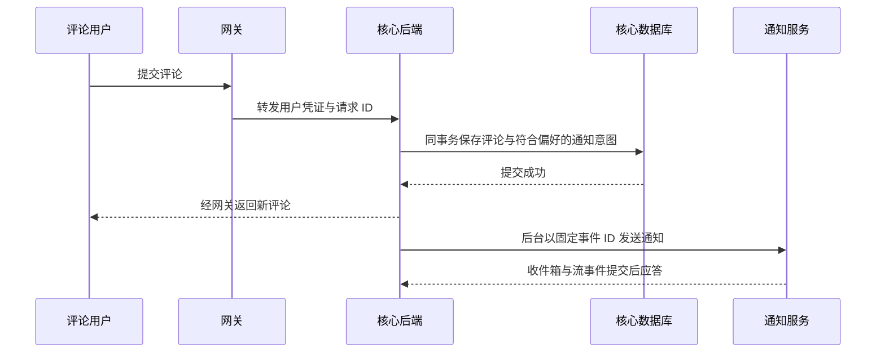

# 服务间通信规范

同频的请求包括必须立即获取结果的业务命令、可以延迟完成的投递以及浏览器长连接。核心域同进程时调用应用接口。进程边界使用 REST、RabbitMQ 或长连接，各自保留明确的提交、失败和重试语义。

## 通信方式与适用场景

| 方式 | 同频用途 | 约定 |
| --- | --- | --- |
| Java 模块接口 | 认证资料、内容权限、关系判定、治理命令 | 传 ID 与 DTO。明确调用是否加入当前事务，由数据 owner 提供实现 |
| HTTP REST | 核心到通知、媒体 worker 到 Java、实时进程到核心核验登录。可选分库模式增加批量资料、联系判定与审核决定 | 对外契约保留 `/api/v1`。内部接口按用途授权，审核提交使用稳定决定 ID |
| gRPC / Protobuf | 可选的 Go 实时进程到核心的内部会话核验 | 沿用同一权威核验逻辑。容器间启用 TLS 和独立服务凭证，连接和单次调用分别设截止时间 |
| RabbitMQ | 主题内容事件、媒体任务、AI 摘要和聊天刷新提示 | 内容和任务按各自的持久化、确认与重试契约处理。聊天提示发往临时队列，浏览器通过权威 REST 补拉 |
| SSE | 现有站内通知与断线补拉 | 用已认证账号和通知游标隔离。`Last-Event-ID` 随连接恢复，必要时分页补拉 |
| WebSocket | 工作区 Go `chat-realtime` 已实现账号级实时提示 | 浏览器收到 `changed` 后经授权 REST 补拉。计划验证容量、断线恢复和轮询回退 |

`RemoteNotificationService` 实现核心到通知的 HTTP 调用，Go 媒体 worker 实现领取、续租和回传。未来新增 Java 跨服务客户端可复用已有封装，并视契约选择 Spring HTTP Service Clients。[通知 HTTP 客户端](../../backend/src/main/java/com/example/demo/notifications/service/remote/RemoteNotificationService.java) · [媒体 Worker 客户端](../../services/media-service/internal/coreclient/client.go)

## 已有链路示例

`PostService.create` 存储评论并调用通知客户端。通知在 `remote` 模式下经 Outbox 送达。可选 RabbitMQ 配置从现有评论回复通知意图构造版本化的 `COMMENT_CREATED` 投影，带原通知事件 ID、评论 ID、主题 ID 和收件人。通知服务提交收件箱和游标后应答，核心收到有效应答后结束投递。同一通知事件 ID 用于超时重试。主题搜索继续消费自己的内容事件协议。[评论写入](../../backend/src/main/java/com/example/demo/posts/service/PostService.java) · [通知客户端](../../backend/src/main/java/com/example/demo/notifications/client/NotificationClient.java) · [评论通知配置](../../docker-compose.comment-events.yml)

## REST 契约与身份

| 路径或接口 | 状态 | 权限与返回 |
| --- | --- | --- |
| `POST /api/v1/threads/{threadId}/posts` | 现有 | 登录用户由核心校验发帖规则、主题状态和回复目标 |
| `GET /api/v1/notifications`、`PATCH /api/v1/notifications/{id}/read` | 现有 | 通知服务按当前收件人读写，支持分页 |
| `GET /api/v1/notifications/stream`、`GET /api/v1/notifications/events?after=0&limit=100` | 现有 | 通知流游标按账号隔离。缓存禁止保存个性化流和补拉响应 |
| `POST /api/v1/notifications/internal` | 现有服务间路径 | 核心直连通知服务，使用内部凭证和 `eventId` 幂等。公网网关拒绝访问 |
| `POST /internal/media/v1/jobs/{jobId}/claim`、`/renew`、`/result` | 现有私有协议 | worker 凭证和当前任务租约，核对任务版本及输出 |
| `POST /internal/v1/users/public-profiles:batchGet` | 核心已实现，可选启用 | 传入最多 100 个 `userIds`，返回公开 `id`、`username`、`nickname`、`avatarUrl`，以及实际缺失的 `missingIds` |
| `POST /internal/v1/social/contact-decisions` | 核心已实现，可选启用 | 接受 `actorId`、`peerId`、`purpose`、`operationId`，返回相同绑定、关系结果、`decisionId`、`evaluatedAt`、`expiresAt` |
| `POST /internal/v1/social/contact-decisions:batchGet` | 核心已实现，可选启用 | 传入同一操作的 `actorId`、`peerIds`、`purpose` 和 `operationId`，按请求顺序返回每个关系的判定，共用判定时点和截止时间 |
| `POST /internal/v1/chat/report-access`、`/report-evidence` | 独立聊天私网入口 | 聊天校验举报者对消息的可见性。核心完成案件授权后按消息 ID 取得单条证据。调用凭证为 `CHAT_GOVERNANCE_INTERNAL_TOKEN` |
| `POST /internal/v1/chat/moderation-decisions` | 独立聊天私网入口 | 接受 `decisionId`、`version`、`messageId`、`reportId` 和 `hidden`，返回已保存的回执。核心在确认 `APPLIED` 后更新对应的隐藏或恢复案件和审计 |
| `GET /api/v1/chat/conversations/{id}/messages` | 工作区已有 | 聊天业务进程校验当前账号的会话访问权，可用 `afterSeq` 或 `beforeSeq` |
| `GET /api/v1/chat/realtime` 的 WebSocket 升级 | 工作区 | 精确路由以 `order: -1` 优先匹配并转发到 Go。首帧提交 JWT，成功后订阅自己账号的变化提示 |
| `GET /api/v1/chat/realtime/session` | 核心私网入口 | Go 实时服务与独立聊天进程直连核心。核心验证 Bearer JWT 后返回 `userId` 与 `expiresAt` |

`RequestCorrelationGlobalFilter` 规范并回传 `X-Request-Id`。网关按路径和方法开放通知列表、已读、事件补拉与 SSE，服务间通知写入走私有路径。工作区实时路由使用精确路径，Go 核验浏览器 `Origin`，再直连 Java 验证用户凭证。[本地网关路由](../../gateway/src/main/resources/application-local.yml) · [Compose 网关路由](../../gateway/src/main/resources/application-compose.yml) · [网关关联过滤器](../../gateway/src/main/java/com/example/gateway/RequestCorrelationGlobalFilter.java) · [通知安全配置](../../notification-service/src/main/java/com/example/notification/config/SecurityConfig.java) · [Java 会话核验](../../backend/src/main/java/com/example/demo/chat/controller/ChatRealtimeSessionController.java) · [Go 连接处理](../../services/chat-realtime/socket.go)

公网网关拦截私有路径并从转发请求移除内部凭证头。通知服务继续验证核心直连时的内部凭证。运行验收覆盖公网拒绝、私网直投与通知补拉。[网关访问边界](../../gateway/src/main/java/com/example/gateway/GatewayBoundaryGlobalFilter.java) · [通知运行验收](../../scripts/Test-NotificationRuntime.ps1)

公开资料和联系判定契约使用独立的 `CHAT_INTERNAL_SERVICE_TOKEN` 作为 `X-Internal-Service-Token`。留空时拒绝对应私有入口。仅核心进程与获授权的聊天进程持有凭证，个人登录凭证无法调用。响应带 `Cache-Control: no-store`，账号 ID 在这些契约中以十进制字符串传递。[聊天私有链路认证](../../backend/src/main/java/com/example/demo/config/ChatInternalSecurityConfig.java) · [批量公开资料](../../backend/src/main/java/com/example/demo/user/controller/ChatPublicProfilesController.java)

联系结果按关系锁内的读取时点签发，当前有效期 2 秒。调用目的为 `DIRECT_SEND`、`DIRECT_ACCEPT`、`GROUP_INVITE`、`DIRECT_DETAIL`，每笔发送将客户端消息 ID 作为 `operationId`。聊天服务接入时，收到结果后核对账号、用途、操作 ID 和有效期，提交前再次判断是否到期。`contactAllowed` 表示没有任一方向拉黑，群邀请同时检查 `friend`。旧版核心仅提供 `mutual` 时，独立聊天沿用互关作为好友来源。接收设置、会话状态和额度由聊天服务在本地事务内判断。[联系判定入口](../../backend/src/main/java/com/example/demo/social/controller/ChatContactDecisionController.java)

### 物理抽取时的路由顺序

下表按工作区网关配置与分库扩展核对。发布前在目标 profile 中复核实际路由，用路由和 HTTP 契约测试覆盖每个入口。

| 匹配 | 目标 | 验收点 |
| --- | --- | --- |
| 精确匹配 `/api/v1/chat/realtime`，允许 WebSocket 升级 | Go 实时进程 | 先于聊天 REST 通配。Go 通过私网直连核心的会话核验入口，按验证结果订阅账号 |
| `/api/v1/chat/friends`、`/api/v1/chat/friend-requests/**`、`/api/v1/chat/blocks` 及拉黑对象路径 | 核心中的社交入口 | 由社交控制器执行关系查询及写入。好友申请由当前用户发起，收件人处理 |
| `/api/v1/chat/conversations/**`、`/direct/**`、`/groups/**`、`/settings` | 聊天业务 owner | 默认核心，分库由 `CHAT_SERVICE_GATEWAY_URI` 转到独立进程。鉴权、幂等键、历史分页和成员权限沿用现有契约 |
| 通知列表、已读、`/stream` 和 `/events` | 通知服务 | 显式枚举公开路径及方法，并覆盖流连接、读游标和未授权请求 |
| `/api/v1/notifications/internal`、`/api/v1/chat/realtime/session`、`/internal/**` | 对外网关显式拒绝 | 拒绝规则先于任何业务通配及核心兜底。核心直连通知、Go 会话核验和媒体内部任务经各自私网入口 |

[Compose 网关路由](../../gateway/src/main/resources/application-compose.yml) · [网关路由测试](../../gateway/src/test/java/com/example/gateway/GatewayRoutesTest.java) · [Go 核验调用](../../services/chat-realtime/socket.go) · [通知运行验证](../../scripts/Test-NotificationRuntime.ps1)

通知列表、已读标记、SSE 和游标补拉分别由两个 Controller 实现。浏览器流客户端负责接收断线时的游标。[通知 Controller](../../notification-service/src/main/java/com/example/notification/controller/NotificationsController.java) · [通知 SSE Controller](../../notification-service/src/main/java/com/example/notification/controller/NotificationStreamController.java) · [浏览器 SSE 客户端](../../frontend/src/api/notificationStream.ts)

内部服务身份按环境与用途发放。在增加信任主体时，为新契约配置独立的调用权限和可轮换凭证。请求 ID 供追踪。用户身份来自验证后的令牌或受信服务的认证上下文，内部接口记录服务身份及允许转发的业务主体。新 JSON 契约对 64 位 ID 使用稳定的十进制字符串，已发布接口保留各自格式。时间使用 ISO 8601 带偏移的时间戳，存储约定见数据库设计。

## 数据交换与降级

| 情况 | 处理方式 |
| --- | --- |
| HTTP 连接或读取超时 | `RemoteChatDirectory` 配置连接 2 秒、读取 3 秒，并校验联系判定自身的有效期。发布前测量依赖请求与数据库持锁时间。幂等查询可在总预算内有限重试，写入重试沿用操作 ID |
| 资料服务不可用 | 已经过资源权限检查的列表可显示占位资料，合并 ID 批量调用，避免 N+1 |
| 关系或权限不可判定 | 返回 `503` 类可重试错误，禁用未获授权的写入或私密读取 |
| 消费者处理失败 | 数据事务完成后确认。永久错误隔离，有界退避与恢复流程见事件设计 |
| 断线或因慢客户端关闭 | 客户端重连时从最后确认的游标补拉，游标过期时重新取权威列表，再接收新变化 |

使用现有接口响应格式。新增接口维持稳定的 `code`、面向用户的 `message` 和请求关联标识。`400` 参数无效，`401` 认证失败，`403` 授权失败，`404` 资源对当前调用方不可见或不存在，`409` 状态或幂等冲突，`429` 限额耗尽，`503` 权威依赖不可用。限额响应在适用时附 `resetAt` 或退避信息。

跨域查询通过 owner 获取有限字段。消费端仅写自己持有的投影和处理记录。提交后的事实用持久化事件传递，跨库变更用有状态、可重试的业务流程协调。Outbox、收件箱与流游标的表归属参见 [数据库归属](03-数据库归属与迁移.md)。

## 验收标准

1. 使用现有前端完成评论至通知闭环。停掉通知服务后评论仍可提交，恢复后以原事件 ID 投递一次可见通知。
2. 模拟提交后 HTTP 响应丢失，按同一操作 ID 重试，检查数据库结果与游标。
3. 用浏览器通过公网网关尝试访问私有路径、伪造内部头和越权订阅，均被拒绝。合法调用方仍可投递。
4. 模拟丢包、重复、乱序和接收端停机，检查重试、隔离、补拉和权限结果。抽取进程前以契约测试覆盖旧客户端与新部署。
