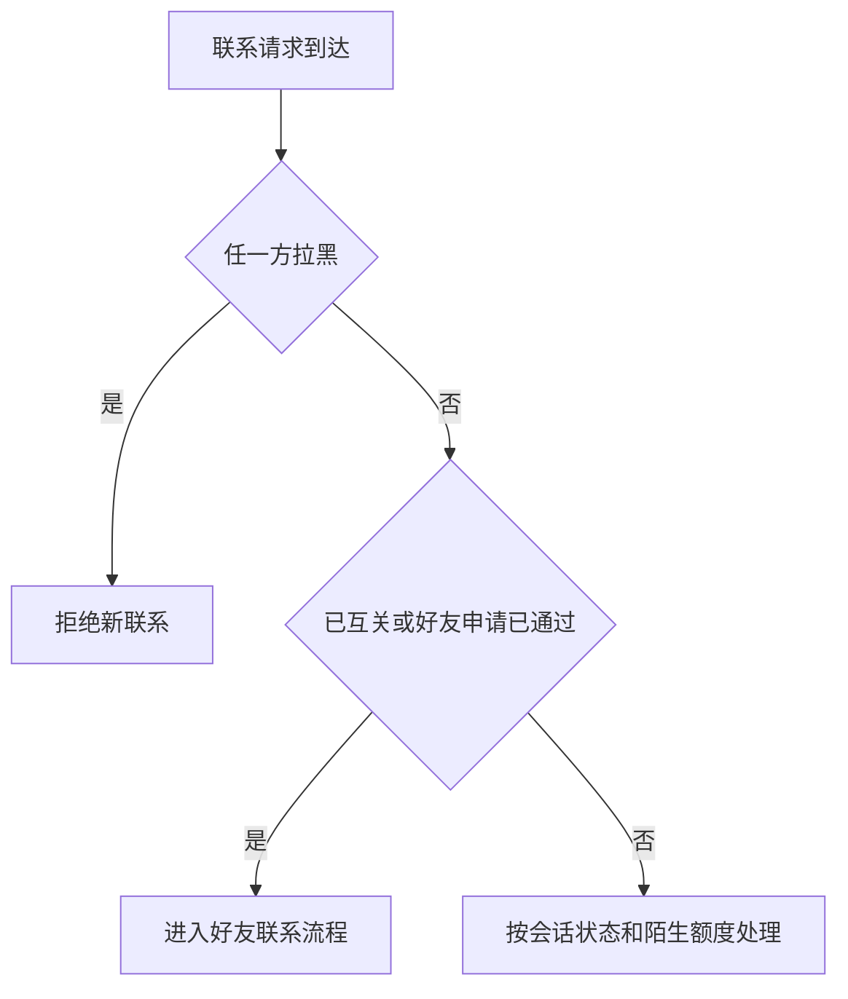

# 社交关系设计

关注是单向订阅。`ContactPolicy` 根据互关、已接受的好友申请和拉黑状态判定私信与入群邀请的联系资格。聊天模块管理会话、接收偏好和额度。[社交关注服务](../../backend/src/main/java/com/example/demo/social/service/UserFollowService.java) · [联系策略](../../backend/src/main/java/com/example/demo/social/service/ContactPolicy.java) · [聊天实现](../../backend/src/main/java/com/example/demo/chat/service/ChatService.java)

## 好友与联系规则

互相关注或对方接受的好友申请都能建立好友关系。两种来源都适用拉黑和账号权限规则。取消关注后，已接受的申请继续提供好友关系。

| 情况 | 好友列表和联系行为 |
| --- | --- |
| 双向互关 | 双方在聊天好友列表可见，可直接发私信，并可发出群邀请 |
| 接受好友申请 | 即使没有互关，双方也能直接发私信、发出群邀请并在好友列表中显示 |
| 没有好友关系 | 首次通过一条待接受私信建立联系。收件人接受私信后可继续，仍按非好友额度计算 |
| 任意方取关 | 有已接受好友申请时仍为好友。已建立会话和历史保留，下一条新消息按当前关系判断 |
| 任意方解除好友 | 清除已接受的好友关系。若双方互关，同时取消发起方对另一方的关注，保留另一方的关注。已建立会话和历史保留，下一条新消息按当前关系判断 |
| 任意方拉黑 | 隐藏聊天好友列表中的对应账号，停止新私信及互相发出群邀请。历史保留，已加入同一群时按群成员权限展示 |
| 解除拉黑 | 刷新联系资格，现有关联、接收设置和会话状态继续生效 |
| 关闭陌生请求 | 阻止新建非好友请求，已建立会话继续按拉黑与日额度判定 |

`sendDirect` 读取双方关系和收件设置。`app.chat.allow-requests-default` 的代码回退值为 `false`，核心 `local` 配置与独立聊天配置的默认值均为 `true`。验收记录实际配置和接收偏好，覆盖开启与关闭。`join` 按邀请状态和有效期处理已有邀请。互关即好友、陌生额度、接收默认值、后续拉黑是否取消已有邀请及历史留存由上线评审确认。[聊天用例](../../backend/src/main/java/com/example/demo/chat/service/ChatService.java) · [本地配置](../../backend/src/main/resources/application-local.yml) · [独立聊天配置](../../backend/src/main/resources/chat-service.yml)

## 数据与技术选型

| 数据 | owner 与约束 |
| --- | --- |
| `user_follows` | 社交。一条 `follower_id → following_id` 关系，方向组合唯一，禁止关注自己。保留当前关注与粉丝查询索引 |
| `chat_blocks` | 社交仓储独占读写，保留 `(blocker_id, blocked_id)` 主键和反向检索。拉黑列表只对执行拉黑的账号公开 |
| `social_friend_requests` | 核心社交为规范排序的账号对保留一行，记录申请方、处理状态和时间。只有收件人能接受或拒绝待处理申请 |
| 好友 | 查询互关与已接受的申请，合并去重并在分页前排除任一方向的拉黑，展示资料按 ID 批量获取 |
| `chat_preferences`、`chat_daily_usage` | 聊天独立管理接收设置和每日额度，与关系数据通过接口协作 |

`FriendRequestRepository` 提供关系与好友列表查询。发送时，聊天从联系策略取得好友、互关和拉黑结果。展示资料和计数可缓存，联系授权走权威状态。[好友查询](../../backend/src/main/java/com/example/demo/social/repo/FriendRequestRepository.java) · [拉黑 SQL](../../backend/src/main/java/com/example/demo/social/repo/SocialRepository.java) · [消息额度 SQL](../../backend/src/main/java/com/example/demo/chat/repo/ChatRepository.java)

## 接口定义

| 接口 | 客户端与结果 |
| --- | --- |
| `POST/DELETE /api/v1/users/{id}/follow` | 保持现有关注和取关契约。同关系重复操作产生一致状态 |
| `GET /api/v1/users/{id}/follow-status`、`/followers`、`/following` | 保持现有状态和分页。公开关系接口沿用现有对外字段 |
| `GET /api/v1/chat/friends?page=1&size=30` | 默认和分库拓扑均由核心社交模块返回分页好友结果 |
| `DELETE /api/v1/chat/friends/{peer}` | 解除当前好友关系并返回好友状态。重复调用不会改变单向关注。若需要再次通过申请成为好友，应发出新申请 |
| `/api/v1/chat/friend-requests/**` | 资料页可提出申请，收件人在消息页处理。当前账号可以查询自己的申请状态 |
| `GET /api/v1/chat/blocks`、`PUT/DELETE /api/v1/chat/blocks/{userId}` | 保持原有入口，写入及查询由社交负责，删除不存在的关系按幂等处理 |
| `ContactPolicy.evaluate(actorId, peerId)` | 同库时返回 `friend`、`mutual` 与 `contactAllowed`。仅内部使用，并保证同一权威状态 |
| `POST /internal/v1/social/contact-decisions` | 核心提供的私有入口。将判定绑定到发起账号、目标账号、用途和操作 ID，返回关系结果及起止时间 |
| `POST /internal/v1/social/contact-decisions:batchGet` | 同一次建群等操作可批量判定多个目标，在统一的关系锁和判定时间下返回结果 |

对外的联系结果使用通用错误文案。只向用户本人展示自己创建的拉黑记录。关注通知继续由关注事务生成通知意图。

[关注接口](../../backend/src/main/java/com/example/demo/user/controller/UserFollowController.java) · [聊天好友与拉黑接口](../../backend/src/main/java/com/example/demo/social/controller/SocialChatController.java)

## 并发、配额和失败

1. **同库阶段**。联系策略沿用身份领域的用户行锁。私信、解除好友、拉黑写入和单个邀请按账号 ID 升序获锁，解除拉黑只锁操作者，批量建群在校验邀请资格前按同一顺序锁定参与者。已开始的联系判定与关系写入按事务顺序生效。[身份行锁](../../backend/src/main/java/com/example/demo/user/service/RelationshipAccountLock.java) · [聊天写入入口](../../backend/src/main/java/com/example/demo/chat/service/ChatService.java)
2. **分库阶段**。已确认以核心锁内的权威关系读取作为授权时点。已提交的拉黑对之后的判定生效，已获授权的这笔在途私信可在其判定有效期内完成。当前实现的有效期为 2 秒。聊天在本地事务内检查会话、偏好与额度，并在提交前再次查验有效期。[联系判定](../../backend/src/main/java/com/example/demo/social/service/ContactPolicy.java) · [聊天提交前检查](../../backend/src/main/java/com/example/demo/chat/service/ChatService.java)
3. **非好友额度**。源码默认账号对所有非好友合计每天 10 条，按 `Asia/Shanghai` 自然日，第一条请求计入。`takeQuota` 用日用量行条件更新，达到上限时响应恢复时间。额度数值进入产品评审。[额度事务](../../backend/src/main/java/com/example/demo/chat/service/ChatService.java) · [计数更新](../../backend/src/main/java/com/example/demo/chat/repo/ChatRepository.java)
4. **依赖故障**。关系 owner 读取失败时，发送和邀请返回可重试错误，当前事务不扣额度。展示接口可在校验权限后显示不完整资料，拉黑接口按本人权限返回。

以首轮内测的请求通过率、陌生账号举报率和额度拒绝率复核 10 条是否合适。额度控制单账号日用量，接受前单条请求、拉黑和通用频控共同限制打扰。

| 并发边界 | 分库前必验的结果 |
| --- | --- |
| 关系已变更后收到发送或邀请 | 权威判定观察到已提交的取关或拉黑，并据此重新计算可联系状态和额度。旧授权无法用于另一组账号或不同用途 |
| 发信取得授权后才发生拉黑 | 已获授权的这笔私信可在有效期内完成。后续新发送必须重新判定，拉黑生效后拒绝 |
| 授权调用超时、过期或重复请求 | 超时与过期返回可重试错误。新提交重新取得判定。已提交的幂等重试按当前访问权返回原结果，额度只记一次 |
| 已邀请未加入时双方关系改变 | 评审是否撤销已有邀请。当前按成员状态与邀请有效期处理，新增发邀请仍校验关系。两个时点分别建回归用例 |

## 验收标准

| 用例 | 预期 |
| --- | --- |
| A 关注 B，B 再关注 A | 双方进入好友列表。并发或重复关注仅产生唯一方向关系 |
| 无互关时接受好友申请 | 双方均可发起私信和群邀请。重复申请保留同一待处理状态，其他账号不可代为接受 |
| 取关后重试发送 | 已成功操作以原编号去重。后续新发送按当前好友关系判断，历史保持可读 |
| 解除同时有互关和已接受申请的好友关系 | 两种好友来源同时失效，对方原有关注保留。会话历史可读，新的联系判定和发信额度按非好友处理 |
| A 拉黑 B | 双向拒绝新增私信和邀请。第三方和 B 无法查询 A 的拉黑记录。群成员权限继续独立判断 |
| 与发送并发的取关、拉黑或偏好切换 | 同库按事务顺序决定结果。分库按已批准的授权时点及超时规则决定结果 |
| 同日同时给不同非好友发送 | 共享一个账号日额度，达到 10 条后返回 `429`。北京时间跨日后计入新日期 |
| 权威关系服务超时 | 不向外暴露内部异常、不放行新增联系、不消耗业务额度 |

工作区测试定义了互关取关、陌生请求设置、拉黑、并发额度与群可见范围场景。分库模式还需结合远程目录契约和应用级演练验证授权时点。[聊天集成测试](../../backend/src/test/java/com/example/demo/chat/ChatIntegrationTest.java) · [远程目录测试](../../backend/src/test/java/com/example/demo/chat/RemoteChatDirectoryTest.java)
