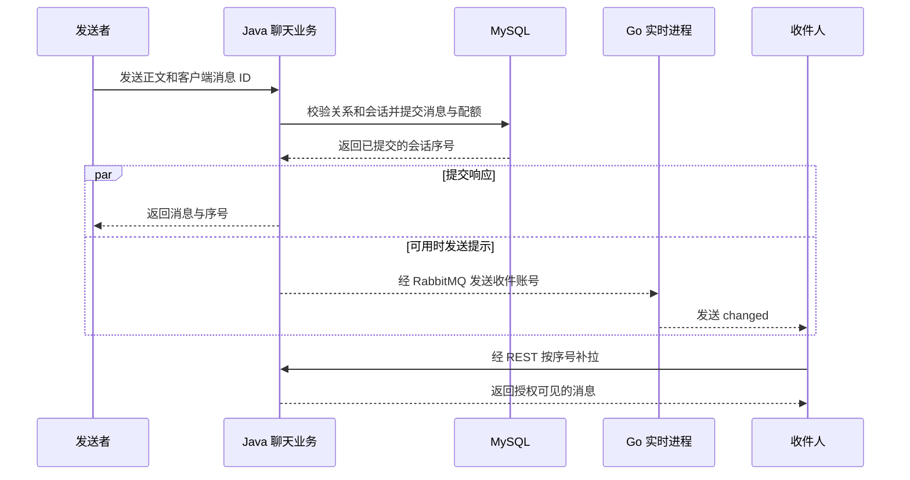

# 即时通讯系统设计

私信和群聊共用 Java 聊天模块与文字消息模型。默认由核心进程提供聊天 API，分库模式由独立聊天进程和聊天专库接管。Go `chat-realtime` 提供 WebSocket 变化提示，核心验证身份和联系资格，Java 聊天模块提交消息并提供历史查询。[聊天 REST](../../backend/src/main/java/com/example/demo/chat/controller/ChatController.java) · [分库配置](../../docker-compose.chat.yml) · [Go 进程](../../services/chat-realtime/main.go)

## 交付顺序与技术选型

| 批次 | 范围 | 技术与边界 |
| --- | --- | --- |
| 好友与私信 | 会话、消息请求、陌生额度、拉黑、已读 | Spring Boot、MySQL 和 REST，当前可见会话增量轮询。消息和权限均以 owner 为准 |
| 邀请制群聊 | 群主、邀请、接受、转让、退出、解散 | 复用单聊的消息基础，群成员状态和状态变更由同一会话事务管理 |
| 实时提醒 | 降低打开的消息页收信延迟 | 工作区 Go WebSocket 提示加 REST 补拉，连接由各进程在内存维护，RabbitMQ 扇出。通知 SSE 属于独立链路 |
| 独立部署 | 可单独发布和伸缩，隔离消息库 | 已有独立 Java 进程、MySQL 专库及网关扩展。JDBC 连接自己的库，核心通过私有 REST 提供身份、社交和审核协调。正式切换需通过迁移与回退验收 |

## 公开实现参考

| 实现 | 公开证据 | 对同频的参考 |
| --- | --- | --- |
| Slack，2023 年工程分享 | Hack Webapp 接收消息发送请求，Java Channel Server 分发事件，Java Gateway Server 维护 WebSocket 与频道订阅。[Slack 架构](https://slack.engineering/real-time-messaging/) | API、频道分发与连接可按各自负载部署 |
| 哔哩哔哩直播，2024 年工程分享 | 业务服务发起推送，Go 长连接平台分配接入节点并维护心跳和下行分发。[B 站长连接设计](https://www.bilibili.com/opus/919363528131870775) | 独立 Go 进程承担连接与在线推送，业务方持有业务规则 |
| OpenIM | Go 启动代码和配置分别定义消息及群组 RPC、消息网关、消息转发与推送。[服务入口](https://github.com/openimsdk/open-im-server/blob/main/cmd/main.go) · [部署配置](https://github.com/openimsdk/open-im-server/blob/main/start-config.yml) | 同一种语言也可按业务、连接与分发拆分部署 |
| Centrifugo | Go 实时服务提供发布接口和频道订阅，在短期事件历史可用时支持重连补发，超出窗口则由应用后端恢复。[发布源码](https://github.com/centrifugal/centrifugo/blob/master/internal/api/api.go) · [恢复协议](https://centrifugal.dev/docs/server/history_and_recovery) | 正文和序号由 Java 业务库持有，Go 可以合并变化提示，客户端按游标补拉 |

跨页恢复用例让接收端断开 WebSocket，期间发送 31 条消息，验证轮询和重连后的消息按序、完整且无重复。31 条跨过当前 30 条的历史页大小。[历史分页实现](../../backend/src/main/java/com/example/demo/chat/service/ChatService.java)

## 会话与历史规则

| 对象 | 首期行为 |
| --- | --- |
| 单聊 `DIRECT` | 以有序账号对唯一定位。好友可直接建立。陌生人首条请求产生 `PENDING`，只允许收件人接受或拒绝 |
| 单聊请求状态 | 收件人接受后进入 `ACTIVE`。仍为非好友时，发起方等待处理。若期间成为好友，下一条发送可建立会话。拒绝进入 `DECLINED`，原收件人可主动建立，成为好友后也可恢复发送 |
| 群聊 `GROUP` | 创建者为群主，可以邀请好友。工作区上限为 50 人，包含群主、现有成员及未到期邀请。邀请有效期为 7 天 |
| 群成员 | 受邀时只看到邀请。接受时将可见下限设为当时 `last_seq + 1`，已读初值为 `last_seq`。退出、移除或解散后，新读取和提交均拒绝 |
| 私信历史 | 接受之前只有双方可看第一条请求。已存在的直接会话历史遵守当前会话访问权。取关或拉黑会限制新联系，历史依照保留策略继续可读 |
| 未读 | 每成员单调保存已读序号。首期会话摘要返回未读状态，按可见的对方消息计算。需要未读计数时沿用相同边界 |
| 举报与撤回 | 举报验证提交人对单条消息的访问权。授权审核员按案件读取必要证据，分区版主权限限于其论坛范围。私信和群聊发送人可以在发送后 2 分钟内调用 `DELETE /api/v1/chat/conversations/{id}/messages/{messageId}` 撤回自己的消息。撤回保留原位置和审核证据，会话成员看到撤回提示，重复撤回保持同一结果 |

[会话和群状态实现](../../backend/src/main/java/com/example/demo/chat/service/ChatService.java) · [历史、成员和已读 SQL](../../backend/src/main/java/com/example/demo/chat/repo/ChatRepository.java) · [聊天举报授权](../../backend/src/main/java/com/example/demo/moderation/service/ContentReportService.java)

## 请求与事务



1. 服务端从已验证身份取发送者，参数只表达会话或收件人。先校验访问资格。已成功提交且仍可返回的相同 `clientMessageId` 返回原结果。相同 ID 与不同正文返回 `409`。
2. 发送新消息时校验关系与当前接收设置，锁定会话后校验角色、状态和成员资格。单聊用规范化账号对的唯一键约束会话。批量建群按稳定顺序取锁，默认走核心账号行锁，分库走专库锁桶以及核心批量联系判定。[同库目录](../../backend/src/main/java/com/example/demo/chat/service/LocalChatDirectory.java) · [分库目录](../../backend/src/main/java/com/example/demo/chat/remote/RemoteChatDirectory.java)
3. 在一个 MySQL 事务内对非好友额度条件扣减、分配会话序号、写消息和更新会话。`ChatChangePublisher.changed` 注册提交后回调，异步发出账号提示。事务失败时额度与消息一并回滚。
4. 日额度按 `(user_id, quota_date)` 计数。第一条请求、接受后的非好友私信计次。重试和被拒绝的发送不重复计次。群消息仅计独立发送频控。开始处理新发送时按 `Asia/Shanghai` 采样一次额度日期，整个事务使用该日期，响应给出带时区的 `resetAt`。
5. 加入、退出、转让、发送和推进游标共享会话锁的顺序。客户端按序号合并。服务端在成员可见范围内推进 `last_read_seq`，重复或过时请求保持单调。

异步提示的交付取决于当前连接和 broker。发送响应表明消息已持久化，阅读位置通过单独的读游标更新。[事务写入](../../backend/src/main/java/com/example/demo/chat/service/ChatService.java) · [会话序号及消息 SQL](../../backend/src/main/java/com/example/demo/chat/repo/ChatRepository.java) · [提交后提示](../../backend/src/main/java/com/example/demo/chat/service/ChatChangePublisher.java)

## 表与索引

| 数据 | 关键约束 |
| --- | --- |
| `chat_conversations` | 复用原型表和规范化二元组 `(direct_low_id, direct_high_id)`。逻辑上区分 `DIRECT` 与 `GROUP`。未来显式类型字段由校验旧行再回填的迁移引入 |
| `chat_members` | 主键 `(conversation_id, user_id)`，保留 `(user_id, state, conversation_id)` 入口索引。记录成员状态、邀请时间、可见下限及读游标 |
| `chat_messages` | 唯一 `(conversation_id, seq)` 负责历史查找。唯一 `(conversation_id, sender_id, client_message_id)` 负责发送去重，保留隐藏标记 |
| `chat_daily_usage` | 主键 `(user_id, quota_date)`，通过受限更新保持额度和消息写入同一事务 |
| `chat_preferences` | 按用户保存陌生请求开关。内测默认值与对外启用默认值各自评审 |
| `chat_blocks` | 由社交持有。拆库时留在核心库，聊天只通过联系策略读取 |
| `chat_write_locks` | 独立聊天库的事务锁。按账号 ID 映射到 256 个锁桶，去重并按桶序加锁 |
| `chat_moderation_receipts` | 独立聊天库的审核回执。决定 ID 与消息版本去重，回执和可见性变更同事务持久化 |
| `chat_event_outbox` | 候选扩展。在可重放的聊天业务事件有独立需求时评估，引入稳定事件 ID、会话 ID、变化类型与配送状态 |

群主与群名使用会话行，群成员与读游标使用同一成员行。迁移需保留 ID、`last_seq`、成员可见范围、额度、历史记录以及去重唯一键。[数据迁移方案](03-数据库归属与迁移.md)

## HTTP 接口

下表沿用工作区聊天原型的 `/api/v1/chat` 前缀。退群、解散和已读更新保留客户端已使用的状态码和字段。冻结契约前以当前分支实际响应生成回归样例。

| 接口 | 使用方式 |
| --- | --- |
| `GET /friends`、`GET /conversations?bucket=messages`、`GET /conversations?bucket=requests` | 好友、会话与请求分页。会话预览和未读遵守成员可见性 |
| `GET /direct/{peerId}`、`POST /direct/{peerId}/messages` | 查询可用操作，发送文字或发起首条请求。新消息返回 `201`，同编号成功重试返回 `200`。响应含会话、消息、状态和额度 |
| `PUT /conversations/{id}/request` | 收件人用 `accept` 处理请求，重复同一决定幂等 |
| `GET /conversations/{id}/messages` | `afterSeq` 增量或 `beforeSeq` 历史，两者互斥，默认最近 30 条。响应含 `items`、`hasMore`、`visibleFromSeq` 和 `revision`。客户端按序号去重 |
| `PUT /conversations/{id}/read` | 提交 `seq`，超出当前可见边界时保持原游标 |
| `POST /groups`、`POST /groups/{id}/invitations` | 群名与邀请人，后续邀请由群主发起 |
| `PUT /groups/{id}/invitations/me`、`POST /groups/{id}/messages` | 接受或拒绝邀请、发送群消息 |
| `GET /groups/{id}/membership`、`GET /groups/{id}/members` | 前者返回当前账号的成员状态和群主，受邀者可用来确认邀请。后者按当前成员资格查询列表 |
| `PUT /groups/{id}/owner`、`DELETE /groups/{id}/members/{userId}`、`DELETE /groups/{id}` | 转让、退出或移除、解散，保留角色与成员校验 |
| `GET/PATCH /settings`、`GET /blocks`、`PUT/DELETE /blocks/{userId}` | 偏好与拉黑入口 |
| `POST /api/v1/reports` | 与论坛举报入口衔接。私密消息采用单条证据与专用审核授权 |

发送请求示例。一次用户操作生成一个 UUID，网络重试复用它。

```json
{
  "clientMessageId": "9b8d36a2-f347-41b1-84eb-dbff34e08c55",
  "content": "你好，想请教一下帖子里的相机设置。"
}
```

发送 DTO 有 `@Size(max = 1000)` 限制，按纯文字呈现。`404` 对无权访问的会话返回统一结果，待接受、群满和幂等冲突使用 `409`，`429 CHAT_DAILY_LIMIT_EXCEEDED` 返回额度及恢复时间。独立服务遇到联系判定超时或过期时返回可重试的 `503`。[请求 DTO](../../backend/src/main/java/com/example/demo/chat/dto/ChatModels.java) · [聊天 Controller](../../backend/src/main/java/com/example/demo/chat/controller/ChatController.java) · [分库联系判定](../../backend/src/main/java/com/example/demo/chat/remote/RemoteChatDirectory.java) · [前端 HTTP 客户端](../../frontend/src/api/chat.ts)

## 工作区 WebSocket 与恢复

| 链路 | 当前实现与源码 |
| --- | --- |
| 路由与认证 | 浏览器升级 `/api/v1/chat/realtime`，首个文本帧发送既有 JWT。Go 检查 `Origin`，再用 Bearer 调 Java 的 `GET /api/v1/chat/realtime/session`。Java 返回用户 ID 和到期时间，Go 返回 `ready`。[浏览器连接](../../frontend/src/pages/messages/realtime.ts) · [Java 会话核验](../../backend/src/main/java/com/example/demo/chat/controller/ChatRealtimeSessionController.java) · [Go 握手](../../services/chat-realtime/socket.go) |
| 广播与连接 | Java 提交后投递账号 ID 列表至 `chat.realtime.changed.v1`。Go 每实例绑定临时扇出队列，用内存连接表发 `changed`，定时发 `heartbeat`。实现限制每实例 512 个连接槽、每账号 4 个连接。消息正文经授权 REST 返回。[Java 发布器](../../backend/src/main/java/com/example/demo/chat/service/ChatChangePublisher.java) · [Go 消费](../../services/chat-realtime/broker.go) · [Go 连接表](../../services/chat-realtime/socket.go) |
| 回退与补拉 | Vue 每 3 秒调度一次，实时连接未就绪时轮询，连接就绪时周期性校正。收到 `changed`、重连完成或回到前台后刷新，以 `afterSeq` 补拉。broker 断开时 Go 关闭订阅客户端，浏览器退回 REST。[浏览器重连](../../frontend/src/pages/messages/realtime.ts) · [消息页补拉](../../frontend/src/pages/Messages.vue) · [Go 连接状态](../../services/chat-realtime/socket.go) |

`BLUEALBUM_CHAT_REALTIME_CHECK=1` 在隔离 Compose 环境验证两个 Go 节点、真实核心身份接口和独立聊天进程。演练记录同一条写入的扇出、单节点停机期间另一条连接的收信、重连后的游标补拉和无关账号隔离。测试通过仅为本次演练开放的本机端口分别连接两个节点。每实例的连接限制属于当前实现，集群容量按实测确定。[双节点 Compose 验证](../../scripts/ci/compose-chat-realtime.sh)

**历史补拉契约**。消息序号用于补充新消息，历史修订和可见下限用于发现旧缓存失效。隐藏或恢复既有消息时，会话内的 `history_revision` 增加。客户端发现 `revision` 或 `visibleFromSeq` 变化时清空旧历史并重新加载最近一页；失去会话访问权时清空当前历史。只有 `hasMore` 为真且序号在前进时，才用最后已收到的序号继续补页。分库需原样保留这三个边界，验收同时覆盖新增 31 条消息、低序号消息被隐藏、退出后重入及旧页面重连。[会话历史查询](../../backend/src/main/java/com/example/demo/chat/service/ChatService.java) · [消息页补拉与缓存失效](../../frontend/src/pages/Messages.vue)

## 验收标准

| 场景 | 必验结果 |
| --- | --- |
| 仅剩一条额度时并发向不同用户发信 | 仅一条成功，另一条 `429`。事务故障后计数与消息一致 |
| 发信成功但响应丢失 | 原请求编号只对应同一条消息和一次扣减。异正文重复返回冲突 |
| 会话不存在、退出群或换账号 | 会话列表、预览、历史、推送均遵守当前权限。切换账号后旧响应无法写回页面 |
| 入群、退群与发送并发 | 群人数不会超限。每成员可读范围以加入／退出顺序和当前成员资格为准 |
| 拉黑、取关以及关系服务超时 | 权限结果符合社交契约，发送失败不消耗额度 |
| 消费者重复、浏览器断网及重连 | 历史完整、序号单调、页面无重复，掉线后补齐。退出群后已排队提示不包含消息正文 |
| 举报与隐藏 | 仅获授权的审核角色能读取单条证据。历史和预览按可见性过滤，已有缓存按 `history_revision` 刷新。分库回执重放只确认一次审核结果 |
| 性能与隔离 | 建议内测用 50 个前台会话，消息提交 P95 ≤ 500 ms，轮询可见 P95 ≤ 5 s。使用真实 MySQL 验证事务和索引 |

工作区已有 HTTP 鉴权、并发额度与群可见范围测试，以及 Go 连接隔离和浏览器重连测试。性能数值用于首轮验收。消息留存、群历史和陌生请求默认值仍需评审。[Java 聊天测试](../../backend/src/test/java/com/example/demo/chat/ChatIntegrationTest.java) · [Go 实时测试](../../services/chat-realtime/socket_test.go) · [前端重连测试](../../frontend/src/pages/messages/realtime.spec.ts)

设置 `BLUEALBUM_CHAT_POLL_LOAD_CHECK=1` 可在隔离分库演练中测量两项时延。一个账号通过公开 API 向迁移后的群发送 20 条消息，另一个账号的 50 个客户端各按三秒间隔轮询历史，逐条核对序号并记录可见时延。报告附样本数和 P95。Go 长连接扇出与重启通过独立的 RabbitMQ 演练验证。[性能验证入口](../../scripts/ci/chat-poll-load.py) · [双实例验证入口](../../scripts/Test-ChatRealtimeRuntime.ps1)
