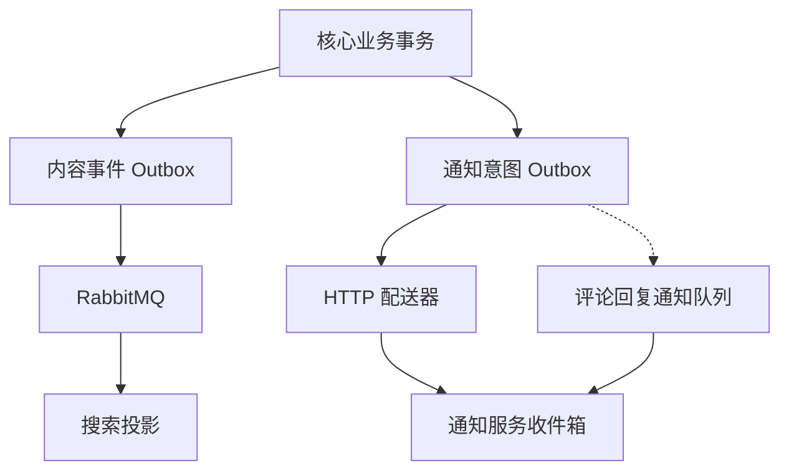

# 消息事件与 Outbox 设计

通知和主题索引使用持久化记录来恢复未完成投递。工作区聊天另有提交后发送的实时刷新提示，交付依赖当前 broker 与连接状态。各链路的可靠性边界以生产者、消费者和数据库实现分别核对。

## 现有职责与技术

| 链路 | 发送端和数据归属 | 当前载体与接收端 |
| --- | --- | --- |
| 主题领域事件 | `ThreadService` 和 `ContentEventRecorder.record` 同事务写 `content_event_outbox` | RabbitMQ `content.events.v1`，搜索侧消费 `content.search.v1`。[主题写入](../../backend/src/main/java/com/example/demo/threads/service/ThreadService.java) · [事件写入](../../backend/src/main/java/com/example/demo/threads/event/service/ContentEventRecorder.java) · [搜索消费者](../../backend/src/main/java/com/example/demo/search/service/ContentSearchConsumer.java) |
| 通知发送意图 | 远程模式下核心业务事务写 `notification_outbox`，含收件人与目标 | 默认经 HTTP 配送。评论回复可选走专用 RabbitMQ 队列，两种入口都依赖 `notifications.idempotency_key` 去重。[通知调度](../../backend/src/main/java/com/example/demo/notifications/outbox/NotificationOutboxDispatcher.java) · [接收端幂等](../../notification-service/src/main/java/com/example/notification/service/PersistentNotificationService.java) |
| 媒体请求 | `media_processing_job` 与 `media_request_outbox` 由 Java 媒体 owner 管理 | RabbitMQ 和可选 Go worker，通过任务租约与 Java 结果验收完成。[媒体发布器](../../backend/src/main/java/com/example/demo/storage/service/MediaRequestPublisher.java) · [Java 任务租约](../../backend/src/main/java/com/example/demo/storage/service/MediaJobService.java) · [Go 任务处理](../../services/media-service/internal/consumer/handler.go) |
| AI 摘要任务 | 版本化任务、请求、尝试和预算数据由核心管理 | RabbitMQ 任务及恢复扫描，写回受内容版本约束。[摘要 DDL](../../backend/src/main/resources/db/migration/mysql/V20261020_3__versioned_summary_tasks.sql) · [摘要消费者](../../backend/src/main/java/com/example/demo/ai/summary/service/SummaryQueueConsumer.java) · [任务恢复](../../backend/src/main/java/com/example/demo/ai/summary/service/SummaryTaskRecovery.java) |
| 聊天审核决定（分库模式） | 核心治理持有 `chat_report_decisions`、每消息版本和在途指针，按租约重试 | 核心经私有 HTTP 让独立聊天应用决定。聊天持久化 `chat_moderation_receipts`，核心收到成功回执后完成案件与审计。[核心审核配送](../../backend/src/main/java/com/example/demo/moderation/service/ChatReportDecisionDispatcher.java) · [聊天审核应用](../../chat-service/src/main/java/com/example/chatprocess/governance/ChatGovernanceService.java) |
| 聊天实时提示（工作区） | `app.rabbit.enabled` 启用时，`ChatChangePublisher.changed` 注册提交后回调，发布非持久化账号列表 | RabbitMQ 扇出到 Go 的临时队列，Go 发送 `changed`，客户端用 REST 对账。[Java 提示发布](../../chat-domain/src/main/java/com/example/demo/chat/service/ChatChangePublisher.java) · [Go 临时队列](../../services/chat-realtime/broker.go) · [消息补拉](../../frontend/src/pages/Messages.vue) |

领域事件表达已发生的事实，通知意图面向具体收件人。两类记录分别建表。后续如改为同一 broker，继续分别管理消息契约和消费结果。`chat_event_outbox` 属于可重放业务事件的候选方案，当前聊天实时提示经浏览器补拉弥补漏发。[主题 Outbox DDL](../../backend/src/main/resources/db/migration/mysql/V20261018_2__content_event_outbox.sql) · [通知 Outbox DDL](../../backend/src/main/resources/db/migration/mysql/V20261014__create_notification_outbox.sql)

## 事件与接口契约

| 契约 | 关键字段和约束 |
| --- | --- |
| 主题事件 v1 | 复用 `eventId`、`eventType`、`schemaVersion`、`aggregateType`、`aggregateId`、`aggregateVersion`、`occurredAt`、`requestId`。已有类型 `THREAD_UPSERTED`、`THREAD_HIDDEN`、`THREAD_DELETED`。[事件枚举](../../backend/src/main/java/com/example/demo/threads/event/entity/ContentEventType.java) · [事件传输校验](../../backend/src/main/java/com/example/demo/threads/event/service/ContentEventPublisherTransport.java) |
| 评论回复通知 v1 | 专用队列 `notification.comment-created.v1` 上的 `COMMENT_CREATED` 投影包含原通知事件 ID、评论 ID、主题 ID、收件人和通知呈现字段。通知提交后返回回执 |
| 评论领域事件（扩展契约） | 若其他业务需要消费所有评论的创建事实，可建立独立事件流，使用 `aggregateType=POST` 与聚合版本。负载携带必要的主题、回复目标及操作者 ID，正文由内容 owner 权限控制 |
| 通知意图 | 稳定 `eventId`、收件人、通知类型、目标类型与目标 ID，以及现有通知呈现所需最小字段。接收端按 ID 和规范化负载判重 |
| 聊天审核命令 | `decisionId`、`messageId`、`reportId`、单消息递增 `version`、`hidden`。相同决定重投返回原回执。旧版本返回 `STALE`，同版本异决定返回冲突。会话历史修订只在可见性改变时增加 |
| 发布接口 | 以领域的事件信封和投递目标调用适配器，结果表达可确认接收、结果未知与明确失败。broker 拓扑、确认和偏移从适配器管理 |
| 消费接口 | 使用相同的业务处理器校验事件并更新本服务状态。HTTP 返回成功、RabbitMQ ACK 或 Kafka 位点提交，分别在下游效果确定后执行 |

若以后将评论领域事件与主题事件放进同一张表，先把现有 `(aggregate_id, aggregate_version)` 的唯一约束扩展为包含 `aggregate_type`，避免主题 ID 和评论 ID 相同导致冲突，同时回归当前主题订阅。事件、重试诊断与隔离区均避免携带原始聊天正文、访问凭证、联系信息或附件读权限。

通知意图在入队和远程配送时检查偏好。评论回复启用 RabbitMQ 时沿用原收件人、偏好和事件 ID。收到已提交的回执后核心确认完成，超时按原事件 ID 重试。切换前核对既有 HTTP 配送记录与通知库。新增其他评论消费者时，单独确定订阅内容、隐藏规则和去重范围。[入队与租约](../../backend/src/main/java/com/example/demo/notifications/outbox/NotificationOutboxService.java) · [配送偏好检查](../../backend/src/main/java/com/example/demo/notifications/outbox/NotificationOutboxDispatcher.java) · [RabbitMQ 接收](../../notification-service/src/main/java/com/example/notification/messaging/CommentCreatedMessageListener.java)

## 事务、租约和消费确认

1. 同事务保存业务状态和 Outbox。业务保存失败或 Outbox 插入失败时一并回滚。
2. 调度器选择到期记录，以短事务获取有超时的租约，再执行外部投递。处理成功后按行 ID 和当前租约标识更新。旧租约返回的结果不能覆盖新租约结果。
3. 主题与媒体发布器启用 publisher confirms 并检查不可路由返回。搜索处理成功后 ACK，异常按错误类型重试或隔离。HTTP 通知保持 UUID 去重。聊天实时提示使用非持久化发送和临时消费队列，相关操作的成功以 Java 提交为准。[主题发布器](../../backend/src/main/java/com/example/demo/threads/event/service/ContentEventPublisherTransport.java) · [搜索消费确认](../../backend/src/main/java/com/example/demo/search/service/ContentSearchConsumer.java) · [媒体发布器](../../backend/src/main/java/com/example/demo/storage/service/MediaRequestPublisher.java) · [聊天提示发布](../../chat-domain/src/main/java/com/example/demo/chat/service/ChatChangePublisher.java)
4. 崩溃或故障后的重投使用相同事件 ID。业务有副作用的消费者把已处理记录与本地效果放进同一事务，或使用目标表的唯一键。通知仍用收件箱唯一键，搜索用聚合版本并保留墓碑，媒体及 AI 校验任务版本与租约。
5. 网络超时、连接故障和暂时不可用有界退避。非法协议、无效状态以及同幂等键异负载隔离，记录错误类别及来源。人工重放保留事件 ID 和版本，权限、关联 ID、操作人与结果均进入审计。

对于分库聊天审核，核心在案件事务中登记待执行的隐藏或恢复命令，后台用原 `decisionId` 发送。接收端提交回执和可见性后，核心在后续事务确认案件、写审计并清除在途指针。`STALE`、目标缺失及冲突进入失败状态，案件保留供核对。回切核心前须结清在途决定并核对既有回执。[案件处理](../../backend/src/main/java/com/example/demo/moderation/service/ContentReportService.java) · [决定及租约仓储](../../backend/src/main/java/com/example/demo/moderation/service/ChatReportDecisionStore.java) · [回退顺序](03-数据库归属与迁移.md#聊天首次分库演练)

## 乱序、索引和异常处理

| 场景 | 结果 |
| --- | --- |
| 相同事件重投 | 通知返回既有结果，搜索保留已应用版本 |
| 旧事件晚到 | 搜索按版本和权威投影处理，隐藏或删除墓碑防止旧正文恢复 |
| 同版本冲突或未知版本 | 隔离并告警，保留可诊断元数据，修复契约后以原 ID 重放 |
| 生产者或消费者停机 | Outbox 或输入记录保留，恢复后处理。超过最大重试的记录进入审核范围 |
| 索引不可用 | `ThreadSearchService.list` 执行数据库降级，对索引候选按权威版本与可见性回查。当前重建在写入门禁内扫描、比对新索引后切换别名 |

现有 `SearchRebuildService.rebuild` 从写入门禁开始，扫描投影、比对数量和每条记录，再通过 `finishOrReconcile` 收尾。未来若为 Kafka 试点建立并行旧链路与影子索引，增量水位须考虑低自增 ID 晚提交。可使用锁定写入窗口，或从提交位置捕获增量。[当前查询回退](../../backend/src/main/java/com/example/demo/search/service/ThreadSearchService.java) · [现有重建](../../backend/src/main/java/com/example/demo/search/service/SearchRebuildService.java) · [写入门禁](../../backend/src/main/java/com/example/demo/threads/maintenance/service/ContentWriteGateService.java)

## 第一阶段实施目标

主题索引投影能够脱离 RabbitMQ 独立执行和验证。投影用例负责权威内容回查、版本校验和索引更新。消息入口负责解析、确认、重试和死信处理。Outbox 调度调用类型化的内容事件发布端口，发布诊断保留确定失败与结果未知的区别。

验收覆盖旧事件读取最新权威投影、相同版本冲突、提交索引后才确认消息、重试耗尽进入死信、原事件 ID 重放及发布超时后的重试。完成现有 RabbitMQ 链路验收后进入 Kafka 试点。

工作区已经拆出独立投影用例、共享消息解析器和内容事件发布端口。RabbitMQ 消费与死信重放共用解析器，Outbox 仅在发布方返回确认后标记已投递。[投影用例](../../backend/src/main/java/com/example/demo/search/service/ContentSearchProjection.java) · [消息解析器](../../backend/src/main/java/com/example/demo/search/service/ContentSearchEventDecoder.java) · [发布端口](../../backend/src/main/java/com/example/demo/threads/event/port/ContentEventPublisher.java)

2026-11-23 定向回归通过 42 项，覆盖独立投影、确认与重试、死信重放、Outbox 租约及发帖事务。随后使用真实 MySQL、RabbitMQ 和 Elasticsearch 完成了主链路、依赖停机、补发及索引回切验收。[独立投影测试](../../backend/src/test/java/com/example/demo/search/service/ContentSearchProjectionTest.java) · [本地验收记录](08-部署与运维设计.md#2026-11-23-本地验收基线)

## Kafka 替换路线

首个候选是可重建的主题搜索投影。多消费者复用同一事件流、按保留期重放或吞吐需求出现时，使用基准链路实测再决定切换。聊天持久化、通知 HTTP 和媒体工作队列可以各自维持现有载体。

| 设计点 | Kafka 适配 |
| --- | --- |
| 路由和顺序 | 主题按事件族和协议版本划分，分区键使用聚合类型与 ID。分区内有序，业务仍校验版本，处理退避重排和历史重放 |
| ACK、位点与副作用 | 每个消费用途独立 consumer group。可确认写入外部存储后再提交连续处理位点。消费位点与写入外部数据库仍需业务幂等 |
| 重试和保留 | 为暂时失败设计可延迟重试，永久失败写隔离记录。隔离或可靠转交成功后才推进原位点。选择可覆盖重建和回退时间窗的保留策略 |
| 多载体验证 | 同一事件 ID 投向旧链路与目标链路。每个目标有独立确认记录。Kafka 影子消费使用独立索引，避免修改当前查询结果 |

现有 `content_event_outbox` 保存事件信封和 RabbitMQ 的配送状态。开启试点时，同一事务在 `content_event_kafka_delivery` 用 Outbox 主键登记 Kafka 状态。各自领取租约、确认和重试，Kafka 影子索引独立核对已应用版本。[原有内容 Outbox](../../backend/src/main/resources/db/migration/mysql/V20261018_2__content_event_outbox.sql) · [Kafka 投递记录](../../backend/src/main/resources/db/migration/mysql/V20261123_1__content_event_kafka_delivery.sql)

按以下顺序切换。

1. 固化事件契约与消费回归，允许内容事件发布适配器分别投递 RabbitMQ 和 Kafka。为试点流建立可靠基线和增量界线，记录捕获、提交和影子消费进度。
2. 从内容 owner 建影子索引，按分区消费和补齐。对比同一水位的 ID、版本、隐藏和删除结果。故意中断连接、重放及制造乱序，确认幂等和告警。
3. 切换时短暂停止产生该流的写入，等待在途事务提交或回滚，记录切换水位。核对两条链路均已处理到该水位并完成可见性对账，再切换查询别名与活动索引配置，恢复写入。回退期继续同步旧链路及旧索引，切回前按同样步骤核对增量。
4. 回退期验证无缺口后关闭旧目标，并按时间窗保留 Outbox 和重放证据。媒体、AI、聊天若需迁移，各自评审延迟重试、租约和结果提交契约。

### 隔离试点运行

运行 `M2_CI_KAFKA_PILOT=1 bash scripts/ci/content-search-smoke.sh` 启动独立的 MySQL、RabbitMQ、Kafka 和 Elasticsearch 容器。结果默认写入 `outputs/m2-search-kafka-pilot`，各阶段使用同一批隔离数据。Java 测试分别检查同一事件、停机期间两条链路的状态、恢复后追平、别名切换和反向回切。

手动组装时启用 `app.content.events.kafka.enabled`，配置 `app.content.events.kafka.bootstrap-servers`、`topic` 和 `group-id`，并在 `app.search.kafka-pilot.rabbit-index`、`kafka-index` 配置不同的受管物理索引名。先由管理员调用 `/api/v1/admin/search/kafka-pilot/prepare?carrier=RABBITMQ` 和 `carrier=KAFKA` 创建两个索引，再调用相同前缀的 `/activate` 进行同水位对账后切换。准备期间暂停流量，保证所有内容写入实例采用相同试点配置。试点开始前已有的内容通过权威库扫描建立基线，开启后新事件在同一事务登记 Kafka 投递。试点只使用 Kafka 主题里的独立消费组，处理失败时保留未确认位点。

创建物理索引需要等待 Elasticsearch 分配初始分片，HTTP 等待上限为 30 秒。查询与文档写入仍分别受适配器的连接和读取超时限制。[搜索索引适配](../../backend/src/main/java/com/example/demo/search/adapter/ElasticsearchContentSearchIndex.java)

2026-11-24 隔离演练三轮均通过。正常阶段核对了两套索引中的同一事件 ID 和版本。Kafka 停机期间 RabbitMQ 继续投递，系统拒绝切到落后的索引。重启 Kafka 后重放停机期间的原事件，切换查询别名并回切 RabbitMQ，逐条核对三份文档，包括切换后新写入的内容。总报告为 `outputs/architecture-kafka-pilot-20261124-v8/checks.json`，各阶段目录保留 JUnit 和业务读回。

[Kafka 适配决策](decisions/ADR-001-内容搜索Kafka并行验证.md)

## 验收标准

- 创建后事务回滚不会留下可投递记录。broker 停机时成功提交的业务事件可在恢复后投递。
- 模拟 broker 接收成功后生产者崩溃，以及消费数据库提交后 ACK 或位点提交丢失。重复投递后业务效果只发生一次。
- 已隐藏或删除主题在逆序重投和搜索重建后保持不可见，现有通知重复投递也只产生一条可见通知。
- 分库审核覆盖聊天服务停机后补投、目标已提交但回执响应丢失、重复及逆序决定。逐条核对核心案件、专库回执、消息可见性和审计条数。
- 对发送积压、最老待发年龄、重试、隔离、重放和索引延迟建立指标。Kafka 试点须通过双链路对账和回退演练。

对应的现有测试入口包括通知事务、接收端并发幂等、主题事件发布和搜索消费。工作区另有提交后聊天提示的测试源文件。[业务事务测试](../../backend/src/test/java/com/example/demo/notifications/outbox/NotificationBusinessTransactionIntegrationTest.java) · [通知幂等测试](../../notification-service/src/test/java/com/example/notification/service/NotificationIdempotencyConcurrencyTest.java) · [主题发布测试](../../backend/src/test/java/com/example/demo/threads/event/ContentEventPublisherTransportTest.java) · [搜索消费测试](../../backend/src/test/java/com/example/demo/search/service/ContentSearchConsumerTest.java) · [聊天提交回调测试](../../chat-domain/src/test/java/com/example/demo/chat/ChatChangePublisherTest.java)
