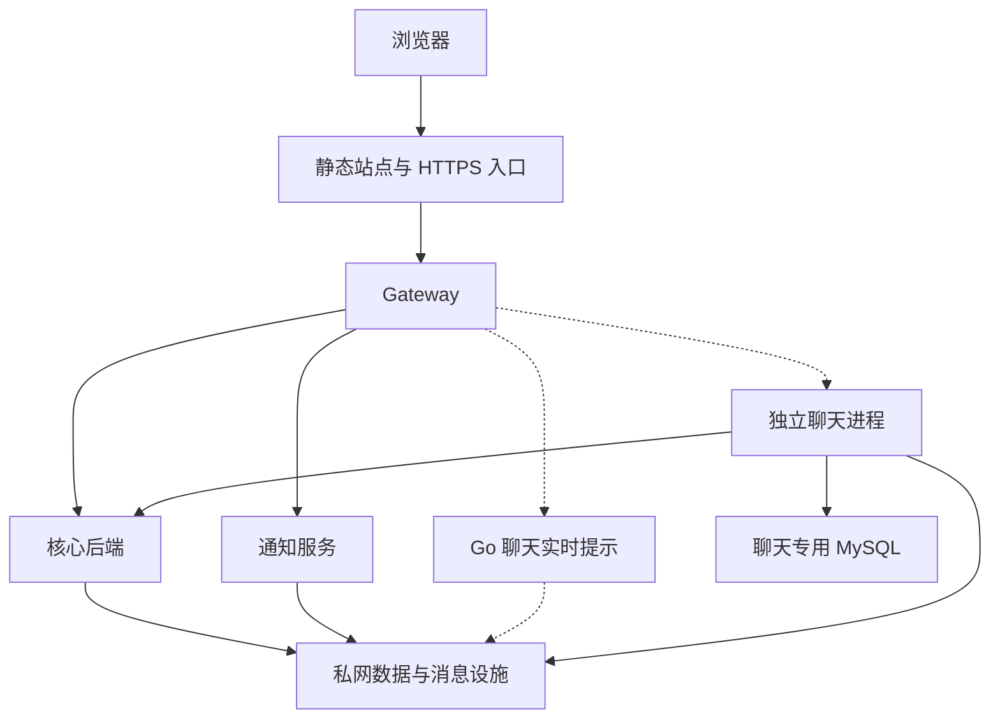

# 部署与运维设计

同频有本地 PowerShell 启动及完整 Compose 两种入口。工作区启动脚本在通知、核心和网关之后尝试启动 Go 实时提示，再启动 Vue。工作区 Compose 已声明对应容器。生产容量和可用性指标在试运行采样后确定。

构建使用 Maven 和前端锁文件，部署使用 Docker 镜像与 Docker Compose，自动验证沿用 GitHub Actions。应用、数据库和消息设施独立配置，发布记录固定镜像摘要与迁移版本。

## 环境与拓扑

| 环境 | 运行方式 | 数据与网络 |
| --- | --- | --- |
| 本地日常 | `Start-Local.ps1` 启 MySQL、Redis、RabbitMQ，再依次启动通知、核心、网关。之后尝试启动 Go 实时提示，再启动 Vue。Go 未启动时聊天可轮询 | Vite 5173、Gateway 9000、核心 8080、通知 8081，Go 默认绑定本机 8092 |
| CI 集成 | Maven、前端静态检查与构建。使用隔离数据库及消息容器执行 API、浏览器和运行验证 | 独立卷、账号与端口。环境可重建，报告记录制品版本、迁移、错误日志和验收结果 |
| 联调及内测 | 完整 Compose 声明 `chat-realtime`，聊天写入默认由核心承担。`docker-compose.chat.yml` 增加独立 Java 进程和 `chat-mysql`。ES 和媒体 worker 使用可选扩展 | 独立聊天进程及专库使用容器私网，运行账号与迁移账号分别授权。已有历史的环境先执行停写复制和对账，再启用分库路由 |
| 生产候选 | 计划只公开 HTTPS 入口和 Gateway 允许的 API。核心、通知、Go 实时提示及独立聊天实例使用私网 | 持久化数据与对象存储分别备份，凭证按环境和用途独立。机密轮换与最小权限在上线前验收 |

[本地启动脚本](../../scripts/Start-Local.ps1) · [完整 Compose](../../docker-compose.yml) · [独立聊天扩展](../../docker-compose.chat.yml) · [Go 镜像构建](../../services/chat-realtime/Dockerfile) · [Vite 代理](../../frontend/vite.config.ts) · [Nginx 代理](../../frontend/nginx.conf) · [Compose 搜索扩展](../../docker-compose.search.yml) · [Compose 媒体扩展](../../docker-compose.media.yml)

## 运维接口与数据

| 接口或存储 | 运维要求 |
| --- | --- |
| `/actuator/health` | 现有启动脚本用于健康检查。发布时区分进程存活和流量就绪。就绪检查以本服务的必要依赖为准，搜索等可降级功能单独告警 |
| `GET /health`（Go） | 工作区 Compose 检查 8092 的 `/health`。Go 用 broker 订阅状态返回 `200` 或 `503`。验证 HTTP 轮询可独立工作。[Go 健康检查](../../services/chat-realtime/socket.go) |
| 指标与日志 | 可选 Compose 配置在私网采集核心 Actuator、通知 Outbox 与 Go 实时节点的指标。网关、各应用及异步事件传请求 ID，采集与告警规则见 [可观测性手册](../engineering/observability.md#微服务联调指标) |
| 通知 Outbox、搜索、媒体的运维与回调接口 | 现有 Controller 分别提供状态、重试、重建及私有回调等入口。统一授权与运维审计属于发布验收。[通知 Outbox 管理](../../backend/src/main/java/com/example/demo/notifications/controller/NotificationOutboxAdminController.java) · [搜索管理](../../backend/src/main/java/com/example/demo/search/controller/SearchAdminController.java) · [媒体内部接口](../../backend/src/main/java/com/example/demo/storage/controller/MediaInternalController.java) |
| 核心／通知／聊天 MySQL 数据库 | 通知与聊天专库各自配置运行和 Flyway 账号，发布前演练授权。备份保留 Outbox、游标、聊天消息、审核决定和回执。分库恢复按业务水位联合核对核心与聊天库 |
| Redis、RabbitMQ、Elasticsearch、对象存储 | Redis 对缓存和认证临时状态分别定义故障策略。RabbitMQ 记录积压和死信，搜索索引可重建，媒体备份含对象与资源元数据 |

业务日志保存请求或事件 ID、错误类别、时长和状态。账号等高基数字段不放进指标标签。聊天正文、密码、访问令牌、一次性票据、完整通知负载和对象访问凭证不进入通用日志。

## 发布、灰度与恢复

1. 在 CI 验证旧客户端契约和新旧库迁移。新增结构先向后兼容，等旧应用和旧消费者退出后再收紧约束。保留镜像摘要与 Flyway 版本。
2. 发布前创建可验证的恢复点，核对密钥与数据库授权、网关路由、健康和运维入口。接收方先支持新事件或字段，发送方随后启用。
3. 私信、群聊与实时提示分开灰度。先用指定账号验证，逐步扩大范围。模块阶段全部共用同一个消息 owner。物理切流按单一写入端处理，详见 [数据库迁移](03-数据库归属与迁移.md)。
4. 回退前关闭相关新写入入口，确认在途事件与请求状态。聊天分库已经产生写入时，先停止新增审核决定并结清在途决定，再停写、反向复制和对账。对账通过后才恢复旧核心写入。[聊天回退顺序](03-数据库归属与迁移.md#聊天首次分库演练)
5. 在隔离环境演练 MySQL 恢复、上传对象恢复、队列中断、推送断线和搜索重建。记录实际可恢复的数据窗口及耗时，据此确定生产 RPO／RTO 与保留期。

## 指标与故障处理

| 关注点 | 验收与故障处理 |
| --- | --- |
| 网关与核心 | 观察并发、错误率、P95、DB 连接池和慢查询。必须保证旧入口的授权、分页和错误语义。网关阻止外部内部凭证头及私有路径 |
| 通知与事件 | 跟踪待发数量、最老待发年龄、重试次数、FAILED／隔离数量、消费延迟和 SSE 连接数。故障恢复后按原事件 ID 补投 |
| 聊天 | 观察提交成功率、端到端可见延迟、额度命中、邀请、连接数、重连补拉和慢客户端。内测性能门槛见 [聊天设计](06-即时通讯系统设计.md) |
| MySQL 故障 | 核心写入或聊天落库失败时不返回业务成功。库恢复后核对事务、游标和 Outbox，再开放写入 |
| Redis 故障 | 公共缓存回源并限制并发。认证、票据和防刷能力按各自策略保护，发送接口受限时返回可恢复状态 |
| RabbitMQ 或通知服务停机 | 保留待发记录。告警并限制后台重试，恢复后验证积压回落和订阅方的幂等结果 |
| Elasticsearch 故障 | 公开搜索降级到权威库，继续按当前可见性过滤。告警并检查恢复后的索引差量 |
| 媒体 worker 停机 | 任务在 Java 保留，租约到期后按现有恢复路径重试，核对最终对象归属与版本 |

告警阈值依据内测基线与用户可接受的时延约定。值班检查同时查看错误计数、持续时长、业务影响及恢复水位。

## 交付职责与验收标准

| 交付 | 主责 | 验收证据 |
| --- | --- | --- |
| 核心域边界与通知自治 | 后端与测试 | 表、repo、事务和存量接口清单，独立数据库账号，通知停机复投及 SSE 恢复报告 |
| 好友、私信与群聊 | 产品、前后端与测试 | 规则评审、两账号权限和限额用例、桌面与移动端回归、真实 MySQL 并发测试 |
| 独立聊天与实时连接 | 后端、前端与运维 | 无跨库 SQL 证据、关系授权时点审批、双节点重连、负载及安全验证、单 owner 切流回退 |
| 搜索和媒体 | 后端与运维 | 搜索重建、别名回切、隐藏版本验证，媒体重复消费、过期租约和对象校验 |
| PostgreSQL 或 Kafka 试点 | 后端、DBA／运维与测试 | 分服务迁移对账、影子验证、错误演练、故障恢复和回退结论 |

## 实施批次与退出条件

| 批次 | 对应交付 | 进入下一批所需证据 |
| --- | --- | --- |
| 通知自治 | 完善现有通知服务的凭证开通与切换。限制公开网关的通知路由。保留核心 Outbox 的 HTTP 投递 | 隔离 MySQL 环境运行 `Test-NotificationRuntime.ps1`，报告 `Succeeded=true`。确认 V3 旧库保留、V4 迁移账号、运行账号 DDL 拒绝、停机积压、补发且只入库一次。另记录公开网关拒绝内部路由及 SSE 补拉的结果 |
| 核心边界 | 聊天资料补齐、联系策略和审核入口先改为 owner 接口。收藏列表和关注动态仍按现有读模型验收 | 仓库检查、Java 架构检查和目标用例通过。新增跨域 SQL 与锁列入评审。资料查询次数、排序、分页总数、治理审计与回退行为有源数据对照 |
| 聊天同库内测 | Java 验证消息与权限，Go 负责提示。私信及群聊可以分别开放内测 | Java 与 Go 测试、前端回归和双账号 Compose 旅程通过。覆盖互关、陌生额度、群邀请、退群、审核隐藏、轮询和重连。浏览器报告记录 `realtime_chat_offline_backlog=31`，校验顺序、条数及重复 |
| 聊天分库演练 | 用工作区的独立聊天进程、专用账号和应用级停写脚本，记录单独发布、故障隔离或扩缩容的实际需求 | 确认联系授权时点和单一写入端。核对五张迁移表、权限、双 Go 节点通知、核心决定与专库回执。模拟目标已写入后的回退并完成反向对账 |
| 可选基础设施试点 | 分别验证搜索索引用 Kafka、通知库用 PostgreSQL。媒体继续按已验证的任务协议演进 | 一次演练只切一条链路。对比基线性能与恢复指标，记录版本、回退时限、同水位对账和故障恢复结果，随后决定是否采用 |

通知自治与核心边界可并行。聊天同库内测以规则得到评审并且当前用例通过为准。聊天分库演练还要求 owner 依赖解除。PostgreSQL 试点以通知自治验收通过为前提，Kafka 试点以主题事件与搜索重建回归通过为前提。[数据库切换](03-数据库归属与迁移.md#聊天首次分库演练) · [通知验证脚本](../../scripts/Test-NotificationRuntime.ps1) · [浏览器旅程](../../tests/e2e/playwright/test_m0_journey.py) · [Kafka 试点](07-消息事件与Outbox设计.md#kafka-替换路线)

每次验收记录提交或工作区差异摘要、启用的 profile 和开关、制品版本、迁移版本、测试入口及报告位置。记录实际结果、未执行项与失败证据。运行数据、请求令牌、消息正文及数据库密码留在各自环境。

本地可设置 `BLUEALBUM_CHAT_REALTIME_CHECK=1` 运行 Compose 双节点验收。`outputs/chat-realtime-ci/chat-realtime-checks.json` 记录节点停机和重连的应用结果，`chat-owner-checks.txt` 记录独立聊天库的写入和权限检查。CI 归档这两份报告及本次容器日志。[Compose 验收入口](../../scripts/ci/compose-browser-smoke.sh) · [CI 配置](../../.github/workflows/ci.yml)

`BLUEALBUM_CHAT_BACKUP_CHECK=1` 创建分库源项目和全新恢复项目。启动应用前，对核心、通知和聊天的表逐一比较行数及 SHA-256。启动后，检查既有历史与已审核消息、仍待处理的审核决定、尚未投递的通知及其游标，同时保留稳定表的摘要对账。演练使用合成数据，CI 只归档对账和业务恢复报告。报告中的本地耗时用于比较演练，生产恢复窗口还取决于备份周期、数据规模与恢复环境。[分库备份脚本](../../scripts/Test-ComposeBackup.ps1) · [恢复演练入口](../../scripts/ci/compose-chat-backup.sh)

开始实施时复用 `node scripts/Check-JavaArchitecture.mjs`、`node scripts/Check-Repository.mjs`、`mvn -B package`、`scripts/Test-NotificationRuntime.ps1` 和现有 Playwright／k6 验证入口。应在隔离环境运行会写数据的测试。上线审批以对应版本的数据库权限、迁移、回退与业务报告为依据。[GitHub Actions](../../.github/workflows/ci.yml) · [通知运行验证](../../scripts/Test-NotificationRuntime.ps1) · [Compose 浏览器验证](../../scripts/ci/compose-browser-smoke.sh) · [备份演练](../../scripts/Test-ComposeBackup.ps1) · [k6 入口](../../perf/k6/core.js) · [Prometheus 联调配置](../../perf/prometheus/prometheus.yml)

工作区 CI 配置通过 YAML 解析，包含独立的 Go 实时服务测试步骤。完整流水线结果以实际执行记录为准。[工作区 CI 配置](../../.github/workflows/ci.yml#L79)

### 2026-11-23 本地验收基线

| 阶段 | 本地证据 | 复现入口 |
| --- | --- | --- |
| 核心边界 | 治理通过内容域接口访问分区和论坛举报目标。相关 Java 回归 65 项通过，覆盖权限、分区缓存随事务提交及回滚、举报幂等和搜索事件。报告在 `outputs/architecture-core-boundaries-20261123/checks.json` | 仓库检查、Java 架构检查及报告所列 Maven 用例 |
| 通知自治 | 独立账号、Flyway V4、停机补发、幂等及 SSE 补拉共 31 项通过。报告在 `outputs/notification-runtime/autonomy-2026-11-21/checks.json` | `scripts/Test-NotificationRuntime.ps1` |
| 分库聊天 | 当前构建的 API 和浏览器回归 148 项通过。浏览器记录了 31 条离线消息及退群重入后的历史范围。权限报告确认 36 条消息写入专库、旧核心聊天表零写入、两端运行账号互访拒绝，报告在 `outputs/architecture-current-compose-retry-20261123`。双节点的停机、重启补拉与无关账号隔离记录在 `outputs/chat-realtime-ownership-final-20261123`。五张聊天表的切流与反向回退记录在 `outputs/chat-cutover-warm-20261123/chat-cutover-checks.txt` | `BLUEALBUM_FULL_PYTHON_REGRESSION=1` 与 `BLUEALBUM_SPLIT_CHAT_CHECK=1` 联用。另用 `BLUEALBUM_CHAT_REALTIME_CHECK=1` 验证双节点，用 `BLUEALBUM_CHAT_CUTOVER_CHECK=1` 验证切流与回退 |
| 搜索 | 真实 MySQL、RabbitMQ 与 Elasticsearch 四轮通过，覆盖主链路、两种依赖停机、补发和恢复。回切旧索引前逐条核对 9 份索引文档，保留后来隐藏的状态并补上重建后新增的帖子。运行时指标记录到停机积压、索引写入延迟、3 条失败事件重放与恢复后的积压归零。报告在 `outputs/architecture-search-observability-20261123/checks.json` | `scripts/ci/content-search-smoke.sh` |
| 媒体 | 16 项运行用例通过，覆盖上传读回、核心重启后的持久性、过期租约与重复执行。报告在 `outputs/m3-runtime-ci-20261121-media-acceptance` | `scripts/ci/media-runtime-smoke.py` |
| 部署治理 | 两个独立项目演练了三库 51 张表的恢复和上传图片读回。待处理审核和通知各处理一次，报告在 `outputs/chat-backup-complete-20261123`。RabbitMQ 停机与恢复时两个 Go 节点告警触发并解除，公开网关的指标路径返回 `404`，报告在 `outputs/microservices-observability-live-20261123`。Prometheus 规则测试覆盖内容事件积压和待发过久告警的触发与解除 | `BLUEALBUM_CHAT_BACKUP_CHECK=1`，观测配置见 [可观测性手册](../engineering/observability.md#微服务联调指标) |

2026-11-23 的基线执行 `mvn -B -pl backend,gateway,notification-service -am package` 成功，核心 829 项、网关 18 项、通知服务 42 项测试通过，均无跳过。

50 个前台客户端的 HTTP 轮询演练中，完成连接预热后，20 次发送的提交 P95 为 239 ms，1,000 次可见性观测的 P95 为 3.002 s。未预热的一轮提交 P95 为 528 ms，超过 500 ms 的内测基线。两轮记录分别在 `outputs/chat-cutover-warm-20261123/chat-poll-load.json` 和 `outputs/chat-cutover-load-20261123/chat-poll-load.json`。

这些报告使用隔离环境与合成数据。生产容量、托管对象存储权限和恢复窗口按目标环境验收。
