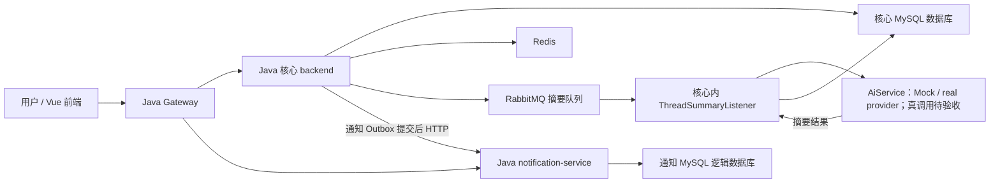
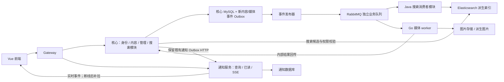

# 同频：产品开发与技术演进报告

日期：2026-10-15。版本：1.0。适用项目：BlueAlbum／同频。

实施进度另见[分阶段推进记录](stage-progress.md)，复现入口见[M0 运行时验收维护说明](m0-runtime-verification.md)。下文保留规划时的现状快照和估算；已完成项以阶段记录和对应验收产物为准。

本报告合并“后续产品开发方向”和“技术进阶拓展方向”，并补充微服务拆分、Go 引入、实施依赖、工作量和验收说明。**现状是源码或已有验收证据；路线、目录、接口、指标和工作量是建议，尚未实施。** 本次编写只读核对源码及既有证据，没有运行服务、修改业务实现或迁移数据库。

## 1. 建议采用的总体路线

同频的目标继续是中文兴趣社区：用户能找到讨论、舒适阅读、发帖、回复并管理自己的内容。界面保留冰蓝／靛蓝、内容优先、手机与键盘可用的既有约定，详见 [产品约定](../../PRODUCT.md)。

建议按五个里程碑推进：

1. **M0：可靠运行与整站验收。** 完整容器部署、浏览器业务链路、权限隔离、备份恢复与自动测试。
2. **M1：社区体验与模块边界。** 编辑器、草稿、阅读和回复体验，同时明确核心内部模块接口并建立基本观测。
3. **M2：全文搜索与可靠内容事件。** 将数据库内容变更可靠同步到 Elasticsearch，验证更新、隐藏、重试和索引重建。
4. **M3：Go 媒体处理与实时通知。** 用一个职责明确的 Go worker 实践跨语言服务协作；用 SSE 提升通知体验。
5. **M4：社区管理与真实 AI。** 完成角色、审核恢复和操作记录；真实摘要通过验收后再开展带引用的站内知识问答。

这条路线把产品收益和技术学习对应起来：搜索服务解决内容发现，Go 图片处理改善发帖与阅读，事件机制支撑补处理，可观测性解释故障与延迟，自动测试证明升级没有破坏已有行为。

当前更合适的下一步是 M0。若希望尽早展示技术深度，可以在 M0 通过后，以 M2 作为第一个重点成果。Go 是明确的后续落地项，不要求先重写现有 Java 核心。

## 2. 当前基础与证据边界

### 2.1 已有能力

| 范围 | 当前实现或配置 | 本报告能确认的边界 |
| --- | --- | --- |
| 前端 | Vue 3、TypeScript、Pinia、Vite；统一品牌与界面约定 | 有 lint、类型检查、单元测试、构建配置；全站视觉和浏览器流程仍需统一验收 |
| Java 应用 | 核心 backend、gateway、notification-service；根 POM 为 Spring Boot 4.0.0、Java 21 | 有三个应用边界，不等于核心各业务域已经独立微服务化 |
| 业务能力 | 注册登录、分区、帖子、评论、关注、点赞、收藏、通知、基础举报 | 有前后端流程；完整浏览器端到端、恢复和公网运行验收尚未统一完成 |
| 数据 | 核心 MySQL；通知独立逻辑数据库和 Flyway 历史 | 可以共用一个 MySQL 实例，但逻辑库与表归属不同 |
| 缓存 | Redis 用于读取加速和状态等 | 帖子缓存失效已安排在事务提交后；不能宣称严格并发一致性 |
| 通知 | 核心通知 Outbox → HTTP → 独立通知服务；UUID 去重 | 是通知域的可靠投递，当前不通过 RabbitMQ 投递通知 |
| RabbitMQ | 已有 AI 帖子摘要队列与 Java listener；默认关闭，本地启动脚本可开启 | 队列消费者仍在核心应用内；独立 AI worker 是后续方案；本报告未检查当前运行开关 |
| AI | 真实模型适配器和 Mock 已有源码；聊天支持 SSE | 本地 profile 使用 Mock；存在真实适配器不代表真实模型调用已验收 |
| 图片 | Java 上传 API、存储 provider；本地存储可用 | 当前上传返回图片地址，未形成独立 Go 图片处理任务链路 |
| 搜索 | 发现页使用线程列表 API；JPA 查询用标题／正文 LIKE 条件 | 全文索引、相关性排序和可靠索引同步是新增工作 |
| 管理 | 配置邮箱定位一个持久化管理员；举报可驳回或隐藏 | 没有完整持久化角色、版主范围、封禁和恢复闭环 |
| 观测 | 健康检查、请求 ID、有限请求日志；核心有 Prometheus 依赖和 perf 配置 | 不等于已有完整指标采集、看板、链路追踪和告警 |
| Nacos | 有依赖和 cloud 配置 | local／compose 关闭发现和配置，不是本地必需运行组件 |
| Go | 主要源码与工程清单未发现 Go 模块 | Go 服务是本报告建议新增的部分 |

依据包括 [根 POM](../../pom.xml)、[前端配置](../../frontend/package.json)、[运行说明](../../README.md)、[Compose](../../docker-compose.yml)、[通知投递说明](notification-delivery.md)，以及第 15 节的源码索引。

### 2.2 已保存的验收证据

2026-10-15 的本机验收报告记录：Java 236 项测试通过，其中 backend 207、gateway 6、notification-service 23，失败、错误、跳过均为 0；独立真实 MySQL 通知验证 13 项通过。前一轮前端记录为 108 项测试通过，本轮没有重复运行前端测试。

本机证据位于 `outputs/runtime-verification-20261015/review.md`、`java-summary.json`、`isolated/checks.json` 和前轮 `outputs/maintenance-20261014/completion.md`。这些是被忽略的本机产物，克隆仓库不保证包含它们。数字属于当时的验收记录，不表示本报告编写时再次执行了这些测试。

通知运行证据覆盖停机后的排队与重试、接收端重启后的投递、MySQL 回读、同 UUID 重放去重、负载冲突 409 和收件人隔离。它没有覆盖完整浏览器流程、完整 Compose 镜像、公网部署、真实 AI 或性能容量。

### 2.3 规划时的历史发现与当前对应

本节保留规划核对时的历史发现，不代表当前工作树仍存在这些缺陷。当前实现和
验收状态以[分阶段推进记录](stage-progress.md)、[测试说明](../../tests/README.md)
和 [Compose 配置](../../docker-compose.yml) 为准；只有重新核对当前资料后，历史
发现才应重新列入待办。

| 规划时的历史发现 | 规划快照依据 | 当前对应与状态 | 需要重新立项时的验证方法 |
| --- | --- | --- | --- |
| 最近浏览的清除键与保存键不一致 | 侧栏删除 `recent_visits_v1`；实际保存键含账号或 `guest` 后缀 | M0 实施范围已记录最近浏览按账号清除与切换；见[分阶段推进记录](stage-progress.md)。最终浏览器验收仍以实际产物为准。 | 使用共享清除函数，验证当前账号清空、其他账号记录保留、侧栏立即更新 |
| 发帖草稿使用固定键 | 发帖使用 `thread-draft-v1`；需明确多账号和退出登录的处理规则 | M0 实施范围已记录草稿按账号或访客隔离；见[分阶段推进记录](stage-progress.md)。最终浏览器验收仍以实际产物为准。 | 定义账号隔离和迁移规则，测试切换账号、刷新、发布成功后的清理 |
| Python 测试说明引用旧配置路径 | 根目录已有 `pytest.ini`；规划快照中的命令仍写 `-c tests/pytest.ini` | 当前[测试说明](../../tests/README.md)已从仓库根目录使用根 `pytest.ini`；该历史文档问题已修正。 | 从新工作区执行收集，并在隔离环境实际执行目标场景 |
| 完整 Compose 的核心未显式等待通知服务健康 | 规划快照中 backend 仅依赖数据库、Redis、RabbitMQ；gateway 等待两个应用 | 当前[Compose 配置](../../docker-compose.yml)的 backend 已等待 notification-service 健康；M0 交付记录见[分阶段推进记录](stage-progress.md)。完整运行验收仍以实际产物为准。 | 用新库与已有库分别验证 V3 → Outbox 迁移和启动 |

上述是规划快照中的静态代码／文档记录，不能替代当前实现检查或本轮浏览器复现。若当前证据再次显示问题，才应进入 M0／M1 待办；演示仍不能把接口存在当作功能可靠。

## 3. 合并后的优先级

| 优先级 | 产品成果 | 技术工作 | 依赖／退出条件 |
| --- | --- | --- | --- |
| P0 | 新电脑能部署，用户完整操作后数据可靠保留 | Compose 验收、浏览器测试、权限回读、备份恢复、CI 环境 | M0 必须形成可重复的运行证据 |
| P1 | 阅读、发帖与回复顺畅 | 本地草稿隔离、编辑器状态、上传错误恢复、手机与键盘验证 | 基本业务链路通过；不改变品牌定位 |
| P1 | 搜索更准确、结果及时更新 | Elasticsearch、内容事件 Outbox、RabbitMQ、幂等索引消费 | 明确可见性、事件版本、重建和故障降级 |
| P1 | 图片处理与通知状态可反馈 | Go 媒体 worker、任务状态、SSE、断线补拉 | 先有可靠任务和收件箱持久化，再推送状态 |
| P1 | 管理操作可追溯 | 持久化角色、版主范围、审核恢复、审计记录 | 服务端权限判定与越权测试通过 |
| P2 | 真实摘要与站内问答 | 真实 provider、模型预算、版本化任务、RAG、引用与评测 | 先完成真实摘要；检索结果遵守当前权限 |
| P2 | 独立扩展和部署更多服务 | 搜索／AI 的独立部署，后续身份服务拆分 | 有独立扩缩容、故障隔离或团队职责的明确需要 |

“技术进阶”不是单独的一批配置工作。每一项应同时交付用户能感知的变化、故障处理规则和验证证据。

## 4. 当前架构与演进目标

### 4.1 当前架构



图中两个数据库目前可以位于同一实例。通知投递与摘要队列是两条不同链路。Gateway 是路由与请求关联层，论坛业务规则继续由核心承担。

### 4.2 第一阶段演进目标

建议暂时保持现有三个 Java 应用，增加一个 Go 媒体 worker；搜索先作为核心中的独立模块运行，Elasticsearch 是可重建的派生数据。观测组件按需启动。



这是建议图，不代表目前已有这些组件。Go 首版承担异步处理，用户上传鉴权与业务数据归属仍由 Java 入口处理。搜索消费者首版可以与核心部署在同一 JVM，后续在接口与数据边界稳定后再独立。

## 5. 微服务拆分：边界、顺序与成本

### 5.1 先明确“模块”和“服务”

模块是同一应用内的职责边界；服务是可以独立运行、部署并承担故障处理的进程。把 controller、service、repo 分成目录，或者把一个 Maven 工程拆成几个子模块，都不能单独证明业务已经微服务化。

一个候选服务至少要说明：负责的业务、数据所有者、对外接口、同步／异步交互、身份来源、超时、重试、恢复、日志和部署。建议用架构决策记录逐项固定，之后再开始迁移。

核心当前跨用户、帖子、分区仓储查询，数据库也有外键。先将跨域访问收敛到明确的应用接口，再减少外域实体／仓储直读，能降低后续拆分中的分布式事务与查询改造成本。可评估 Spring Modulith 做模块验证和接口约束；它是可选治理工具，需先验证与当前 Boot 4.0 的依赖兼容，现有边界检查仍继续使用。[官方模块说明](https://docs.spring.io/spring-modulith/reference/fundamentals.html)

### 5.2 候选服务划分

| 候选 | 业务与数据归属 | 建议时机 | 主要成本 |
| --- | --- | --- | --- |
| notification-service | 收件箱、已读、通知去重；核心继续判定业务事件与发送偏好 | 已独立，优先完善 SSE 与观测 | 连接恢复、跨实例推送、通知事件兼容 |
| Go media worker | 图片变换执行与输出；首版不拥有用户或帖子表 | 第一项 Go 服务 | 消费幂等、任务回传、存储权限、图片资源限制 |
| search-service | 搜索查询、索引同步、重建；不拥有帖子权威数据 | 搜索模块稳定后再独立 | 事件乱序、权限过滤、重建、故障降级 |
| ai-worker | 模型调用、任务执行、用量与执行证据 | 真实摘要及任务模型稳定后 | 长耗时、费用、取消、旧结果防覆盖 |
| identity-service | 用户、认证、账号生命周期与身份接口 | 后期、有明确独立需求时 | JWT 签发验证、撤销、角色更新、资料投影与历史 ID |
| content-service | 帖子、评论、分区、标签、内容可见性及关联互动 | 核心长期主体，后续可从 backend 演进 | 事务、跨表查询、审核规则、计数与分页 |
| moderation-service | 举报流程和审计；通过内容所有者执行隐藏／恢复 | 管理流程规模增加后再评估 | 权限归属、命令授权、失败补偿、审计完整性 |

首轮没有必要同时建立独立身份、评论、点赞、收藏、排行榜服务。它们目前与内容或身份关系紧密；拆分收益需要通过实际负载、故障和组织边界证明。管理中的“隐藏内容”应最终由内容所有者执行，避免审核服务直接写帖子数据库。

### 5.3 数据与认证原则

- **数据所有者唯一。** 其他服务通过接口或事件获取信息，不用另一服务的数据库账号读写业务表。Go worker 无需为了“服务独立”单独增加一个数据库。
- **同一 MySQL 实例可以承载多个逻辑库。** 各服务使用独立账号、迁移历史和最小权限；独立实例是资源或隔离需要，不是首版前置条件。
- **跨服务只传 ID 与必要契约。** 不传 JPA Entity，也不让 Go 依赖 Java 内部类。用户名、头像等读模型要声明同步延迟和兜底规则。
- **Gateway 不能成为唯一鉴权点。** 资源所有者验证当前用户和操作权限，内部调用使用独立服务身份。身份服务拆分时需单独设计签名密钥、轮换与撤销语义。
- **避免同步调用成链。** 用户发帖的同步路径尽量限定在核心事务；索引、图片变换等通过持久化任务异步处理。

### 5.4 迁移步骤

1. 写出业务边界、数据表归属和契约，建立现有行为的集成测试。
2. 在当前应用内用接口隔开实现，保留稳定的浏览器 API。
3. 新服务先处理独立任务或执行只读影子验证，不产生两份互相冲突的权威写入。
4. 数据迁移时定义回填、增量同步、校验、写入切换和回退顺序；任一时刻保持一个权威写入者。
5. 切换路由或适配器后，复验鉴权、读回、重启和依赖停机。
6. 删除旧路径前确认回退窗口、旧数据保留策略和事件消费进度。

新增一个服务会增加构建、镜像、配置、凭证、健康检查、日志、告警、部署与回退工作。因此服务数量应按阶段增加，首个 Go 服务证明完整协作流程后再考虑第二个跨语言服务。

## 6. Go 的具体落地方案

### 6.1 首选：异步媒体处理

推荐首版处理 JPEG／PNG 的尺寸识别、缩略图和受控压缩。用户上传接口继续保留 `POST /api/v1/uploads/images`、multipart 字段 `file` 和返回图片地址的兼容性。当前 Java 实际返回 `url`，前端也兼容 `path`；首版保持现有 Java 返回契约。原图可先用于内容，派生图片在任务完成后由新增资源查询提供。新增异步任务不能直接把原接口从 200＋url 改成 202＋jobId，否则现有编辑器会被破坏。

建议流程：

1. Java 校验当前用户与上传限制，保存原图并建立资源元数据。
2. 核心数据库同一事务写入 `media_job` 与媒体请求事件；原图对象写入和 SQL 事务不是原子操作，需定义失败后的孤立对象清理与对账。
3. 发布器将事件发送到媒体队列，Go worker 获取受控对象键，读取原图并处理。
4. Go 按资源 ID、任务版本和变换规格生成确定的输出键，完成上传。
5. Go 调用 Java 内部结果接口；Java 以任务 ID＋版本进行幂等落库，必要时在同一事务中写完成事件。
6. **只有 Java 持久化接受结果后，Go 才确认请求消息。** 回传超时或崩溃允许重试，已存在输出可复用；同版本不同结果应报告冲突。

首版 Java 拥有资源权限、任务状态和业务关联，Go 拥有处理执行。这样 Go 可独立扩容或停机，论坛仍能阅读已有原图。后续确有需求，再将媒体元数据整体迁到独立媒体服务。

### 6.2 Go 工程范围

建议新增以下目录；它们目前不存在：

```text
services/media-service/
  go.mod
  go.sum
  cmd/media-worker/main.go
  internal/config/
  internal/consumer/
  internal/processor/
  internal/storage/
  internal/coreclient/
  internal/telemetry/
  Dockerfile
  README.md
contracts/
  events/media-processing-requested-v1.schema.json
  events/content-changed-v1.schema.json
  openapi/media-internal-v1.yaml
```

Go 官方对服务项目建议将内部实现放在 `internal`、命令入口放在 `cmd`，适合这里的独立 worker。[Go 工程组织说明](https://go.dev/doc/modules/layout)

Go 可先使用标准 HTTP、context 和结构化日志，加 RabbitMQ 团队维护的 `amqp091-go`；具体版本在实施时锁定并验证。RabbitMQ 的 Go 工作队列教程可用于学习消息确认和持久化。[客户端](https://github.com/rabbitmq/amqp091-go)、[Go 工作队列教程](https://www.rabbitmq.com/tutorials/tutorial-two-go)

### 6.3 必须具备的运行能力

| 能力 | 实施说明 | 验收例子 |
| --- | --- | --- |
| 并发控制 | 有限 worker、队列 prefetch 与处理预算；不能无限创建 goroutine | 大图批量进入后，内存和并发保持在设置范围 |
| 输入校验 | 以真实解码结果校验格式、尺寸、像素数；对象键由服务签发 | 超限或伪装文件产生明确失败结果，不无限重试 |
| 取消与退出 | context 超时、停止接新任务、等待或安全放弃在途任务 | 停机后未确认任务能再次消费 |
| 幂等 | 稳定输出键、任务版本、幂等回传 | 同任务重复 10 次只有一份有效任务结果 |
| 消息恢复 | 重建连接、channel 和消费者，验证异常退出恢复 | RabbitMQ 重启后恢复处理；不能假定客户端自动完成所有恢复 |
| 服务身份 | 独立内部凭证、最小存储权限、不直接写核心表 | 无凭证回传被拒绝，旧版本结果不能覆盖新版本 |
| 观测 | jobId／eventId 关联日志、时长、失败数、队列积压 | 能从上传找到一次 Java → Go → Java 的执行记录 |
| 测试与构建 | `go test ./...`、`go test -race ./...`、`go vet ./...`、镜像运行测试 | 正常图、坏图、超时、重放和中断都有证据 |

Go 的引入价值是学习跨语言契约、并发和独立 worker 生命周期；实际 CPU、内存和吞吐收益要以同规格压测测量，不预先宣称替换 Java 一定更快。

建议媒体任务状态为 `PENDING → PROCESSING → SUCCEEDED / FAILED / CANCELLED`，由 Java 持久化和校验转换。用户重新处理建立新任务版本，自动重投保持原 eventId；版本与执行尝试次数分开。已完成结果的重传可返回相同结果，旧版本或已取消任务的回传不能覆盖有效状态。永久处理失败也要先记录失败结果或进入可检查的隔离流程，再结束消息处理。

媒体任务可能耗时更长，不能照搬通知的 30 秒租约。需要根据处理预算设计任务超时、在途保护及恢复，长任务可使用心跳或续租；任务租约、broker 消费确认与 HTTP 回传超时是不同控制项。存储中已写出而尚未被业务接受的图片也要纳入对账与清理策略。

### 6.4 其他 Go 候选的取舍

| 候选 | 适用条件 | 当前建议 |
| --- | --- | --- |
| 媒体 worker | 有上传与派生图片需求，任务边界清楚 | 首选 |
| 搜索索引 worker | 想练习事件消费与索引更新 | 可以后续尝试，但首轮 Java 搜索与 Go 媒体更容易划清职责 |
| 实时连接服务 | 大量长连接且需要独立扩展 | 先在通知服务做 SSE；获得连接数和资源数据后再决定 |
| 身份／论坛核心重写 | 明确长期迁移目标，有充分兼容测试与迁移资源 | 当前不列入首轮；会涉及较多事务、权限和数据迁移 |

## 7. 全文搜索与可靠事件

### 7.1 产品范围

首版搜索覆盖公开、正常状态的帖子：标题与正文相关性、分区／标签筛选、更新时间排序、适量摘要和安全高亮。输入联想可以在检索稳定后增加。用户搜索与帖子搜索继续保持不同资源边界。

Elasticsearch 的 `text` 字段用于分析后的文本检索，`search_as_you_type` 支持输入过程中匹配；中文分析器、同义词与分词效果需通过项目自己的词例评估，不能认为默认配置已满足中文社区。[文本字段](https://www.elastic.co/docs/reference/elasticsearch/mapping-reference/text)、[输入联想字段](https://www.elastic.co/docs/reference/elasticsearch/mapping-reference/search-as-you-type)

### 7.2 索引与数据归属

建议索引包含 threadId、title、正文纯文本、sectionId、tagIds、authorId、status、updatedAt、contentVersion、schemaVersion。MySQL 是内容与权限的权威来源，Elasticsearch 是可以从数据库重建的派生索引。

现有通知 Outbox 带收件人、通知类型、偏好规则和通知生命周期，不能把搜索更新伪装成某个用户通知。建议单独设计内容事件表／发布器；可以复用经过验证的租约、重试思路，但表结构、状态与完成语义需要重新定义。

候选链路是：内容事务 → 内容事件 Outbox → RabbitMQ → 搜索消费者 → Elasticsearch。内容修改和事件记录必须同事务提交；若事件写入失败，该内容操作按契约回滚。不要只在提交后发一个可能丢失的内存事件。

### 7.3 内容事件和媒体事件共用的最低契约

| 字段 | 用途 |
| --- | --- |
| eventId | 固定 UUID，重复投递保持不变 |
| eventType／schemaVersion | 区分业务和版本，避免消费者误读新格式 |
| aggregateId／aggregateVersion | 内容或任务 ID 与版本，识别旧事件、乱序和覆盖风险 |
| occurredAt | 事件产生时间，不作为唯一顺序判据 |
| traceparent／correlationId | 请求与异步执行关联；允许后台任务没有原浏览器请求 |
| payload | 必要数据或受控引用，不带密码、用户 JWT 或存储密钥 |

新增消息的长整型 ID 建议统一为十进制字符串并在 Java／Go 边界解析；既有浏览器 HTTP 契约保持兼容。线程目前没有专门内容版本字段，新增 `contentVersion` 也是迁移工作，不能用时间戳简单替代可靠版本控制。

消息格式与业务接口应通过 JSON Schema／OpenAPI 和 Java、Go 两端契约样例验证；首版可以继续 HTTP＋JSON 和 AMQP，不要求同时引入 gRPC。

### 7.4 RabbitMQ 的可靠性要求

发布端需要确认 broker 接受消息并处理无法路由的情况；确认不代表消费者已经完成。消费端在有效结果持久化后才确认消息，重传与重投必须可幂等处理。重要队列与消息应有合适的持久化配置。[RabbitMQ 官方可靠性说明](https://www.rabbitmq.com/docs/reliability)

以下是本项目建议的应用规则：

- 发布器确认成功后标记事件为 **PUBLISHED**，不称为业务“已完成”；消费者执行状态和索引延迟另行观测。
- 每类用途使用独立队列，例如搜索更新与媒体任务；不能让不同用途竞争消费同一个工作队列。
- 对瞬态错误做有上限的退避；无效负载或永久错误进入可检查的失败／死信流程，避免无限立即重新入队。
- 用聚合版本避免旧事件覆盖新内容；删除／隐藏后保留版本或墓碑信息，防止旧创建事件把内容重新带回。
- 去重记录和外部写入不是天然原子事务。索引写入使用稳定 document ID 与版本规则，再完成消费记录；崩溃后的重复处理应安全。
- 重放仍须遵守当前资源版本和可见性，不能因重放成功恢复已被隐藏的旧内容。

### 7.5 权限、重建与降级

搜索结果返回标题、摘要、高亮前，应通过当前权威权限校验，避免隐藏内容在索引延迟期间泄漏。分页总数、是否还有结果及过滤后的数量需要定义专门响应语义，不直接暴露未授权命中数或复用错误 total。

高亮按允许标签处理并进行安全渲染。重建使用新索引、基线回填、增量补齐、样本／版本校验和别名切换；保留旧索引以便回退。重建期间的事件保留与同步进度必须覆盖回填窗口。

Elasticsearch 不可用时，可以按已定义的条件降级到现有数据库搜索，并告知能力差异；发帖仍由权威数据库事务决定。记录降级比例，不能悄悄把错误伪装成“没有结果”。

### 7.6 搜索验收

至少验证：新帖出现、编辑更新、隐藏／删除不可泄漏、重复事件、事件乱序、消费者停机恢复、broker 重启、索引故障、重建切换和中文检索质量。使用固定的数据集和负载报告 P50／P95、错误率、索引更新延迟；性能目标在基线测量后确定，历史压测数字不能直接作为新目标已达成。

## 8. 可观测性与自动化验证

### 8.1 可观测性的首轮范围

在现有健康检查和请求 ID 基础上，补三类证据：指标回答“哪里异常”，追踪回答“一次操作经过哪里”，日志回答“具体发生什么”。Spring Boot 使用 Micrometer Observation 支撑指标与追踪；线程切换与异步任务需要显式考虑上下文传递。[Boot 4.0 系列官方说明](https://docs.spring.io/spring-boot/4.0/reference/actuator/observability.html)

建议先接入 Prometheus／Grafana 指标，再使用 OpenTelemetry／OTLP 和一个追踪后端。Go 可通过 OpenTelemetry SDK 接入相同追踪体系。[Go 官方 OTel 说明](https://opentelemetry.io/docs/languages/go/)

| 指标类别 | 需要回答的问题 |
| --- | --- |
| API 时长与失败率 | 注册、发帖、搜索是否变慢或失败 |
| DB／Redis 连接与缓存回退 | 连接池是否不足，缓存故障是否影响权威读取 |
| Outbox 数量与最老待处理时间 | 事件是否长时间未发布或投递 |
| RabbitMQ 就绪／未确认消息与失败任务 | 消费是否停滞或反复重试 |
| 搜索同步延迟与降级次数 | 用户为什么搜不到刚更新的内容 |
| 媒体时长、失败类别与资源使用 | 图片处理是否被大图或某格式拖慢 |
| AI 调用时长、用量和失败 | 真实调用是否耗时、超预算或失败 |

每个新增服务要有 liveness／readiness 区分，不能把所有可选下游短时故障都当成进程应重启。日志和指标不得记录密钥、Token 或完整私人正文；userId／threadId 不作为无上限指标标签，使用受控维度和必要追踪字段。

告警先覆盖三种实际故障：待处理事件积压、搜索消费者停机、媒体任务持续失败。阈值基于测得的正常区间与验收预算，测试告警恢复和去重。

### 8.2 自动化验证分层

| 层次 | 当前基础 | 建议补充 |
| --- | --- | --- |
| 静态与模块单元 | Java、Vue、目录和依赖检查 | 保留现有门禁；为新增 Go 和契约增加检查 |
| 真实组件集成 | 已有独立真实 MySQL 通知验证脚本 | Testcontainers 的 MySQL／RabbitMQ 等组件测试，验证迁移、唯一约束、事务与重启 |
| 浏览器业务 | 已有 Selenium／Playwright 场景 | 选定关键场景实际运行；先复用现有测试，避免同时改测试框架与业务 |
| 完整部署 | Compose 和 Dockerfiles 有配置 | 构建镜像、健康等待、接口／UI 验证、重启与数据读回 |
| 故障与容量 | 已有通知故障验收、perf 材料 | 事件乱序、重复、停机、资源限额与同条件负载对比 |

Testcontainers 的 MySQL 模块可以在测试中启动真实数据库；应固定镜像版本、独立账号与数据、设置等待和清理策略，避免每个小单元测试都启动一套容器。[官方 MySQL 模块](https://java.testcontainers.org/modules/databases/mysql/)

当前 CI 运行 Java 测试与前端检查，但 Python job 只编译和收集，不执行 API／浏览器用例。新增 CI 需要准备隔离服务与账号、安装浏览器并真正运行目标场景，保存必要日志和失败证据。[Playwright Python CI 文档](https://playwright.dev/python/docs/ci)

## 9. 社区体验、草稿与实时通知

### 9.1 发帖和阅读

首轮体验工作聚焦三个操作：找到讨论、写出帖子、收到并定位回复。

- 编辑器保存与提交状态清晰；上传失败保留用户文本，允许重试；防止重复提交。
- 发帖草稿先完善账号隔离和本机恢复，再设计后端同步。编辑页的草稿也需明确范围。
- 手机检查导航、正文宽度、代码块、长标题、表单和评论；键盘能到达操作，焦点可见。
- 已有评论锚点和通知跳转保留，测试跨页评论定位、被隐藏内容、失效链接以及已读失败处理。
- 最近浏览继续标明本机范围；清除与账号切换通过共享状态入口处理。

跨设备草稿需要后端所有权、资源 ID、版本字段和冲突规则。建议保存时提交预期版本，冲突时保留双方内容供恢复；不能用“最后请求到达者覆盖”处理两个设备的编辑。离线队列、内容大小限制和过期清理应单独设计。

### 9.2 SSE 通知

当前通知菜单按用户操作刷新，并没有固定间隔通知轮询；AI 聊天的 SSE 是另一条已有链路。新增站内推送可优先使用 SSE，Spring MVC 提供 `SseEmitter` 支持。[Spring SSE 文档](https://docs.spring.io/spring-framework/reference/web/webmvc/mvc-ann-async.html#webmvc-http-streaming-sse)

建议顺序是通知落库后推送收件箱变化，客户端收到事件后更新或重新查询。数据库仍是权威收件箱，SSE 断开不丢已持久化通知；重连后按游标或明确查询补拉。

必须定义连接鉴权、Token 过期／退出登录、多标签页、心跳、退避、游标、未读计数一致性和资源释放。原生 EventSource 的认证方式要与现有 Bearer 方案匹配，可评估已有 fetch 流式方式；不能为方便连接把长期 Token 放进 URL。

Gateway 现有普通响应预算不能照搬给长连接，需要专门流式路由、超时和代理缓冲设置。通知服务多实例时，事件必须送到持有目标连接的实例；仅采用竞争消费者队列会漏掉其他实例的连接，应另行设计广播／连接归属，首版单实例先验收。

## 10. 社区管理与权限

建议先将权限做成核心内的独立模块，完成普通用户、分区版主、管理员的操作矩阵。UI 隐藏入口只能改善体验，服务端必须判定角色、资源归属与版主分区范围。

| 功能 | 首轮内容 | 验收重点 |
| --- | --- | --- |
| 角色与范围 | 持久化角色、版主负责分区、角色变更记录 | 普通用户与其他分区版主不能操作；角色撤销后按约定及时失效 |
| 内容审核 | 既有驳回／隐藏，增加原因与恢复 | 隐藏和恢复同步影响详情、列表、搜索、AI检索和通知链接 |
| 用户处理 | 限时／长期发帖限制及理由 | 登录、浏览、发帖、评论分别定义影响，不只增加一个按钮 |
| 操作记录 | 操作者、对象、动作、理由、时间、关联 ID | 数据与操作结果匹配，敏感正文和凭证不进入审计 |
| 分区管理 | 创建、编辑、归档与版主配置 | 既有帖子归属、历史链接和标签行为明确 |

现有单邮箱管理员方式保留为兼容启动方案或迁移入口，后续建立明确的初始管理员引导和数据迁移。拆身份／审核服务前，先把角色检查和内容操作分别收敛到其所有者接口。

## 11. 真实 AI 与 RAG

### 11.1 先完善真实摘要

当前已有真实 provider、Mock 和摘要队列，因此首轮重点是可靠任务语义与真实调用验收：内容版本、任务 ID、状态、超时、失败类别、重试、取消、用量和权限。

当帖子修改后，旧摘要任务即使晚返回也不能覆盖新内容版本；用户点击“重新生成”要有明确的强制重试语义。真实 key 从私有配置读取，报告只记录模型标识、状态、时长和必要用量，避免收集敏感内容。

完成一组正常、长文本、模型故障、超时、旧版本返回、重复任务和额度耗尽的验收后，再考虑独立 ai-worker。它读取授权内容快照，通过版本化结果接口回传，不直接写帖子表。

“真实调用通过”至少要求确认该测试运行配置为 `provider=real`，记录模型标识、请求关联 ID 和脱敏 provider 响应证据，再读取 `threads.summary`、`summary_status` 及对应内容版本。可另用可控假服务验证协议与超时，但不能把它或 Mock 的成功结果算成外部真实模型验收；仅 HTTP 成功和状态 COMPLETED 不足以证明。

### 11.2 RAG 的范围

RAG 是先检索相关内容，再让模型基于这些材料回答。Spring AI 提供模块化检索增强能力；选用框架前仍需与现有 provider、依赖管理和任务模型对齐。[RAG 官方说明](https://docs.spring.io/spring-ai/reference/api/retrieval-augmented-generation.html)

建议首版仅使用正常、公开帖子，返回可打开的原帖引用；证据不足时清楚说明检索不足。流程为正文清洗 → 分段 → 向量生成 → 版本化索引 → 检索 → 当前权限校验 → 生成 → 引用展示。

需要建立自有评测集，例如 30 个问题，分别考察命中、引用是否支持回答、无材料时的行为、隐藏内容过滤、延迟与费用。帖子内容属于待分析数据，不能把其中“忽略规则”等文字当成系统指令；首版问答不开放任意外部工具执行。

如已有 Elasticsearch 满足向量需求，可先评估同一检索基础，避免立即增加第二套数据库；最终选择取决于检索质量、权限过滤和资源测试。混合检索、重排和多步 Agent 是后续实验项。

截至本次查阅，Spring AI 2.0.x 官方声明支持 Boot 4.0.x／4.1.x；项目根 POM 当前是 Boot 4.0.0。实施时锁定经过项目验证的稳定版本，不直接复制最新文档中的依赖组合。[兼容说明](https://docs.spring.io/spring-ai/reference/getting-started.html)

## 12. 里程碑、工作量与交付物

工作量是规划估算，单位为人日：一个人投入约一个完整工作日。假设开发者熟悉当前项目、依赖可获取、需求保持本报告的首版范围；不包含学习新语言的全部时间、环境故障或外部服务等待。第一阶段结束后再校准，不能将人日直接当作承诺日期。

| 里程碑 | 主要交付 | 建议工作量 | 完成门槛 |
| --- | --- | --- | --- |
| M0 | Compose 实跑、关键浏览器链路、备份恢复、测试入口一致 | 5–8 人日 | 注册到通知和举报链路有持久化／权限证据，恢复后数据与图片一致 |
| M1 | 体验修复、草稿隔离、核心模块接口、基础观测 | 6–10 人日 | 手机／键盘与账号切换通过，关键操作能追踪，模块边界有检查 |
| M2 | 内容事件、全文搜索、重建、失败恢复 | 8–14 人日 | 修改／隐藏／乱序／重放／停机／重建均正确，中文检索基线记录 |
| M3 | Go 媒体 worker、Java-Go 契约、SSE 单实例 | 10–16 人日 | 图片任务持久化回读、幂等回传、消费恢复、通知断线补拉通过 |
| M4A | 角色、版主范围、审核恢复、审计 | 7–12 人日 | 越权与撤销测试通过，审核结果影响所有读取路径 |
| M4B | 真实摘要；可选首版 RAG | 摘要 4–7；RAG 另 8–15 人日 | 真调用、预算与旧结果保护通过；RAG 有评测与引用证据 |

截至 M3 的估算合计 29–48 人日；它是任务工作量，不是团队按人数简单相除后的日历时长。开发 Go 若需要从基础学习，必须额外留出学习与联调时间。

M1 的界面与模块任务可以在接口固定后分工；M2 消费契约稳定后 Go 原型可以与搜索测试并行。数据迁移、发布切换、角色语义和跨语言消息契约仍由一个明确的负责人统筹验收。

## 13. 第一批可执行任务

| 编号 | 任务与允许改动范围 | 交付物／验收 |
| --- | --- | --- |
| R01 | 整理运行与测试入口；README、tests 文档、已有脚本 | 配置路径统一；新工作区按说明完成测试收集；证明目标用例实际执行 |
| R02 | 最近浏览清除、草稿账号隔离；相关 composable、侧栏、发帖页 | 共享清除入口；账号切换和刷新测试；不删除其他账号数据 |
| R03 | 完整 Compose 迁移启用与运行验收；Compose、Dockerfiles、测试脚本 | 新库与已有库分别验证顺序；不依赖用户已有容器；测试资源可靠清理 |
| R04 | 关键浏览器场景；tests 下既有测试树 | 注册、登录、发帖、评论、收藏、通知、举报，包含反向权限和重启回读 |
| R05 | 备份恢复与观测基线；运维脚本／配置 | 恢复到独立环境，校验账号、帖子、通知和图片；记录基础资源与延迟 |
| R06 | 架构契约；docs 与 contracts 建议目录 | 内容／媒体事件、状态、版本、权限、数据归属与回退策略确定 |
| R07 | 内容事件与搜索模块；核心相应业务域、迁移、消费者 | MySQL 事务与事件原子提交；确认／幂等／乱序／隐藏／重建有测试 |
| R08 | Go 媒体原型；services/media-service 建议目录及契约测试 | 合成图片任务可处理，回传落库后再确认；有资源限制和退出测试 |
| R09 | SSE 与管理角色；通知服务、核心权限模块、前端对应页面 | 持久化通知补拉与Token生命周期通过；权限矩阵不依赖前端按钮 |

首轮执行 R01–R05；在边界确定前不把服务拆分、目录重命名、依赖大升级和数据迁移混进同一改动。每项记录目标、修改文件、验证方法、实际结果及剩余限制。

## 14. 资源预算、部署与回退

### 14.1 本地资源

现有工程定义了 MySQL、Redis、RabbitMQ、三个 Java 应用和前端，并有部分链路的既有运行证据；本报告没有检查它们此刻是否运行。新增 Elasticsearch、Go worker 和观测组件都会占用内存、磁盘及启动时间，应按功能拆 Compose profile，逐阶段测量工作集和磁盘增长。预算依据目标机器与实际测量制定，本报告不声明某个固定内存一定足够。

建议基础 profile 运行社区；search profile 增加 Elasticsearch；media profile 增加 Go；observability profile 增加采集与看板。这些是待设计的部署配置。压测时保留 CPU／内存限制、数据规模、连接数和冷／热缓存条件，Java 与 Go 比较使用相同处理规格。

### 14.2 公网部署作为单独里程碑

完整 Compose 本地验收通过后，公网部署还需确定域名与 TLS、代理入口、认证验证模式、密钥与数据库账号、备份、上传持久化、公开端口、更新和回退流程。当前本机配置关闭部分认证验证并使用 Mock，不能直接拿来作生产配置。

首版可用单机 Compose，在明确资源、可用性或学习需求后再引入 Kubernetes。Nacos、gRPC、服务网格和更多消息系统同样按具体需求评估；现有 Compose 固定服务名足以支持第一批独立服务的发现与连接。

### 14.3 回退与降级

| 新能力 | 故障或发布回退方式 | 必须保留的证据 |
| --- | --- | --- |
| 搜索 | 暂停消费者、按约定降级 DB 查询、回切旧索引 | 权威内容与事件记录、版本、同步进度 |
| Go 媒体 | 停止接任务、重试未确认任务、继续使用可访问原图 | 任务状态、对象键、派生图版本，不能删除原图 |
| SSE | 回到菜单查询与断线补拉 | 持久化收件箱与已读状态 |
| AI | 保留旧有效摘要或显示任务失败，按额度规则重试 | 内容版本、模型／任务版本、失败类别与用量 |
| 微服务迁移 | 暂停切换、由单一写入者回退；按已确认的数据迁移方案恢复 | 数据校验、增量窗口、路由版本与备份 |

回退应用版本不等于数据库自动回退。新增字段／表优先使用兼容迁移；删除和不可逆变更要在回退窗口后执行。任何“恢复成功”都必须在独立恢复环境中读取数据和图片证明。

## 15. 源码与官方资料索引

### 15.1 项目依据

- 架构与版本：[根 POM](../../pom.xml)、[核心 POM](../../backend/pom.xml)、[前端配置](../../frontend/package.json)。
- 运行与自动化：[README](../../README.md)、[Compose](../../docker-compose.yml)、[CI](../../.github/workflows/ci.yml)、[测试说明](../../tests/README.md)。
- 通知：[投递运维说明](notification-delivery.md)、[通知客户端](../../backend/src/main/java/com/example/demo/notifications/client/NotificationClient.java)、[通知 Outbox 实体](../../backend/src/main/java/com/example/demo/notifications/outbox/NotificationOutbox.java)。
- 搜索与核心耦合：[帖子仓储查询](../../backend/src/main/java/com/example/demo/threads/repo/ThreadRepository.java)、[帖子服务](../../backend/src/main/java/com/example/demo/threads/service/ThreadService.java)。
- 草稿与历史：[发帖页](../../frontend/src/pages/ThreadCreate.vue)、[最近浏览状态](../../frontend/src/composables/useRecentVisits.ts)、[侧栏浏览面板](../../frontend/src/components/sidebar/RecentVisitsPanel.vue)。
- 通知体验：[顶部通知菜单](../../frontend/src/components/header/NotificationsMenu.vue)。
- 图片：[上传 API](../../backend/src/main/java/com/example/demo/storage/controller/UploadController.java)、[存储服务](../../backend/src/main/java/com/example/demo/storage/service/StorageService.java)、[前端上传调用](../../frontend/src/api/uploads.ts)。
- AI：[摘要队列消费者](../../backend/src/main/java/com/example/demo/threads/service/ThreadSummaryListener.java)、[AI 服务](../../backend/src/main/java/com/example/demo/ai/service/AiService.java)。
- 管理：[管理员判定](../../backend/src/main/java/com/example/demo/admin/security/AdminAccessService.java)、[举报服务](../../backend/src/main/java/com/example/demo/moderation/service/ContentReportService.java)。

### 15.2 官方资料的使用边界

外部链接已于 2026-10-15 查阅，正文在相应技术说明旁给出。官方页面可能随版本更新；本报告没有下载或引入依赖。Spring Data Elasticsearch 有明确的版本配套表，实施时以项目 BOM 解析和实际集成测试确定服务端／客户端版本。[配套表](https://docs.spring.io/spring-data/elasticsearch/reference/elasticsearch/versions.html)

本报告中的服务边界、首版范围、里程碑和工作量是结合当前源码作出的设计建议，官方文档仅支持技术机制和工具能力，不替代本项目的架构决策或运行验收。

## 16. 术语说明

| 术语 | 在本项目中的含义 |
| --- | --- |
| 模块化核心 | 同一个 Java 应用内把业务职责、接口和内部实现划清楚 |
| 微服务 | 能独立运行和部署，具有明确数据归属与失败处理规则的应用 |
| Outbox | 在业务数据库事务里同时记录待发事件，再由后台可靠发送 |
| 幂等 | 同一操作或消息重复到达，不产生额外的有效业务结果 |
| 最终一致性 | 内容先提交，索引或其他派生状态随后同步；延迟与异常需要观测和恢复 |
| 租约 | 有时间限制的任务处理权，过期后允许其他执行者恢复任务 |
| 发布确认／消费确认 | 前者证明 broker 接受消息，后者证明消费者按契约完成处理，两者不能互相代替 |
| 派生索引／读模型 | 从权威数据生成、用于查询加速且可以重新构建的数据 |
| SSE | 通过 HTTP 持续向浏览器发送事件，适合通知和任务状态更新 |
| Trace／Span | 一条操作链及其中每个处理步骤，用于跨服务定位延迟与故障 |
| RAG | 先检索材料，再让模型结合材料回答，并保留引用与权限规则 |
| 人日 | 一个人投入约一个完整工作日的任务工作量，不是直接的日历工期 |
