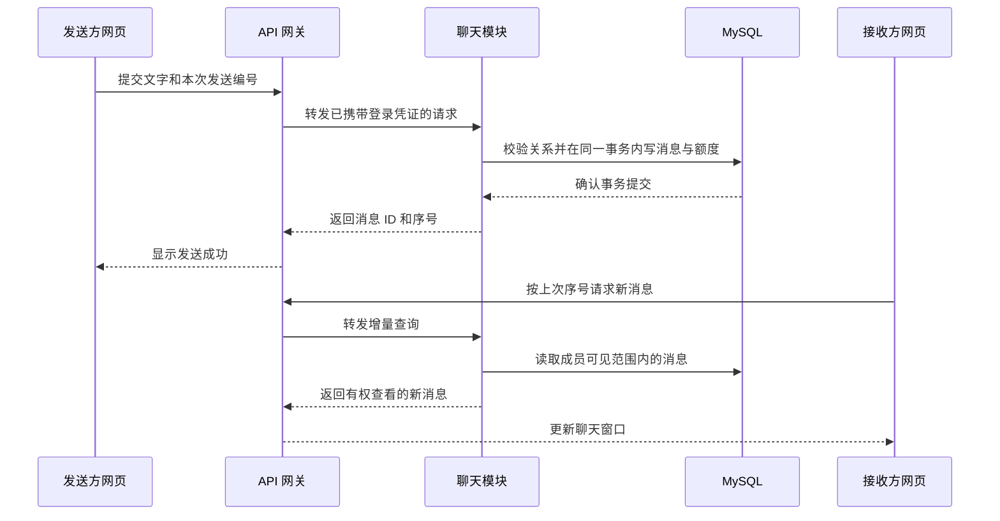

# 同频好友、私信与群聊设计方案

| 项目 | 内容 |
| --- | --- |
| 评审状态 | 方案草稿 · 待评审 |
| 产品目标 | 让论坛成员能从帖子和个人主页转入一对一交流，或邀请熟悉的成员进入小群讨论 |
| 首期交付顺序 | 互关好友与文字私信 → 邀请制文字群聊 → 站内提醒和接收延迟优化 |
| 建议由谁评审 | 产品确认联系规则和历史可见范围，研发确认数据与接口，测试确认验收用例 |

## 1. 产品规则

### 好友与私信

| 场景 | 建议行为 |
| --- | --- |
| A 与 B 互相关注 | 自动显示在彼此的好友列表。可直接发私信，使用通用防刷频控 |
| A 单向关注 B，或双方都未关注 | A 首次只能提交一条文字消息请求。B 在「请求」里预览、接受或拒绝。B 接受前，A 无法追加消息 |
| B 接受过请求，或双方曾通过互关建立会话 | 原会话可继续使用。每次发送按当前关系判断，非好友消息计入当日额度，成为好友后使用好友规则 |
| 任意一方取关 | 历史仍可查看。会话已经建立的，下一条私信开始按非好友规则计次 |
| B 拒绝 A 的请求 | 同一发起人不能反复提交。B 可以主动与 A 建立对话，双方互关后也可恢复发送 |
| 关闭「允许非好友发起消息请求」 | 关闭新请求入口。已建立的会话继续遵守日额度和拉黑规则 |
| 任意一方拉黑 | 双向停止私信和互相邀请入群，从消息页的好友列表隐藏该联系人。已有私信历史保留；同处一个群时，群消息继续按群成员权限显示 |

每日额度按**发送账号 + 北京时间自然日**计算。一个账号发给所有非好友的私信合计 10 条，首条请求和接收方接受后的非好友私信都计次。A 今天给小林发了 6 条、给小周发了 4 条，今天还能给好友发消息，给任意非好友发下一条都要等到北京时间零点。B 接受请求后发出的消息计入 B 自己的额度。服务端按 `Asia/Shanghai` 算额度日期，消息时间和接口里的恢复时间使用带时区的时间戳。

额度在消息成功提交时扣减。失败或被拒绝的发送操作不扣额度，同一次发送的网络重试只扣一次。对方后来拒绝消息请求，已提交的首条请求仍计入当天用量。群消息使用独立的常规发送频控。

私信存在三种会话状态。**待接受**由非好友首条请求创建，只有收件人能接受或拒绝。**已建立**由好友初次发送、收件人接受，或待接受双方互关后再次成功发送产生。**已拒绝**保留本次请求记录，等原收件人主动开启或两人互关后再转为已建立。拉黑在这些状态之上优先判定。

聊天举报沿用论坛举报和审计流程，并使用专用的 `CHAT_MESSAGE` 目标类型。授权审核员只看到被举报的单条消息及处理所需信息，普通分区版主的权限仍按分区范围判定。分库模式下，案件等聊天服务确认应用审核决定后更新处理状态。消息请求的独立入口参考 Discord 的现有做法。 [Discord 消息请求](https://support.discord.com/hc/en-us/articles/7924992471191-Message-Requests) · [举报目标类型](../../backend/src/main/java/com/example/demo/moderation/model/ReportTargetType.java)

### 群聊

| 操作 | 建议规则 |
| --- | --- |
| 创建与邀请 | 创建者成为群主，填写群名并选择至少一位互关好友。群主可继续邀请自己的互关好友，受邀者确认后加入 |
| 邀请与名额 | 建议单群最多 50 人，含群主、已加入成员和有效待接受邀请。拒绝或到期释放名额，初始邀请有效期建议为 7 天 |
| 阅读与发送 | 受邀者在接受前只看到邀请信息。加入后只看从加入时起产生的消息。成员取关后群成员资格仍有效 |
| 离开与管理 | 成员可以退出，群主可以移除成员。被移除或退出后，服务端停止提供该群的历史与新消息。再次接受邀请后，从这次加入开始看 |
| 转让与解散 | 群主可以把权限转给当前成员。有其他成员时，群主退出前需先转让；群主也可以解散，解散后停止会话访问 |

给每位成员记录加入时的消息序号，可以明确判定哪一条开始可见。Matrix 也将入群之前的历史可见性作为独立规则。 [Matrix 房间历史可见性](https://spec.matrix.org/v1.18/client-server-api/#mroomhistory_visibility)

### 页面和操作入口

- 个人主页提供「发私信」。桌面侧栏和移动端「我的」提供「消息」，页面包含「会话」「好友」「请求」。发出去的请求在会话列表显示「等待接受」，收到的请求和群邀请在「请求」中处理。
- 桌面端左侧会话、右侧聊天，移动端在会话列表和聊天页之间往返。创建群聊、成员与隐私操作放在消息页能找到的位置。
- 输入框呈现发送中、成功、失败和可重试状态。非好友额度耗尽时显示恢复时间。历史向上加载，正在阅读旧消息时显示「有新消息」，保留当前阅读位置。
- 首期以文字和未读会话提示为验收范围。图片、音视频、已读回执和在线状态作为后续独立需求评审。

## 2. 技术选型和职责

| 层 | 采用什么 | 在功能里做什么 |
| --- | --- | --- |
| 浏览器 | 现有 Vue 3、TypeScript、Vue Router、Axios、Vite，必要的跨页状态使用 Pinia | 渲染会话、好友和邀请，维护当前会话、发送重试状态。Vite 负责开发服务和构建 |
| 网关 | 现有 Spring Cloud Gateway | 将 `/api/v1/chat/realtime` 的 WebSocket 连接交给 Go 服务，其余聊天 API 由核心服务处理 |
| 聊天业务 | Java 21 + Spring Boot 4.0，在现有 `backend` 下新增聊天业务域 | Spring Security 验证已有 JWT 登录凭证。Controller 接收请求，Service 做权限判断和事务，Repository 负责数据库读写 |
| 权威数据 | MySQL 8.0 + Flyway，聊天仓储使用 Spring JDBC | MySQL 保存会话、消息、成员和额度。Flyway 按版本应用建表和索引变更 |
| 限流和任务 | Redis 通用防刷，RabbitMQ 广播聊天变更 | 数据提交后，Java 异步发送接收账号列表。每日 10 条是业务额度，和消息一起在 MySQL 提交 |
| 实时推送 | Go `chat-realtime`，本地监听 8092 | 委托 Java 验证已有凭证，只向对应账号的连接发送刷新信号。客户端通过聊天 API 读取详情 |

本地请求从 Vite 的 5173 入口，经 9000 网关到 8080 核心服务。站内通知由 8081 的独立服务处理。用户域持有关注关系，向聊天域提供互关判定和好友查询入口。聊天域通过公开 Service 调用用户域，保持仓库的跨域依赖约定。 [同频启动说明](../../README.md) · [模块契约](module-contracts.md) · [前端依赖](../../frontend/package.json) · [Java 版本配置](../../pom.xml)

### 接收新消息的方案

| 方案 | 怎么工作 | 同频采用时机 |
| --- | --- | --- |
| HTTP 增量轮询 | 点击发送用 POST，浏览器从上次读到的会话序号开始查询 | 实时连接不可用时，前台打开的会话每 3 秒补拉。连接正常时每 12 秒校对，页面可见时立即补拉 |
| HTTP + SSE | 发送仍用 POST。SSE 是服务端向浏览器保持的一条单向通道，收到变化提示后再查聊天接口 | 核心聊天稳定后评估接入。现有通知流按收件人发送通知变化，聊天目标类型和跳转契约需要适配。先做请求与邀请提醒，避免每条群消息挤占通知列表 |
| WebSocket | 浏览器连接消息中心后发送登录凭证，收到 `ready` 或 `changed` 即刷新会话数据 | 私信、群聊新消息和群邀请。重连会立即补拉，积压超过一页时逐页读取 |

RabbitMQ 使用 `chat.realtime.changed.v1` 扇出交换机。每个 Go 实例绑定一个临时队列，载荷只含受影响的账号 ID，浏览器只收到 `changed`。消息正文、会话可见性和补拉顺序由 Java 的 HTTP 接口负责。凭证随连接的首帧传递，Go 服务按前端 Origin 白名单和 Java 返回的令牌过期时间限制连接。

`docker compose up --build` 会启动 Go 服务。Windows 本地的 `scripts/Start-Local.ps1` 检测到 Go 后会构建并启动它。直接运行 Go 服务时，RabbitMQ 与 Java 核心使用相同的 `SPRING_RABBITMQ_*` 配置。前端域名变化时配置 `CHAT_REALTIME_ALLOWED_ORIGINS`，网关上游可用 `CHAT_REALTIME_GATEWAY_URI` 覆盖。

演示时用普通窗口和隐私窗口登录两个账号，互关后互发私信，再发出群邀请、接受并发送群消息。断开接收端网络，发送几条消息，再恢复网络，可以检查缺失消息是否按序补齐。

Compose 浏览器冒烟测试也会走这条链路。测试观察接收账号收到的 WebSocket 帧，验证待加入的成员无法读取群历史，并在连接中断后检查 HTTP 轮询及重连后跨页补齐 31 条消息的顺序。

## 3. 数据设计

以下是逻辑表设计。字段名可以在数据库评审时对齐现有命名。

| 数据 | 关键字段和约束 | 用途 |
| --- | --- | --- |
| 现有 `user_follows` | `follower_id, following_id` 唯一 | 两种方向都存在时为互关。好友查询在用户域用自连接分页读取 |
| `chat_conversations` | `id, type, title, owner_user_id, status, last_seq, last_activity_at` | 私信和群聊共用会话结构；群主由会话记录确定 |
| `chat_direct_pairs` | `low_user_id, high_user_id` 联合唯一，`conversation_id` 唯一，另存状态和初始发起人 | 固定以较小 ID 在前。同一对成员同时建会话，只得到一个私信会话 |
| `chat_members` | `conversation_id, user_id` 联合唯一；另存加入状态、邀请到期、`visible_from_seq, last_read_seq`；按 `user_id` 建会话查询索引 | 查某人属于哪些会话、从第几条能看、已读到哪条 |
| `chat_messages` | `id, conversation_id, seq, sender_id, client_message_id, body, created_at`；会话内序号唯一，`conversation_id + sender_id + client_message_id` 唯一 | 每条消息只落一次，按会话内序号翻页与补拉 |
| `chat_daily_usage` | `sender_id, quota_date` 联合主键，`used_count` | 由所有非好友私信共享同一天计数器 |
| `chat_privacy_settings` / `chat_blocks` | 设置按用户唯一，拉黑按 `blocker_id, blocked_id` 联合唯一 | 持久保存接收偏好及拉黑关系。拉黑记录只对发起方暴露管理入口 |

消息序号 `seq` 就是这段会话的第几条。入群时当前最后一条是 20，新成员的可见起点是 21，已读游标初始化为 20。服务端读取前核对成员状态和可见起点，列表预览、未读提示与详情使用同一权限。会话接收和退出与发消息写入按会话行串行化，确定两项操作的先后。

## 4. 一条消息如何发送



1. 浏览器为一次发送生成 UUID 格式的 `clientMessageId`。如果网络断开，重试仍使用同一个编号。
2. 后端从已经验证的 JWT 获取发送者，校验正文、会话权限、好友关系、拉黑状态和接收设置。新私信通过固定顺序的用户 ID 找到或创建唯一会话；群消息检查当前成员资格。
3. 在权限范围内查找相同发送编号。已经成功提交的重试返回原消息。相同编号携带不同正文返回冲突，由用户确认是否发一条新消息。
4. 在 **同一个 MySQL 事务**内，以 `used_count < dailyLimit` 为条件将非好友计数加一，并分配序号、写入消息、更新会话摘要。用量达到上限或写入失败时回滚。事务提交后才返回发送成功。
5. 收件人按最近收到的序号补拉。前端合并结果时按消息 ID 去重，页面处于前台并显示最新消息后提交已读进度。服务端只推进到该成员可见的序号，重复或旧客户端提交不会让已读进度回退。

事务相当于把「写一条消息」和「用掉一次额度」作为一个整体。A 还剩 1 条额度，两个浏览器标签同时发给不同非好友，两次请求都竞争同一账号当天的计数行，最终只有一次提交成功。私信关系和拉黑更新需与发送复用稳定的用户锁顺序，群加入和退出与发消息共用会话锁。外部通知投递放在事务提交之后的异步阶段。 [MySQL 锁定读](https://dev.mysql.com/doc/refman/8.0/en/innodb-locking-reads.html) · [Matrix 客户端发送编号](https://spec.matrix.org/v1.18/client-server-api/#transaction-identifiers)

## 5. API 初稿

下表中聊天接口使用 `/api/v1/chat` 前缀，举报使用现有完整路径。当前登录账号来自认证上下文，路径参数只指定要访问的用户或会话。

| 接口 | 用途 |
| --- | --- |
| `GET /friends?page=1&size=20` | 查询我的互关好友 |
| `GET /conversations?bucket=messages` / `GET /conversations?bucket=requests` | 分页查询会话或待处理请求。摘要只返回当前账号可见的数据 |
| `GET /direct/{peerId}` | 从个人主页进入聊天时查询已有会话和可用操作；没有会话时只返回发送前的状态 |
| `POST /direct/{peerId}/messages` | 向指定用户发送私信；第一条在事务内创建会话 |
| `PUT /conversations/{id}/request` | 收件人接受或拒绝一对一消息请求 |
| `GET /conversations/{id}/messages?afterSeq=80` | 补拉序号大于 80 的消息。使用 `beforeSeq` 向前翻历史，两个参数互斥 |
| `PUT /conversations/{id}/read` | 推进当前账号在该会话的已读序号 |
| `POST /groups` / `POST /groups/{id}/invitations` | 创建群、邀请好友 |
| `PUT /groups/{id}/invitations/me` / `POST /groups/{id}/messages` | 处理发给自己的邀请、发群消息 |
| `GET /groups/{id}/members` / `PUT /groups/{id}/owner` / `DELETE /groups/{id}/members/{userId}` / `DELETE /groups/{id}` | 查看成员、转让群主、退群或移除成员、解散 |
| `GET /settings` / `PATCH /settings` | 读取和修改接收设置 |
| `GET /blocks` / `PUT /blocks/{userId}` / `DELETE /blocks/{userId}` | 查看自己的拉黑名单，拉黑或解除拉黑 |
| `POST /api/v1/reports` | 使用现有论坛举报入口，扩展 `CHAT_MESSAGE` 类型并验证证据访问权 |

例如对 `POST /api/v1/chat/direct/42/messages` 提交以下内容。

```json
{
  "clientMessageId": "9b8d36a2-f347-41b1-84eb-dbff34e08c55",
  "content": "你好，想请教一下帖子里的相机设置。"
}
```

新写入返回 `201`，同编号重试返回 `200`，两次都指向同一 `messageId`。响应提供 `conversationId`、`messageId`、`seq`、`createdAt` 和会话状态。消息正文按纯文字展示，文本上限建议 1,000 字符，前后端使用同一计数规则。首次历史请求返回最近 30 条，增量接口返回按序排列的消息、是否还有下一页和下次游标。

| HTTP 状态 | 用户侧行为 |
| --- | --- |
| `400` 参数或正文无效 | 提示修改，保留输入 |
| `401` 登录失效 | 进入现有登录流程，清除上一个登录会话的消息状态 |
| `403` 联系受限 | 展示通用提示「当前无法发送消息」，避免向对方直接暴露拉黑设置 |
| `404` 会话不存在或当前账号不可访问 | 回到列表并刷新 |
| `409` 状态冲突或发送编号冲突 | 根据业务错误码处理，待接受时提示等待，群满时停止邀请 |
| `429` 当日额度耗尽 | 返回稳定的业务错误码及 `resetAt`，显示如「明天 00:00 恢复」 |

## 6. 验收和灰度

| 验收重点 | 必须能复现的结果 |
| --- | --- |
| 互关和取关 | 双向互关从既有关注数据识别；任意一方取关，历史仍可见，下一条发送按新关系判定 |
| 首次请求 | 非好友只能提交一条待确认请求。只有收件人能接受或拒绝。关闭新请求后，陌生账号无法创建会话 |
| 配额并发 | 仅剩 1 条时，同时找两位非好友发送，正好 1 条成功。北京时间零点后开始新一日计数 |
| 网络重试 | 服务端已经提交但浏览器没收到响应，使用原编号重发，数据库只存在一条消息、一次扣减 |
| 越权与隐私 | 其他账号访问会话 ID 看不到消息、预览、成员或未读数；拉黑后禁止新增一对一消息；分区版主看不到私信举报证据 |
| 群成员和历史 | 受邀未加入时无法看群消息，加入后从当时的序号开始，退出后不能继续补拉；并发邀请不突破群容量 |
| 刷新与账号切换 | 离线恢复后补齐新消息，无重复；点击另一个会话或切换账号后，旧请求结果不能写回当前页面 |
| 安装与回退 | 新库与已有库均能运行 Flyway 迁移；关闭对应功能开关可停止入口和接口流量，已提交数据可在恢复功能后读回 |

前端用 Vitest 检查状态与重试，后端用 Spring Boot 测试覆盖规则与权限，并在真实 MySQL 验证事务并发和 Flyway。用现有 Playwright 补桌面、移动端和双账号端到端路径，再用 k6 验证内测负载。首轮性能目标建议为 50 个前台会话并发时，95% 的发送在 500 毫秒内收到提交确认，95% 的接收方在 5 秒内看见新消息。这是待压测的验收目标。

灰度时优先看消息提交成功率、发送和接收延迟、额度拒绝率、请求接受或举报率。日志记录请求 ID 与脱敏错误码，消息接口使用私有访问控制和 `Cache-Control: no-store`，聊天正文只在消息和授权举报证据中按业务要求保存。

## 7. 分工与评审决策

| 阶段 | 主责与交付 | 进入下一阶段的条件 |
| --- | --- | --- |
| 规则与接口评审 | 产品、研发和测试共同确认状态规则、字段、错误码及用例 | 好友、陌生私信和群历史的规则可以逐项写成验收用例 |
| 好友与私信 | 后端负责关系、权限、消息和额度。前端按接口样例并行搭建列表、会话和请求流程。测试准备双账号与并发场景 | 两个普通账号走通互关、请求、回复、额度与拉黑 |
| 群聊 | 后端实现邀请、成员、群主与历史可见策略，前端交付群聊和成员管理，测试验证第三方和退出边界 | 完成群成员权限、并发与兼容性验证后，向小范围账号开启 |
| 实时投递与扩大内测 | Go 推送变更信号，浏览器按消息序号补拉 | 验证跨账号私信和群消息可见性、Broker 断开后的轮询和重连，以及现有论坛回归 |

按一名前端、一名后端及测试兼任做粗估，好友和私信约 1–2 周，群聊与联调约 1 周。正式排期以接口评审、举报权限改动量和团队可用时间为准。

| 待确认项 | 本稿建议 |
| --- | --- |
| 新用户接收陌生请求的默认值 | 内测账号默认允许单条请求并提供关闭入口。公开启用前观察拒绝和举报情况后确定默认值 |
| 每日 10 条和群上限 | 先用本稿数值测试，并把额度、群容积和邀请时效纳入配置 |
| 私聊与群聊记录保留 | 在上线评审确认账号注销、群解散、消息历史及举报证据的保留期限和清理规则 |
| 首次上线到达范围 | 优先开放消息页内的好友、私信和请求能力，通过验收后再开群聊和站内通知提醒 |
