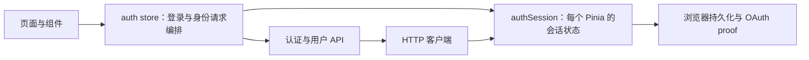

# 2026-10-23 性能与交互审查

本轮以 `171424172cc6ab293dc1649b3a247b6bac6d9686` 为源码基线，保留现有应用与模块边界。下列结果来自本机构建、隔离数据库和自动化测试，不代表生产部署验收。

## 持续目标与软件工程验收要求

原有全项目持续优化目标完整保留。根据用户 2026-10-24 的新增要求，每轮改进还必须符合软件工程规范，重点包括高内聚、低耦合、单一职责、清晰的模块边界与接口契约、可维护性和可验证性。这些是持续验收条件，不代表当前全站已满足。

- 先定位业务规则、数据归属、调用方和依赖方向，再确定文件及模块责任；不以文件更少、更小或层数更多本身作为优化依据。
- 将相同语义的规则集中到适当边界，界面负责交互，API 边界负责响应确认，业务层保留业务规则；复用现有合适机制，避免把业务语义不同的生命周期强行合并。
- 对共享、拆分或依赖调整，说明它解决的具体问题、相关调用方、兼容约束与回归证据；不制造无需求的扩展层、公共大模块或循环依赖。
- 检查结构与依赖，同时运行覆盖实际行为的验证；静态边界检查通过不能替代授权、持久化、并发、运行时或浏览器验收。

会话隔离、响应契约、列表与表单、构建和数据库改进分批记录于下文。2026-10-27 00:38 检查点已验收收藏读取与恢复：坏条目在 API 边界被拒绝，不再造成 Vue 渲染错误；列表读取独立于详情互动，旧导出保持兼容；数组/缺少 total 的响应明确标记总数未知，保留实际当前页和前后翻页，不再误退第一页。最终前端 120 文件/1157 项、lint、类型检查、构建与结构检查通过，六份相关源码在各最终命令前后及收尾核对中未变。构建显示详情页不再加载收藏列表校验，相比原基线少 333 raw/208 gzip 字节；收藏页因必要的校验和恢复多 2100 raw/576 gzip，不将此称为运行时加速。独立只读复审已完成，DOM 联测只替换传输层，不是 HTTP、数据库或浏览器验收。主后端 585、独立通知 41、脚本 49 沿用各自此前证据，没有重复执行；此前通知与会话保护保留。整体目标为 active，原 320 分钟周期任务仍 PAUSED，软件工程规范持续适用；本批没有提交、推送、部署或把局部验收当作全项目完成。

## 已验证的改进

| 场景 | 原行为 | 当前行为与证据 |
| --- | --- | --- |
| 用户搜索列表 | 每个用户单独查询资料；20 人页执行 22 条 SQL | 当前页批量读取资料，1 人与 20 人完整页均为 3 条 SQL；H2/Hibernate 统计验证 |
| 昵称搜索 | 5 人页执行 7 条 SQL，前端搜索页未指定昵称字段 | 5 人页为 3 条 SQL；搜索页明确传入用户名、昵称字段 |
| 公开用户搜索字段 | `fields` 只做子串判断，用户名/昵称搜索仍会匹配邮箱、手机号；默认入口也会匹配联系方式 | 公开查询只支持用户名、昵称的完整字段名，默认同时搜索两者；拒绝联系方式、未知或空字段项。实际 H2 查询验证匹配结果、总数和分页；管理查询保留独立授权入口 |
| 用户搜索恢复 | 失败无重试、空后页无返回入口；导航前修改页码，分页后再过滤导致结果与总数矛盾 | 合并当前页在途重试，空后页可返回；页码由路由和服务端确认，拒绝/取消导航可重试；匹配规则集中在后端，页面展示原分页结果 |
| 排行榜加载与恢复 | 等分区读取结束才请求榜单，错误无重试；末页少于 4 条或空后页没有翻页入口 | 两种资源独立加载和重试，筛选统一为单份区域；保留末页和空后页分页，规范化查询及大 ID，忽略旧请求和卸载后的更新 |
| 热门标签类型 | 聚合查询未限制标签类型，与标签搜索语义不同 | 仅返回 `thread` 类型标签，保留正常帖子、分区过滤、去重计数及排序；H2 验证其他类型、隐藏/删除帖子、分区和并列计数排序 |
| 粉丝与关注列表 | 20 人页执行 46 条 SQL，其中逐人统计随后被丢弃 | 批量读取展示摘要，1 人与 20 人完整页均为 5 条 SQL；保留排序、分页、资料回退及完整资料接口的关注数 |
| 粉丝与关注页恢复 | 空后页隐藏返回分页；重复重试和快速换页可能发出额外读取 | 保留空后页返回入口；资料与关系读取分别合并在途重试，卸载后不再发起读取；拒绝不安全页码并归一实际页码，保留新路由替换旧请求的保护 |
| 评论点赞展示 | 50 条评论登录态 103 条 SQL、匿名 53 条、作者列表 52 条 | 当前页批量查询点赞数及当前用户状态；1 条和 50 条完整页均分别为 5、4、3 条 SQL；两位用户、零点赞、时间及点赞排序均有数据库验证 |
| 评论重复提及 | 同一条评论中每次出现 `@用户名` 都重新查询，包括重复的不存在用户 | 先按首次出现顺序合并完全相同的拼写；模拟仓库验证 200 次有效名和 200 次不存在名的查询调用由 400 次降至 2 次；大小写变体仍分别交给数据库匹配，下一条评论重新查询，收件人顺序与回复排除规则保持一致 |
| 帖子列表与作者列表（JPA） | 10 条帖子逐条读取点赞数与标签，共 22 条 SQL | 当前页批量读取，1 条与 10 条完整页均为 4 条；保留作者摘要、回复数、标签排序；两种作者列表路径均有数据库验证 |
| 帖子排行榜 | 20 条排名逐条读取标签，共 22 条 SQL | 保留投影中的点赞、回复及热度，仅批量补充标签；1 条与 20 条完整页均为 3 条；空列表不额外查询点赞或标签 |
| MyBatis Plus 列表状态 | 第一轮取得正常实体后，映射时没有复核第二轮投影的状态 | 仅将第二轮投影仍为 `NORMAL` 的条目加入公开列表及缓存；模拟仓库覆盖混合状态与全部不可见，H2 覆盖旧实体快照对应已隐藏、已删除的存储状态；保持单帖及管理路径原有语义 |
| 顶栏用户建议 | 列表后再逐个查询最多 5 份用户资料 | 直接使用列表已返回的昵称、头像；一次搜索导航更新关键词和页码只触发一次列表请求 |
| 发现页与分区页 | 应用入口间接加载公式和代码高亮 | 轻量标题渲染与正文渲染拆分；创建、详情页按需加载；构建自动检查静态依赖图 |
| 分区页加载 | 所有预览返回后才显示整页；一个慢请求延迟所有分区 | 分区元数据先显示，初始预览一次批量读取；统计等待期间不显示假零值；整页和单分区失败均可重试，忽略离页后的响应 |
| 分区预览请求与内容 | 当前页逐区读取完整帖子页；冷缓存 JPA 夹具中 20 分区 80 条语句 | 当前页一次批量轻量预览，失败后可逐行重试；最终完整回归夹具中 20 分区 1 条语句，raw/gzip 分别从 1672204/16752 降至 19108/1278 字节；原生 MySQL 另验证生产读取及字段契约，未测真实页面耗时 |
| 扫码状态资料 | 状态、扫码、确认响应带通用用户 DTO，confirmed 轮询再次读取用户 | 进度 DTO 仅返回状态所需字段，轮询不读取用户；确认存在校验及 exchange 完整用户/JWT 保留，真实 JSON 与调用数专项覆盖 |
| 扫码交换身份 | 为 JWT 读取一次用户，DTO 映射再次读取，可能取到不同资料快照 | 同一份已读取用户用于 JWT 与纯 DTO 映射；内存和 mock Redis 路径仓库调用数为 1，用户消失仍返回 404 且不签发 JWT |
| MySQL 会话时间 | 默认 URL 只声明驱动 UTC，服务器会话为 +08:00 时，往返看似正常但实际存储与既有读取各偏移 8 小时 | 8 处默认来源中的 10 条 URL 同步设置强制会话 UTC；原生 MySQL、数据库级非管理员账号及 UTC 服务器对照均验证真实 epoch，未改历史数据 |
| 分区分页缓存 | 原始分页参数不同但实际页面相同，仍写入不同缓存 | 缓存键与数据库共用归一后的分页参数；状态缓存回归证明等价请求只调用一次仓库，返回页码与大小保持一致 |
| 帖子筛选缓存 | 关键词、标签直接拼接，`a:b` + `c` 与 `a` + `b:c` 共用键 | 对归一后的完整筛选元组做长度分帧与 SHA-256 摘要；状态缓存回归验证两组查询互不借用结果，分页键也使用实际页码 |
| 评论渲染 | 父组件更新可能再次解析未变化的正文 | 每条正文独立计算；测试验证输入、其他评论内容变化不会重复解析当前正文 |
| 编辑页异常 | 资料加载失败与空数据难以区分；成功保存后等待跳转期间可能再次提交 | 区分加载、失败、空数据，支持原位重试；跳转完成前保持提交锁，跳转失败恢复操作并明确已保存 |
| 中文输入 | Markdown 规则可能在输入法组词期间处理按键或重排列表 | 组词期间同步原始文本，结束后规范化；失焦后不抢回焦点。已验证合成事件，尚未覆盖实体设备输入法 |
| 通知流 | 两个慢发送可能占住全部调度线程；大网络分片可能被误拒绝 | 调度与发送、完成响应分离；同一连接只允许一个轮询任务；前端按行与事件限制大小，允许多个合法事件合并到一个分片 |
| 通知刷新与账号切换 | 会话、重连信号重复读取；较旧角标覆盖较新列表的未读数；页面隐藏也清除偏好请求上下文 | 仅真实账号令牌变更重置会话；同一轮刷新合并；列表与角标共享未读请求顺序；同账号的在途偏好请求继续生效，换账号后清除并重载偏好 |
| 通知已读与跳转 | 顶栏和设置页中不同通知的已读响应互相覆盖；较旧列表可能恢复未读状态；查看通知等待已读写入 | 两个入口均按通知 ID 隔离在途写入，账号切换和退出后忽略旧响应；拦截已读提交前发起的旧列表；查看立即跳转；保留已成功写入的本地已读状态，角标或列表刷新失败不会误报已读写入失败 |
| 通知偏好保存 | 保存期间继续勾选后，服务端返回的旧提交结果会覆盖新修改 | 将服务端结果保留为已保存基准，按字段保留提交后发生的修改；未保存提示继续生效，下一次保存发送最新值；失败与账号切换另有回归覆盖 |
| 公开用户页分页 | 应用外层按完整地址和认证事件重建所有页面，丢失分页并重复请求 | 用户主页、关注与粉丝页在自行隔离请求后允许保留实例；真实 App 与生产路由记录的内存路由测试验证实例、页码及请求次数；其余页面继续保持认证及地址变更时重建 |
| 关注与粉丝页请求 | 翻页、切换列表重复加载相同用户资料，失败状态混在一起 | 资料与列表独立请求、独立重试；只在用户 ID 改变时读取资料，切换列表或翻页只读取列表；忽略旧路由、旧页码及卸载后的响应 |
| 主页的关注状态 | 页面自身的在途资料和关注操作没有覆盖令牌切换 | 令牌及认证事件立即使旧操作失效，同一轮刷新合并；换账号刷新关系标记，保留公开帖子的页码和列表；资料重试不重复请求帖子 |
| 跨标签页的自动请求 | 页面仍使用账号 A 的状态时，统一客户端可从存储读取账号 B 的令牌 | 自动认证请求先核对内存与存储令牌，不一致时在适配器前拒绝；GET 与发帖 POST 均有旧代码复现及修复后验证；同步捕获请求令牌与认证代次，旧 401 不清除新登录；显式凭据及公开认证接口保留原语义 |
| 已打开页面的账号同步 | 内存账号不响应其他标签页的退出或切换 | App 在挂载、令牌存储事件、聚焦和恢复可见时同步；换令牌后清除内存旧身份，不把单独存储的资料归给新账号，也不写回存储；同令牌事件不重启会话，卸载后移除监听 |
| 顶栏身份恢复 | 令牌存在但资料为空时不能建立稳定用户身份；并行入口重复读资料 | 使用响应所属令牌及账号上下文接纳服务端身份，合并当前账号的在途读取；令牌变化即使缓存用户 ID 相同也使旧响应失效；补齐身份本身不触发全局认证事件或重建编辑页 |
| 账号信息未就绪时的发帖 | 草稿保存静默不可用，身份补齐时清空刚输入的内容 | 明确提示、支持重试，在确认稳定用户 ID 前阻止发布；同令牌身份补齐保留输入，按空字段补充已有账号草稿，再保存到账号专属键；换账号、失败重试及迟到响应有回归，不创建共享 pending 草稿 |
| 基础账号信息保存 | 以响应到达时的表单作为已保存基准，提交后的编辑被误记为已保存；用户名缓存与顶栏不更新 | 以提交快照及服务端返回值合并各字段，保留后续编辑和未保存状态；只向已验证的当前身份同步已保存字段，用户名事件更新顶栏；较早的共享身份读取失效，新读取不复用旧请求 |
| 账号信息与密码操作 | 换账号和卸载后仍接纳旧读取、保存、密码响应；旧消息计时器可能清除新消息 | 令牌、会话、用户及操作顺序共同校验，账号切换清空旧字段，失败登录代次变更不误清表单；防重复保存和重载冲突，密码成功只清理提交后未修改的输入；卸载清理计时器与监听 |
| 关联状态读取 | 迟到响应可能显示旧账号状态，未验证状态也可能表现为空列表 | 会话变化清空旧状态并合并重载，拒绝迟到响应与旧 finally；身份补齐不重复读取；存储错配时明确提示，不宣称没有关联账号；保留只读模式和原位重试 |
| 修改密码时输错当前密码 | 后端返回 401，统一客户端将有效登录清除 | 返回 400 并保留“当前密码不正确”；真实 JWT、安全链、控制器、服务与 H2 回读验证错误密码未写入、正确修改可验证新哈希、弱密码未写入、缺失或无效 Bearer 仍为 401；真实前端表单、API 客户端及 Pinia 联合验证 400 可重试、401 仍退出 |
| 长用户名账号保存资料 | 前端只接受最多 20 位，后端基础资料接口及数据库列支持 64 位 | 表单接受 3–64 位，保留原有字母、数字及下划线规则；已有 21、64 位用户名修改手机号不再被阻止，65 位仍拒绝提交；注册提示和输入上限同步 |
| 新密码编码边界 | 注册没有上限，改密仅限制 128 个字符，超过实际编码器的 72 个 UTF-8 字节会返回 500 | 前端在本地拒绝，后端增加字符粗界与 UTF-8 字节检查，超限返回 400；ASCII、中文、emoji 恰好 72 字节可注册、可改密且哈希可验证，超限不新增用户或改写哈希；登录与当前密码保持历史验证兼容 |
| 注册中的异步校验与重复提交 | 提交锁在用户名检查后才开启，人工验证后发送实时表单值；卸载后仍可能继续注册或发送事件 | 首次等待前上锁，整次操作使用同一输入快照；用户名并发检查按相同输入合并，旧 blur 结果不改写新错误；本地校验失败不发送可用性请求；卸载后停止尚未发出的注册及旧界面事件，已发出的后端请求不宣称撤销 |
| 我的帖子删除与恢复 | 确认目标没有绑定打开时的会话；删除失败隐藏列表，成功后的刷新失败容易混淆；末页删除后可能停留空页 | 确认目标绑定会话与列表，换账号或存储漂移清空私有状态；失败保留目标以重试，成功立即移除旧行，较早列表读取不能使其复现；刷新失败独立重试，末页回退仅依据同一查询的总数，不改写随后选择的新筛选与页码 |
| 我的评论删除与恢复 | 尚未采用私有帖子的会话保护，旧账号删除完成可能继续读取；删除失败关闭确认框，末页删除后仍停在空页 | 与帖子页共用 `useOwnedContentList`，绑定令牌、用户、会话代次及确认时的查询，阻止重复删除和迟到响应；失败保留目标重试，成功本地移除并刷新，分区请求不再阻塞私有列表；两页 33 项专项通过，包含原有帖子页全部 19 项 |
| 注册失败后的验证票据 | 请求失败仍保留已经提交的票据；直接重置也可能清除等待期间重新取得的票据 | 记录发起请求的组件与票据，只在该请求结束且票据仍相同时重置；没有发出注册请求、组件卸载或已换新票据时保留相应边界，真实验证组件另有回归 |
| 人工验证组件生命周期 | 等待脚本时可能重复创建组件，重置或卸载后仍接纳旧回调；脚本加载失败后复用失败 Promise | 合并同一代次的渲染和手动验证，重置与卸载使旧异步工作失效；旧完成不能释放新验证请求，卸载后的 reset 无操作；失败脚本可通过可见按钮重试；使用模拟 SDK 回调验证，未连接外部 Turnstile |
| 认证弹层加载 | 顶栏静态导入完整登录、注册及扫码界面，访问公开页面也加载这些代码 | 打开时才动态加载，等待和失败均有可关闭的对话框、重试与键盘焦点恢复；构建门禁同时核对动态入口和首屏静态依赖，05:58 拆分后的首屏 JavaScript gzip 较其上一轮减少 9.19% |
| 密码与验证码登录等待 | 首次等待后才上锁，提交读取实时字段；关闭、切换方式或修改地址后仍可能发出请求，旧 finally 可清除新请求的忙碌状态 | 首次等待前建立互斥操作，使用模式、地址、密码或验证码快照；同步取消旧上下文，卸载后不继续发请求；只撤销仍由自己持有的认证代次，旧表单卸载不取消后来开始的其他登录 |
| 登录响应写回 | 另一标签页先改存储令牌、App 尚未同步时，认证代次仍相同，旧响应可能覆盖新会话 | 密码与验证码四条 store 登录路径同时核对发起时的内存、持久化令牌及代次，在身份补读前和写回前拒绝旧响应；保留新标签页的成对身份记录，真实 Pinia 和前端请求适配器另有回读验证 |
| 验证码会话与重试 | 已取得的验证码会话只凭字符串复用，完成登录前又要求未被接口接收的人工验证 | 发送时使用人工验证；完成接口仅提交绑定的渠道、规范化地址、验证码和会话，不再索取第二张票据；账号状态变更使旧会话失效，自己的错误验证码响应仍允许同一会话重试；旧响应不发送迟到通知 |
| 收藏会话与末页恢复 | 请求仅按序号接纳，换账号、存储漂移和卸载没有保护；末页减少后只改页码却未读取有效页 | 令牌、用户、会话代次和请求顺序共同隔离，同令牌身份补齐保留有效页；末页收缩最多补读一次有效页，第二次仍不一致时显示可重试错误，不循环请求或发布标错页码的内容 |
| OAuth 与扫码登录归属 | 仅核对认证代次，未覆盖存储先变化的间隙；成功事件中的同步账号替换仍可能留下跳转或成功通知 | 交换、重试、提交及跳转核对内存和存储令牌及认证代次；提交后再次确认归属，二维码清理使用原会话标识；通知回调关闭或替换会话后不再继续成功事件 |
| 登录处理中提示 | OAuth 交换等待时显示失败标题与红色图标，成功文案包含实现术语 | 初始及重试等待显示正在登录，提供状态播报与减少动画适配；成功提示改为普通用户用语 |
| 详情关注、点赞与收藏 | 旧作者、帖子或账号的响应可写回新页面；状态读取失败或字段缺失时可能被当作未操作 | 作者/帖子、令牌对、已知身份及局部代次共同保护，支持同令牌身份补齐，合并有效读取、拦截重复写入；读取失败或关系字段缺失时须先重试读取，不发布推测的操作结果 |
| 举报弹层 | 切换账号或目标后仍接纳旧结果，关闭再打开可能被旧请求解锁 | 开窗时固定账号及目标，关闭、目标变化和账号变化立即失效；旧结果不更新新表单，Tab 留在弹层内，关闭恢复启动按钮焦点 |
| 评论浏览与互动 | 主要隔离切帖，账号切换仍可能应用旧列表、清空新草稿或执行上传进度；旧页点赞可能影响新页读取 | 会话、身份、查询及请求顺序共同保护，切换时清除私有输入及个性化状态并合并重载；同评论重复点赞合并，按查询隔离写入版本，不取消较新页面的列表读取 |
| 互动 API 响应 | 将响应直接当作布尔状态和计数使用，错误 ID、字符串布尔值或互相矛盾的关注字段可能被接纳 | 共享纯解码器校验字段和目标，拒绝异常状态；保留原始错误的端点和字段信息，界面提供只读恢复，不自动重发写入 |
| 评论操作失败 | 点赞、上传或发送错误被作为整个列表的失败，已有评论一同隐藏 | 读取与操作错误独立，保留已有评论及草稿；未确认点赞结果可明确刷新评论状态 |
| 常驻聊天的账号隔离 | 切换账号后历史仍在，后续可能随新令牌发送；停止后仍可接纳已排队分片 | 新会话清空历史和输入；打开、发送及回调检查归属，原生流复用客户端发送前会话检查；完成、失败及取消清理流并释放锁 |
| 社区管理刷新 | 任一资源仍读取时可能再次总刷新，快速翻页也可能重复请求 | 总刷新按全部资源合并，翻页按自身资源防重；失败完成后可重试 |

## 构建体积对照

两个源码版本使用同一套已安装依赖，分别执行 Vite 生产构建。统计入口及目标路由递归静态导入的 JavaScript，去重后对每个文件 gzip 并求和；不含动态导入、CSS、字体与图片。

| 入口及路由 | 基线 JavaScript / gzip（字节） | 当前 JavaScript / gzip（字节） | gzip 减少 |
| --- | ---: | ---: | ---: |
| 应用入口 | 987841 / 332996 | 326726 / 115976 | 65.17% |
| 应用入口 + 发现页 | 995939 / 336579 | 442004 / 167407 | 50.26% |
| 应用入口 + 分区页 | 993905 / 335749 | 440195 / 166639 | 50.37% |

这些数字反映当前构建产物；压缩设置、依赖版本和源码变化都会影响结果。未据此推算加载耗时或 Core Web Vitals。

05:58 认证弹层拆分前，入口为 360852 字节、gzip 125648 字节；拆分后为 320050 字节、gzip 114097 字节，gzip 减少 11551 字节（9.19%）。前值独立记录于 `outputs/optimization-deferred-auth-before.json`。11:10 为 114137 字节；12:26 为 114264 字节；16:41 为 115715 字节；10-25 00:08 为 115992 字节；08:28 为 115797 字节。08:42 的入口为 115976 字节，较 08:28 增加 179 字节；包含发现/分区路由分别增加 181/179 字节。各检查点均保留对照日志，不把职责拆分的体积代价隐藏，也不据此推算真实加载时间或统一性能改善。

`frontend/scripts/check-initial-load.mjs` 随 `pnpm build` 检查 manifest：应用入口、发现页和分区页的静态依赖不得包含 `math`、`highlight` 分包，创建与详情页必须仍为动态入口；认证弹层必须为动态入口，且其产物文件不能出现在首屏递归静态依赖中。渲染依赖检查依赖现有分包名称，认证检查依赖源码入口键；改名或更换构建工具时应同步修改规则。

## 缓存键兼容性

帖子列表键使用 `cache:threads:list:v2:` 加固定长度摘要。每个字段先写入 UTF-8 字节长度，再写入内容，包含关键词、标签、分区、页码及每页大小；摘要按字段流式更新，不额外分配整份元组的拼接缓冲区。中文、表情、冒号、百分号和 NUL 边界均有回归覆盖。

清理规则保持 `cache:threads:list:*`，继续覆盖新旧键。新格式不会读取旧格式条目；旧条目按原有两分钟 TTL 到期，或由既有写入后的清理路径删除，无需手工清空 Redis。详情、评论、限流及认证键的格式保持兼容。

匿名评论缓存也使用实际页码复用；每次读取仍校验主题可见状态。登录用户继续绕过匿名缓存，点赞标记仅根据当前用户和当前页的评论 ID 批量查询。点赞数与用户状态的异常回退分别用模拟仓库验证，H2 测试另验证正常数据库结果及查询数；这些结果不代表真实数据库故障时的可用性验收。

帖子列表对照另在测试数据源上统计当前线程的 `Connection.prepareStatement` 调用，同时记录 Hibernate 统计；两者差额包含标签服务的 JDBC 查询，避免漏算或将重载方法的内部调用重复计数。对照使用相同的 100 条帖子数据集，计数在准备数据后清零。MyBatis Plus 列表复用批量映射，实体顺序及缺失投影过滤由单元测试覆盖；未据此声称其真实数据库查询耗时已验收。

## 验证与边界

后端最终完整回归在仓库根目录执行 `mvn -pl backend test`；网关和通知服务分别保留各自在最后一次源码变更后的完整模块回归结果。前端目录执行 `pnpm test`、`pnpm lint`、`pnpm run type-check` 和 `pnpm build`。构建门禁自身的回归测试为 `node --test scripts/__tests__/FrontendInitialLoad.test.mjs`。仓库结构和 Java 边界分别由 `scripts/Check-Repository.mjs`、`scripts/Check-JavaArchitecture.mjs` 检查。

仓库脚本回归为 `node --test scripts/__tests__/*.test.mjs`。Windows 本机需把 `BASH_BIN` 指向原生 Git Bash 的完整可执行文件路径；前一轮系统默认入口指向 WSL Bash，导致 8 项路径或环境传递失败，显式选择 Git Bash 后当时的 47 项全部通过。Linux CI 直接使用其原生 Bash；本次新增首屏门禁用例后完整脚本回归为 49 项。

下表分别记录完整模块测试及前端检查。后端、网关和通知服务保留各自最后一次源码变更后的完整回归，之后源码没有继续改动；前端在本次最终源码上重新运行完整回归和检查。脚本源码本次未改动，保留 05:58 的完整回归。

| 检查 | 结果 |
| --- | --- |
| 后端完整模块回归 | 513 项通过，0 失败、错误、跳过 |
| 通知服务完整模块回归 | 35 项通过，0 失败、错误、跳过 |
| 网关模块（根项目回归） | 6 项通过，0 失败、错误、跳过 |
| 前端完整回归 | 101 个测试文件、895 项通过 |
| 仓库脚本回归（显式 Git Bash） | 49 项通过，0 失败、跳过 |
| 前端 lint、类型检查、生产构建及首屏门禁 | 均通过 |
| 仓库结构、Java 依赖边界、差异空白检查 | 均通过 |

2026-10-25 08:42 检查点的完整前端日志为 `outputs/optimization-auth-boundary-frontend-final.log`；lint、类型与构建对应 `optimization-auth-boundary-lint-final.log`、`optimization-auth-boundary-types-final.log`、`optimization-auth-boundary-build-final.log`，全部在该检查点源码上顺序执行并通过。08:28 的 883 项、00:08 的 874 项及各自失败与修复记录仍保留。仓库脚本仍为 `optimization-heartbeat-scripts-gitbash-final.log`；05:58 显式选择本机实际 Git Bash 路径后 49 项全部通过。完整后端回归仍记录于 `outputs/optimization-backend-forms-final.log`，其后后端源码未改动。本批结构及边界检查见下方续审证据。

前一轮首次完整前端回归发现两个旧关联状态用例未初始化 Pinia；补齐真实登录状态及卸载清理后，该组 18 项专项与完整回归均通过。生产逻辑随后追加的退出状态回归，以及注册、登录、私有内容和弹层回归，都已包含在 12:26 的 738 项中，并保留在本批最新回归内。

本机日志保存在被 Git 忽略的 `outputs/optimization-*.log`，体积对照为 `outputs/optimization-bundle-comparison.json`。可复现的回归用例随源码保留；日志本身不随代码发布。

通知隔离测试覆盖发送阻塞、完成响应阻塞、共享写锁争用、其他用户的事件和到期处理、连接名额回收与停机；另有本机 HTTP 测试覆盖游标、收件人隔离和登录到期。慢连接仍可能占用自身名额；这些测试不能替代真实网络背压和生产容量测试。详见 [通知投递与运维](notification-delivery.md)。

先前版本的浏览器布局检查通过 60 项；最终源码在其后仍有改动，因此该结果不作为最终版本的浏览器验收。数据库性能测试采用 H2 MySQL 兼容模式，目标 MySQL 的执行计划和部署迁移仍需独立验收。本轮未部署，也未提交或推送 Git 变更。

## 继续审查的边界

完整优化目标保留。2026-10-24 续审已落实并纳入完整前端回归的范围：

- 冷启动只从 `currentUserSession.v1` 的令牌与用户成对记录恢复身份，单独的旧 `currentUser` 不再用于确定草稿或历史归属。旧资料格式通过顶栏服务端读取恢复；原有草稿和历史键均保留。
- 登录仍更新令牌；资料补齐与更新使用单独的元数据写入，不重写令牌。内存与存储令牌错配时拒绝资料写回，普通资料补丁也不能改变当前用户 ID。迟到清理只删除仍属于该次写入的缓存记录，保留其他标签页新写入的身份。
- 历史与媒体缓存要求匹配的已验证身份；真实令牌存在而身份未知时不使用访客槽位。媒体操作同时核对初始化缓存时的令牌和用户，旧账号的更新或关闭操作不能写入新账号缓存。
- 真实 App、顶栏和发帖页的组件链验证旧缓存与错配缓存均先确认服务端身份，确认期间输入保留，随后仅写入正确的账号草稿；资料恢复不触发额外的全局登录事件。历史页与侧栏也响应同令牌的身份补齐。
- 资料更新事件必须带明确用户 ID。顶栏及评论拒绝其他用户或无归属事件；接纳当前用户的保存事件后，顶栏使较早的资料 GET 失效，评论支持头像清空。
- 资料保存和头像、简介图片上传绑定发起时的令牌、会话与操作顺序。账号切换、显式重新登录和卸载使旧响应、进度及后续写入失效；同令牌身份补齐保留表单。保存结果按字段合并，保留提交后发生的输入；上传与保存冲突期间禁用对应操作。
- 关注动态主页面和侧栏共享身份恢复，在每次后续读取前检查会话，避免离页或换账号后的旧请求继续读取。身份恢复失败显示明确错误并支持原位重试；同账号分页和筛选保持原有语义。
- 帖子详情允许同令牌身份补齐完成在途读取，避免误判账号切换后一直加载。身份未知时不写访客历史；身份确认后只为仍然有效的当前路由补记一次历史，旧路由、旧会话和卸载后的操作不能补写。
- 基础账号信息及密码表单按上述会话规则隔离；身份未知时不推断资料事件 ID，同令牌身份补齐后仅向已验证用户同步。账号错配时不发写入，并清除旧表单及密码。关联页采用相同的读取归属原则，未验证的状态不显示为空列表。

这些校验限制旧操作的接纳和写回，不代表浏览器存储具有跨标签页原子事务。浏览器最终验收和目标 MySQL 边界保持前述限制。

已启用绑定本会话的定时继续任务，每隔 5 小时 20 分钟读取最新目标、工作区与本文，再选择下一轮有实际价值的改进；已有工作正在执行时避免重复启动。本轮收尾不会取消整体优化目标。

当前续审已将前端用户名长度调整为 3–64，保留原有字母、数字与下划线规则；21 和 64 位已有用户名修改手机号、65 位拒绝提交的账号页回归通过。注册流程的对应提示、异步提交及“我的帖子”的会话、删除和分页恢复已纳入完整前端回归。其他私有内容入口仍应继续审查，不能据此推断整个站点的所有写入都已完成验收。

本机依赖探针已确认 `spring-security-crypto:7.0.0` 的默认 BCrypt 配置在新密码超过 72 个 UTF-8 字节时拒绝编码，而已有哈希的 `matches` 仍具有原来的后缀截断兼容行为。本轮只为注册和新密码增加明确长度校验，登录与当前密码验证不套用新设密码规则，也不迁移哈希或自动修改旧密码。前端覆盖 ASCII、中文、emoji 的恰好 72 字节与超限组合；后端真实 HTTP 基线记录超限注册和改密返回 500，修复后 10 项专项验证注册/改密的成功、400、持久化与哈希回读，以及登录/当前密码的历史兼容。最终完整后端回归另加入用户名 64/65 边界：64 位注册及资料修改成功，65 位被拒绝且存储状态不变。注册强度与用户名字符规则的其他历史差异不在此处隐含修改。

## 2026-10-24 05:58 定时续审证据

本次主代理核对工作区及目标状态后，按明确文件边界委派三个 `luna_worker`，并检查返回源码、diff、失败基线及通过日志。未重复启动已有任务，所有无关修改均保留。

- 私有内容：旧“我的评论”实现的 13 项回归有 8 项失败，原始输出为 `outputs/optimization-owned-lists-preproduction-myposts.txt`；共享实现后的两页 33 项全部通过，记录于 `optimization-owned-lists-focused-final3.txt`。页面保留各自默认排序、摘要和评论定位链接，共有模块只管理会话、列表、删除及分页。
- 验证重试：修正测试自身的挂载等待后，旧生产实现的 22 项中 6 项失败，见 `outputs/optimization-verify-retry-baseline-v2.log`；最终认证专项为 13 个文件、108 项通过，见 `optimization-verify-retry-auth-scoped-final.log`。真实 Vue 验证组件覆盖首次手动票据重置、重置后的新回调、旧回调隔离、卸载及失败脚本重试；验证服务与 Turnstile SDK 回调仍为模拟。
- 弹层：等待、失败重试、重复重试、关闭后的迟到模块、事件转发及焦点恢复共 6 项通过，顶栏既有 9 项通过；首屏门禁 6 项通过并纳入 49 项脚本回归。生产构建另证明 `AuthModal.vue` 为动态入口，其产物文件不在首屏静态闭包中。
- 主代理最终运行前端完整 615 项回归、完整 lint、类型检查及生产构建，均通过；上述 33 项及 108 项均包含于完整前端回归，不与 615 相加。脚本的 6 项门禁回归也已包含于 49 项，不重复计数。
- 仓库结构覆盖 479 个 Java 文件、218 个前端文件、620 个本地导入及 248 个文档链接，Java 边界检查覆盖 348 个文件和 2654 条依赖，均无错误；日志为 `outputs/optimization-heartbeat-structure-final.log` 和 `optimization-heartbeat-java-boundaries-final.log`。这些静态检查不能替代运行时权限、数据隔离或数据库验收。

该次仍未进行浏览器或外部 Turnstile 验收，目标 MySQL 与部署边界保持不变；后续按完整目标继续推进。

## 2026-10-24 11:10 定时续审证据

主代理先核对目标、工作区、最新记录和现存子代理，确认没有重复任务，再按定时继续指令完成下面的工作。完整目标保留，不因这次局部验收而取消或缩小。

- 登录组件：早期 8 项回归中 6 项失败，日志为 `outputs/optimization-login-flow-raw/pre-fix.log`。验收时另将最初未修改的 HEAD 登录组件复制到独立目录，对最终相同的 19 项回归复核，13 项失败、6 项通过，见 `optimization-login-form-isolated-baseline.log`；当前组件 19 项全部通过。隔离副本只替换目标组件，其余依赖和模拟服务使用当前版本，没有覆盖工作区修改。
- 登录状态写回：密码与验证码四条 store 路径、身份补读期间的存储退出及无事件的内存令牌变化，共 6 项新回归在旧实现上失败；`optimization-login-store-baseline.log` 为 6 失败、10 通过。加入发起时的令牌对照后，store、存储及验证组件三个文件共 44 项通过，见 `optimization-login-store-widget-final.log`。
- 验证组件：同代次的并行手动验证只启动一次，旧完成不释放新的在途验证，卸载后暴露的 reset 不再调用验证服务。三项新用例在旧实现上失败，基线为 `optimization-login-widget-baseline.log`；当前 8 项组件回归通过。
- 真实前端请求链：`AuthLoginTransport.spec.ts` 使用真实 Pinia、认证 API、Axios 客户端及 JSON 请求转换，以内存适配器模拟网络响应，并核对令牌和成对用户缓存回读。覆盖关闭、重复提交、超 72 字节历史登录密码的原样发送、错误密码 401 不清除其他会话、验证码发送/完成的字段、无二次人工验证、账号切换、错误验证码重试及旧表单不取消新登录。主审补充的旧验证码完成响应曾额外发送通知，1 项失败基线为 `optimization-login-superseded-otp-baseline.log`；修复后请求链共 16 项通过。适配器不是真实服务端或 Cognito 验收。
- 收藏页：子代理原有 3 项用例均通过，但未在修改前保留新增用例的失败输出。主代理另用最初未修改的 HEAD 收藏组件隔离副本运行最终 12 项，7 项失败、5 项通过，见 `optimization-bookmarks-isolated-baseline.log`；当前组件 12 项通过。末页只补读一次，纠正后仍有错误页码时显示可重试错误。
- 主代理最终完整前端为 87 个文件、668 项通过；登录表单 19 项、请求链 16 项和收藏页 12 项组成的 47 项专项均已包含其中，不重复相加。完整 lint、类型、构建及首屏依赖门禁通过。结构检查为 479 个 Java 文件、220 个前端文件、634 个本地导入和 248 个文档链接；Java 依赖边界仍为 348 个文件、2654 条依赖，无错误。对应日志为 `optimization-login-structure-final.log` 和 `optimization-login-java-boundaries-final.log`。

用于基线复核的独立副本与准备脚本保存在被忽略的 `outputs/`，临时前端副本已移走，没有遗留新待提交的验证副本。生产源码在最终完整检查后未继续改动。

本轮没有浏览器、真实 Turnstile/Cognito、目标 MySQL 或部署验收，也没有提交或推送。下一轮先验收尚未完成的工作，再以源码核对 OAuth/扫码登录响应及帖子详情、评论交互的并发与账号切换边界，并选择有证据的性能改进；本次通过不代表全项目完成。

## 2026-10-24 12:26 手动续审证据

本次按用户“继续”推进。主代理核对实时目标及工作区，依文件边界分别委派四个 fresh/no-history `luna_worker` 处理 OAuth/扫码登录、详情关注、详情互动及评论区，并逐项检查源码、diff、用例和原始输出。主代理实现共享认证上下文及举报弹层保护，补齐子代理未覆盖的提交后同步事件、异常结果和查询边界，再统一验收。没有覆盖此前修改。

- 认证归属：共享 `AuthOperationContext` 固定认证代次、内存令牌和存储令牌，OAuth/扫码登录提交前核对，提交后的同步认证事件若已替换账号也返回失效。OAuth 保存本次提交后的上下文，延迟及手动跳转不借用后来账号；二维码通知回调关闭、刷新或替换会话后不再继续成功事件。主审新增的两项同步事件回归在子代理实现上失败，见 `outputs/optimization-oauth-qr-parent-baseline.log`，修复后通过。`optimization-auth-context-baseline.log` 的 5 项失败只证明新增 API 尚不存在，不作为旧竞态复现依据。
- 详情归属：关注按作者，点赞与收藏按帖子，分别核对会话、令牌对、已知身份及请求顺序。真实同令牌身份补齐保持有效请求，新的登录尝试只改变认证代次时不清空普通页面状态；同步令牌或身份 A→B→A、目标变化、卸载、存储漂移及旧 finally 均有回归。关系字段缺失时保持未知并重试读取，禁止推测成功或反向操作；主审额外发现关注写响应缺失字段仍发送成功事件，`optimization-detail-follow-malformed-baseline.log` 为 1 失败、13 通过，修复后 14 项通过。
- 旧组件隔离复核：从固定 HEAD `171424172cc6ab293dc1649b3a247b6bac6d9686` 读取上述四个组件，使用当时最终相同的 65 项测试与当前依赖，结果 34 失败、31 通过；当前四组件对应 65 项全部通过。日志为 `optimization-session-isolated-baseline.log`、`optimization-session-components-final.log`，源码及测试摘要记录于 `optimization-session-baseline-manifest.json`。这些是修改后的隔离重建，不是修改前原始日志；仅目标组件来自 HEAD，别名依赖仍为当前版本，二维码的同目录组件引用只改为等价别名以定位当前依赖。副本在 `outputs/optimization-session-isolated-baseline/`，未替换工作区生产文件。随后主审追加的关注异常结果与 OAuth 等待文案两项用例均单独复现失败后修复，包含于完整回归。
- 举报：旧实现 5 项中的 4 个竞态用例失败，见 `optimization-report-session-baseline.log`。固定开窗账号和举报目标后，关闭、目标改变、账号切换及卸载不再接纳旧成功、错误或解锁；无事件的存储变化在提交前被拒绝，在响应时被发现则关闭旧表单。最终 8 项覆盖真实同令牌身份补齐、无关登录代次不清空表单、重开窗口的独立忙碌状态、键盘循环及焦点恢复；键盘修复另有 1 项失败记录于 `optimization-report-keyboard-baseline.log`。与既有举报集成共 12 项通过。
- 评论：主审最初 8 项中 7 项在未修改生产实现上失败，保留于 `optimization-comments-session-baseline.log`。最终 14 项会话专项覆盖旧列表、提交、上传及进度、同评论重复点赞、身份补齐、令牌及同对象身份 A→B→A。主审另指出旧页点赞完成不应取消新页加载，最终使用查询维度的写入版本和操作归属；第二页用例同时核对内容与页码。既有“同时发送两个点赞、后响应覆盖前响应”的用例调整为“在途重复点赞只发一次”，保留明确请求次数与已确认结果断言，没有通过放宽断言掩盖重复请求。
- 用户提示：OAuth 首次及重试等待不再显示失败标题/红色图标；提供正在登录的状态及减少动画适配，成功提示移除“收口”等实现用语。`optimization-oauth-progress-baseline.log` 为 1 失败、18 通过，修复后 19 项通过。焦点与状态验证使用 jsdom，不是浏览器视觉验收。
- 最终验证：完整前端 90 文件、738 项通过；完整 lint、类型、生产构建及首屏门禁通过。结构检查覆盖 479 个 Java 文件、223 个前端文件、647 个本地导入和 248 个文档链接；Java 边界仍为 348 文件、2654 条依赖，无错误。记录见 `optimization-session-frontend-final.log`、`optimization-session-lint-final.log`、`optimization-session-types-final.log`、`optimization-session-build-final.log`、`optimization-session-structure-final.log`、`optimization-session-java-boundaries-final.log`。完整回归后只增强评论翻页测试的模拟页码及断言，14 项再次通过，生产源码未变。

当前入口 gzip 为 114264 字节，较上一轮 114137 增加 127 字节；重依赖仍位于按需入口，首屏依赖门禁通过。没有用源码体积代替真实速度或容量验收。后端、网关、通知服务和仓库脚本本次未改动，沿用各自最新完整回归证据。

前端隔离只限制后续请求、界面接纳和本地写回，不能撤回已发送并可能已在服务端完成的举报、关注、点赞、发帖或上传。浏览器、外部身份服务与验证码、目标 MySQL 及部署仍未验收。下一轮先验收新增未完成工作，再检查其他私有入口、评论和关注的响应契约、重复请求，以及多处会话保护逻辑的复杂度；共享或结构调整必须先明确边界并保持回归证据。

定时继续任务 `5-20` 保持启用、每 320 分钟继续本会话，已更新后续优先事项。实时 goal 工具仍报告 `usageLimited`，本次普通用户消息下的实际工作不代表工具目标状态已恢复为 active；未修改或取消完整目标，也未提交、推送或部署。

## 2026-10-24 下午续审：互动契约、公开主页与聊天隐私

本批先验收既有子代理工作，再按明确边界委派全新无历史的 `luna_worker` 补齐聊天开窗和卸载保护。主代理检查源码、diff、后端 DTO 与关注服务的实际字段，并补充恢复交互、传输前校验和资源清理；没有将失败测试数量解释为独立漏洞数量。

- **互动响应边界**：评论、帖子点赞、收藏及关注 API 在返回业务状态前校验实际布尔值、非负安全整数计数及响应目标 ID；拒绝空对象、数组、字符串布尔值、错误目标、矛盾的关注别名。ID 使用十进制字符串无损比较，大于安全整数范围的字符串 ID 不转为 Number。关注服务实际同时返回 `following` 和 `followedByMe`，解码器兼容单一合法别名并拒绝互相冲突的双字段。异常不被改写成“未关注”、零计数或操作成功，也不自动补发写请求。
- **关注恢复**：API 解码错误与组件发现的异常结果使用相同的未知状态，保留计数并提供只读重试。详情关注增加实际错误类型回归；用户主页增加存储令牌漂移、同对象用户 ID 的 A→B→A、旧资料不得覆盖已确认关注操作等保护。同令牌身份补齐保留视图和操作，切换账号保留公开帖子页码，关系读取失败不关闭整张资料卡。资料重试在途合并，不重复读取公开帖子。
- **评论反馈**：加载失败与点赞、上传、发送失败分开。写入失败仍展示已有评论；上传保留草稿，发送失败移除未成功的临时条目。点赞结果未确认时提示刷新评论状态，刷新只发读取，不推测是否已在服务端点赞，也不自动执行相反操作。
- **聊天隐私**：聊天组件常驻在路由外，旧实现可能保留上一账号的历史，再把这些历史作为新账号的上下文发送。现在按令牌对、用户身份与请求实例保护：换账号清空历史和输入并关闭窗口，同账号关闭重开保留内容；身份补齐及显示资料更新保留当前聊天。两个开窗入口都先核对存储，访客显示登录入口而不启动流。停止、卸载先使请求失效，再取消；旧消息、错误、完成及 Promise 回调不能更新新请求。主审将全用户对象的深层观察缩小为令牌和身份键，并移除未使用的请求编号及重复的同步检查。
- **聊天传输与资源**：原生 fetch 流不经过 Axios 拦截器，主审新增失败用例确认内存 A / 存储 B 仍能发请求。现在直接复用客户端已有的会话一致性校验，在捕获发送令牌后、发出内容前拒绝错配。流取消后拒绝迟到分片；完成标记、协议失败及取消都会清理 reader 并释放锁，取消后迟到的响应 body 也被取消。除模拟 reader 外，另用真正的 `ReadableStream` 验证取消和解锁；这不是外部模型处理已撤销的证明。
- **社区管理重复请求**：总刷新在成员、分区、记录任一资源仍读取时合并；成员和记录翻页按各自资源保护，保留原有搜索并发和旧响应顺序规则。失败完成后允许一次明确重试，没有新增服务端缓存或请求协议。

失败对照与专项证据：

- 互动解码器最终 39 项通过，见 `optimization-interaction-contract-final.log`。原始 `optimization-interaction-contract-baseline.log` 使用 `mockClear` 留下的一次性响应队列，后续失败相互污染，**不作为可靠的逐项基线**；改用 `mockReset` 隔离后，HEAD 包装器与当前依赖组成的旧实现副本为 35 失败、4 通过，见 `optimization-interaction-contract-baseline-reconstructed.log`。这是后来重建的对照，不是修改前的原始记录。
- 用户主页原始 25 项为 10 失败、15 通过，见 `optimization-profile-context-baseline.txt`；主审新增重复重试用例原始为 1 失败、26 通过，见 `optimization-profile-retry-baseline.log`。最终用户主页 27 项、连同真实 App 公开路由和关系列表共 40 项通过，见 `optimization-profile-context-parent-final.log`。
- 评论反馈修改前的原始 4 项全部失败，见 `optimization-comment-feedback-baseline.log`；后来加入 API 异常恢复的 5 项在 HEAD 评论组件副本中全部失败，见 `optimization-comment-feedback-isolated-baseline-final.log`。首次副本缺少相对组件导入，另有一次基线进程尚未结束就修改源码的重叠运行，两份记录均保留但不能作为有效前后对照，后者明确命名 `optimization-comment-contract-feedback-overlap-unusable.log`。修复后评论相关 47 项通过；关注错误恢复的原始 1 失败、14 通过及互动联合 80 项通过分别见 `optimization-follow-contract-recovery-baseline.log`、`optimization-interaction-parent-final.log`。
- 聊天最初原始 10 项仅覆盖旧测试，全部通过，不能据此证明新回归的失败。HEAD 聊天组件/API 的隔离副本在冻结的 24 项中有 14 项断言失败、10 项报告通过，另有旧组件同步回调访问尚未初始化变量的 1 个未捕获异常；由于该异常，不将报告通过数作为独立可靠的验收，见 `optimization-chat-ownership-baseline-reconstructed.log` 及副本目录 README。主审随后新增的三个账号隔离用例未计入这份冻结对照。两个开窗与卸载边界的原始记录为 4 失败、10 通过，流清理原始为 3 失败、6 通过，传输前错配原始为 1 失败、10 通过，分别见 `optimization-chat-final-boundaries-baseline.log`、`optimization-chat-stream-cleanup-baseline.log`、`optimization-chat-transport-ownership-baseline.log`。最终聊天、流、摘要及客户端会话联合 40 项通过，见 `optimization-chat-transport-ownership-final.log`。一次新增测试在 DOM 更新前判断开窗状态导致的失败另保留为 `optimization-chat-ownership-parent-test-timing-probe.log`，修正测试等待后通过，没有因此放宽生产行为断言。
- 管理页原始 10 项为 2 失败、8 通过，修复后 10 项通过；另有管理举报 6 项和移动账户入口 2 项通过。见 `optimization-admin-refresh-baseline.log`、`optimization-admin-refresh-final.log`。重复请求数量来自测试中的实际调用次数，不是生产流量或服务器吞吐测量。

隔离副本已移至根目录被忽略的 outputs，不留在前端源码或测试扫描路径内。上述前端保护限制后续发送与界面接纳，不能撤回已在服务器完成的写入、上传或模型处理；未进行浏览器、外部模型、身份服务、目标 MySQL 或部署验收。

16:41 最终完整前端为 92 文件、824 项通过；完整 lint、类型检查、生产构建和首屏门禁均通过。先前 823 项通过后新增了流发送前会话错配保护，因此在最终源码上重新执行全部检查，未沿用补充修复前的通过记录。仓库结构检查覆盖 479 个 Java 文件、226 个前端文件、675 条本地导入及 248 个文档链接；Java 依赖边界为 348 文件、2654 条依赖，均无错误，记录于 `optimization-interaction-structure-final.log` 和 `optimization-interaction-java-boundaries-final.log`。差异空白检查通过，未暂存、提交、推送或部署。

完整优化目标保留，未标记完成。实时 goal 工具在本批开始及收尾均返回 `paused`，本轮按用户明确的“继续”执行具体优化，不声称工具目标已恢复。定时继续任务 `5-20` 保持 ACTIVE、每 320 分钟绑定原会话，已更新避免重复实施的清单及后续优先事项。下一轮先核对真实状态及未验收改动，再审查其他私有入口、读写响应契约、可测量性能瓶颈，以及会话保护重复逻辑的清晰共享边界。

## 2026-10-24 夜间至 10-25 续审：软件工程要求与私有操作边界

本轮开始时目标工具已实际返回 active，前两个定时检查中的暂停状态不再作为阻塞依据。用户随后追加“符合软件工程规范（如高内聚、低耦合）”，已写入本文顶部的持续验收条件和定时续审提示；原有完整目标没有缩小或标记完成。用户明确要求暂时暂停定时任务，工具已确认 `5-20` 为 PAUSED；未因此暂停当前已开始的优化轮次，也未改变原 320 分钟间隔或目标会话。

主代理先划定 API 与页面的职责，两个 fresh/no-history `luna_worker` 只读确认上传及通知实际调用链，再分派明确文件范围的实现；扫码页亦由独立 worker 实施。主审检查源码、差分和证据，退回扫码页的同 tick 身份变化、用户名与身份混用及重复流程问题，再补齐联合回归与管理页修复。

| 本轮责任边界 | 实际调整及工程依据 |
| --- | --- |
| 通知协议确认属于 API，通知展示属于界面 | 通知服务 PATCH 已读正常返回完整 DTO，API 仅向调用方输出 `{id, read:true}` 确认；校验自有字段、严格 true 和无损匹配的目标 ID。两个界面不再各自推断成功，顶栏也不再把返回字段展开合并到列表行，减少对服务端 DTO 的耦合 |
| 自动认证规则共用，显式凭据语义保留 | 上传缺省/空/mock 令牌不再将存储中的新账号令牌伪装成免检查的显式凭据；在捕获令牌后复用既有客户端身份断言，同一快照用于发送及媒体跟踪。已有真实显式 token 调用保持兼容；创建和编辑页在上传前检查真实且匹配的账号，保留正文及既有进度、迟到响应保护 |
| App 负责账号切换重建，存活页面负责自身刷新 | 真实 App 与生产路由记录的联合测试复现两个管理页在两个账号间切换共调用权限读取 3 次。页面先失效旧操作，等待 App 的渲染完成，仅仍存活且边界未变的实例再自行读取；修复后为 2 次，保留独立挂载页面的刷新能力，未扩大页面实例复用范围 |
| 扫码页集中维护自身状态机 | 扫码、确认共用私有操作执行函数，复用共享认证上下文；保留两个业务阶段的独立入口与条件。按二维码、令牌、有效身份键和本地生命周期失效旧回调；同步观察防止同 tick A→B→A 被批处理漏掉，用户名更新不作为身份替换，未知身份补齐不清空有效操作 |

这些调整改善了明确的局部边界，不代表所有模块已达到高内聚、低耦合。未为了形式分层新增公共大模块、修改后端职责图或重命名目录；其他共享机会仍应先核对语义与调用方。

为确定下一步结构优先级，主审另对 132 个前端生产文件的本地静态导入/导出做声明级分析，排除测试、动态导入、外部包及显式纯类型导入，得到 325 条边和一个 5 文件强连通分量：`api/client.ts`、`stores/auth.ts`、`api/auth.ts`、`api/users.ts`、`api/threads.ts`。具体可见客户端依赖认证 store，store 调用认证/用户 API，用户 API 又为 `normalizeThread` 引入帖子 API。记录为 `optimization-frontend-static-cycles.json`。这证明当前存在静态依赖环，不证明运行时已发生初始化错误；既有结构检查没有报错也不能当作不存在耦合的证明。下一轮应先核对认证读取/401 处理的注入边界，以及纯数据映射与请求模块的分离机会，再以调用方回归决定最小调整，不一次性替换整个认证机制。

用户可见变化：

- 通知 ACK 为空、目标不符、`read:false` 或非布尔值时保留未读、列表和手动重试，提示“已读结果暂未确认”；普通网络失败单独提示。此时不刷新角标或补发 PATCH。点击查看仍立即导航，不等待标记已读。
- 创建、编辑中的退出或存储漂移不启动上传，也不删除输入。API adapter 级测试验证自动错配调用在 HTTP adapter 前被拒绝、匹配账号成功发送和跟踪、显式凭据覆盖仍保留。
- 移动端扫码确认防止同一渲染周期重复提交及扫码/确认并发，离页、切二维码、换账号及明确认证边界不接纳旧结果。有效过期时间到达后禁用后续操作，已确认不被时钟倒退为过期，无效时间不显示 NaN；界面不再宣称已验证设备信息或保证桌面已经进入登录态。
- 旧审核写入结束后先检查归属，再考虑列表读取，不打断新账号列表。存储变化被观察到后清除旧举报与理由，重新验证前也检查身份，避免卡住加载状态；重复刷新在处理函数入口合并。

证据及限制：

- 管理审核新增 5 项在原实现上全部失败，见 `optimization-admin-followup-baseline.log`；追加的错配重验证和反馈检查分别在中间实现上为 1 失败、4 通过，见 `optimization-admin-reverify-drift-baseline.log`、`optimization-admin-drift-feedback-baseline.log`。App 双重刷新原始 2 项均失败，见 `optimization-app-admin-refresh-baseline.log`；修复后管理/App 联合 4 文件、23 项通过，见 `optimization-admin-app-ownership-final.log`。
- 主审独立运行扫码、上传、通知相关 11 文件、146 项通过，见 `optimization-qr-upload-notification-parent-final.log`；连同上述管理 23 项为本批 169 项专项覆盖。后续仅增强扫码的同一渲染周期双击断言并修改真实操作文案，包含于最终完整回归。
- 部分 worker 首次“baseline/final”文件实际为整理摘要，不能作为完整原始输出。原文件保留，另以 `*-worker-summary.log` 标明；上传摘要中的 8 个失败还包括一项被称作旧 ThreadEdit 失败，但前轮完整回归通过，因此未未经复核便认定其无关，也不把 8 项都当作本次缺陷复现。扫码经主审退回后保留了 13 项中 3 失败、10 通过的中间实现边界输出，见 `optimization-mobile-qr-parent-boundaries-baseline.log`。
- 主审另外从固定 HEAD 读取扫码组件、上传 API、通知 API，以冻结的当前 34 项测试和当前依赖重建隔离副本，实际为 26 失败、8 通过：扫码 9/4、上传 API 3/2、通知 API 14/2。见 `optimization-night-boundary-baselines-reconstructed.log`。通知副本仅追加当前纯错误类供断言引用，旧请求函数未改变，避免因缺少新 export 而产生伪失败。只有这三个生产文件来自 HEAD，其他别名依赖仍为当前工作区；没有重建创建/编辑页的精确旧脏快照。副本及复现说明在 `outputs/optimization-night-boundaries-baseline/`，已移出前端扫描路径。这是后来重建的对照，不是修改前的原始记录，更不是 26 个独立漏洞。
- 上传检查阶段还实际运行既有 `UploadControllerIT` 与 `MediaUploadControllerIT`，两份 Surefire XML 各 2 项、无失败/错误/跳过，主审核对源码与报告。后者回读 H2 中 owner、asset、job、outbox 及本机文件字节，并验证其他用户无法读取状态；摘要见 `optimization-upload-controller-report-summary.json`。这 4 项是局部后端证据，不能替代整个后端或真实对象存储验收。

本批没有进行浏览器、实体移动设备扫码、外部身份服务、真实云存储、外部模型或目标 MySQL 验收。前端拒绝后续操作和迟到响应，仍不能撤回已经在服务端完成的审核、上传或扫码确认。

00:08 验收检查点：最终 97 个前端文件、874 项测试通过，完整 lint、类型、生产构建及首屏门禁通过。修正上传令牌类型后重新执行了完整 874 项，而非沿用修复前的记录。结构检查为 479 Java 文件、231 前端文件、696 本地导入、248 文档链接；Java 依赖边界为 348 文件、2654 依赖，均无错误。日志对应 `optimization-night-frontend-final.log`、`optimization-night-lint-final.log`、`optimization-night-types-final.log`、`optimization-night-build-final.log`、`optimization-night-structure-final.log`、`optimization-night-java-boundaries-final.log`。入口 gzip 115992 字节，较上一检查点增加 277 字节；按需依赖门禁保持通过。

随后上午继续目标：先核对源码和构建记录时间，确认上述源码没有在检查点后改变，再以静态环为依据，开始隔离纯帖子数据映射。该下一批实现与认证传输边界调查尚待单独验收，不能把 00:08 的通过记录用于其后的未验收修改。整体目标保持 active，定时任务按用户指令保持 PAUSED。

## 2026-10-25 上午续审：纯数据映射职责与通知在途防重

本批主审先核对源码修改时间及已结束的验证进程，确认 00:08 检查点通过后未再改变生产源码，再继续新增工程规范要求下的结构改进。按明确文件范围委派 fresh/no-history `luna_worker` 实现、调查及补充契约证据，返回后逐项检查差分、原始输出和依赖图。

- **纯数据映射隔离**：将既有 `normalizeThread` 原样移到 `api/threadNormalization.ts`，仅保留类型依赖；用户和“我的帖子”API 直接调用纯模块，帖子 API 继续使用并兼容导出同一函数。保留头像字段优先级、旧字段回退、额外字段、输入不变及原有 falsy 行为，不把此步骤扩大为全部 Thread 的协议校验。4 项验证覆盖有效映射、兼容入口和导入纯模块时不初始化 HTTP client；API 目录当时 15 文件、120 项通过，见 `optimization-thread-normalization-final.log`。
- **依赖结果**：相同声明分析从 132 文件、325 条边、5 文件静态环变为 133 文件、326 条边、4 文件静态环。`api/threads.ts` 已退出该强连通分量；`api/users.ts` 与 `api/my.ts` 不再依赖帖子请求模块。新增一个纯模块和一条边并不意味着耦合变差，本次依据是职责及依赖方向，而非追求文件或边数量减少。前值在 `optimization-frontend-static-cycles-before-normalization.json`，当前值在 `optimization-frontend-static-cycles.json`。认证客户端/store/认证和用户 API 的 4 文件环仍然存在，未宣称全部解耦或消除运行风险。
- **通知按 ID 防重**：两个入口复用各自已有的 `pendingReads` 归属机制，在分配新序号前拒绝同通知的重复提交，不新增全局锁、网络缓存或公共状态。不同通知继续并行，失败及 ACK 未确认后允许手动重试，账号切换允许新账号发起请求；旧 finally 不会清除新账号的在途锁。两项同 tick 双击在未修改实现上各发出 2 次调用，原始基线为 2 失败、37 通过；修复后 39 项通过，包含增强的失败重试和旧账号 finally 检查。见 `optimization-notification-read-coalescing-baseline.log` 与 `optimization-notification-read-coalescing-final.log`。
- **认证传输边界固定**：只读梳理确认客户端实际依赖 `token`、`getAuthGeneration` 和 `handleUnauthorized`，生产调用者包括 Axios、AI/通知 SSE、上传。未来拆分必须保留当前无 active Pinia 时存储凭据发送、代次 unknown、401 不清存储/不弹过期提示的行为，也不能引入全局可变桥而混用不同 Pinia 的账号。新增真实 client + Pinia + AxiosError/adapter 的 3 项契约测试，验证无 Pinia GET/401 和 A 请求迟到 401 不清除新 active Pinia B 的身份，见 `optimization-auth-context-contract-final.log`。本步没有修改认证生产代码，也不是静态环已修复的证明。

本批没有制造新业务层或移动整个目录；纯数据映射、请求执行、界面并发各自集中在已有合适边界。验证仍限定于本机自动化与静态依赖，未进行浏览器或真实外部请求。所有无关工作区修改保留，未暂存、提交、推送或部署；整体目标保持 active，定时任务保持 PAUSED。

08:28 最终检查点：主审等待所有源文件稳定后顺序执行完整前端回归、lint、类型检查和生产构建，99 文件、883 项通过，构建及首屏依赖门禁通过，见 `optimization-cohesion-*-final.log`。仓库结构覆盖 479 Java 文件、234 前端文件、707 本地导入及 248 文档链接，无错误，见 `optimization-cohesion-structure-final.log`；Java 边界源码未改，沿用 348 文件、2654 依赖无错误的最新检查。差异空白检查通过，无暂存。最新体积对照保存在 `optimization-bundle-comparison.json`，原夜间对照仍有独立日志。

后续继续原完整目标：认证核心的 4 文件环尚需按已固定契约评估；其他私有入口、运行时可靠性、实际性能和全站用户体验也未完成全部验收。不能把上述局部结构改善、883 项通过或静态门禁当作整个项目目标完成；当前没有取消、缩小或完成整体目标，也没有恢复定时任务。

## 2026-10-25 08:42 续审：认证会话状态与请求编排解耦

主审基于上一检查点的源码与契约制定接口，分别委派会话层实现、请求层测试边界迁移、公开 store 集成测试三个 fresh/no-history `luna_worker`；主审自行调整原账号 store 和客户端，再检查所有差分及验证。迁移前两个生产文件及依赖图已快照于 `outputs/auth-session-boundary-before/`，没有用 HEAD 覆盖此前的优化。

新职责如下，全部是前端进程内职责，不是新增服务器或全局注册桥：

- 新 `stores/authSession.ts` 只拥有令牌、用户、认证代次、OAuth claim、元数据版本、同步状态转换、持久化及原有事件；不导入 API、登录编排 store 或 HTTP 客户端。其状态由 Pinia 实例隔离，没有进程级共享令牌或可变回调注册表。
- 原 `stores/auth.ts` 保留公开入口、登录 API 调用、用户读取和同身份读取合并；通过 `storeToRefs` 共享会话状态，不保留另一份令牌或用户。令牌、用户及 `$patch` 的两个入口已实测相通。会话提交原语不额外增加认证代次，保持密码、验证码、OAuth/二维码各自的旧时序。
- 客户端只读取会话层的 token/generation 并请求其 401 清理，不再导入登录编排。`captureAuthGeneration`、自动凭据归属断言、显式覆盖、公开认证接口及旧响应处理的对外签名和策略保持。
- 主审查到 `ThreadDetailSummary.vue` 真实订阅原 store 的 `$onAction`，因此保留明确的委托 action，避免直接转发已绑定到其他 store 的包装函数。新测试验证 `invalidateAuthOperations` 仍以原 action 名触发 after；原 AI 摘要及登录/改密真实客户端专项共 49 项通过。

证据：

- 主审使用 TypeScript AST 打印比较迁移前后同步函数，去除注释并只计入 `writeAuthState` → `commitAuthState` 改名，17 个声明全部一致，见 `optimization-auth-session-migration-comparison.json`。构造时初值另由主审逐项阅读核对；该比较本身不能证明 store 接线和运行行为。
- 会话层 7 项验证独立导入、双 Pinia 隔离、同步状态/事件、存储同步、元数据与 generation、OAuth claim、mock token 清理；公开 store 集成 5 项验证共享 refs、`$patch`、401 事件、action 订阅、实例隔离及原登录请求和持久化。见 `optimization-auth-session-core-final.log`、`optimization-auth-session-facade-final.log`。
- HTTP/SSE 测试将其 mock 从旧编排层移到实际被请求层调用的会话层；业务登录表单仍 mock 原公开 store，没有放宽业务断言。初次主审集成 87 项中的一个正向 401 spy 仍监听旧入口，记录于 `optimization-auth-session-integration-before-spy-retarget.log`；主审把该文件四个正反 spy 都改到会话层，并增强令牌、用户与存储实际清空的断言，随后 87 项通过，见 `optimization-auth-session-integration-final.log`。独立请求/SSE 四文件 31 项通过，见 `optimization-auth-transport-retarget-final.log`。这些专项有交集，不简单相加当作唯一覆盖数。
- 类型预检发现新测试用了未注册的 `hcaptcha` 类型，改为项目已有 `turnstile`，保留原请求字段与断言；错误记录于 `optimization-auth-session-types-initial-failure.log`。没有为过检查扩展生产验证码类型或使用类型强制转换。
- 同一声明分析现在覆盖 134 个生产文件、328 条边，静态环为零；旧 4 文件图保留于 `optimization-frontend-static-cycles-before-session-split.json`。这是排除测试、动态导入、外部包及显式纯类型导入后的本地静态图，不等于全部运行时、后端或系统边界均已解耦。

最终主审在稳定源码上顺序执行完整前端回归、lint、类型检查和生产构建：101 文件、895 项通过，首屏依赖门禁也通过，见 `optimization-auth-boundary-*-final.log`。仓库结构为 479 Java 文件、237 前端文件、722 本地导入和 248 文档链接，无错误；Java 源码未变，沿用最新边界结果。入口 gzip 为 115976 字节，较上一批增加 179 字节，此处的收益是职责及依赖方向改善，不宣称真实加载速度变快。

没有浏览器、真实身份提供方或目标数据库的新验收，也未提交、推送或部署。软件工程规范继续作为全项目验收条件，不能用静态零环或 895 项测试替代全项目完成；完整目标保持 active，定时任务继续保持 PAUSED。

## 2026-10-25 09:07 续审：公开搜索边界与列表恢复

主代理先核对目标实时状态、已有子代理及脏工作区；完整目标仍为 active，定时任务仍为 PAUSED。按明确文件范围委派 fresh/no-history `luna_worker` 处理排行榜、搜索页恢复及分区/标签只读调查，主代理检查原始基线、源码差分和实际调用方，并自行实施公开搜索业务边界和最终验收。没有提交、推送或部署。

- **公开搜索与管理搜索分责**：`UserService.list` 的唯一生产入口为公开用户列表；旧 `fields.contains("nickname")` 只增加昵称条件，却没有排除邮箱、手机号。现改用完整字段名白名单，仅支持 `username`、`nickname`，按 `Locale.ROOT` 处理大小写与空白，默认选择两者；联系方式、未知项及逗号间空项在查询前返回 400。仓库新增明确的 `searchPublic`，移除不再使用的旧昵称查询；资料仍按当前页批量读取。管理服务已有 `requireAdmin` 后直接调用原 `search` 的独立入口，该能力保持。这里确实改变了公开入口的默认匹配范围及无效字段行为，没有宣称所有旧调用都原样兼容。
- **分页结果只有一个匹配来源**：先前客户端用 JavaScript `includes` 再过滤服务端已分页的结果，与 SQL LIKE、数据库排序规则可能不同。主审新增用例复现 `_` 查询返回合法公开用户后，界面显示“共 1 位用户”却显示暂无结果。后端公开字段边界通过数据库验证后，移除显示层重复过滤，页面直接使用服务端页内容和总数。没有让客户端承担服务端隐私限制，也没有新增客户端扫描或补页请求。
- **搜索页恢复与导航归属**：重试合并相同有效关键词/页码的在途请求，路由改变仍可启动新请求；旧 finally 不释放新请求。空后页保留返回入口，读取失败、加载中不展示旧分页或旧总数。导航不提前改显示页码，pending 归属防止快速跳页及 Enter/blur 重复跳转；导航失败或拒绝后可明确重试。主审退回并删除一组重复的输入专用导航状态，保留单一 pending 机制，并补充旧导航失败不释放新导航的交叉顺序测试。
- **排行榜独立资源**：分区与榜单独立开始，分区慢或失败不隐藏已加载榜单；各自错误、重试和卸载保护分开，重试在途合并。筛选按钮仅保留一份，并明确选中状态。仅观察有效分区/页码，页码要求正安全整数，分区大 ID 保留十进制字符串；末页 1–3 条与空后页均能翻回，空第一页不展示无用分页。App/router 未改，当前 App 仍可能按 fullPath/authRenderKey 重建这些页面，因此组件旧查询测试不能直接解释为当前实际导航中的可见污染漏洞。
- **热门标签契约**：只读调查未发现分区或标签 DTO 的逐行查询；热门标签实际是一条聚合查询，但缺少标签类型限制。只在热门 SQL 增加 `tg.type = 'thread'`，与搜索已有过滤对齐，保留 DISTINCT、排序、分页及分区条件。主审另补并列计数时按名称排序的断言，没有引入新缓存或迁移。

原始失败证据及验收范围：

- 排行榜原始 26 项为 18 失败、8 通过，见 `ranking-baseline-stdout.log`、对应 stderr 和 exit-code；收尾补充空第一页及真实卸载 reject 后为 29 项通过。搜索恢复原始 20 项为 8 失败、12 通过，见 `users-search-recovery-baseline-2026-10-25.*`。后续新增导航归属及服务端页契约；页契约中间基线为 1 失败、22 通过，见 `optimization-user-search-server-page-baseline.log`。主审最终两文件合计 52 项通过，见 `optimization-ranking-search-parent-final.log`。失败用例数不是独立漏洞数。
- 后端联合原始基线为 18 项、9 失败、9 通过、无错误，见 `optimization-public-user-tag-contracts-baseline.log`。其中联系方式/字段和标签问题有真实 H2 查询；未知字段单元用例因旧实现继续调用未配置的 mock 仓库而得到 NPE，这不是实际接口必然返回 500 的证据。用户搜索首次 13 项基线独立保存在 `optimization-user-search-fields-baseline.log`。后续用户/标签/分页控制层定向 22 项通过，见 `optimization-public-user-tag-contracts-final.log`；追加排序断言纳入随后完整后端回归。
- 默认 wrapper 使用不完整的 `.m2` 插件缓存，首次联网元数据探测被有意停止，随后离线执行也停在插件依赖解析阶段；它们没有执行用例，不计为失败基线。保留 `optimization-user-search-fields-metadata-probe-interrupted.log` 和 `optimization-user-search-fields-wrapper-cache-failure.log`。实际基线及通过记录使用已配置缓存的 `D:\Environment\apache-maven-3.9.11\bin\mvn.cmd -o`，未改 POM 或下载替代依赖。
- `outputs/public-user-tag-contracts-before/` 保留实际用户查询修改前的脏源码和原始失败 XML；其中 `TagRepository.after-filter.java` 是 worker 加过滤后才复制的文件，明确不是修改前快照，目录 README 已说明，不能将它用于伪造旧实现证据。

最终验证：前端 102 文件、935 项，后端 525 项全部通过，无失败、错误或跳过。后端实际本轮 117 份 Surefire XML 合计也为 525，摘要为 `optimization-public-read-surefire-summary.json`。完整 lint、类型、生产构建和首屏依赖门禁通过；旧 934 项结果在主审移除显示层过滤前生成，已保留为 `*-before-server-page.log`，最终结果重新执行。日志为 `optimization-public-read-frontend-final.log`、`optimization-public-read-backend-final.log` 及同前缀 lint/types/build 记录。结构检查为 480 Java 文件、238 前端文件、724 本地导入、248 文档链接；Java 边界为 348 文件、2657 依赖，均无错误。当前静态前端图仍为 134 文件、328 条边、零环，范围限制沿用前批说明。入口 gzip 115974 字节；微小构建体积变化不是运行速度变快的证据。

后续仍须继续完整目标：分区页目前每个分区单独请求预览，调用方有 O(S) HTTP 扇出，需要先确定内容读模型边界及实际测量，再决定批量接口；不能称作分区 Controller 的数据库 N+1。另一次只读审查未确认普通用户可按任意 ID 读取联系方式：本人基本资料从认证 principal 取 ID，公开 profile DTO 不含邮箱/手机号。二维码 status 持有 pollToken 时会返回认证用户 DTO，但该能力凭据也参与交换流程，是否包含不必要资料仍应结合实际消费者、凭据能力及序列化契约进一步审查，暂不认定为已确认漏洞。

本批没有新浏览器、实体设备、目标 MySQL、真实对象存储、外部身份或模型验收。H2 和组件测试不能替代这些证据，SQL LIKE 与目标数据库排序规则也没有新增兼容性验收。软件工程规范持续适用，完整目标未取消、缩小或完成；定时任务继续暂停。

09:08 收尾：`git diff --check` 首次发现搜索模板新改行保留了旧行尾空格，仅移除该空格后检查通过；未改变模板语义，未因此重复完整回归。对应十个源码/测试文件的最终 SHA-256 和修改时间保存在 `optimization-public-read-source-hashes.json`。当前脏路径 177、暂存路径 0，HEAD 仍为 `171424172cc6ab293dc1649b3a247b6bac6d9686`。定时提示已更新本批证据及后续边界，实时配置仍为 PAUSED、320 分钟间隔，未恢复定时执行。

## 2026-10-25 晚间续审：批量分区预览与扫码状态最少数据

本批继续原完整目标。先核对 09:08 检查点的十份源码 SHA-256，均无变化，再阅读实际前后端调用链并确定边界。定时任务仍暂停。白天的子代理曾因额度限制结束；主审随后使用实时工具确认普通任务可执行，核对基线命令的落盘日志、exit=0 和无活跃 Maven 进程后继续，没有重复启动旧测量，也没有自行改变目标或定时任务状态。

### 分区预览的责任及可复现测量

旧页面只展示标题、作者、时间和封面，却逐分区读取完整帖子页，连同正文、点赞和标签补充。白天的正向测量实际通过：当前脏工作树、隔离 H2、Redis mock miss、JPA 路径，S=1/10/20 对应 4/40/80 条 prepared statement，原始 JSON 总和为 83631/836343/1672774 字节。该统计包含 Hibernate 和 JDBC，未把标签 JDBC 漏掉；未使用真实浏览器或网络计时，也不是干净 HEAD 的基线。日志为 `optimization-section-previews-baseline.log` 和 `.exit`；旧前端测量在 `section-previews-before/legacy-performance.*`，选择运行的 1 个测量用例通过，其余 5 个为本次名称过滤而未运行。旧源文件、冻结用例保留在同目录。

主审确定内容读模型后，由 fresh/no-history `luna_worker` 实施，主审阅读代码、退回契约及路由测试缺口后验收：

- 新 `GET /api/v1/threads/section-previews?sectionIds=...` 由线程模块拥有，最多 50 个原始输入 ID，按首次出现顺序去重并返回；空输入不读数据库，非法或超量输入拒绝。固定每分区最多 4 条，不增加无需求的通用批处理框架或缓存。
- Controller 绑定请求，Service 负责边界和预览映射，Repository 只做一次 JDBC 读取；窗口先对正常帖子的 ID、分区和时间排名、统计，再补选中帖子的正文及公开作者字段。没有在窗口中搬运所有正文，也不读取本页不用的点赞、标签和回复。作者数据仍来自当前数据库的 users/user_profiles 公开字段，与原投影相同，不宣称内容与身份已经完全解耦。
- 轻量 DTO 仅含标题、作者、时间和封面引用；线程、作者及分区 ID 均用字符串无损返回。正文仅用于服务端首图提取，不进入响应。封面提取保留 Markdown 优先、HTML 回退及原 JavaScript 空白语义，未改为外部图片抓取或通用 Markdown 解析器。
- 页面先显示分区元数据，再发一次批量预览请求。批量响应整体返回，不再宣称初始结果逐分区流式出现；失败后保留各行独立重试，通过同一接口只读该分区，不自动退回 S 个旧请求。每行在途合并、序号、整页代次和卸载保护保留。
- API 解码器核对完整请求/响应 ID 集、计数、固定预览数量、ISO 日期和字段类型，拒绝缺项或假零；作者 null 允许，前导零与大 ID 规范化一致。主审删除了未使用的错误别名，并补齐非法日期、缺项、leading-zero UI 及类型断言。

新 H2 夹具同时测量同一批数据的新旧响应，每帖约 20 KiB 正文。专项输出中 S=1/10/20 的新读取均为 1 条 prepared statement；新 raw/gzip 为 883/291、9478/742、19108/1278 字节；同夹具旧 raw/gzip 总和为 83610/888、836064/8393、1672204/16742。这里的 gzip 是测试中压缩的字节数，旧值逐页压缩求和；不是实际 HTTP 传输记录或加载耗时。窗口读取仍随满足条件的帖子量处理数据，1 条 SQL 不代表恒定数据库工作量，也没有据此增加索引或声称大规模数据压测通过。

后台专项 12 项通过，见 `optimization-section-previews-backend.log/.exit`；原始 12 项版本另存 `*-before-mvc.*`。主审要求 MVC 同时注册新旧线程 Controller，确认具体预览路径进入新服务且旧服务无交互，并实测 ISO 日期和 null 作者字段存在；过滤器关闭的 MVC 用例不是完整授权验收。前端专项收尾 34 项通过，原始输出位于 `section-previews-parent-review/`。旧测量 Java 文件已移出 src/test，且仅其对应 target class 残留被清除，避免把临时基线夹具作为常规回归。

### 原生 MySQL 读取及跨语言契约

主审另用本机 MySQL 8.0.37 创建仅属于本轮 outputs 的独立数据目录及 33179 端口，以 PID、命令行、@@datadir 和 @@port 核对实例。通过真实生产 Repository/Service、JDBC 和 DTO 序列化验证正常/隐藏/删除过滤、4 条上限、空与未知分区、并列时间 ID 排序、超安全整数 ID、中文作者、Markdown/HTML 封面；随后将真实输出交给生产前端解码函数验证，传输层为内存 adapter，不是 HTTP 或浏览器。

首次只核对日期字符串的成功不足以证明时间戳正确。主审追加与数据库 UNIX_TIMESTAMP 的比较，实际发现隔离实例的 SYSTEM 时区与驱动声明 UTC 不一致；保留 `probe-timezone-configuration-baseline.log`。仅修正自建测试实例的全局/会话时区并重建自有测试夹具后，实际存储时间戳、DTO 时间及前端解码均通过；没有修改项目配置、现有数据库或历史数据，也不宣称所有时区部署已兼容。一次 classpath 文件尾换行引起的源文件启动编译失败另存 `probe-classpath-newline-failure.log`，不作为生产代码失败。

证据在 `outputs/section-previews-mysql-20261025/`：SQL 夹具、原型 SQL、`PreviewMysqlProbe.java`、真实 JDBC 日志和 exit、生产解码适配脚本及 `frontend-contract.json`。最终该最小 MySQL 夹具返回 4 个分区、7 条预览，生产读取为 1 条 prepared statement，序列化 1583 字节、计算 gzip 326 字节。该夹具只有本读取所需表列，不是全套迁移、整站 MySQL、真实云存储或生产服务验收。窗口语法另核对 [MySQL 8 官方窗口函数说明](https://dev.mysql.com/doc/refman/8.0/en/window-function-descriptions.html) 和 [CTE 说明](https://dev.mysql.com/doc/refman/8.0/en/with.html)，官方说明不能替代上述实际执行证据。

### 扫码状态最少数据

扫码轮询和移动确认只消费状态、地址、过期时间与提示；没有生产调用方消费 status.user。主审选择移除这一多余字段，使进度 DTO 不再依赖通用 UserDto，也不再在 confirmed 轮询时读取用户仓库。保留确认时的用户存在校验、qrId+pollToken 能力验证、状态转换、单次交换及 exchange 的完整用户/JWT。前端解析器忽略旧服务端附加的 user；mock 只移除公开状态字段，内部交换身份保留。仅删除确认无调用的一参 getStatus 及其私有无 token helper，未扩大为整个二维码状态机重写。

原始后端基线为 16 项中 3 失败、13 通过：真实 JSON 字段多余及轮询用户读取被复现；修复后 16 项通过，见 `optimization-qr-status-baseline/`、`optimization-qr-status-backend-specialized/`。前端首次专项误删了登录/exchange 仍需要的 parseUser，失败日志保留，恢复该通用解析后 3 文件、31 项通过，见 `optimization-qr-status-frontend-vitest-rerun/`。这不是任意用户 ID 读取联系方式的漏洞证明；确认后的 qrId+pollToken 本来就可执行交换。未知外部客户端若依赖旧 status.user，其契约确实会改变。

20:59 检查点：最终前端 103 文件、965 项完整回归、lint 和生产构建/首屏门禁通过；类型预检发现新测试 fixture 的 number/string 声明仍未实际修正，主审修正后完整类型检查通过，见 `optimization-section-preview-types-preflight.log` 及 `*-final.log`。最终前端日志为 `optimization-preview-qr-frontend-final.log`、同前缀 lint/build 记录。后端完整回归正在独立执行，尚不能以专项结果替代。完整目标继续 active，定时任务继续 PAUSED，未提交、推送或部署；浏览器及整站运行验收仍未完成。

21:03 最终验收：后端完整 541 项通过，无失败、错误或跳过，见 `optimization-preview-qr-backend-final.log`；本轮 121 份新 Surefire XML 合计同为 541，过期临时基线 XML 已从统计排除，见 `optimization-preview-qr-surefire-summary.json`。前端 965 项、lint、完整类型检查、构建和首屏门禁保持通过。结构检查为 490 Java 文件、240 前端文件、728 本地导入；Java 依赖边界 354 文件、2688 依赖，无错误。静态前端图 135 文件、329 条边、零环，仍只代表声明级本地依赖。

入口 gzip 为 115974 字节，与上一检查点相同；分区路由累计 gzip 为 167675 字节，较上一批增加 1040 字节，用于新的边界解码，不宣称所有资源体积都减少。完整构建对照见 `optimization-preview-qr-bundle-final.log`。新增请求和数据字段各有明确责任，没有新增全局认证桥、搜索适配器或整站通用批处理层。

原生 MySQL 最终在本轮稳定编译结果上再次执行生产 JDBC/Service 探针，并以真实存储 epoch 校验时间，再执行生产前端解码，全部通过。随后仅对 PID 47204/端口 33179、属于本轮 outputs 数据目录的实例尝试清理。自动审批审查拒绝“停服并递归删除目录”的组合命令，返回 `blocked by policy`，该组合未执行，也没有通过其他方式删除目录。改为更安全的仅正常停服操作，成功后已确认进程结束、端口不再监听；数据目录和 SQL/Java/日志均保留，见 `section-previews-mysql-20261025/cleanup.json`。没有申请用户再次批准，也未操作其他 MySQL 实例。

后续仍继续完整目标：核对部署环境服务器/驱动 UTC 约定与时间戳读回，不能将本轮修正夹具当作全项目时区修复；检查 QR exchange 中 `issueLogin` 读取用户后再调用 `toUserDto(userId)` 的重复仓库读取；继续其他私有入口、读写契约、真实性能、全站体验与有依据的结构改进。计数测试夹具仍有重复，后续若共享需保持 Hibernate/JDBC 计数语义和上下文隔离。以上是下一步入口，不是整个目标的完成清单；目标保持 active，定时任务保持 PAUSED，未暂存、提交、推送或部署。

21:05 收尾核对：当前脏路径 196、暂存 0，HEAD 保持 `171424172cc6ab293dc1649b3a247b6bac6d9686`。本批 23 份源码/测试最终 SHA-256 与修改时间保存在 `optimization-preview-qr-source-hashes.json`，完整后端中的测量行另存 `optimization-preview-qr-measurements.json`。结构复查通过，暂停定时提示已更新到本检查点，仍为 PAUSED、320 分钟间隔。
完整回归的旧响应 gzip 实际为 S=1/10/20：878/8403/16752 字节，和此前专项记录 888/8393/16742 略有差异；两次输出均保留，未将其混作同一份测量。最终新响应仍为 291/742/1278，raw 大小两轮一致，精确结果以各自原始日志及本轮测量 JSON 为准。

## 2026-10-25 21:24 续审：身份快照与 UTC 连接契约

本批先核对上一检查点的 23 份源码 SHA-256，全部一致；目标实时状态仍 active，定时任务仍 PAUSED。主代理确定 QR 的最小改动边界后委派 fresh/no-history `luna_worker`，并另外只读审查密码/OAuth/OTP 登录。主代理自行复现、决定和实施跨运行入口的 UTC 配置修正，再检查差分与验证证据。

### 扫码交换只读取一份用户

`issueLogin(userId)` 原先读取 User 后生成 JWT，再调用按 ID 读取用户的 DTO helper。前轮移除 status.user 后，这已是该 helper 的唯一调用方。现在把已读取 User 直接传给纯 DTO mapper，保留用户不存在 404、JWT 签发及所有响应字段，不改变二维码消费、token 校验、Lua 或状态转换。不是引入全局用户 mapper 或跨模块重写。

原始新增契约 7 项中 2 项失败，真实服务观察到重复仓库读取与快照不一致；修复后与既有扫码/Redis 服务专项合计 19 项通过。测试覆盖首次用户快照 A 与误读时的 B、JWT/DTO 使用 A、用户消失不签发以及 mock Redis 共用签发路径。见 `outputs/qr-exchange-single-read-20261025/` 原始 baseline/final-specialized stdout、stderr 和 exit。调用数是 Mockito 观测，不等于真实 SQL 次数或外部登录耗时，也没有把 Redis 脚本 mock 当成真实 Redis 验收。

只读审查未在密码、OAuth 或 Cognito OTP 的实际签发路径确认类似重复或分裂读取：密码与 OTP 使用同一 User；Redis OAuth 在 code 原子消费后读一次 User，内存回退使用同一授权码快照，生产部署已有 Redis 前提。当前没有用户删除/禁用公开能力，因此未把代码外删除后的旧 JWT 情形包装成已确认公开漏洞。Cognito 的 session/username 外部绑定没有新增真实 provider 验收，不以 mock 成功响应代替它。

### 不把“写入后能读回”当成时间戳正确

主代理检查了默认 MySQL URL 的实际入口，并在已属于本轮 outputs 的 MySQL 8.0.37 数据目录重启独立 33179 实例，明确设置全局时区 +08:00。使用旧配置的原始失败为：

- 既有 UTC 时间戳实际 epoch 为 1767225605，JDBC 读取被解释为 1767254405，偏移 +28800 秒。
- 要写入的 epoch 为 1783825445，实际存储变成 1783796645，偏移 -28800 秒。
- 同一旧连接设置下的往返读取却返回 1783825445，看起来正常。故仅有往返相等不能证明实际存储正确。

原始运行使用实际源码中的 URL 参数，断言失败及所有数值保存在 `mysql-utc-contract-20261025/legacy-parameters-baseline.log/.exit`。这不是前轮的测试实例配置误差被直接当作项目漏洞；本轮以项目自己的默认参数、受控非 UTC 服务器、真实存储 epoch 和新旧参数对照重新复现。

根据 [Connector/J 官方时间配置说明](https://dev.mysql.com/doc/connector-j/en/connector-j-connp-props-datetime-types-processing.html)，驱动的 UTC 转换声明与设置服务器会话时区是不同选项。本轮保留原 `serverTimezone=UTC`，增加 `forceConnectionTimeZoneToSession=true`：仅连接初始化时使该会话使用 UTC，不改变服务器全局时区。实际测试使用当前已安装的 Connector/J 9.5.0，没有升级依赖。仅在本轮专用实例中切换全局时区用于对照，没有操作其他 MySQL 实例。

已对齐的 8 个文件、10 条默认 URL：backend 的 base/local/mysql 配置，通知服务默认配置，Compose 的通知连接覆盖，以及内容事件、通知和内容搜索运行脚本。所有修改前源码保留在 `mysql-utc-contract-20261025/before/`；`source-url-matrix.json` 验证这些来源参数规范化后相同。没有改 H2 URL，也没有把 MySQL 专用属性加入所有 DataSource。外部完全覆盖的 URL 仍需遵守同一会话约定，本轮不会自动改写调用者自定义连接字符串。

新参数在全局 +08:00 的服务器上把会话设为 +00:00，既有读取、实际存储和往返全部等于预期 epoch；服务器全局时区保持 +08:00。额外创建仅有该测试库 SELECT/INSERT/UPDATE/DELETE/CREATE 权限、没有全局管理权限的账号，直接使用当前源码参数验证成功，见 `nonadmin-source-config-final.log` 和 `fixture-user-grants.log`。账号凭据未写入源码或日志。服务器为 UTC 的独立对照也通过，见 `source-config-utc-server-final.log`。结构化汇总为 `verification-summary.json`。

主代理再使用当前源码连接参数执行生产预览 Repository/Service/JDBC 和前端解码函数，仍保持真实时间、大 ID、中文、封面与空分区合同。见本批目录的 `production-jdbc-probe.log/.exit` 和 `frontend-contract.json`；传输仍为内存 adapter，不是完整 HTTP/浏览器链路。本轮实测针对 TIMESTAMP 与这些默认连接设置，不扩大为全部时间类型、任意环境覆盖或历史误写修复；未修改已有项目数据库或历史数据。

### 验收与继续边界

后端完整 544 项、通知服务完整 35 项、脚本 49 项全部通过，无失败、错误或跳过。新模块 XML 分别为 121 和 7 份，按本轮运行开始时间排除旧报告，合计与原始日志一致，见 `optimization-auth-utc-surefire-summary.json`。完整日志为 `optimization-auth-utc-backend-final.log`、`optimization-auth-utc-notification-final.log`、`optimization-auth-utc-scripts-final.log`。

脚本首次为 41 通过、8 失败，原因是子进程无法找到 Bash，不能当作代码回归基线；保留 `optimization-auth-utc-scripts-missing-bash.log`。主代理根据真实 Git 安装位置使用测试已支持的 BASH_BIN，重跑 49 项通过，没有为此修改业务脚本或减弱测试。两个 PowerShell 脚本 AST 无解析错误；内容搜索脚本通过实际 Git Bash 的 `-n` 检查。首次硬编码的 C: Git Bash 路径不存在，不能把其包装命令的退出值当作语法通过；真实 D: 安装路径的 Bash exit=0 另存记录。

结构与 Java 边界检查保持无错误：490 Java 文件、240 前端文件、728 本地导入；Java 354 文件、2688 依赖。前端静态图 135 文件、329 条边、零环。前端生产/测试源码本批未改变，因此不重复运行既已覆盖的 965 项、lint、类型和构建，引用前轮对应日志；实际新默认时间参数的前端解码桥接已另行运行。

隔离时区测试实例已正常停服并核对进程及端口结束，见本批 `cleanup.json`。仍保留前轮自动审批拒绝清理的数据目录，没有重试递归删除，也没有要求用户再次批准。未暂存、提交、推送或部署；完整目标保留 active，定时任务保留 PAUSED。

下一步仍覆盖全项目：验证实际部署的自定义 URL/时间类型与业务时间处理；继续用户体验、私有入口、响应合同、实际性能及有证据支持的结构改善；计数测试夹具共享仍需先约束生命周期和统计语义。不能把上述局部列表或通过数量当作整个项目完成。

21:26 收尾：本批 10 份源码/测试配置的最终 SHA-256 与时间保存在 `optimization-auth-utc-source-hashes.json`。前端检查点 10 份相关文件哈希无变化，src 中也无晚于完整回归的新源码，复用证据单独保存为 `optimization-auth-utc-frontend-evidence-reuse.json`。当前脏路径 204、暂存 0，HEAD 仍为 `171424172cc6ab293dc1649b3a247b6bac6d9686`。结构复查通过；定时提示已更新本批结果，实时状态仍 PAUSED，间隔仍 320 分钟，完整目标仍 active。

## 2026-10-25 21:48 续审：关系页恢复与测量夹具职责

本批先核对现存子代理与验证句柄，接回已经启动的工作，没有重复创建同范围任务。主代理限定关系页两文件、线程服务测试四文件的职责，审查原始差分和结果，并在验收中修正测试自身的问题。前一批 10 份源码/配置哈希均未变化，见 `optimization-relations-counter-previous-source-recheck.json`。

### 空后页能返回，重试各自合并

`UserRelations.vue` 原先仅在 items 非空时展示分页器，因此较后页为空后失去返回入口；资料与关系的重试没有在途合并，卸载后调用重试仍可能发起读取。现在分别在各自 loader 入口检查 disposed 与当前 loading，保留原路由同步失效序号及新目标清空旧 busy 状态的语义，没有合并两个资源的生命周期，也没有新增全局请求框架或路由分页。

空后页保留分页和独立文案，空第一页不展示无用分页。加载或失败时隐藏旧分页；分页拒绝忙碌、卸载、不安全整数及非正整数输入，输入提交后归一到实际页码。原 8 项生命周期、请求顺序及独立错误用例保留。生产修复前新增后的 13 项为 8 通过/5 失败，修复后 13 项通过，原始 stdout/stderr/exit 均在 `outputs/relations-recovery-20261025/`。失败用例数不是独立漏洞数；后补用例也不冒充原始基线。

补充用例验证 total 缩为 0/1 时空后页能返回第一页，合法页码 Enter+blur 同 tick 合并，超页数输入归一和旧目标 pending 不阻塞新路由。主代理进一步让快速换页测试保留可达的第三页，避免被页数 clamp 掩盖，并在加载隐藏分页后重新获取当前 DOM 输入框，避免对脱离 DOM 的旧节点断言。最终相关 15 项通过，见 `optimization-relations-counter-targeted-final.log`。这是 Vue Test Utils 组件与 DOM 事件测试，不是浏览器、HTTP 或真实数据库链路。

### 同一测量规则只维护一处

线程列表与分区预览两套集成测试原有相同的 Counter/DataSource proxy/BPP。现在仅在同一个 `threads.service` 测试包共享 `SqlStatementCountingConfiguration`：每个 Spring Context 有自己的 Counter，每线程有自己的 LongAdder，reset 只影响当前线程；仅成功返回的 `Connection.prepareStatement` 计数，保留 Hibernate 与 JdbcTemplate 的观测，SQL 反射异常解包，已经包装的 DataSource 不再次包装。静态 Bean 工厂及 infrastructure role 限于测试配置，没有改生产 DataSource、业务接口或查询。

两个业务测试仅调整 import/配置引用并移除重复设施，其数据、排序、分页、SQL 断言和响应测量未改。新增的两个真实 H2/AnnotationConfigApplicationContext 用例验证两上下文与线程隔离、reset、带凭据连接、二次 BPP 不重复计数、失败 prepare 不计数及原 SQLException 保留。主代理审查时发现初稿 `JdbcTemplate.queryForObject(String, Class)` 走普通 Statement，要求换成带参数的真实 prepared 路径；小测试不再用无限保留内存库的 DB_CLOSE_DELAY，连接、statement、上下文和 executor 均有关闭路径。

改动前两个集成类 9 项通过，改动后连同共享设施用例 11 项通过。成功基线为 backend 目录执行安装版 Maven `-o -Dtest=ThreadServiceListIntegrationTest,ThreadSectionPreviewReadIntegrationTest test`；`baseline-backend-cwd` 和 `specialized` 的原始 stdout/stderr/exit、专项 XML 副本及汇总保存在 `outputs/thread-sql-counter-before/`。早先根 reactor 命令在后续 gateway 找不到所选测试、`-pl demo1` 选择器错误均另保留，不能包装成业务测试失败；记录为 1 的旧 baseline.exit 不作为成功基线使用。

`comparison.json` 对照显示：线程空页仍 2、排名页仍 3、JPA/作者列表仍 4 次 prepared；预览 1/10/20 分区均仍 1 次 JDBC、0 次 Hibernate。新响应 raw/gzip 均未改变；旧响应单分区 gzip 在两次运行中为 888/878 字节，其余本次对照一致，保留各次原始结果。两个类相关的 BPP 初始化警告从专项基线 4 条变为 0。这是测量职责集中和隔离验证，不能声称业务查询因此更快、内存更小或已达到数据库常数工作量。

### 业务时间只读结论与本轮最终验证

只读审查追踪管理员 datetime-local → ISO/Instant → 发帖限制 TIMESTAMP 与实际发帖门禁，以及通知 Outbox → 幂等持久化 → SSE 序列游标。未在这两条链路确认新的时区或秒/毫秒混用。`until.isBefore(now)` 与执行时 `until.isAfter(now)` 存在精确相等的静态边界差异；未运行固定时钟/真实请求复现，主代理未接受将其称为已确认公开缺陷，也未为此直接跨模块注入 Clock。租约等于截止点、通知接收时间/源事件时间排序及 /events 与 /stream 未来游标差异仍需先明确产品合同，不因风格不同直接改规则。

主代理后端完整回归 546 项，122 份按本次开始时间筛选的新 XML 无失败、错误或跳过，见 `optimization-relations-counter-backend-final.log` 与 `optimization-relations-counter-surefire-summary.json`。前端完整 103 文件/972 项通过；此后只为新增 DOM 断言补充 HTMLInputElement 类型，再运行相关 15 项及最终全量 lint、类型、构建/首屏门禁，全部通过。首次类型错误原始记录另存 `optimization-relations-counter-types-before-element-annotation.log`，不冒充业务缺陷基线。最终原始日志为 `optimization-relations-counter-{frontend,targeted,lint,types,build}-final.log`。通知及脚本目录无本批新修改，35/49 项沿用 21:24 记录，没有声称本轮重跑。

结构检查 492 Java/240 前端文件、728 本地导入及 248 本地文档链接无错误；Java 生产边界仍 354 文件/2688 依赖，前端静态图仍 135 文件/329 边/零环。对应 `optimization-relations-counter-{structure,java-boundaries,static-cycles}-final.log`。最终首屏静态 JS shell raw/gzip 为 326694/115966，Discover 为 441972/167394，Sections 为 443294/167667；raw 与上一检查点一致，小幅 gzip 变化不作为新性能收益。构建比较另存 `optimization-relations-counter-bundle-final.log`，不代表 CSS、图片、网络或页面耗时。

本批六份源码/测试最终 SHA-256 在 `optimization-relations-counter-source-hashes.json`。当前脏路径 206、暂存 0，HEAD 未变；未提交、推送、部署或进行新的数据库写入/浏览器访问。原 320 分钟周期任务 `5-20` 仍 PAUSED；用户另要求的五小时后单次唤醒 `automation` 为 ACTIVE，目标为当前会话，约 10 月 26 日 02:36（香港时间）。单次唤醒不承诺绕过平台额度/目标限制，也不自动恢复原周期任务。

完整优化目标保持 active，软件工程要求继续适用。下一步继续检查其他真实用户入口、读写合同、部署自定义时间配置及有测量支持的性能/结构问题；若扩展计数设施共享，先比较其他领域的统计语义和隔离生命周期，不能直接推广为全局测试框架。上述局部改进及通过数量不代表全项目完成。

## 2026-10-26 02:32 单次唤醒：目标状态仍受限

用户要求的五小时后单次唤醒已收到，系统事件时间为 2026-10-25T18:31:04Z（02:31 香港时间）；实际触发早于此前依据创建时刻估计的 02:36，以真实事件为准。本次实时 get_goal 返回 `usageLimited`，不是 paused 或 active；账户额度工具同时返回 ordinaryUsageAllowed=true，五小时窗口使用 2%、周窗口 16%。因此不能把目标仍受限解释成当前账户额度仍耗尽，也不能声称单次唤醒已自动恢复持久目标。当前目标工具没有恢复受限状态的入口，本次未绕过该状态。

两项上一轮只读子代理（举报写入合同、移动个人入口）均以旧额度错误终止，没有返回审查结果；本次没有重启或把它们当作已验收。未见 Java/Vitest 验证进程运行，工作区仍 206 个脏路径、暂存 0。本次未修改生产源码或运行新测试。主代理上次只读看到的设置页候选问题仍待复现：`confirmDiscardIfNeeded` 在导航实际成功前清除 dirtyTabs，而 `router.push` 可能取消或失败；须用真实 memory router 验证确认后取消导航是否会丢失 beforeunload/离开保护，再决定最小修复，不能把静态观察当成已验证修复。

一次性唤醒任务 `automation` 已通过应用工具删除，避免完成单次投递后残留；原 `5-20` 周期任务仍 PAUSED、320 分钟，未启用。完整优化目标及既有修改保留，未标记 complete/blocked，也未将其自行改为 paused；恢复状态需由平台支持的用户/系统控制完成。

## 2026-10-26 10:59 续审：设置草稿、偏好合同与退出确认

10:10 实时目标工具返回 active，才继续已保留的完整优化目标；不是主代理自行修改受限状态。先核对前一批六份源码哈希均一致、206 个脏路径及现存子代理，再明确各自文件责任。主代理审查差分与原始结果，未重复执行已经验收的私有列表、关系页或 SQL 计数重构。

### 导航确认不等于导航已提交

`Settings.vue` 原先在用户确认后、router.push 真正完成前清除 dirtyTabs。现在确认函数只返回决定，标签与浏览器导航共用路由守卫；只有实际提交的 selectedTab 变化才清除离开的草稿标记，无关 query 变化不清除。忽略旧标签迟到的 dirty 事件；按钮导航在途合并并禁用，拒绝时显示切换失败且保留草稿，正常取消不当作错误，成功后清除旧错误。没有改子表单保存、认证、全局路由或引入公共导航框架。

原 3 项正向测试通过。升级为真实 createMemoryHistory + RouterView 后原始记录为 8 项中 4 失败：其中一个是旧实现确认 false 后不调用 push 的测试前提差异，一个在取消完成前先被 disabled 断言截住；不能把这两项当作草稿保护缺陷的复现，也不把四项等同四个漏洞。后来单独完成受控 beforeResolve 取消，再断言 beforeunload，旧实现明确失败；最终 8 项通过，包含返回、取消、拒绝后重试、无幽灵 dirty、重复点击及无关 query。

证据在 `outputs/settings-navigation-20261026/`。该补充旧实现对照实际于 10:21:17 临时把工作树的 Settings.vue 换回快照、测试后恢复最终实现，并非独立 alias/copy 运行。主代理发现报告措辞不符后要求更正 README，保留时段、快照/最终哈希及原始输出；不将其冒充原始修改前测试，也不再以临时换回当前源码替代独立对照。最后的完整前端回归与源码哈希针对恢复后的最终实现。

### 完整偏好响应才可更新草稿基线

当前 UserSettingsController 的 GET/PATCH 返回完整 UserSettingsDto，服务的默认与持久化映射均保留四个可选通知布尔值、固定开启 system、关闭 email 及字符串 frequency。前端原组件却会把 null/缺字段补成默认开启，保存时还能显示成功。现在 API 的两个通知偏好入口共用局部解码函数，检查完整对象/布尔字段/固定开关与非空频率，忽略无关字段，拒绝空体、HTML、数组、缺字段和错误类型；未改同模块其他账户接口或请求内容。

组件只接受已验证 DTO，持有独立表单副本，移除“把协议异常补成默认设置”的重复规则。读取异常时不开放编辑；保存响应未确认时不改变草稿和已保存基线，明确提示“保存结果暂未确认，请重试。”，保留既有保存期间编辑、账号切换和旧响应保护。这里是针对故障注入的协议防护，不声称当前后端自身会返回 HTML/空体，也不代表确认服务端没有完成写入；偏好 PATCH 是赋值操作，重试相同内容不新增业务事件。

生产修复前新增 25 项中 24 失败/1 通过：包括非法响应矩阵、返回白名单和两项真实 Axios adapter→组件路径，不能当成 24 个独立缺陷。后与既有组件用例合计 46 项通过。首次专项发现旧 mock 缺少新错误类导出，随后发现直接拿 DTO 作为表单对象会让共享测试值被修改，均保存中间失败记录并修正，没有删断言；新测试 `.at()` 不符合当前 ES2020 类型库的问题也已改为兼容索引。见 `outputs/notification-preferences-contract-20261026/` baseline、各中间失败及 final-specialized 日志。

主代理另用真实 UserSettingsService、Spring Data JPA 仓库与独立内存 H2，显式提交事务后检查 SQL 存储、重新构造服务读回和 shouldDeliver 实际开关：reply/like=false、mention/follow=true。Jackson 序列化的默认、保存、读回 DTO 均通过实际前端 API 解码函数，false 未被补成 true。原始 `backend-service-contract.log/.json/.exit.txt`、`frontend-java-contract.log/.json/.exit.txt` 与可复现 helper 保存在同目录。资源已关闭，无项目数据库写入；这是显式事务及内存 adapter 桥接，不是完整 Spring Boot/AOP、HTTP、鉴权、MySQL 或浏览器链路。

### 复用确认弹层，确认动作绑定打开时的会话

MobileMe 原 `<dialog>` 回退仅设置 open，取消依赖原生 method=dialog，确认又无条件调用 close。新增无原生方法用例的原始 3 项为 2 通过/1 失败，观察到取消后仍打开。现改用既有 ConfirmDialog，复用命名、Escape、焦点与键盘处理，删除仅旧原生弹层用的样式，保留退出文案及主体入口。不重写共享弹层、主题或身份核心。

打开时捕获 token/auth generation，确认前仍须同一有效登录会话且弹层打开；重复确认只退出一次。账号变更时关闭失效确认，相同会话资料事件保持确认；页面销毁时清除开关和快照。主代理审查初稿发现销毁后父确认回调仍可能退出，新增直接保留真实父 onConfirm 回调的用例，先失败再修复；这属于新实现审查缺口，不能记作原始项目缺陷基线。B 账号切换也用父回调验证，不依靠 Vue 自动吞掉卸载子组件事件产生假阳性。最终本页 7 项与共享弹层 2 项通过，见 `outputs/mobile-logout-confirmation-20261026/` 原始 fallback、pre-fix-unmount 和 final-targeted-after-unmount 输出。

### 完整验证、成本和后续

主代理完整前端 105 文件/1007 项通过。随后仅补 MobileMe 测试按钮的 HTMLButtonElement 泛型，相关 9 项再通过，全量 lint、类型、构建及首屏门禁均 exit=0。类型标注前错误另存 `optimization-settings-confirmation-types-before-button-annotation.log`；`optimization-settings-confirmation-runtime-equivalence.json` 证明该测试 TS→ES2020 JavaScript 字节一致，不把它扩展为任意代码变换或浏览器证明。完整测试使用的九份哈希与最终九份哈希分别保留为 `optimization-settings-confirmation-frontend-tested-source-hashes.json`、`optimization-settings-confirmation-source-hashes.json`。最终原始日志为 `optimization-settings-confirmation-{frontend,mobile,lint,types,build}-final.log`。

后端、通知服务和 scripts 本批源码无变化，546/35/49 项复用对应上一检查点，没有声称今天重新全量运行，复核记录为 `optimization-settings-confirmation-reused-evidence.json`。本轮另行运行的真实服务/数据库桥接不计入这些 JUnit 数量。结构检查为 492 Java/242 前端文件、737 本地导入和 248 文档链接，无错误；Java 生产边界仍 354 文件/2688 依赖，前端静态图 135 文件/330 边/零环，均有本轮日志，不能替代运行时验证。

构建 shell raw/gzip 为 327472/116205，Discover 为 442750/167633，Sections 为 444072/167906，均比上一检查点增加 778/239 字节，通过现有预算。useHeaderIdentity 静态导入同一 settings API 的 getMyProfile，新增偏好校验进入共享首屏链；`optimization-settings-confirmation-initial-code.json` 从实际 manifest 的静态 JS 中确认唯一错误类名位于 index 产物，不能把代码包含扩展为实际传输或页面延迟证明。记录成本，不称本批提升首屏性能。下一步可据实际调用方评估小范围拆分偏好与身份 API 职责、保留兼容出口后重新测量，不为文件数直接重构。

举报写入只读复审未确认当前用户可触发缺陷：201/DTO、幂等与既有会话保护均有源码及旧覆盖，本轮未重跑举报专项。取消登录是否清除既有跳转意图仍需统一实际事件顺序和 OAuth/扫码语义，未直接改动。继续审查其他用户入口、响应合同、通知事件突发时的读取合并、部署时间覆盖及有证据支持的性能/结构改进；此局部列表不是整个目标。

当前脏路径 213、暂存 0，HEAD 仍为 171424172cc6ab293dc1649b3a247b6bac6d9686。未提交、推送、部署或越过此前浏览器/清理拒绝；原 320 分钟周期任务仍 PAUSED，单次任务已删除。完整优化目标实时为 active，未标记完成。

## 2026-10-26 11:14 续审：按职责隔离偏好 API 与首屏代码

前批已经确认 useHeaderIdentity 为取得 getMyProfile 而静态依赖 settings.ts，使同模块新增的通知偏好校验进入 index。主代理先检查实时 active、九份源码哈希均未变化及现存代理，再保存当前完整 before-dist、四份源码快照，并规定兼容导出、函数行为和测量边界后委派 fresh/no-history luna_worker。不是仅凭文件大小或主观分层拆代码。

新的 notificationSettings.ts 集中持有两个偏好读写入口、错误类和局部解码规则；settings.ts 通过 ESM re-export 保留旧三个出口，七个身份/资料/账号 API 不变。通知组件直接依赖新模块，既有单元 mock 相应调整；旧入口合同测试继续使用 settings.ts，并新增同函数/同错误类 identity 断言。真实 Axios adapter 的组件测试未改，没有复制两套 decoder、改 Header/auth 核心、放松响应校验或提高构建预算。

这是结构重构，改动前正向基线 46 项通过，不虚构失败基线。改动后专项 47 项、限定范围 lint、生产构建通过。主代理检查实际 diff，并用 TypeScript 解析得到的声明文本（统一换行）确认保留的七个声明和移动的八个声明均存在且原样一致；该检查不是通用语义等价证明。旧/新出口 identity、异常响应矩阵和当前组件路径仍由执行测试证明。五份最终源码 SHA-256 与构建后核对结果保存在本批 final-source-hashes.json、main-provenance.json。

主代理对保存的 before-dist 和当前实际 manifest/JS 重新比较：

| 静态 JS 闭包 | 改动前 raw/gzip | 当前 raw/gzip | 变化 |
| --- | --- | --- | --- |
| shell | 327472 / 116205 | 326567 / 115924 | 减少 905 / 281 字节 |
| shell + Discover | 442750 / 167633 | 441845 / 167350 | 减少 905 / 283 字节 |
| shell + Sections | 444072 / 167906 | 443167 / 167625 | 减少 905 / 281 字节 |
| shell + Settings | 932777 / 319233 | 932733 / 319259 | raw 减少 44、gzip 增加 26 字节 |

唯一错误类名不再出现在 shell/Discover/Sections 的静态闭包，仍存在于 Settings 异步入口可达产物，说明校验没有为了体积而被删除。统计为相同已安装依赖、各 JS chunk 独立 gzip 后相加，排除 CSS、字体、图片、网络、缓存与时间；不声称所有页面变小、实际传输减少相同数值或页面延迟改善。设置页 gzip 的增加也如实保留。

数据在 `outputs/notification-settings-boundary-20261026/`：before-dist、baseline-targeted/targeted-final、build-current、主代理 main-verify.log/.exit.txt 和 main-acceptance.json。main-acceptance 由实际当前构建与快照重新生成，未只接受代理口头报告。当前入口另以此前真实服务/H2/SQL 读回产生的 JSON 夹具执行三次解码调用，false 和固定开关保持；原夹具与 retained-backend-service-contract.json 的 SHA-256 相同，retained-java-contract 及 frontend-java-contract 输出明确为“复用旧数据库结果、重跑当前前端”，没有声称本批重新执行数据库或 HTTP。

主代理完整前端 105 文件/1008 项、全量 lint 和 type-check 均 exit=0，见 main-full-frontend/main-full-lint/main-full-types 原始日志与退出记录。构建由实现代理执行，主代理已检查 exit=0、产物、源码一致性和预算结果，因此未在无源码变化时重复构建。后端/通知/scripts 本批无改动，546/35/49 项仍沿用各自最后完整验收，不伪作新运行。

结构检查 492 Java、243 前端文件、742 本地导入及 248 文档链接无错误；Java 生产边界保持 354 文件/2688 依赖；前端静态图 136 文件/332 边/零环。源码静态依赖图不等于最终 chunk 图，两种证据分别记录，均不能替代运行时、鉴权或持久化验收。

并行只读审查补齐了登录弹层事件顺序：本地密码/验证码/桌面扫码 success 先由 AppHeader 消费 redirect，再关闭；OAuth 发起是外部导航，不发 close，回调页是独立消费者。人工关闭、遮罩、Escape 当前不会清 pending redirect，因此旧历史/发帖意图会被下次直接登录消费。此轮未改变取消语义或这些消费者；后续应先把“显式取消”和“成功后关闭/外部导航卸载”定清，再用真实组件事件回归，避免误删有效 OAuth/扫码跳转或扩大为全局认证重写。另继续检查其他私有入口、通知突发读取合并、部署时间覆盖和有证据支持的性能问题，整体目标没有缩小为本批模块拆分。

当前脏路径 214、暂存 0，HEAD 不变。未提交、推送、部署、访问此前被拒绝的浏览器或清理保留目录。原周期任务仍 PAUSED，完整目标实时 active，未标记完成。

## 2026-10-26 13:10 续审：登录关闭的意图与会话归属

本批先核对真实进程、目标和子代理，没有因输出截断重复启动验证。主代理将 Header 的跳转意图与 AuthModal 的认证代次分开限定责任，审查两个实现的差分和原始结果；未把取消、成功、外部 OAuth 导航和组件卸载混为同一动作。

### 取消放弃当前跳转，成功先消费再关闭

Header 只在收到 close 时关闭弹层并 clearPendingAuthRedirect。密码、验证码及桌面扫码成功先发 success，由原 onLoginSuccess 取出并消费目标，再发 close；重复清理无副作用。外部 OAuth 发起不发 close，单独卸载 Header 仍保留回调页持有的意图，没有新增 token watcher 或全局存储清理规则。

真实 Header、DeferredAuthModal、AuthModal、Pinia 与 memory router 的六项用例，在生产修改前保留的运行中为 4 失败/2 通过，修改后六项通过，相关五文件 29 项通过；包括按钮/Escape/遮罩取消，取消后重新直接登录不产生旧历史条目，成功保留 query/hash 且只消费一次，单独卸载保留 OAuth 意图。原始 stdout/stderr/exit 和 AppHeader.vue.original 在 outputs/auth-redirect-intent-20261026/；这是保留的修改前运行，不声称一定是代理第一次运行。主代理仅把冷加载等待改为有条件的 3000ms 上限，没有固定延时或删断言。

### 成功不再作废刚提交的新会话

commitAuthState 同步发 auth-state-changed，常驻 SidebarLeft 随即按新 token/generation 读取治理权限。旧 AuthModal 成功后又调用 onClose，额外递增同一个全局 generation，却不发新事件，因此延迟返回的同账号治理响应被丢弃。现在成功路径仍先 emit success，只使本地 OAuth 请求序号失效并 emit close；人工关闭的全局 invalidateAuthOperations 和卸载的本地失效仍原样。没有移除 SidebarLeft 的旧账号保护，也没有增加补读请求或全局事件。

新增用例使用真实 Modal、SidebarLeft、Pinia 和 memory router，登录表单受控提交新账号，待弹层关闭后才返回管理员权限，断言两个治理入口出现；另确认人工取消仍作废捕获的代次。Header 身份和通知流使用各自代次，不能把这个问题扩展为头像或 SSE 均失效；移动页路由重建时序未作同等复现。

证据分类：代理最初 baseline/postfix-new-spec 的夹具误以 undefined 结束治理 Promise，两个失败运行不能当作产品基线，baseline-classification.txt 保留说明；v2 及相关五文件 20 项通过。主代理后又修正零参数 deferred helper 的泛型声明，并在独立副本执行旧实现：从 HEAD 读出原 Modal，确认当前实现仅反转本次成功路径即可与其一致；副本只将四个相对子组件 import 适配成 canonical alias，不回退工作树源码。有效对照为 1 失败/1 通过，失败在正确管理员 payload 返回后仍找不到举报入口，人工取消通过；当前相同夹具 2 项通过。这是后来执行的隔离旧实现对照，不冒充原始修改前输出。原始日志、配置、旧源码、SHA 与 provenance 在 outputs/auth-success-generation-20261026/isolated-old/ 及同层 isolated-old/main-current 日志。

### 最终验证与证据范围

完整前端 107 文件/1016 项通过，全量 lint 通过。随后全量类型检查暴露新增事件监听 mock 的 ReturnType 推断包含 constructable 联合类型，主代理改为明确 () => void；保留 main-full-types.log 的 exit=2，不能算产品缺陷。该纯测试类型修正后两文件 8 项、全量 type-check、改动测试 lint、生产 build 与首屏预算均 exit=0。未因类型标注重复跑全站，也没有将首次类型检查写成成功。阶段日志、前后源码哈希和 main-provenance.json 在 outputs/auth-completion-review-20261026/。

主代理重新读取实际 manifest/JS，对保存的上一轮偏好拆分构建比较：shell raw/gzip 从 326567/115924 到 326574/115959，Discover 从 441845/167350 到 441852/167386，Sections 从 443167/167625 到 443174/167661，Settings 从 932733/319259 到 932740/319296。增加量如实保留，不宣称这两项可靠性修复带来体积收益；偏好错误类仍不在首屏静态 JS，仍在设置异步可达。统计排除 CSS、图片、网络与执行耗时，见 build-comparison.json。

结构检查为 492 Java/245 前端文件/749 本地导入/248 文档链接，无错误；Java 生产边界仍 354 文件/2688 依赖，前端静态图仍 136 文件/332 边/零环。后端、通知与脚本没有本批实现改动，546/35/49 项沿用此前验收，没有重跑数据库或真实身份/HTTP/浏览器提供方链路。

13:10 检查时 217 脏路径、暂存 0、HEAD 仍 171424172cc6ab293dc1649b3a247b6bac6d9686。四份当前阶段源码已记录最终哈希（纯测试类型修正前另存），之前偏好边界五份哈希在进入下一阶段前均一致。未提交、推送、部署、访问被拒绝浏览器或重试清理保留目录。原周期任务仍 PAUSED，单次唤醒已删除，实时完整目标 active。

下一步已明确通知列表筛选的交互合同并委派限定组件工作：类型/仅未读自动应用，旧查询不能填入新条件下的列表；保留已读 ACK 后新读取使旧快照失效的行为，不用 loading 硬挡写后刷新，不把设置偏好和列表生命周期强行共用。该下一阶段尚未验收，也不包装成已测网络瓶颈。整体目标继续覆盖其他入口、读写合同、部署时间及有依据的性能和结构改进。

## 2026-10-26 13:18 续审：通知筛选自动应用与请求归属

主代理先依据只读调用图决定明确交互合同，再委派 fresh/no-history luna_worker 实施限定组件工作。类型与“仅未读”选择现在自动应用，保留手动刷新作为重新读取；同 tick 的控件变化由 Vue watcher 合并，非 immediate，不重复初次挂载读取。这是减少额外操作并使控件与列表一致的交互改进，不声称已测得网络性能瓶颈。

本批生产修改仅 SettingsNotificationsTab.vue：读取入口拒绝 disposed；捕获独立查询值及类型/未读/页码/页大小的快照 key；响应、错误和 finally 共用当前 token、未销毁、请求序号和查询身份校验。即使旧 await continuation 已入队、下一次 watcher 读取尚未启动，旧条件结果也不能被接纳。没有增加全局请求层、跨模块共享或 loading 硬挡；已读 ACK 后仍发新 GET 使先前快照失效，session 仍仅清空/失效并等待 resync。设置偏好加载、保存和 dirty 生命周期未合并到列表逻辑。

新增 NotificationFilterLifecycle.spec.ts 六项，既有 SettingsNotificationsTab.spec.ts 的任务前后 SHA-256 均为 41c35756d472fcb0f814c6b704ff5ca4649f5f83428bfb4a33be26f2e02a6efb，本批未修改。原生产组件的新增五项运行保留为 3 失败/2 通过，失败因没有自动读取，属于新交互合同的旧行为对照，不当作三个独立缺陷。首轮 fixture 缺 router mock 有注入警告，修正后在未改生产组件时重跑并另存；实现后第一次运行错选到偏好 checkbox 的夹具失败也另存。正确列表选择器后通过，未抹除中间失败，见 baseline-classification.json。

主代理检查 diff 后要求补强时序：旧请求先结束而最新仍 pending 时，旧成功/失败/finally 不得写入或关闭 loading；已读动作先在真实按钮开始，后台 signal 发旧 GET，ACK 后的新 GET 继续生效；新账号 resync 使用另一个独立 Promise，销毁后实际 resolve，并直接保留 loader 回调验证不再发新读。没有用重复 resolve 同一 Promise 或触发已移出 DOM 的旧按钮冒充销毁/并发证据。

补充的第六项在排空挂载微任务后先 resolve 旧 Promise（不 await），同步修改两个真实 DOM 控件，令旧 continuation 先于 watcher 读取；检查同 tick 只补一次 GET、参数正确且组件列表状态没有旧数据。主代理另在 outputs 内独立复制当前组件，仅移除查询身份这一条件运行此用例，明确在旧数据进入列表的断言处失败：1 失败，另 5 项按 -t 选择跳过。该 mutation 是检验后补测试是否能识别保护缺失，不是原始项目历史基线；生产源码未回退。初次副本因相邻 node_modules 路径解析不到 vue-router 而未执行测试，另保留为配置故障；加前端依赖解析 alias 后的 v2 才是有效负例。

代理最终六项通过，既有与新增合计两文件 27 项及限定 lint 通过。主代理接回冻结源码后完整前端 108 文件/1022 项、全量 lint、type-check、生产 build/首屏门禁全部 exit=0；结构检查 492 Java/246 前端文件/756 本地导入/248 文档链接无错误，Java 生产边界 354 文件/2688 依赖无错误，前端静态图仍 136 文件/332 边/零环。无源码变化后不重复跑完整后端；546/35/49 项仍为各自先前验收。

主代理用本批 before-dist（上一登录关闭修复的已验收构建）与当前实际 manifest/JS 比较：shell raw 326574 保持，gzip 115959→115958；Discover raw 441852 保持，gzip 167386→167384；Sections raw 443174 保持，gzip 167661→167660；Settings raw/gzip 932740/319296→932880/319376（增加 140/80 字节）。微小首屏 gzip 差异不当作性能收益，设置页增加量保留；偏好校验仍首屏不含、设置异步可达。仅统计 JS 静态闭包及独立 chunk gzip，不代表网络、CSS、图片、实际耗时或服务端并发合同。

全部阶段证据在 outputs/notification-filter-lifecycle-20261026/，包括组件快照、任务前后源码哈希、原始 baseline/中间/targeted-final-v4/settings-notifications-regression-v4、主代理 main-full-* 和 main-build、main-query-guard-mutation-v2、build-comparison.json 及 main-final-source-recheck.json。主代理核对本批两份源码和前一批四份认证源码哈希全一致，旧测试不变。218 脏路径、暂存 0、HEAD 仍为 171424172cc6ab293dc1649b3a247b6bac6d9686；未提交、推送、部署或访问被拒绝浏览器，未重试清理保留目录。

实时完整目标 active，不标记完成；原 320 分钟周期任务 PAUSED，单次唤醒已投递并删除。后续继续实际用户入口、读写响应契约、通知突发读取是否存在可测重复工作、部署自定义时间配置及有依据的结构/性能改善。若考虑请求共享或尾随刷新，须先量化并区分筛选代次、账号生命周期和写后新鲜度；本批只证明同 tick 控件变化合并，不能声称跨 SSE burst 或所有刷新均已合并。

## 2026-10-26 13:37 续审：后台通知读取合并与举报提交确认

上一轮为实质进展。本轮先核对目标 active、218 脏路径/暂存 0、HEAD 未变及现存子代理/进程；没有重复启动相同工作。磁盘无根 AGENTS.md，采用用户本会话提供的 delegation policy：主代理定义接口、生命周期和责任，fresh/no-history luna_worker 执行只读测量或限定实现，主代理检查源码差分、原始证据及最终回归。之前已验收的修复未重复实施。

### 先量化，再只合并同资源的后台读取

源码确认 useLiveNotifications 已把流事件在 100ms 内合并，不能再以“缺少去抖”泛化问题。真实 SettingsNotificationsTab 组件、受控 Promise 与直接 changed 信号的测量显示：初次挂载 GET 完成后，三个分开的同 token/query 信号启动三个新 GET，在途数 1/2/3，含初读总 4；最新返回先展示，旧响应随后丢弃。这里没有执行真实 SSE 的 100ms 定时或模拟真实服务器耗时，信号代表源头合并之后的输入；不宣称实测了带宽、服务负载或页面延迟。

主代理限定仅 SettingsNotificationsTab 的自动 changed/resync：用局部 token/queryKey/refreshPending 上下文合并；同上下文在途时只标记一次后续读取，旧成功/错误不接纳，完成后最多补一次当前查询。手动刷新、筛选 watch、已读 ACK 后 reload 仍强制新 GET，吸收先前排队信号并通过原序号使旧请求失效；session、销毁清上下文，hidden 时不尾随，恢复时由 resync 读取。查询快照、存储漂移、偏好读写及 dirty 责任保持，未创建全局调度器、改变 Header 或流源合并规则。

受控相同场景改后 changed 读取 2、峰值在途 1、含初读总 3；首个在途请求完成前的信号合并成一次后续读取，后续返回才接纳。七项新合同与实际计数用例共八项，连同原筛选六项和组件二十一项为四文件 35 项通过。保留 manual/query 强制替换、ACK 不被旧读取阻塞、旧成功/错误/finally、token/session/hidden/unmount 用例。持续信号仍可能等到没有更新标记的快照才显示，保留了此前 latest 语义，不能声称消除了所有加载等待或合并了所有手动操作。

测量与代理原始证据在 outputs/notification-refresh-burst-20261026/：最初 notification-refresh-burst.*、measurement-result.json、快照与原用例；当前可用的 notification-*-raw-final-v4/notification-refresh-burst-raw-final-v3、limited-regression-raw-v4 和 limited-eslint-raw-v4。改后 measurement-result-coalesced-20261026.json 从真实 Burst 输出解析，不用硬编码计数。删除了新增合同中重复、硬编码测量字段的第八项，保留真正 ControlledReader 计数用例。

主代理独立复制旧组件和已保存原测量用例，确认组件 SHA 与 E65935...D65E9 快照相同，执行 main-isolated-before-v5：一文件/一项通过，实际复现 3 次 changed GET、并发 3。副本仅增加配置中的前端依赖 alias，未回退生产工作树。这是后执行的旧实现对照，不替代最初运行的原始来源。

证据审查明确排除：实现代理早期 notification-background-refresh-baseline.stdout.log/.exit.txt 及若干 final 短输出是事后手写摘要，没有原始 stdout/stderr，不能把所述八项/六失败当作已验收基线，也不能补写原始记录。相邻 classification 文件已标 NON-RAW/MISSING；若干旧手工派生 JSON 未保留，不能独立追溯，本批不采用它们。当前真实 raw 日志与主代理独立测量才是依据。主代理首次隔离配置误合并 include 数组选中了原套件，已停止自己的特定进程，混合运行不作完整回归；后续 no-test/外置依赖解析故障分别保留 v2-v4，不计产品失败，正确限定 root/include/依赖后的 v5 才有效。

### 举报确认匹配持久化目标，兼容合法重放

读取真实 controller/service/DTO 后确认：自然键为 reporter/type/id，重复提交先返回旧记录，reason/detail/status/createdAt 不回显当前表单，201 也不区分新建与重放。当前 createReport 生产调用方只有 ReportDialog；主代理在独立 Axios adapter 中调用原 API，实际六项通过，证明 null、HTML、错误目标和空 204 可被它当作 resolved 值。该故障注入不证明当前后端会发错，也不证明服务端没有完成写入。

提交 API 现在返回独立 ReportAcknowledgement，只接受自有的三个字段：正安全整数 id、合法且与请求相同的 targetType、正安全整数且与请求相同的 targetId。返回新的最小对象，不把旧原因、审核状态等 metadata 当作提交回显；保留既有 ReportResponse 类型导出和 submitReport 同函数 alias。API 不依赖认证 store、不接受损失精度或字符串强制转换，不能声称支持任意 Java BIGINT。

专门错误有稳定 REPORT_ACK_UNCONFIRMED code；ReportDialog 按此边界提示“举报提交结果暂未确认，请重试”，保留理由/详情且允许手动重试，不自动补发、不标 submitted、不显示成功。HTTP 错误、会话/目标归属、关闭与焦点机制未改。真实 Axios adapter→实际 API→真实弹层/Pinia 测试证明异常 200 后表单保留、同 payload 手动重试收到合法旧 HIDDEN 记录后一次成功，以及 HTTP 错误和切账号后迟到 ACK 的处理。此重试不撤回服务端已经完成的写入。

生产修改前 API 新合同三十项中二十八失败/二通过，包含额外字段裁剪等新合同，不能称二十八个漏洞；真实传输/组件三项中一失败（原来无错误提示而进入成功）、二通过。首个传输用例转义语法错误导致未执行、后一次从 Teleport 外取控件的夹具错误均另存，不当作产品基线；prechange-transport-contract-v2 才是有效组件对照。改后新合同 33 项、既有举报 12 项及限定 lint 通过。主代理将新测试的 Array.at 改为兼容索引后再运行最终完整检查，没有虚构该标注修正前的类型失败。快照/哈希、prechange/postchange 原始 stdout/stderr/exit 在 outputs/report-ack-contract-20261026/。

只读报告所称早期 Maven 尝试没有完整可独立复核的原始输出，已改记为证据缺失，不据此判断四个后端测试类通过或失败；不将其包装成当前后端完整回归。主代理另外直接编译当前 ContentReportService、ReportResponse、ContentReport 和输出目录内的 ReportReplayProbe，使用仓库代理仅返回已有记录、任何保存或意外调用即失败；两种目标乘四个真实状态共八种。真实服务返回旧 SPAM/旧详情，Jackson 序列化结果均通过当前前端 API 的内存传输入口，输出三个确认字段。此 probe 没有数据库、Spring 事务/AOP、治理锁、鉴权、HTTP 或持久化回读证明，不能替代它们。

### 主代理最终验收及体积变化

本批七份生产/测试源码冻结后，完整前端 112 文件/1063 项、全量 lint、type-check、生产 build/首屏门禁全部 exit=0。阶段完整原始日志、最终 SHA 与构建后一致性检查在 outputs/notification-report-review-20261026/；Java compile/replay、八次前端 bridge、fixture 与 source hash 同目录。后端/通知/scripts 未实施新修改，546/35/49 项沿用此前各自验收，不宣称本轮重跑。

静态结构检查为 492 Java、250 前端文件、773 本地导入、248 文档链接无错误；Java 生产边界 354 文件/2688 依赖，前端声明级图 136 文件/332 边/零环。这些不是 SQL、运行时安全或跨服务部署证明。

主代理比较实际 manifest/JS 与 13:18 已验收 before-dist：shell raw 326574 保持，gzip 115958→115960；Discover raw 441852 保持，gzip 167384→167385；Sections raw 443174 保持，gzip 167660→167661；Settings raw/gzip 932880/319376→933281/319511（增加 401/135 字节）；ThreadDetail 为 948078/324229→949181/324705（增加 1103/476 字节）。增加量保留，校验仍首屏不含、设置异步可达；不以 gzip 波动宣称优化收益。比较仅为 JS 静态闭包和单 chunk gzip，不含 CSS/图片/网络/耗时。首次比较 helper 因替换扩大了断言下标、误查 ThreadDetail 的偏好 marker 而失败，保留脚本和日志；实际 Settings marker 始终存在，修正 helper 的 v2 通过，没有为此改生产源码或重复构建。

当前 223 脏路径、暂存 0、HEAD 仍 171424172cc6ab293dc1649b3a247b6bac6d9686，七份最终源码哈希均与构建前一致。未提交、推送、部署，未访问被拒绝的浏览器或重试清理保留数据。完整目标实时 active，不因本批完成而取消；原 320 分钟周期任务保持 PAUSED，单次唤醒已投递并删除。下一轮继续其他真实入口、读写合同、部署自定义时间配置、可测资源浪费及有依据的结构改进；若扩展后台协调到 Header/其他页面，先分别确定角标、打开列表、已读 revision 与会话生命周期，不直接复制当前局部协调器。

## 2026-10-26 14:00 续审：时间显示、媒体空闲调度与连接配置手册

上一轮已取得实质进展。本轮实时目标仍 active，先核对 HEAD、223 脏路径/暂存 0、现存子代理和实际进程；上一批进程已结束，没有重复启动相同工作。主代理限定时间格式器、媒体轮询和配置说明的接口与责任，fresh/no-history luna_worker 执行，主代理检查实际差分、原始日志、忽略规则和最终构建；整体目标没有缩成这三个局部事项。

### 相对时间不再出现零数量单位

当前格式器原先在 week<4 后进入 floor(day/30)，28/29 天得到“0个月”；在 month<12 后进入 floor(day/365)，360–364 天得到“0年”，未来方向同样存在。主代理明确仍沿用固定秒/日近似：7–29 天为 1–4 周，30–364 天为 1–12 个月，365 天起为年；不引入日历库或更改时区、秒/分/时/天、缺失/无效/零时间及绝对显示。

生产改动仅两个阈值附近。原三项与新增过去/未来边界合为四项；修改前 3 通过/1 失败，首次断言在旧“0个月前”处停止，不能称它动态覆盖了所有旧失败范围。修复后四项与限定 lint 通过。主代理另执行保存旧源副本和当前格式器，固定同一 UTC now，实际比较过去/未来共 22 个日期点，确认两个零单位范围及相邻边界保持；这是后执行副本对照，不冒充最初修改前运行，也不把日期点数当独立缺陷或测试项数。

原始快照/哈希、baseline-with-new-tests、after-fix-time-spec/eslint、task-snapshot.diff 和主代理 main-compare/main-comparison.json 在 outputs/relative-time-boundaries-20261026/。真实调用方包括评论、通知、主题头部、我的内容及动态面板；只读调用清单不代表所有页面的浏览器视觉验收。

### 无任务时停止媒体空循环，新工作唤醒

先用真实 composable、Pinia、真实媒体状态缓存边界和 stub getMediaAsset 测量：空缓存初始及三个 2500ms 窗口累计 4 个 AbortController、4 次 timer 安排、API 调用 0；初始终态缓存确认一次后 API 调用仍 1，但同样继续空循环。新上传/重试变为 PENDING 后，旧实现要等下一轮 timer 才发现。这里均为受控 fake timer 与 API 调用计数，不是实际 HTTP、CPU、内存占用或耗电测量。

新实现只在 useMediaProcessing 内持有每个会话的轮询上下文，集中管理初始待确认 ID、offset、running、timer、controller 和媒体 watch 的清理。候选仍为现存记录中的初始待确认项或 PENDING/PROCESSING；无候选不建 controller、不排下一轮。初始终态缓存仍先确认一次；从空闲进入新上传/重试时由状态变化唤醒，避免依赖空计时器。当前请求或已排 timer 时不重叠；一轮最多四项、活动任务 2500ms 节奏保留，失败初始 ID 仍可重试，移除记录后不追加其读取。会话切换/销毁会 abort、清 timer、停止本会话 watch，旧 finally 只操作自己的上下文；hidden 仍不发读取，活动任务保持既有定时恢复方式，没有扩展通用可见性框架。

原测量五项通过，原 spec/JSON/hash 与 stdout/stderr/exit 保存在 outputs/media-poll-idle-20261026/。新增合同在生产未改时九项为 7 失败/2 通过，反映新空闲停止/唤醒期望，不当作七个独立缺陷。随后补充的三项是初始 API 失败保持候选、活动 batch 移除记录、旧会话迟到 finally 不影响新 timer；没有为这三项虚构原始基线。最终十二项及相关四文件 27 项、限定 lint 通过，contract-final.measurements-derived.json 从实际记录提取：空状态三个窗口 controller/timer 都 0，API 仍 0；终态缓存 controller=1、API=1、timer=0。新上传/重试在没有推进 2500ms 时开始读取。阶段代码与测量不改变后台处理任务本身或上传/取消 API。

主代理检查真实上传与重试调用路径：uploadImage 在上传响应返回后 trackMediaUpload，getMediaAsset/changeMediaJob 已核对响应 assetId 与请求相同，避免把已存在的确认规则再次作为待办。

### 自定义 JDBC 配置的责任与可交付文档

只读审查确认默认 backend、local/mysql profile、通知服务、Compose/性能继承与相关专项脚本已有 serverTimezone=UTC&forceConnectionTimeZoneToSession=true，不重复实现。MYSQL_URL/DB_URL 没有消费者；直接 Spring/JAR 的完整 datasource URL、通知专用 URL、外部配置及 Hikari 属性是不同的显式覆盖通道，不能假设它们自动补回默认参数。hibernate.jdbc.time_zone/Jackson 配置不等价于 JDBC 会话设置。

Connector/J URL/Properties 和 HikariConfig 纯配置探针保留原始编译/运行输出：首次缺 SLF4J 在 Hikari 部分失败，后用缓存依赖的 v2 exit=0、仅有 NOP logger 警告。只观察原始 serverTimezone/connectionTimeZone 键，不据此推断 alias 是否归一；没有建池、连接或 SQL。历史默认 URL 的真实 MySQL UTC 读回是此前证据，本轮未重跑，不能扩展为任意自定义部署已通过。

共享手册为 docs/engineering/mysql-jdbc-timezone.md，README 增加入口。它分别说明直接 JAR、Start-Local 的继承环境隔离/私有 runtime.env，以及 Compose 的显式 environment 映射，避免把根 .env 替换变量当作自动传入容器。只展示无凭据、仅含 UTC 参数的自定义 URL，不复制本地 useSSL=false 开关到远端示例；占位 JAR 名称有明确说明。验证要求从应用同一 JDBC 连接读回会话时区和必要时间戳往返，管理终端新连接不能代替。

主代理在验收发现初稿位于被忽略的 docs/runbooks，且旧 application-secrets.yml 注释位于被忽略的本地文件。没有修改 gitignore 或 force-add：将本任务新手册移入现有共享白名单 docs/engineering 并修正链接；确认本地文件当前内容恰好等于任务前原字节加唯一注释参数后，精确恢复该任务前字节，SHA-256 回到 d0929194195613e23e85cebcd79337b8d40a9f759a7c9d462d9c91388469b748。未覆盖其他修改，也没有将本地 secrets 纳入共享交付。恢复证据为 outputs/time-media-review-20261026/local-comment-restoration.json，代理的早期 runbook/注释快照不是最终交付状态。

只读和初稿文档证据在 outputs/jdbc-time-config-review-20261026/；最终路径、哈希和主代理检查在 outputs/time-media-review-20261026/。未修改任何实际默认 URL、Compose、用户 .env 或运行时强制策略。

### 最终验证与范围

主代理完整前端 113 文件/1076 项、全量 lint exit=0；首次类型检查暴露三个问题：计时器 mock 参数失去类型、迟到响应回调被过窄的 PENDING 字面量限制、可见性属性在外层 if 后被 TS 收窄。补正 MockInstance/MediaAssetState 声明后，相关五文件 32 项通过；生产 hunk 首次因 patch 上下文未匹配而未应用，因此中间 type 仍只有可见性一条，原始失败另存。最终用 boolean helper 保留每次循环动态重读 document.visibilityState，避免删除运行时保护来消除类型错误；媒体十二项、全量类型、限定 lint、生产 build/预算均 exit=0。完整 1076 是 helper 提取前执行，最终相关用例验证该同语义提取，没有无理由重跑全站。所有 main-full-*、中间/最终 type、targeted、build 的原始日志与退出记录保留。

本轮没有修改后端、通知或脚本实现，546/35/49 项仍沿用此前各自验收，不宣称本轮重跑或数据库/HTTP/浏览器通过。结构检查 492 Java/251 前端文件/776 本地导入/252 文档链接无错误；Java 生产边界仍 354 文件/2688 依赖；前端声明级图 136 文件/332 边/零环，不是运行时或授权证明。

主代理以 13:37 已验收 before-dist 对当前实际 manifest/JS 比较：shell raw/gzip 326574/115960→327491/116279（增加 917/319 字节）；Discover 441852/167385→442769/167705；Sections 443174/167661→444091/167980；Settings 933281/319511→934198/319828；ThreadDetail 949181/324705→950098/325024。各静态闭包 raw 均增加 917 字节，gzip 如实记录，不声称空闲调度使首屏更小；偏好校验仍首屏不含、设置异步可达。仅为静态 JS 与单 chunk gzip，不代表 CSS、网络、耗时或节电收益。

最终六份交付源码/测试/文档哈希已更新，类型修正前另存；前一批七份源码重新核对一致。本地配置恢复 SHA 与任务前相同，新共享手册不被忽略、仍未暂存。当前 229 脏路径、暂存 0、HEAD 仍 171424172cc6ab293dc1649b3a247b6bac6d9686。未提交、推送、部署、访问被拒绝浏览器或重试清理保留目录。实时完整目标 active，原 320 分钟任务 PAUSED，单次唤醒已投递并删除。

后续继续其他实际用户入口、读写协议、时间/缓存生命周期及有测量依据的性能/结构问题；不要把本批 UI 近似时间修复当成全局日历语义，也不要将本地媒体会话协调器直接推广到通知、资料或其他生命周期。

## 2026-10-26 14:28 续审：浏览记录缓存恢复与发帖响应候选

上一轮已有实质进展。本轮先确认 HEAD、229 脏路径/暂存 0、目标 active 及真实进程，未重复启动相同工作。按用户 policy 派发的 fresh luna_worker 只读任务返回额度错误、没有产生文件或可验收结果；实时目标工具仍 active，账户工具 ordinaryUsageAllowed=true（五小时窗口 3%），两者与该子代理错误不能互相替代。主代理没有重启同一失败任务、切换代理模型或声称恢复额度，直接在仍允许的当前执行上下文完成本批实现与验证。完整目标不缩小、不标记完成。

### 缓存结构只在存储边界确认一次

useRecentVisits 原来只检查 JSON 是数组，随后多个读取/清理函数直接访问 it.ts，数组混入 null 会抛 TypeError。新增合同在生产未改前执行：两文件十五项中 7 失败/8 通过，原五项账号隔离全部通过；失败包括实际 RecentVisitsPanel setup 和 RecentHistory 挂载后的读取。七个失败是同一边界问题及新结构合同的多个观察，不当作七个独立漏洞。原始 baseline stdout/stderr/exit 和两份原文件/哈希保存在 outputs/recent-visit-cache-20261026/。

主代理先明确 schema、调用方及兼容要求，再仅修改该模块：局部 decodeStoredVisit 确认非数组对象、非空字符串 path、有限且可表示为日期的时间戳；支持既有数字字符串时间并返回 number。合法 name/title/sectionName 与字符串/有限数值 id、sectionId 按字段复制，损坏可选 metadata 被忽略而保留可用记录，未知字段不进入接口。没有新增路径白名单、重解释旧 query/hash、修改 future-clock 处理或引入日历/时区规则。

所有内部读取改名为 readStoredVisits 并通过同一解码入口，调用方不再重复防 null；过期筛选、列表上限与写入时机仍保留在各自既有方法中，避免把不同生命周期强行合并。纯 getRecentVisits/getAllRecentVisits 不回写、不发事件；只有原有添加、清理、标题更新和移除等动作才持久化归一后的当前账号记录。没有新增全局缓存框架或改认证存储。真实 router/Pinia/侧栏及历史页用例现在都保留有效记录并正常渲染，页面的初始 prune 可清掉损坏项，不修改其他账号 key。

新十项包括混合坏项恢复、可选 metadata、旧 path/id、非法日期、90 天精确边界和既有未来时间语义、纯读不写、清理账号范围、添加/更新/删除恢复，以及两个真实组件入口。与原五项和历史页三项合计三文件 18 项通过。未把测试里的 jsdom storage 当真实浏览器数据，也没有读取或重写用户浏览器 profile。

### 主代理最终验证与成本

冻结后的完整前端 114 文件/1086 项、全量 lint、type-check、生产 build/首屏门禁全部 exit=0；本批没有中间类型或夹具失败。源码从边界解码后再简化冗余 null 守卫、给可选文本局部变量明确窄类型，随后完整回归，没有把未测试版本当最终源码。main-full-* 原始日志、退出记录、source-diff.patch、before-dist、最终哈希和一致性检查在同一目录。

结构检查 492 Java/252 前端文件/780 本地导入/252 文档链接无错误；Java 生产边界仍 354 文件/2688 依赖，前端声明级静态图 136 文件/332 边/零环。后端、通知、脚本没有本批实现变更，546/35/49 项沿用此前证据，不声称本轮重新执行，也没有真实 DB/HTTP/浏览器验收。

实际 manifest/JS 与上一已验收构建比较：shell raw/gzip 327491/116279→328091/116458（增加 600/179 字节）；Discover 442769/167705→443369/167886；Sections 444091/167980→444691/168160；Settings 934198/319828→934798/320009；ThreadDetail 950098/325024→950698/325207。均为静态 JS 闭包与各 chunk gzip，大小增加如实保留，不将健壮性校验宣传为首屏变小、真实传输或页面耗时改善。偏好校验仍首屏不含、设置异步可达。

本批两份最终源码及上一批六份源码/测试/文档哈希重新核对；原 useRecentVisits.spec.ts 未改。当前 230 脏路径、暂存 0、HEAD 仍 171424172cc6ab293dc1649b3a247b6bac6d9686。未提交、推送、部署、访问被拒绝浏览器或重试清理保留目录；本地 secrets 仍保持上一批已恢复的原字节。原周期任务仍 PAUSED，单次唤醒已投递并删除，实时完整目标 active。

### 下阶段候选：不能直接复制举报重试语义

另只读追踪 createThread → normalizeThread → ThreadCreate.submit。当前 normalizer 负责头像兼容，不是结构确认；页面在 Promise resolve 且仍属当前提交时显示成功、清草稿和表单，即使 created?.id 不存在。主代理离线 Axios adapter 调用真实 API/normalizer，三项观察测试通过：201 的 null、HTML、空对象均 resolve 且无自有 id。该探针是记录当前缺口的成功观察，不是修复回归，也不是后端确实返回异常或真实 UI 已动态复现的证明。

证据为 outputs/thread-create-response-review-20261026/ 的 probe/config、main-probe stdout/stderr/exit、源哈希与由实际返回值生成的 observations.json；仅输出合成请求，没有网络或发帖写入。当前 create controller/service 路径直接 new Thread/save，尚未证明全栈幂等。下一步须明确创建与编辑的实际 DTO、未知提交结果下的草稿/导航/通知与重试行为，再限定响应校验：不能把举报的按自然键幂等重放和“可直接重试”文案照搬到发帖，也不能为修复简单异常体就全局改 normalizer 或凭空声明可撤回已完成写入。本轮未修改这些生产入口。

整体目标继续覆盖其他真实入口、读取/写入合同、缓存与时间生命周期、有测量依据的性能和结构改善；本地浏览记录这一批完成不等于全项目验收完成。

## 2026-10-26 14:56 续审：帖子写入确认与列表依赖边界

完整目标继续 active。本批主代理在上一轮已明确的边界内实施，未重试额度错误的子代理或切换模型规避限制；实时代理列表没有其他运行中的修改任务。保护既有脏工作区，不提交、推送或部署。证据集中在 outputs/thread-write-contract-20261026/，上轮三个 createThread 观察不再当作未修复事项。

### 先保留失败基线，再限制成功确认

原实现只对创建响应做头像兼容，编辑响应直接返回。新增 API 与真实页面/Pinia/内存路由测试在未修改生产文件时执行：两文件十七项中 13 失败、4 通过，baseline stdout/stderr/exit 与四份生产原文件/哈希保留。创建 201 HTML 实际让标题变空；编辑目标 42 却返回 99，实际仍触发成功并跳至 /threads/42。失败数是多个合同及界面观察，不计作十三个独立漏洞。迟到的异常创建响应在换账号后不污染新界面的既有保护原本通过。

核对 ThreadsController 的创建 201、编辑 200 均返回 ThreadDto，ThreadService 创建 new Thread/save，未证明全栈幂等。threadWriteResponse 是局部响应/结果模块，只确认非数组对象、自有 id/title、有效正安全数字或无损十进制字符串 ID、字符串标题；编辑必须匹配原请求目标，允许请求 ID 的前导零，比较不经过 Number。保留可选 DTO 元数据和既有头像兼容，不要求标题、正文或标签与请求逐字相等，不给读取 normalizer 增加新的写入规则。

无响应的 Axios 网络错误和 5xx 被标记为 ThreadWriteUnconfirmedError 并保留 cause；普通 403 等原 HTTP 错误继续传播。异常 2xx 同样是结果未确认，不能据此说写入失败或撤回。没有新增自动重发、服务端幂等键、数据库迁移或全局错误策略。此合同只覆盖当前创建/编辑调用方的最小确认，不能当完整 ThreadDto 验证。

创建和编辑页仅对仍属当前提交的未确认结果提示核对，保留当前输入，创建不清已有本机草稿，编辑不发成功事件或跳转。两种响应式布局都提供新标签页核对入口：我的帖子或原帖子，保留当前编辑页；按钮显示再次发布/再次保存，后续由用户明确点击。测试确认等待 500ms 不会自行发送第二次，正确确认后仍正常清草稿、刷新和导航。再次创建仍可能重复，文案明确先核对，不能宣称该交互实现了幂等或阻止所有重复；编辑仅保证当前内存输入，没有新增关闭/刷新后的持久化承诺。已确认旧会话写入的公共刷新及现有本地会话保护语义保留。

原十七项基线之后补充网络丢失响应、5xx 及有效确认后的再次操作；不能将后补用例说成原基线已经失败。首批相关五文件 64 项通过，新增 RouterLink 暴露旧 ThreadEdit 单测的组件 stub 缺失，修正夹具后五文件 67 项 stderr 为空；这是测试环境警告，不是应用路由故障。最终相关六文件 70 项通过，包含 AppSessionRecovery。全量回归仍保留其他夹具已有的路由拒绝/未注册链接警告，没有关闭测试或降低断言掩盖生产问题。

### 用实际构建决定小范围拆分

第一版把解码引入 threads/my 共享模块，虽然行为测试通过，发现页静态 JS 却由 443369 增到 444668 字节，实际 manifest 可达 threadWriteResponse chunk。主代理因此只集中 createThread/updateThread 到 threadWrites.ts，两个编辑页直接引用；threads/my 保留原导出兼容，原 API 测试继续通过兼容入口调用。三处页面测试 mock 路径随真实调用调整，没有变更断言。纯响应模块不引入初始化 API client 或认证存储，请求实现也没有在发送前增加异步 import 等待，避免新增身份漂移窗口。没有将整个查询 API、私有列表或不同生命周期搬到公共大模块。

实际构建与 14:28 已验收 before-dist 对比：

| 静态 JS 闭包 | 原 raw/gzip 字节 | 最终 raw/gzip 字节 |
| --- | --- | --- |
| 应用入口 | 328091 / 116458 | 328055 / 116443 |
| 发现页 | 443369 / 167886 | 443253 / 167854 |
| 分区页 | 444691 / 168160 | 444655 / 168144 |
| 设置页 | 934798 / 320009 | 934762 / 319993 |
| 帖子详情 | 950698 / 325207 | 950582 / 325173 |
| 创建页 | 908275 / 313164 | 909193 / 313590 |
| 编辑页 | 906114 / 312556 | 907209 / 313058 |

check-build 使用真实 manifest/JS 与逐 chunk gzip：确认写入错误标识不在入口、发现、分区、设置、详情闭包，而创建/编辑均可达；偏好校验仍不进入入口、设置仍可达。拆分前构建和比较另存 after-contract-dist/build-comparison.before-write-split，未用最终结果覆盖中间成本。创建/编辑分别增加 918/1095 raw 字节，公开读取路径减少很小，如实记录，不宣称真实网络、首屏耗时或用户体感收益。

### 最终验收与继续范围

拆分前完整 116 文件/1106 项、lint、类型、构建通过；新导出和调用路径改变后，最终冻结版本重新执行完整 116 文件/1106 项及全量 lint/类型，均 exit=0，最终构建/首屏门禁与额外可达性检查也通过。main-*-final、main-build-split、targeted-split 保留原始输出和退出记录。结构检查为 492 Java、256 前端文件、794 本地导入、252 文档链接，无错误；Java 声明边界仍 354 文件/2688 依赖，前端声明级图 138 文件/339 边/零环，不代替运行时、授权或数据库验证。

十一份最终生产/测试文件哈希及七份修改前后的显式路径 diff 已存；上一批浏览缓存两份和时间/媒体/手册六份哈希一致。本地 secrets 仍为 d0929194195613e23e85cebcd79337b8d40a9f759a7c9d462d9c91388469b748。当前 234 脏路径、暂存 0、HEAD 仍 171424172cc6ab293dc1649b3a247b6bac6d9686。四个新增文件为两个 API 模块和两个合同/UI 测试。文档更新首次 patch 因表格上下文不符而未应用，随后按实际内容精确补丁；没有生产或测试失败被该命令故障掩盖。

本批只运行离线 Axios、jsdom 页面及静态构建，未实际发帖、调用真实 HTTP/数据库或访问被拒绝浏览器。后端 546、通知 35、脚本 49 仍沿用此前记录，未声称重跑；不重试已拒绝的数据清理，不启用原 PAUSED 周期任务或重建已投递单次任务。完整目标仍需继续其他用户入口、读写协议、缓存/时间生命周期和有测量依据的性能/结构改进，本批不是全项目完成。

下一候选已只读定位到 createPost → Comments.submit：API 直接返回 data，页面接纳后替换乐观条目、清空内容并 load；updatePost 当前没有生产调用方。独立 outputs/comment-write-response-review-20261026/ 保存源码哈希、node 环境探针和原始输出，三个成功观察证明 201 null、HTML、错误 threadId 在当前真实 API 中均 resolve。它们是离线现状观察，不是修复回归、页面动态复现或后端确实返回异常的证明。下一步先挂载实际评论界面建立失败基线，明确乐观条目/总数、回复目标、未知写入及会话语义，再限定实现；不能直接套用帖子表单或举报的重试策略，也不能给无调用方的更新 API 凭空扩展功能。

## 2026-10-26 15:06 续审：评论创建确认、只读核对与计数归属

上一目标轮有真实实现及验收进展，本轮先核对当前工作区、实时 active 目标及真实进程，没有重复启动已结束任务。先前子代理额度错误不重试或换模型规避；主代理继续负责已明确边界的实施和最终验收。只改 createPost、局部响应模块和 Comments，不改没有生产调用方的 updatePost，不自动提交、推送、部署，也不恢复 PAUSED 周期任务。

### 原始失败与实际责任

核对 PostsController 创建 201 返回 PostDto；PostService 创建新 Post、写入 threadId/contentMd/replyToPostId，验证父评论属于当前帖子，再 save、失效缓存和通知，未证明全栈幂等。实际 PostDto 使用 content，前端读取也保留 contentMd 兼容。不能把 POST 网络失败等同于服务端未保存，或照搬按自然键重放的举报语义。

生产未改前，新增 API 与真实 Comments/CommentsList/CommentsComposer/Pinia 的离线 Axios adapter 合同两文件二十项，原始 16 失败/4 通过。实际错误目标 201 会清空回复输入；模拟超时被显示为发布失败；发送期间先切换排序刷新出服务端 total=16、再收到普通 403，旧 catch 无条件减一使 total=15，分页入口消失。这些是两个边界问题的多项观察，不计作十六个独立漏洞。基线、两份生产原文件/哈希、stdout/stderr/exit 均在 outputs/comment-create-contract-20261026/；上一轮三个 API 探针仍只代表当时的现状观察，不代替本轮界面失败基线。

### 将确认留在 API，将输入与计数留在评论生命周期

postCreationResponse 是只含响应/错误语义的局部模块，不引入初始化 client 或认证存储，也不把评论目标/回复规则塞进帖子的标题确认模块。确认非数组对象、自有有效 id/threadId、与请求相同的帖子及父评论、可展示的字符串 content/contentMd。响应数字 ID 须正且安全，字符串 ID 无损比较；请求支持前导零，顶层回复允许缺省或 null。可选 DTO 元数据保留，不要求服务端正文与请求逐字相同，不宣称是完整 PostDto 解码。API 在发送前捕获原 threadId/replyToPostId，调用方随后修改 payload 不改变确认目标。

无响应的 Axios 错误和 5xx 转为 PostCreationUnconfirmedError 并保留 cause，普通 403 等仍传播；未确认没有自动再次 POST。Comments 在当前提交仍有效时保留输入和回复目标，移除自己的乐观条目；只有该临时条目仍在当前列表中，才回退对应的一次本地计数。如果服务端新列表已经替换临时条目，则保持新列表总数，不把私有本地增量从服务端快照里再扣一次。

未确认提示独立于普通加载错误，提供原位“刷新评论核对”按钮，沿用现有 retryLoad 和 loading 防重。核对只 GET：成功或失败都不清输入/回复目标；读取成功也不冒充确认了原写入，提示仍保留。用户再次发送是明确的新 POST，仍可能产生重复，文案要求先核对；没有新增幂等、内容启发式去重或服务端撤回。新提交、换帖及账号边界按各自原生命周期清理状态，迟到旧响应不能重新挂上提示。没有新增关闭/刷新后的评论草稿持久化承诺。

界面按 impeccable 的现有 PRODUCT/product register 审查，保留站点字体、颜色与按钮词汇，使用文本提示、44px 最小点击区域和已有自适应间距，不增加确认弹窗或装饰。未访问此前拒绝的浏览器，没有把 jsdom 或源码检查写成实际截图、视觉或对比度验收。

### 主代理最终证据

首批七文件 66 项通过；之后补充发送目标快照、核对读取失败后恢复、换帖清理三项，最终相关七文件 69 项通过、stderr 为空。三项后补不计入原二十项基线。它们同时覆盖有效确认后正常清空、账号迟到保护、已有行/回复/分页保留及读写调用次数。未改旧测试断言或生产 mock 绕过新响应边界。

冻结后的完整前端 118 文件/1129 项、全量 lint、type-check、生产 build/首屏门禁均 exit=0，无本批中间类型或夹具修复；全量中已有其他组件的 router-link/故意导航拒绝警告原样保留，不视作本批生产异常。结构检查 492 Java、259 前端文件、802 本地导入、252 文档链接无错误；Java 声明边界仍 354 文件/2688 依赖，前端声明级图 139 文件/341 边/零环。这些静态检查不代替运行时授权或持久化验证。

实际 manifest/JS 与上一已验收 before-dist 比较：

| 静态 JS 闭包 | 原 raw/gzip 字节 | 最终 raw/gzip 字节 |
| --- | --- | --- |
| 应用入口 | 328055 / 116443 | 328055 / 116443 |
| 发现页 | 443253 / 167854 | 443253 / 167855 |
| 分区页 | 444655 / 168144 | 444655 / 168144 |
| 设置页 | 934762 / 319993 | 934762 / 319992 |
| 帖子详情 | 950582 / 325173 | 952131 / 325639 |
| 创建页 | 909193 / 313590 | 909193 / 313591 |
| 编辑页 | 907209 / 313058 | 907209 / 313060 |

新增评论确认标识只在详情静态闭包可达，其他列举页面不含；既有帖子写入和偏好延迟边界继续通过断言。详情增加 1549 raw/466 gzip 字节，其他页面 raw 不变、gzip 微差如实保留，不能将 hash/压缩差异说成网络或页面耗时改善。没有因想象中的列表耦合而提前再拆一个请求模块。

本批五份生产/测试哈希、显式源 diff、main-full-*、targeted-expanded、结构及 build-comparison 原始输出/退出记录均保留；上一批十一份交付哈希一致。当前 237 脏路径、暂存 0、HEAD 仍 171424172cc6ab293dc1649b3a247b6bac6d9686；未修改本地 secrets 或数据保留目录。本轮是离线 Axios/jsdom/静态构建验收，没有真实评论写入、HTTP、数据库或浏览器验收；后端 546、通知 35、脚本 49 仍沿用以前证据。目标继续 active，原 320 分钟任务仍 PAUSED，已投递单次任务不重建。

继续审查评论及其他用户入口的真实数据归属、读写合同与有测量依据的性能/结构问题。当前还可核对乐观作者摘要使用 Number(user.id) 的精度及未知身份语义，但这里只是源码候选，未建立界面失败基线或宣称新漏洞。不能因本轮二十三个新增回归通过而缩小或完成整个优化目标。

## 2026-10-26 15:15 续审：临时作者摘要与编辑目标可达性

上一目标轮是有实现及验证的进展。本轮先核对 active 目标、HEAD、237 脏路径/暂存 0 和真实进程，没有相同检查在执行。主代理明确当前评论生命周期及两个组件边界后自行实施，未重试此前额度错误的子代理或换模型规避限制；完整目标不缩小、不标记完成。

### 不把合成编号当真实作者或回复目标

在原生产代码上挂载实际 Comments/CommentsList/CommentsComposer，以未完成的 mock 写入观察临时行，八项基线 7 失败/1 通过。字符串账号 9007199254740993123 实际生成 /users/9007199254740993000；只有 userId 的旧资料实际落到通用 /users；昵称显示用户名。未知身份原来把 authorId 填为 0，链接本来也是通用 /users，不将它说成已导航到编号 0。原回退用户名/占位头像用例通过。头像断言位于昵称断言之后，原基线未执行到该断言；原源码固定空头像与修复后的头像验证分别记录，不声称基线已动态证明所有头像后果。

另复现一个编辑可达性问题：临时评论的回复按钮仍可点击，replyToPostId 被设成 temp_*；发送随后失败会删除临时行，顶层 composer 又因 replyToPostId 非空而隐藏，实际剩余 composer 数为 0。基线还记录发送和上传期间的回复按钮缺少 disabled。失败计数是多个合同观察，不能当七个独立漏洞。证据、两份生产原文件/哈希及 baseline stdout/stderr/exit 在 outputs/comment-optimistic-ui-20261026/；本轮写入/上传用 mock 控制等待，不是实际 HTTP 或服务端失败复现。

临时作者现在使用提交时已验证的 session.ownerId，保留字符串大 ID 与既有 userId 回退；未知身份省略 authorId，不凭空填 0。昵称优先使用当前 nickname，再按原用户名/“我”回退；头像使用当前 avatarUrl，仍由 CommentsList 既有 normalizeImageUrl 负责地址适配。没有新增资料请求、改认证缓存、把字符串大 ID 转 Number 或承诺服务端所有 Long JSON 序列化已无损。临时摘要在当前会话内使用，原账号变化、迟到写入和上传保护保持不变。

setReplyTo 在发送/上传期间拒绝切换，闲时也只接受当前列表中非临时的真实评论，并保留目标原有 ID 类型。CommentsList 接收已有 submitting 状态、原样传给两处内嵌 composer；根评论与子回复的回复按钮同步使用 native disabled，临时行点赞同样禁用，与既有处理器对临时点赞的拒绝一致。主组件仍做动作边界检查，不能只依赖按钮属性；列表保留呈现责任，没有新全局 store 或共享生命周期框架。全局已有 button:disabled 的不可用光标与 hover 排除规则沿用，未做全站样式改造。

原八项之后补充一个子回复场景：根评论回复发送期间不能改选子评论，失败后保留原输入和目标，并恢复选择子回复；上传结束后同样恢复正常回复。早期七文件 60 项出现 1 失败/59 通过，原因是新头像测试误把配置后的 http://localhost:8080/uploads/... 写成必须原样 /uploads/...；保留该原始失败和测试修正前快照，改用明确的合成绝对头像地址进行严格比较，未修改 normalizeImageUrl 或放宽为任意 URL。修正后七文件 61 项通过、stderr 为空。该夹具失败和后补第九项都不计作原基线新增发现。

### 冻结版本与依赖成本

在上述相关回归后，完整传递内嵌 composer 的 submitting prop 并冻结源码，随后完整前端 119 文件/1138 项、全量 lint、type-check、生产 build/首屏门禁均 exit=0；完整回归覆盖该最终 prop 传递。既有创建响应、计数、账号、上传和错误恢复回归均保留，未改旧测试断言。main-full-*、main-build-comparison、源 diff 和退出记录均在本轮目录。

结构检查 492 Java、260 前端文件、807 本地导入、252 文档链接无错误；Java 声明边界仍 354 文件/2688 依赖，前端声明级图仍 139 文件/341 边/零环，没有新增生产模块或导入边。这不代替运行时、数据库、浏览器或身份系统验收。

真实 manifest/JS 与上一已验收 before-dist 对比：

| 静态 JS 闭包 | 原 raw/gzip 字节 | 最终 raw/gzip 字节 |
| --- | --- | --- |
| 应用入口 | 328055 / 116443 | 328055 / 116441 |
| 发现页 | 443253 / 167855 | 443253 / 167854 |
| 分区页 | 444655 / 168144 | 444655 / 168143 |
| 设置页 | 934762 / 319992 | 934762 / 319989 |
| 帖子详情 | 952131 / 325639 | 952694 / 325780 |
| 创建页 | 909193 / 313591 | 909193 / 313586 |
| 编辑页 | 907209 / 313060 | 907209 / 313056 |

详情增加 563 raw/141 gzip 字节，其余列举页面 raw 不变；gzip 微差不当作用户性能收益。此前评论创建、帖子写入、通知偏好的可达性断言继续通过。没有读取真实用户浏览器资料、发出头像网络请求或访问被拒绝的浏览器，DOM 链接构造与按钮属性检查不等于实际导航、图片加载或视觉验收。

三份最终生产/测试哈希及上一批除本次重叠 Comments 之外四份文件一致性已记录。当前 238 脏路径、暂存 0、HEAD 仍 171424172cc6ab293dc1649b3a247b6bac6d9686。未提交、推送、部署或修改本地配置/保留数据；后端 546、通知 35、脚本 49 沿用以前证据，本轮未重跑或做 DB/真实 HTTP/浏览器验收。完整目标继续 active，原 320 分钟任务仍 PAUSED，单次唤醒已投递不重建。

下一步继续其他实际用户入口、列表与回复的数据结构、身份补齐和读写生命周期，以及有测量支持的性能/工程结构改进；不能把本轮临时 UI 的修复扩大为整个评论系统或全项目已完成。

## 2026-10-26 15:34 续审：通知已读转换与重复事件

上一目标轮有实现和完整前端验收。本轮核对 active 目标、238 脏路径/暂存 0、真实进程及最近记录后，将审查扩展到后端/独立通知服务。按源码和责任图确认通知收件箱/流事件归通知服务，核心 Outbox 仍归核心调用链；HTTP client 已在构造时复用，流服务已有会话上限/单次在途/阻塞写隔离，未凭文件长度或类名改结构。主代理明确边界后自行实施，未重试此前额度错误的代理或换模型规避限制。

### 先确认持久化状态，而不是重复请求次数

原 PersistentNotificationService.markRead 每次读取拥有者资源后都调用 UPDATE；是否 append read 事件只看之前的 Notification.isRead 快照。NotificationRepository 的 UPDATE 只限制 id/user_id，不限制原状态。因此已读重放仍更新；并发调用若均先读到未读，即使后续更新的是同一已读状态，也各自追加 read 流事件。既有串行幂等测试只检查事件，不检查已读重放的写入或并发旧快照。

新增四项 Spring 事务/JdbcTemplate 测试在生产未改时运行，六个调用用 barrier 固定在各自真正查询出的未读快照上，读取实际通知表、事件表及游标。最初 baseline 有 2 失败/1 错误/1 通过：额外错误来自在事务代理上设置 MANDATORY 方法的 spy，且计数器把一次 update 的两个重载调用各算一次。先后修正为对代理目标设置失败、只计最外层 varargs 更新调用，分别保留 baseline、baseline-v2 和测试快照，不将夹具问题写成生产缺陷。

可靠 baseline-v3 为四项中 2 失败/2 通过：五次已读重放更新调用=5；六个相同未读快照产生 read 事件=6、总游标=7（包含 created）。隔离 MySQL 8.0.37/REPEATABLE-READ、同一生产源码哈希下的 baseline-mysql 也为 2 失败/2 通过，并给出相同 5/6/7。账号/缺失资源边界及模拟事件失败后的事务回滚原本通过，保留作回归，不声称它们是新增缺陷。

### 事务和模块边界保持清晰

仓库 markRead 现在返回是否实际转换，SQL 增加 AND read_flag=FALSE，且保留 id/user_id 条件；服务对已读快照直接返回，对未读快照调用条件更新，仅 changed=true 时追加 read 事件。状态更新与 append 继续在原 @Transactional 内，不引入全局 Java 锁、额外读回、重试队列或迁移。仓库负责条件 SQL，应用服务负责通知事件，不把业务事件写入仓库，也不修改核心 Outbox、接收幂等、HTTP DTO 或 SSE 事件名称。并发未获转换的调用仍返回同一拥有者资源且 read=true，与原接口语义一致。

四项新回归分别覆盖已读重放、六个并发旧快照、其他账号/不存在资源、追加异常时真实回滚并再次成功。失败注入在事件 append 调用处抛异常；实际 JDBC read_flag 和游标读回证明事务撤销，不能说成测试了硬盘损坏或真实网络失败。第一条正常返回还核对 id、标题和帖子定位链接。五次重放仍需读取资源；update 指标是最外层 JdbcTemplate.update 调用，不是所有 SQL、锁等待、IO 或请求延时，不能用它宣称数据库恒定成本或性能倍数。

### H2 全量与两种 MySQL 更新计数设置

第一轮 main-h2-verify 中原 35 项通过，新四项在 context 初始化报错：PowerShell 清理可选 MySQL 地址后传入空字符串，而新夹具只把 null 当未设置。修正为 null/blank 回到默认独立 H2；非空 MySQL 地址仍仅允许 loopback 和专用 notification_read_acceptance_ schema，且要求单独凭据。保留该失败输出、四个错误的 JUnit 及修改前测试文件；这是本批新增测试配置问题，生产 SQL/服务逻辑未因此调整。

冻结后的 main-h2-verify-v2 完整通知模块 8 suites/39 项、0 失败/错误/跳过，八份 JUnit 均为本次新生成。mvn -o verify 同时通过 Java 检查、编译、测试、JAR/repackage；packaged-artifact.json 保存实际 52517379 字节 JAR 和 SHA-256 d5f38d895bef107a28bfd06a3cd14f063c99793e400dc9b2f86a2daaa9b54a09。完整回归包含已有真实随机端口 HTTP/SSE 的拥有者重放、令牌到期关闭、匿名/过期/非法游标拒绝，以及 MockMVC 鉴权，不扩大为前端浏览器或全站端到端完成。

| 数据库与设置 | 已读重放次数 | 最外层更新调用 | 同一未读快照并发数 | read 事件 | 总游标 |
| --- | --- | --- | --- | --- | --- |
| H2，原生产 baseline-v3 | 5 | 5 | 6 | 6 | 7 |
| MySQL 8.0.37，原生产 baseline | 5 | 5 | 6 | 6 | 7 |
| H2，最终完整 verify | 5 | 0 | 6 | 1 | 2 |
| MySQL，useAffectedRows=false | 5 | 0 | 6 | 1 | 2 |
| MySQL，useAffectedRows=true | 5 | 0 | 6 | 1 | 2 |

两种 MySQL 设置分别运行同四项、各 4/4，通过实际数据库读回和事务检查，不把它们算成八个不同业务用例。最后独立 SQL 读回为通知=1、已读=1、created=1、read=1。MySQL 使用本轮新建目录 outputs/notification-read-transition-20261026/mysql-data、loopback 33183、独立新 schema 和仅获该 schema 权限的测试账号；没有连接、修改原用户实例或以前保留的 section-previews 数据。测试凭据只在被忽略的任务输出中，未写入源码、日志展示或提交。

本轮原始 stdout/stderr/exit、各阶段 JUnit、measurements.json、源哈希/diff、MySQL identity/readback、打包哈希均在 outputs/notification-read-transition-20261026/。measurements 从实际原始日志提取；双重重载计数 10 的早期结果不代替修正后的 5，更不能混作物理 SQL 数。JDK/Mockito agent 警告按原样保留，未改 JDK 或全局构建参数隐藏。

最终补充凭据扫描的 PowerShell 读取/字符串调用遇空值报错；随后使用 System.IO.File.ReadAllText 逐文件处理，50 份日志/JUnit（含 19 份空文件）完整重查，log-credential-scan.json 记录零临时密码匹配。原始业务测试、源码和数据库结果不受此辅助脚本错误影响，未把它计入生产失败或覆盖原始测试输出。

### 资源收尾和继续范围

首次清理检查因启动器 PID 与监听 PID 不同而在动作前停止；确认 Windows mysqld 由启动器 16228 创建子进程 37212，pid 文件、父子关系、命令行 datadir/port、监听归属及 SQL @@datadir/@@port 全部匹配后，才通过该实例的 loopback 端口优雅 shutdown。mysql-cleanup.json 确认启动器/子进程均已退出、33183 关闭。没有 kill 其他实例或尝试递归删除，本轮数据和以前被拒绝清理的数据均保留；该身份核对过程不是绕过拒绝。

最终三份通知生产/测试源码哈希一致；前端上一批三份哈希未变。结构检查 493 Java、260 前端文件、807 本地导入、252 文档链接无错误，Java 生产边界仍 354 文件/2688 依赖；这些声明检查不是运行时或持久化证明，后者以本轮数据库/事务证据为准。当前 241 脏路径、暂存 0、HEAD 仍 171424172cc6ab293dc1649b3a247b6bac6d9686。没有提交、推送或部署；前端 119 文件/1138、主后端 546、脚本 49 沿用各自此前证据，未无理由重新执行。

整体目标继续 active，原 320 分钟周期任务仍 PAUSED，不重建已投递单次任务。下一轮继续其他实际瓶颈、事务/重放/资源生命周期和有证据支持的模块结构改进，不能把本轮通知已读的四项合同当作整个通知系统或全项目验收完成。

## 2026-10-26 19:28 续审：通知回执合同与持久投递确认

本批跨目标轮连续推进，沿用已确认运行的工具句柄，没有因观察窗口结束而重启全量。先前通知已读改进有实际进展；本轮主代理追踪接收 DTO/服务、远端创建、Outbox 领取/重试/完成及所有相关调用方，明确边界后实施。之后 fresh/no-history luna_worker 对指定源码和原始证据只读复审；主代理检查 diff、哈希及证据并保留最终验收责任。没有修改、取消或缩小整体目标。

### 不能只凭非空 ID 结束持久队列

RemoteNotificationService.create 原来只拒绝空响应；Dispatcher 只检查响应和 id 非空。因此 0/负数 ID、只有 ID 的对象、消息或目标不匹配的回执都可能被当作送达。生产未改前，两个新测试类十九项中 16 失败/3 通过：MockRestServiceServer 的 HTTP/JSON 边界 13 项中 11 失败，实际 H2 Outbox 状态测试 6 项中 5 失败，行确实被提前改为 DELIVERED。它们是同一确认缺口的多个观察，不能称十六个独立漏洞。

baseline stdout/stderr/exit、两份原始 JUnit、四份修改前源码/测试和哈希在 outputs/notification-ack-contract-20261026/。正常已读回执和无目标系统消息原本通过，继续保留。新正例里 targetType 的外围空格随后按接收 DTO Pattern 改成 canonical post；type/title/content 的外围空格仍用于验证接收端 trim 语义，不能把旧快照里的 padded targetType 说成真实 HTTP 合法输入。

### 相同确认规则集中在通知领域

新增无状态 NotificationCreationAcknowledgement，仅依赖 NotificationDto/JDK：正 ID、与请求 trim 后相同且非空的 type/title/content、相同 nullable threadId/targetId/targetType。远端创建在 HTTP/JSON 返回后调用，Dispatcher 在 markDelivered 前调用；前者保护直接创建调用，后者保护持久投递入口，共用同一规则而不分别维护两套判定。列表、已读、公共 DTO、事件 ID、租约、幂等接收和投递重试策略未改。

不要求 read=false，重放时用户可能已经读过；不按当前时间匹配 createdAt，也不将可选/派生 link 纳入投递身份。校验不修改返回对象，不是完整 NotificationDto 解码，也不能独立证明未回显的 recipient/eventId。现有接收方仍负责实际持久化和幂等键负载一致性；该接口接点不等于任何替换实现都天然可靠。

非法创建回执由远端适配器映射成固定 503 理由；Dispatcher 的异常进入原 markFailedOrRetry，沿用同 eventId、尝试上限和退避。错误信息不拼接异常体或用户消息。新 H2 测试确认坏回执保持 PENDING、尝试为 1，再以原事件 ID 获取合法已读回执后 DELIVERED/尝试 2，并检查 lastError 不带消息内容。没有新增任意自动重试、改变没有 eventId 的旧调用语义或修改接收方事务。

旧 Dispatcher 单测两处补全原投递的 7/8/post 元数据，旧远端凭据测试补全原请求的 9/8/post 返回字段，未改原请求和断言来躲过校验。首次补丁误匹配列表中的相似 null 判断，编译直接拦截；保留该源码快照和 targeted 编译日志，恢复列表原逻辑后，仅在创建路径加入确认。编译失败时脚本复制的 targeted-junit 是旧报告，已用 targeted-junit.unreliable.json 明确排除，不能当本轮失败基线或通过证据。修正后的 targeted-v2 七套件 39 项通过。

### 完整后端、独立复审和后补覆盖

首轮完整 565 项有 1 项新测试失败：坏回执场景仍为 PENDING，但 attempts=0，尚未领取，确认逻辑没有执行；不能据此声称生产时钟故障。测试未显式安排“当前可领取”前提。将本测试的首次领取和手动重试设为已知过去时间，隔离回执合同与墙钟/数据库时间转换，不改生产领取规则、不删除断言；保留该失败报告和测试前快照。

main-full-backend-v2 的 mvn -o verify 完整 565 项、0 失败/错误/跳过，并完成检查、编译、JAR/repackage。复制目录包含一份 10 月 25 日旧 ThreadSectionPreviewBaselineTest（1 项），按命令开始时间排除后，本次新报告为 124 suites/565 项，不能报成 566。旧报告保留、未删除；full-backend-junit-summary.json 记录排除项。实际 JAR 为 140073078 字节，SHA-256 677d41cb9308a837eb21e50410148f46555cf63db61857e4a76eb6532779e53d；不是部署或 native/AOT 镜像证明。

只读复审未发现范围内可复现产品缺陷，指出 ACK 不含 owner/eventId、混合 nullable 目标覆盖、targetType 输入边界以及 mock/wire/日志的证明范围。主代理据此在两个测试类分别补充关注用户（无帖子）、帖子目标（无评论）、可空 targetType，合计六项正例；最终 targeted-v3 七套件 45 项、0 失败/错误/跳过。补充只改测试，三份生产源码与完整 verify 的哈希及 JAR 均未变，不将这六项说成已包含于完整 565，也不通过重复其他五百多项凑用例数。peer-review-summary.md 明确是审查摘要，不是新增测试执行日志。

### 实际 HTTP 与两个数据库的确认丢失演练

独立验收夹具使用真实核心 Outbox 仓库/事务服务/Dispatcher、RemoteNotificationService 和另一个进程里的真实通知服务，分别连接独立内存 H2；偏好服务被设为允许，身份为本地签发的合成 JWT。第一次实际 HTTP 创建已持久化并返回后，LostOnce 在调用边界合成异常，让核心保持 PENDING。通过实际 API 读回接收方的一条通知并标为已读，再用同一事件 ID 重试：接收方仍为同一条、同 ID、已读，核心最终 DELIVERED/尝试 2，另一合成账号查询为 0；核心数据库也直接核对送达行。它是受控的确认丢失注入，不是真实 socket 丢包，不是完整 gateway/用户登录/生产 MySQL 链路。

首次独立 sender 使用无连接池夹具时，H2 检查约束报 database closed；改为与应用相同类型的 Hikari 后 wire-probe-v2 通过，保留两阶段原输出，没有据此改业务 SQL 或宣称定位了数据库产品缺陷。复审后的 wire-probe-v3 再确认上述流程，并验证三种混合 nullable 目标均能被真实服务接收和读回；外围带空格的 targetType 在 Bean Validation 前提下返回 400，独立账号收件箱仍为 0。因此线上 HTTP targetType 须为 canonical post/thread/user 或 null；Outbox 的入队归一化与此相容。该结果不扩大为所有字段组合都做了真实 HTTP 验证。

wire-acceptance-result-v3.json 来自实际 stdout 中的唯一结果行，不是预填模拟结果。接收夹具 v3 绑定 127.0.0.1:33184，核对 PID/参数文件/端口后以 stop 文件让 Spring context 关闭；wire-cleanup-v3.json 确认进程退出、端口关闭。前一夹具也在三分钟时限后自行关闭并留下关闭标识。没有强杀其他 Java/MySQL 进程，没有访问此前拒绝的浏览器地址或改用户配置；两套新数据库是内存夹具，以前保留的 MySQL 目录未动。

### 最终边界和继续范围

本批七份生产/测试哈希、四个现有文件的显式 diff、各阶段失败/通过输出、freshness 分类、JAR 哈希、独立 Java 验收源/参数文件及资源清理记录均保留在同一目录。临时密钥只在被忽略的 wire-private.properties/进程环境中，不作为共享源码或命令行参数；原始证据的字面扫描未发现两个合成密钥。不新增独立日志捕获测试，因此不把固定错误映射、lastError 检查和密钥扫描说成所有日志配置下均无泄漏的证明。

结构检查 496 Java、260 前端文件、807 本地导入、252 文档链接无错误；Java 生产声明边界 355 文件/2692 依赖，无违规。静态检查不证明 SQL、反射或运行时授权，持久化证据以各测试范围为准。前端上一批三份及通知上一批三份源码哈希未变；前端 119 文件/1138、独立通知 39、脚本 49 沿用既有证据，未再次运行。当前 248 脏路径、暂存 0、HEAD 仍 171424172cc6ab293dc1649b3a247b6bac6d9686，没有提交、推送或部署。

整体目标继续 active，原 320 分钟任务保持 PAUSED，单次唤醒不重建。本批创建回执验收不是整个通知系统或全项目完成；后续继续读取/写入、领取和租约、资源生命周期，以及有实际测量支持的性能和模块结构改进。

## 2026-10-26 19:52 续审：Outbox 有界候选读取与抢占顺序

主代理先核对 active 目标、248 个脏路径/暂存 0、现存代理与进程及上一批记录，没有重复启动已结束工作。明确领取、投递、租约和数据归属后，将测量、两份生产源码和两份新测试交给 fresh/no-history luna_worker；另一名 fresh luna_worker 只读检查查询、抢占和事务语义。主代理检查源码 diff、原始日志、报告新鲜度与哈希，独立运行完整 verify 并负责最终验收。全部证据位于 `outputs/outbox-claim-read-cost-20261026/`。

### 原始测量与改动边界

Dispatcher 原本逐条调用 claimOne，以免后面的通知在等待 HTTP 期间消耗租约；但每次领取会各加载最多 100 条 PENDING 与过期 IN_FLIGHT，通常只使用一条。修改前直接在真实 H2/JPA 上分别种入 150 条待发、150 条过期及各 150 条混合积压，每种连续领取并标记完成 50 条。统计在种入后清零、在 JDBC 读回前截取，三个性能上限断言均失败，0 errors；每种均有 50 个不同 ID、50 条最终 DELIVERED 与 attempts=1 的数据库读回，不把三个负载场景算作三个独立漏洞。

| 50 次领取及完成 | 原实体加载 | 当前实体加载 | 原/当前预编译语句 |
| --- | ---: | ---: | ---: |
| 仅待发积压 | 5000 | 50 | 200 / 200 |
| 仅过期租约积压 | 5000 | 50 | 200 / 200 |
| 混合积压 | 10000 | 100 | 200 / 200 |

两份仓库方法改为保留原条件和静态排序的 List + Pageable；服务第一轮按本次 limit 读取，两类按可领取时间及 ID 合并。第一次条件抢占失败后立即停止小窗口，扩大到原来的每类 100 条窗口一次，并跳过此前所有已尝试 ID。若继续先消耗小窗口里较新的过期项，就可能跳过尚未取出的第二条较老待发项；该反例已加入测试。初始窗口已为 100 时不再扩大，最多两轮读取，统一使用最初捕获的 now。

领取状态保持在同一个方法内，只有查询/合并作为局部私有辅助方法；主代理要求收回一个八参数、传递可变状态的辅助方法，避免为这项优化增加不必要的结构。仓库负责有界数据查询，服务负责顺序和抢占，Dispatcher 继续即时逐条领取；未提前批量占租约、跨投递缓存 Delivery、添加依赖/接口层/索引迁移，未改重试、接收端、其他状态转换或模块责任。这是具体读取成本支持的小范围改进，不以方法或文件数量本身作为软件工程指标。

### 验证与失败分类

最终九项 fixed-clock/mock 测试覆盖页码及大小、统一截止时间、抢占后的立即扩大、已成功/失败 ID 不重复尝试、失败/空列表/不足批次的停止、初始满窗口、混合时间及 ID 顺序、批次上限与 attempts 快照。真实 H2 性能回归三项通过；相关 12 套件/72 项均通过，包含原有两工作者单行互斥、过期租约恢复及旧 owner 不能完成、过期项不被大量待发饿死、事务与回执等验证。主代理逐份核对这 12 份 XML 的修改时间均在相关命令开始之后。

首次新测量测试因循环变量被 lambda 捕获而编译失败；首次选择测试因 page=1 的桩配置配上 batch=10 调用导致 1 项失败，均为测试夹具错误，保留输出，未计为产品失败。原始可运行的基线测试起初只留有哈希，后从保留的 apply_patch 和 lambda 修正内容恢复：恢复文件与原记录 SHA256 `82C721C52DE8AB6F5A2F2EC4F0572DD8C4A87FAC53DFA64317AE6CA1046C06CA` 完全一致，明确标为精确哈希恢复，不称为运行当时的文件快照。基线实际进程开始时间未记录；Spring 启动和 Maven 结束时间有原输出，不倒填开始时刻。两份原生产源码则有实际修改前快照及哈希。

主代理独立 `mvn.cmd -o verify` 于 19:48:08 开始、19:51:50 结束：126 份新鲜报告、583 tests，0 failures/errors/skips，打包及 repackage 成功；旧的 `ThreadSectionPreviewBaselineTest` XML 时间为 10 月 25 日，单独列为过期排除，未删除或凑入数量。四份本批源码在完整运行前后哈希相同，完整运行中的三条原始统计也再次为 50/50/100 实体及各 200 语句。产物 `backend/target/demo1-0.0.1-SNAPSHOT.jar` 为 140073437 字节，SHA256 `291CF0C8CBCE1109097A283F6716E80AE9256076444004C54FFD0A9CABE7C4AA`，没有部署。

### 证明范围与后续

独立复审未发现本批引入的可复现缺陷，但它是静态审查，不是额外测试。MySQL 默认 RR 下的第二轮可能扩展同一一致性快照，并不保证看见最新提交；有界 100 窗口在激烈争抢下仍可能遗漏更后的候选，与此前边界相同。复审另提到极长未提交领取超过租约时旧 attempts 快照的可能性，该边界在旧算法也存在，本批没有数据库复现，不列为已证实或已修复缺陷；后续须先用可重复实验决定是否改变确认/快照合同。

本轮证明的是 H2/JPA 实体物化减少 99%，不是物理扫描行数、网络字节、生产吞吐或页面耗时，语句数没有下降。未新做 MySQL、真实 HTTP、浏览器或生产端到端验收；此前拒绝的浏览器地址与保留的 MySQL 数据目录未访问/删除。仓库结构 498 Java、260 前端文件、807 本地导入、252 文档链接无错误；Java 声明边界 355 文件/2696 依赖无违规，这些不能替代 SQL、反射、运行时授权证据。

当前 252 个脏路径、暂存 0、HEAD 仍为 `171424172cc6ab293dc1649b3a247b6bac6d9686`。本批仅四份生产/测试源码及本记录；其他改动保留，没有提交、推送或部署。Maven/测试进程已结束，实时整体目标保持 active；已核对原任务 `5-20` 仍 PAUSED，不自动恢复周期任务。本批有界领取优化不是全项目完成，后续继续按最新实证审查其他读写入口、生命周期与性能，并持续验收高内聚、低耦合、单一职责和明确接口边界。

## 2026-10-26 20:14 续审：延迟提交后的领取次数快照

上一批留下的长事务/旧 attempts 观察在本批得到实际验证，未把此前的静态推理倒写成此前已经复现。主代理先核对 active 目标、252 个脏路径/暂存 0、上一批记录及无存活 Java 验证进程，再明确业务边界；fresh/no-history luna_worker 负责真实数据库夹具和原始基线，主代理实施两份生产文件的局部条件更新和现有 mock 接口适配，另一名 fresh luna_worker 独立只读复审。证据位于 `outputs/outbox-claim-snapshot-20261026/`，原始、扩展和修复后证据分别保留。

### 复现与影响

A 工作者在 T0 领取同一条待发通知、attempts 增至 1，但外层事务尚未提交。B 在 T0+31 秒读取旧的 PENDING/attempts=0 快照；事务屏障确认 B 已完成候选读取、尚未执行条件更新，再让 A 提交其截止于 T0+30 秒的租约。原条件只验证状态和时间，B 可以领取此时已经过期的租约，将数据库 attempts 增至 2，却根据旧候选生成 Delivery.attempts=1。maxAttempts=2 时，后续失败被误判为仍应重试的 PENDING。

这是实际 Spring/JPA 仓库和数据库更新、提交及 JDBC 读回，不是模拟 SQL 成功结果。转发仓库仅在 B 的真实条件更新前控制屏障，查询和更新仍委托给真实仓库；使用可控时钟表达 29/31 秒边界，没有真的等待 31 秒，也没有强制触发 JDBC 锁超时。它证明该顺序下的实现问题，不给出实际发生频率或生产锁等待分布。

最初 H2 单用例为 1 test/1 failure/0 errors；扩展后以 29 秒未过期作为通过对照，31 秒过期复现为失败，2 tests/1 failure/0 errors。补充隔离标记后的基线仍为这一结果，各阶段源码快照、实际命令时间、XML 新鲜度及哈希均保留。一项复现同时触发“返回次数错误”和“终态判断错误”两个断言，不计成两个独立缺陷。

主代理再在真实 MySQL 8.0.37 上以相同原实现复现：专用新库 `notification_claim_acceptance_20261026_1959`、专用账号，两个场景串行执行，2 tests/1 failure/0 errors。实际 JDBC 连接、URL 和版本来自应用输出，B 事务内连接元数据均为 JDBC isolation=4（REPEATABLE_READ）；H2 对应为 2。`baseline-mysql/` 的源文件在命令前后未变，不是旧实现隔离副本或手工模拟结果。

### 局部修复与职责

仓库条件领取增加 `attempts = expectedAttempts`，服务一次捕获候选次数，同时用它产生 Delivery 的下一次计数并传入更新条件。若延迟提交导致数据库次数已变化，旧领取安全返回空；后续新事务读取新候选，仍可按 attempts=2 恢复过期租约。计数一致性在同一条原子更新中校验，不新增查询、锁、事务范围或迁移，不修改 Dispatcher 的即时领取、租约时长、人工重试重置、失败策略或接收端幂等合同。

本批生产差异只涉及上述仓库条件/最后一个参数以及服务中的局部捕获；公共 claimOne/claimBatch 签名不变，直接生产调用方仍只有该服务。现有选择测试只适配新参数，并核对捕获的预期次数；新数据库测试同时检查旧 owner 不能结束新领取、下一事务成功恢复第 2 次、失败进入 FAILED。这将数据快照一致性放在负责领取的边界，保持业务规则集中，不引入通用版本框架或新模块。

### 验收结果与限制

修复后 H2 专项 11 项通过（快照 2、选择 9）；真实 MySQL 两个场景均通过：B 拒绝过时快照，A 的已提交次数保持 1，C 以新事务恢复至 2，旧 A 不能标记送达，C 的失败最终为 FAILED/attempts=2。`fixed-mysql/` 有完整 stdout/stderr、命令时间、2 项 fresh XML 和运行前后源码哈希。

独立复审未发现本批引入的具体生产回归，也指出 MySQL 参数为空会回退 H2、夹具只打印而不自行断言隔离级别、没有任意操作者之间的通用专库互斥。主代理因此另用 `main-mysql-evidence-validation.json` 核对两轮真实 MySQL 连接/URL/版本、每条 B 隔离标记必须为 4、两个最终 FAILED 标记，并保证本次只有主代理在新专库上串行执行。该外部核对不能替代未来其他操作者的环境验收。

主代理独立完整 `mvn.cmd -o verify` 于 20:09:58 开始、20:13:36 结束：127 个新鲜套件、585 tests，0 failures/errors/skips，打包及 repackage 成功。五份相关源码（含未修改的加载量回归）在完整运行前后哈希相同；仅排除 10 月 25 日的旧 `ThreadSectionPreviewBaselineTest` XML，保留原文件。完整运行中的加载量依旧为 50/50/100、三种场景语句各 200，保持上一批对原 5000/5000/10000 的实体物化减少 99%，不扩大成生产数据库吞吐提升。JAR 为 140073502 字节，SHA256 `E97DCCAB015B8C42E3BED4449142B58186A740E25D4C7682D0744878D694624E`，没有部署。

MySQL 本次使用 Hibernate 生成且销毁的测试表，Flyway 关闭；验证领取 SQL、事务顺序和提交后读回，不等同生产迁移、真实时间长事务压测或完整消息 HTTP 链路。未重新运行前端、独立通知服务、脚本测试或浏览器。仓库检查 499 Java、260 前端文件、807 本地导入、252 文档链接无错误；Java 声明边界 355 文件/2696 依赖无违规，静态检查不证明运行时授权、反射或 SQL 性能。

### 资源、原始输出和继续范围

本次复用此前自建并已正常停止的 `notification-read-transition-20261026/mysql-data`，没有接触此前拒绝删除的目录，也没有新建另一份数据目录。先核对端口空闲，再启动独立实例；shutdown 前交叉核对服务 PID 37508、launcher 36352、父进程、PID 文件、端口归属及实际 SQL datadir。首次关闭观察仍有退出中的进程，后续 `mysql-cleanup-final.json` 确认两进程均退出、33183 端口关闭、数据保留；未强杀、未递归删除，用户原有 MySQL 进程未动。

首次身份探针的未加引号主机参数被 PowerShell 解析为 host=127，返回 Unknown host，尚未连接数据库；修正参数后验证成功，保留两次原输出，不算数据库故障。合成凭据仅在被忽略的专用文件/测试进程环境中；完整结束后扫描本批 164 份原始日志/XML，生成密码字面匹配为 0，不把此扫描说成所有潜在日志配置下均无泄漏。

当前 253 个脏路径、暂存 0、HEAD 仍 `171424172cc6ab293dc1649b3a247b6bac6d9686`。上一轮有界查询、回执及其他修改完整保留；本批未提交、推送、部署或绕过浏览器拒绝。实时整体目标保持 active，原周期任务 `5-20` 保持 PAUSED；后续继续按项目实证检查其他读取/写入、资源生命周期与性能，以及高内聚、低耦合、单一职责和明确接口边界，不把本批可靠性修复当作全部项目完成。

## 2026-10-26 20:36 续审：首次通知游标初始化的锁升级

本批先核对目标、253 个脏路径/暂存 0、现存代理与进程及上一批证据，没有重复运行主后端验证。主代理追踪通知创建、REQUIRES_NEW 写入、MANDATORY 事件追加和迁移中的游标主键，明确边界后将真实数据库夹具及一处初始化改动交给 fresh/no-history luna_worker；主代理检查 diff 并独立执行 MySQL、完整模块 verify、引擎和 SQL 读回；另一名 fresh luna_worker 只读复审。证据位于 `outputs/notification-cursor-init-20261026/`。

### 场景与修改前证据

同一事件 ID 的六路重放只会有一次真实写入，原有幂等测试未覆盖“同一用户首次收到不同事件”。旧初始化先 COUNT，再尝试 INSERT，捕获重复键后 SELECT FOR UPDATE；在 MySQL RR 中，两个事务的旧读视图都可能认为游标不存在，重复 INSERT 的共享锁随后同时升级为排他锁，造成死锁。

新夹具使 B/C 的真实通知写入事务先在追加边界执行一次实际 cursor COUNT，确认空读视图后暂停；A 正常创建并提交首条，再释放 B/C。只有数据库实际抛出重复游标插入异常的线程才进入下一道锁升级屏障，所有查询/更新仍执行真实 JDBC。额外 COUNT 和屏障是受控复现探针，不是生产代码额外查询、真实流量记录或发生频率测量，也未伪造 SQL 失败。

H2/READ_COMMITTED 基线通过：B/C 隔离为 2，空预读后实际初始化能看见 A 的游标，无重复键，三次创建提交、游标 3、事件序号 1/2/3。修正后的夹具仅加强 executor 清理断言，保留此前完整快照及 SHA，未倒写已运行基线。真实 MySQL 8.0.37/RR 基线则为 1 test/1 failure/0 errors：B/C 隔离均为 4、预读均 0、两个真实 DuplicateKeyException，随后一个 CannotAcquireLockException，只提交两条通知、游标 2 和两条事件。

主代理还读取该隔离实例的 SHOW ENGINE INNODB STATUS：最新死锁时间 20:26:34，落在本次 20:26:15—20:26:35 命令窗口内，表名精确为专库 `notification_stream_acceptance_20261026_202024.notification_stream_cursor`，两个事务均持有 S 记录锁、等待 X 记录锁，其中一个被回滚。因此不是只凭通用异常类推断死锁，也不是把 H2 的通过结果说成 MySQL 已通过。它是修改前的基线，不是当前失败；既有 Outbox 重试仍可恢复暂时失败，本批没有证据称通知永久丢失。

### 最小修改与规范边界

NotificationEventLog 的初始化改为 `INSERT ... ON DUPLICATE KEY UPDATE next_sequence=next_sequence`，删除旧 COUNT/分支/重复键异常路径和无用导入。后续 FOR UPDATE、Math.addExact、序号更新、事件插入和 MANDATORY 均不变；创建写入与事件仍共享 REQUIRES_NEW 事务，标读与事件仍共享原事务。没有新增迁移、公共接口、全局锁、自动重试层或跨模块抽象。

[MySQL 8.0 官方锁说明](https://dev.mysql.com/doc/refman/8.0/en/innodb-locks-set.html)说明普通重复 INSERT 与 ON DUPLICATE KEY UPDATE 在重复主键上的锁类型不同，是本次初始化选择的设计依据；项目效果仍以本批测试和引擎证据为准。这项改进将初始化集中在拥有游标分配职责的边界，减少先查再写的竞态，不以缩短代码或新建层次本身作为优化理由。

### 修复后验收

修复后 H2 专项两项通过。真实 MySQL 在专库、专用户上串行执行，同样两项通过：受控并发不再经过重复 INSERT 错误/锁升级屏障，三次调用全部返回不同 ID，三条通知持久提交、cursor=3、三个 created 事件的 sequence=1/2/3。另用真实无效外键事件写入强制回滚首次分配，确认游标行及事件均不残留；随后对同一用户正常创建时仍从 sequence=1 开始。

`main-mysql-evidence-validation.json` 核对真实 MySQL JDBC 连接及专库 URL、B/C 隔离级别均为 4、修改前后原始 marker、XML 新鲜度与源码稳定性。修复运行后引擎的最新死锁记录仍为旧的 20:26:34，没有将旧记录误报为新失败，也不以单次测试宣称所有死锁都已消除。服务测试进程退出后再通过独立 MySQL 客户端读回最后的回滚验证账号 10802：一条通知、cursor=1、一条 created 事件/sequence=1，对应 `mysql-final-readback.stdout.log`；并发案例的三条数据已被下一测试的专库清理替换，未将该末次读回称为并发三条仍在。

主代理独立 `mvn.cmd -o verify` 于 20:30:50 开始、20:31:29 结束，9 个新鲜报告套件、41 tests，0 failures/errors/skips，打包及 repackage 通过，未排除或混入过期 XML。四份相关源码在完整运行前后哈希相同，完整运行也再次通过上述 H2 并发和回滚案例。Flyway V1—V4 在测试中启用，真实 MySQL 验证使用随项目提供的迁移；不等于生产迁移 rollout 或数据规模验收。通知 JAR 为 52517295 字节，SHA256 `14217617321DE5EFDB5192FB0F5D49F1EBE632788719494BABC29CEC3CEC9477`，没有部署。

独立复审未发现阻塞源代码缺陷，确认事务调用链、公共签名及迁移未变；它不是额外测试运行。直接把 cursor 设为 Long.MAX_VALUE 的溢出回滚、迁移种入的任意非零值没有专门运行新用例；Math.addExact 的保留由源码核对，普通非零值递增和事务回滚由现有及新测试覆盖，不将此扩大为所有边界数值已验收。

### 资源和继续范围

本次复用此前自建、已正常停止的 `notification-read-transition-20261026/mysql-data`，仅新建专用测试库和账号，未新建或删除数据目录。先核对端口空闲，结束前交叉核对 launcher 41916、server 43732、父进程、PID 文件、端口归属及实际 SQL datadir 后正常 shutdown。第一次观察仍有退出中进程，最终 `mysql-cleanup-final.json` 确认两进程退出、33183 端口关闭、数据保留；用户原有 MySQL 进程未动，没有递归删除或浏览器访问绕过。本批 40 份原始日志/XML 的本次合成数据库密码字面扫描为 0，私密配置文件排除；这不代表所有日志配置均已审查。

结构检查 500 Java、260 前端文件、807 本地导入、252 文档链接无错误；Java 声明边界 355 文件/2695 依赖无违规，静态检查不证明 SQL、运行时授权或性能。主后端 585 项、前端 119 文件/1138 项、脚本 49 沿用各自此前范围，没有为未修改模块重复测试；主后端 JAR 仍为上一批 `E97DCCAB015B8C42E3BED4449142B58186A740E25D4C7682D0744878D694624E`，本批未改变其源码。未新增完整 gateway/core HTTP 或浏览器验收。

当前 255 个脏路径、暂存 0、HEAD 仍 `171424172cc6ab293dc1649b3a247b6bac6d9686`。本批生产只改一处服务类，新增一个测试类并更新本记录；其他修改保留，没有提交、推送或部署。整体目标继续 active，原周期任务 `5-20` 仍 PAUSED；接下来继续依据实际项目检查其他读写入口、用户体验、性能、生命周期和软件工程边界，不将通知初始化的局部修复作为整个项目完成。

## 2026-10-27 00:38 续审：收藏条目契约、读取边界与未知总数翻页

本批跨日完成，证据目录保留开始日期 `outputs/bookmark-row-contract-20261026/`。主代理先核对 active 目标、255 个脏路径/暂存 0、现存代理与进程及上一批记录；沿用已读取的 impeccable/product 界面规范和项目 PRODUCT，保留「同频」现有视觉、原生按钮及状态语言。明确字段语义、读取与互动调用方后，将有界测试和实现交给 fresh/no-history luna_worker，主代理检查 diff、运行独立验收并承担最终接受责任。没有直接提取通用会话框架或重写页面生命周期。

### 坏条目的原始基线与恢复

原收藏 API 只验证分页外壳，`items: [null]` 仍直接发布到页面，模板读取 threadId 时出现 Vue TypeError；坏 ID 也可能形成无效路由。新集成测试只 mock api/client 传输层，真实调用收藏 API、分页解码器、Pinia 和 MyBookmarks。局部 Vue errorHandler 将原始渲染异常捕获进断言，避免把 runner 未处理异常误当作可靠基线；修复后要求没有 Vue 错误、显示本地化重试提示，再次读取后出现真实 `/threads/42` 链接。

修改前两文件 15 项为 13 失败/2 通过：包括坏行/重复目标拒绝、空展示字段归一化和一项实际渲染失败。归一化期望不是额外产品漏洞，13 个失败不等于 13 个独立缺陷。原始 JSON/stdout/stderr、实际开始/结束、源码快照与 SHA 均保留，缺失的 JSON unhandled-error 字段未解释为零。最初大字符串 ID 夹具后来改为 `9007199254740993`，仍超出 JS 安全整数但位于后端 Long 范围内，不把原 21 位测试值称为真实服务 ID。

读取边界现在要求条目是非空对象、拥有正安全整数或正规范十进制字符串 threadId、拥有字符串 title；保留大 ID 字符串，不将其强转 Number。可空/缺失的 sectionName 和 bookmarkedAt 归一为字符串空值，其他非字符串展示字段拒绝；保留空标题和已有非法日期字符串的展示回退，不扩展成完整时间格式或 Long 上限验证。页内数字 7/字符串 '7' 视为同一目标，重复即拒绝整页；不静默过滤坏条目或伪装成空收藏。错误只含安全字段/端点，不包含行负载或实际重复 ID；其他额外字段、原始传输数据和通用分页默认值保留。

### 有测量依据的读取模块拆分

最初把私有行校验放在 bookmarks.ts 内，相关三文件 27 项通过。主代理额外将重复 ID 从错误文本移除，并去掉无必要返回类型断言。修改前真实构建与静态依赖保存为 before-dist；内联构建保存为 inline-dist。测量发现 MyBookmarks 与 ThreadDetail 都比原基线多 1185 raw 字节（分别 461/464 gzip），原因是详情互动与收藏列表共用模块。

据此新增 `api/bookmarkPages.ts`，集中读取 DTO、条目解码、元数据来源和 `/users/me/bookmarks`；`api/bookmarks.ts` 保留原三项互动函数，兼容 re-export 原列表函数及类型。MyBookmarks 直接依赖读取模块，旧页面测试仅先调整 mock 路径，原会话保护用例保留。新读取模块不反向导入互动模块，不新增通用 schema/ID/session 层；这是实际加载链支持的小范围责任拆分，不是仅为了文件数量。

### 复审发现的既有未知总数问题

独立复审首先指出旧数组/省略 total 时，通用解码器产生的是本页条数，页面却将它用于全局页界，可能在第 2 页自动读取第 1 页。主代理比较原始页面和 API 快照，确认该行为在本批前已存在，不归咎于新增行解码器；新的失败基线运行在当时已拆分的当前源码上，没有称为原始源码隔离副本。

该阶段三文件 33 项为 23 通过/10 新期望失败，包含新增派生字段期望与实际退页/无法继续翻页，不是十个独立缺陷。真实 API/页面场景覆盖：第 2 页数组、第 2 页对象但无 total、第 2 页空数组，以及未知首屏满页后继续翻页。要求不能自行再读 page1，用户明确点击上一页时才读取 page1，页面保留真实行和当前页，空后页也可返回。

BookmarkPage 增加可选 totalKnown；真实 API 根据对象是否拥有已验证的 total 计算它，并覆盖传入同名字段。数组和省略 total 为 false；未携带该标记的既有调用/测试页面保持原“已知总数”约定。全局通用分页解码器和 Pagination 组件不改，API 的本页 total 回退仍保留，但 UI 不再把它当作全局页界。

已知总数继续使用原分页器和有效的越界回退。未知总数显示本地原生上一页/下一页、当前页和“暂未获取总数”，不显示猜测的总数或总页数；满页时允许尝试下一页，短页停止下一页，限制安全整数和最大页边界。空后页显示“本页暂无收藏”与返回提示；空首屏隐藏无意义的两个禁用导航按钮。账号切换、token/owner/epoch、存储漂移、卸载及旧响应守卫未改。修复后三文件 33 项通过，既有 12 项会话/列表保护用例继续保留。

### 完整验证、失败分类及静态加载量

本批首次完整 120 文件/1151 项与 lint 通过，类型检查发现新测试 settle() 声明 Promise<void> 却返回 Promise<unknown>。原失败输出和准确测试源码已保存；这是测试辅助函数类型问题，不是产品故障。主代理改成两次显式 await。跨日恢复时先等待原 58837/31990/65767 句柄返回终态，并核对四份源码在中断期间未变，没有因观察过期而重新启动。修正后 full-v2 的 1151 项、lint、类型和内联构建通过；之后读取拆分及未知总数是实际新改动，因此再次做最终验证，旧结果没有冒充新源码结果。

最终完整测试 00:33:09—00:35:11：120 文件、1157 tests 全通过，0 failed/pending，JSON 在本次命令后新生成；类型检查、lint、Vite 构建和初始加载检查通过。六份相关源文件在各最终命令前后及收尾核对中哈希一致。只读复审代理首次额度错误未返回结论；在报告的重置时刻后一次重新调用得到实际只读报告，最终未发现阻塞回归。复审未自行运行测试，主代理核对其意见与原始证据，没有声称自行恢复平台目标或限制。

构建比较为入口加页面的静态 JavaScript 及按块分别 gzip，排除 CSS、图片、网络、浏览器缓存和运行耗时：

| 加载入口 | 原 raw / gzip | 内联 raw / gzip | 最终 raw / gzip |
| --- | ---: | ---: | ---: |
| 壳层 | 328055 / 116441 | 328064 / 116446 | 328027 / 116433 |
| 发现页 | 443253 / 167854 | 443262 / 167859 | 443225 / 167843 |
| 分区页 | 444655 / 168143 | 444664 / 168148 | 444627 / 168134 |
| 我的收藏 | 335507 / 119894 | 336692 / 120355 | 337607 / 120470 |
| 帖子详情 | 952694 / 325780 | 953879 / 326244 | 952361 / 325572 |

`main-final-build-comparison.json` 从三份实际 manifest/资源重新计算，并断言最终只有收藏页能到达列表校验和 totalKnown 标记，详情、列表入口、设置、创建和编辑都不能静态到达它们。最终详情比内联少 1518 raw/672 gzip，比原始少 333/208；收藏因必要恢复功能比原始多 2100/576。其他几十字节级差异不当作运行时加速；初始公式、高亮和认证弹层的原延迟边界仍通过构建检查。

### 证明范围与继续

上述联测证明 jsdom 中的真实 API/组件路径、DOM 状态、重试、精度及翻页，不是 HTTP、数据库授权、真实浏览器或视觉验收；此前明确拒绝的浏览器地址与访问边界保留，没有改用端口绕过。没有安装依赖或改变环境配置。主后端 585、独立通知 41、脚本 49 沿用各自此前证据，未重复运行或将它们说成本批新验收。

结构检查 500 Java、262 前端文件、814 本地导入、252 文档链接无错误。主代理保存原始与中间快照、各阶段 JSON/日志、类型失败、最终六源哈希、构建边界断言和只读复审摘要。当前 258 个脏路径、暂存 0、HEAD 仍 `171424172cc6ab293dc1649b3a247b6bac6d9686`；无关修改保留，没有提交、推送或部署。整体目标继续 active，原任务 `5-20` 保持 PAUSED；后续继续用户体验、其他读写契约、性能与清晰软件工程边界的持续审查，不把收藏的局部验收当作整个项目完成。

## 2026-10-27 01:06 续审：最近浏览的展示范围与存储操作绑定

本批先核对实时 active 目标、脏工作区、既有代理及进程，并读取上一收藏检查点，保留完整优化目标与高内聚、低耦合等工程要求。主代理明确身份、生命周期和数据键语义后，将基线、三文件实现与有界测试委派给 fresh/no-history luna_worker；独立只读复审和主代理最终验收均完成。证据目录为 `outputs/recent-history-storage-scope-20261027/`。本批不改后端、认证同步流程、缓存格式、路由记录范围或生产 guest 入口，也不提取通用会话框架。

### 原始基线与实际影响

页面和侧栏已展示账号 A 后，使用真实 persistAuthState 将存储切为 B，保留尚未收到同步事件的内存身份 A。原清除/移除函数到执行时重新取当前存储键，会将针对 A 展示内容的操作写到 B；侧栏刷新还能在内存仍为 A 时展示 B 记录。测试使用两账号相同的帖 ID/path，直接比较两份 localStorage 原始字节，且确认没有 auth-state-changed 事件及 Vue 错误。此为同步前窗口的受控 jsdom 复现，不是生产浏览器触发频率或后端授权结论。

原始两文件五项测试为四失败/一通过，JSON、stdout/stderr、起止与退出码及源码哈希保留；四个失败是同一存储目标漂移的不同表现，不能当四个独立漏洞。原历史页清空后再次修剪，会把被移除的 B 键重建为 `[]`；侧栏清除则删除 B 键，证据区分这两种结果。正常 A 清除原本通过。修改前源码实际快照及字节哈希在 scope-fix/pre-change-snapshots，区别于事后旧实现副本。没有以超过缓存十条上限的假数据制造分页问题。

### 职责与修复

useRecentVisits 保持不依赖 Pinia，集中拥有 token/已确认 owner/key 的不可变范围及其存储校验。可选 expectedIdentity 使调用方同时校验内存身份；真实 token 没有确认 owner 时拒绝，不回退 guest。显式 null、过期 token、同 token owner 漂移均不回退到新的当前账号。getRecentVisits/getAllRecentVisits/clear/remove/prune 可接收范围，旧不带参数调用语义保留；无效范围读为空、写入及通知不执行。读取/写入内部始终使用已解析的一份键，不在中途重新定向到 B。原坏记录解码、90 天/未来时间语义、十条限制、路由跟踪及元数据方法保留。

RecentHistory 和 RecentVisitsPanel 各自持有展示范围，在读取完成发布前、清除/移除前核对内存和存储；身份不一致时清空可见记录并显示账号同步提示，分别用重新加载/既有刷新恢复。历史页登录门槛保留；侧栏先创建 auth，再同步执行受保护初读，避免改为挂载后空闪。两处仍各自管理监听和卸载，token-only 后续身份补齐通过 owner watch 恢复。既有两个 sidebar mock 仅改为 importActual 后覆盖读取函数，其原断言未删。

独立复审一度认为 localStorage 漂移会使清空按钮 disabled 而无法进入守卫；主代理指出 computed 不追踪 localStorage，其缓存不会由存储替换单独失效。复审核对后明确撤回该结论，没有据此改动生产逻辑。补测明确验证点击前按钮 enabled，点击后旧数据隐藏并显示 alert；未同步时重新加载仍不发布 B，真实 applyAuthState(B) 后恢复 B 且没有 Vue 错误。guest 正向只验证 helper 和独立挂载 panel，生产 SidebarLeft 原有 v-if=isLoggedIn 未变，不能据此宣称新增访客侧栏。

### 验证与成本

首次修复定向八文件/39 项通过；随后仅加强两个新 UI spec 和一个新 scope spec，补正常 A 单条移除、独立 guest 仅清 guest、显式 null 全操作 no-op/no-event，最终八文件/42 项通过、stderr 为空，运行前后相关文件哈希相同。ui-final 保留第一次补测结果，ui-final-rerun 保留恢复后 Vue 错误断言的最终结果，没有覆盖原始基线。token 轮换、同 token owner 漂移由 helper 层验证，不扩大为这些路径各自均有 UI 场景。

主代理首次全量为 123 文件/1167 项通过。最终补测后再次完整运行，于 01:04:22 开始、01:06:22 结束，123 个实际文件/1170 项全部通过，0 failed/pending，原始 JSON 新鲜且 exit 0；最终全量 lint 和 vue-tsc 也均 exit 0，八文件哈希在各运行期间一致。文件数按 testResults 条目统计，不把 Vitest describe suite 数当文件。全量 stderr 仍有 SearchBox 的 router-link fixture 警告和 SettingsNavigation 故意拒绝路由的输出，不称其为空，不从 JSON 缺失字段推定未处理异常数量。

Vite 构建与初始加载/重依赖预算检查于 01:00:09—01:00:21 通过。此后仅改测试，主代理核对三份当前生产源码与成功构建时哈希全部一致，故不重复构建。体积对比使用本批开始时保存的上一已验收收藏构建，并有来源时间和成功记录；不是新执行的修改前构建。静态 JS shell 从 328027/116433 raw/gzip 到 329367/116853，增加 1340/420 字节；历史页 shell 加路由为 335053/119490 到 337289/120239，增加 2236/749 字节。这是边界保护的必要体积成本，不是性能收益；按每 chunk gzip 相加，排除 CSS、图片、网络、浏览器缓存和运行时延迟。

结构检查 500 Java、265 前端文件、828 本地导入、252 文档链接无错误；Java 声明边界 355 文件/2695 依赖无违规。这些静态检查不证明 SQL、反射或运行时权限。跨 context 的 localStorage 不提供事务，最终校验之后的竞争仍可能影响已捕获键，不能称为跨页签原子性；本批没有浏览器、HTTP、数据库或生产频率验收。

### 保留状态与继续范围

当前 262 个脏路径、暂存 0，HEAD 仍 `171424172cc6ab293dc1649b3a247b6bac6d9686`。本批生产改动限历史数据模块、历史页及侧栏，新增三个测试文件并适配两个 mock；其他修改保留。私密配置 SHA 与上一记录相同，主后端/通知 JAR 仍分别为 `E97DCCAB015B8C42E3BED4449142B58186A740E25D4C7682D0744878D694624E` / `14217617321DE5EFDB5192FB0F5D49F1EBE632788719494BABC29CEC3CEC9477`，未重复执行未修改后端测试。没有提交、推送、部署、浏览器拒绝绕过、启动数据库或重试拒绝清理。

整体目标继续 active，原周期任务 5-20 经实时配置核对仍 PAUSED，五小时单次唤醒不重建。继续按真实源码与证据审查其余私有入口、读写契约、生命周期、用户体验、测量支持的性能瓶颈与模块边界；本轮最近浏览修复不代表整个项目完成。

## 2026-10-27 06:16 续审：通知与关联状态读取契约，前端已验收、后端回归仍待收尾

本轮从上一最近浏览检查点继续，实时目标保持 active，原周期任务未恢复。主代理核对工作区、代理和进程，先明确只读 API 与写入/会话职责，再委派 fresh/no-history luna_worker 建立基线和有界实现，检查实际 diff、原始输出及独立复审。前端证据在 `outputs/private-reader-contracts-20261027/`，后端内存实现另记于 `outputs/connected-memory-ownership-20261027/`。本段只记录已经通过的前端范围；核心后端完整回归的一项失败仍在调查，不能将其算作通过。

### 关联状态：错误响应不再被解释为未关联

源代码确认后端提供 own items 数组，条目包含 provider、primitive boolean connected，以及 nullable displayName/linkedAt。旧前端直接返回 data，页面将非数组 items 变成空数组；null 条目或缺少 provider 则会在渲染中访问 provider/toLowerCase 报错。新原始基线使用真实 Axios client adapter、API、Pinia 和页面，五项为四失败/一通过；两个实际 TypeError 由局部 Vue errorHandler 捕获进断言，避免未处理 runner 异常。正常 GitHub 展示原本通过，坏外壳被显示为空、无法出现重试入口的失败均保留，不将四项失败称为四个独立漏洞。

connected.ts 现在在读取边界拒绝坏外壳、坏条目、缺失/非 boolean 状态及 trim/lower 后重复的 provider；保留未来 provider、原始拼写和条目额外字段，返回新行，不修改输入。实际 DTO 的 displayName/linkedAt 接受缺失/null/string；明确给出的 undefined 不是 JSON wire 值，按坏值拒绝。ConnectedAccount.connected 改为必需 boolean，并补实际 DTO 的两项 nullable 字段；旧可选资料字段保留。页面会话保护、重载合并、只读模式、写入导出均未改。新数据正常显示、坏响应局部错误、原位重试、存储/token/auth-generation 无副作用由 transport 用例验证。三文件 34 项定向通过，独立只读复审未发现读取范围的阻塞。旧 disconnectAccount 返回对象声明与后端 204 的不匹配仍存在，但该写入适配器未被当前只读界面调用，本批不将其当作已修复。

### 通知：先验证身份和状态，再发布到两处界面

实际列表由 gateway 转给独立 notification-service，SSE 仅发变更信号后重新 GET；读回执 ACK 是另一合同。旧分页解码只保证外壳与 items 数组，null 行会使通知菜单访问 null.id 报错，缺失 ID/非 boolean read/不安全 numeric ID 仍可透传，后置 ACK 校验无法恢复已经在列表阶段丢失的数值精度。原始两文件 13 项为九失败/四通过，其中一项实际 Vue 错误，其他为坏载荷断言；不是九个独立漏洞。规范后端 DTO/数据库通常不会生成这些坏行，这些是读取边界防御与兼容性证据，不是正常服务已返回坏数据的证明。

listNotifications 在现领域 API 内逐行解码，复用既有 canonicalPositiveId：own ID 必须为正 safe number 或规范十进制字符串，own read 必须为 boolean；已知可选文本/目标 ID 接受缺失/null，否则按各自类型验证。保留未来 string kind/targetType、nullable 字段及 extras，按 String(id) 查重后拒绝整页。错误仅包含端点、行位置和字段，不回显载荷。bare array、分页 metadata/source 兼容仍保留，未新增 totalKnown 翻页语义、全局 schema 层或跳转策略。类型中的 nullable 声明与边界对齐，两处 UI 仅扩展通知类型标签参数签名；生产已读 ACK/SSE/页面会话和动作实现没有本批新改动，不能把工作区已有 SSE 修改混说成全局未修改。

定向六文件 86 项通过，四个 Vue 错误断言均为 0；覆盖 recent/unread/badge 请求分离、真正坏 row 经 decoder 拒绝后关闭重开恢复、冻结输入不变、大十进制字符串精度、坏目标 ID、HTTP 错误原样保留。菜单联测 mock client 传输方法，关联页联测使用实际 Axios adapter；不将两者都称为真实 HTTP，更不扩大为浏览器或部署验收。

### 主代理发现并修复类型验收问题

第一次完整前端回归 127 文件/1212 项通过，lint/build 通过，但 vue-tsc 拒绝两处 {...record} 的整体类型断言，以及新 transport 测试键值 tuple 推断。失败的源码副本、stdout/stderr 和退出码保留在 first-type-failure-snapshots 与 main-final-types.*，未覆盖或以 Vitest 通过掩盖。主代理在原运行终结后改为显式返回已验证的 provider/connected 或 id/read，并为测试 map callback 声明 tuple；没有使用 as unknown 双重强转绕过检查。

最终类型检查于 01:25:49—01:25:58 exit 0；最终 lint、构建及初始加载预算也通过。完整测试于 01:26:08—01:28:26 再执行，127 个实际文件、1212 项全部通过，0 failed/pending，新鲜 JSON、十文件哈希稳定。06:12 再核对当前十文件与最终测试结束哈希相同；该跨时段核对不是一次新测试。独立通知复审最初引用旧类型报告，后核对 main-accepted-types 与当前显式字段返回，明确撤回类型阻塞。

对比本批开始保存的上一已验收构建，最终静态 JS shell 为 330417 raw /117228 per-chunk gzip，相比 329367/116853 增加 1050/375 字节；设置页 shell 加路由为 937966/321059，相比 936075/320401 增加 1891/658。此为读取保护成本，不是页面速度改善；旧构建有来源记录，不称新执行的修改前构建，统计排除 CSS、图片、网络、缓存及运行时延迟。结构检查 501 Java、269 前端文件、839 本地导入、252 文档链接无错误；Java 声明边界 355 文件/2699 依赖无违规，非运行时授权证明。

### 尚未关闭的后端验收

关联状态审查还发现内存 fallback 的解绑/重绑索引和唯一归属问题，已有七项原始基线（六失败/一通过）及修复后 17 项专项证据。主代理完整 core verify 于 01:23:22—01:27:24 运行，128 个新鲜 XML 共 594 tests，其中一项 NotificationOutboxDeliveryIntegrationTest 首次派发后 attempts=0；完整运行失败，未重新打包。旧 ThreadSectionPreviewBaselineTest 报告按修改时间排除。原摘要收集器对 OrderedDictionary 求和得到 null，原输出保留；main-full-summary-audited.json 从保存的 XML-derived 明细重算为 594/1 failure/0 errors/0 skips，与原 Maven 输出一致。

失败案例的 SQL 日志显示插入及候选 SELECT，没有 claim UPDATE，不能误归为本次绑定代码导致的 CAS 或远端 ACK 故障；原日志缺少绑定时间，尚不能认定时钟漂移/精度是确切根因。继续验证受控到期时刻的投递测试设计、内存绑定失败方已有绑定的补充断言及最终完整 core 验收，不删除或放宽 attempts/持久状态/幂等键断言。当前前端验收不代表本批后端或全项目完成；不提交、推送或部署，原周期任务继续 PAUSED。

## 2026-10-27 06:25 续审收尾：内存关联绑定归属、投递测试时钟与完整核心验收

承接上一前端检查点，本段关闭本轮尚未通过的核心后端验收，不将整体目标标记完成。最终主代理离线 core verify 于 06:19:53 开始、06:23:25 结束，128 个新鲜报告套件、595 tests，0 failures/errors/skips，checkstyle 0 违规，package/repackage 成功。六份相关源码在运行前后哈希一致；旧 ThreadSectionPreviewBaselineTest XML 继续按时间排除，未删除或混入。main-accepted-summary.json 的求和器已使用 PSCustomObject 明细，先前 null 汇总的原文件及 audited 更正均保留。

### 内存 fallback 的一个绑定生命周期

真实源代码中，InMemoryConnectedAccountsService 原来分别保存可变 ConnectedAccountDto 与 provider/externalId→owner 索引：解绑只改 DTO，旧索引仍可命中；同 owner 重绑未清旧 externalId；其他 owner 绑定相同账号会覆盖索引，且 list 返回内部 DTO 引用。原七项服务测试为六失败/一通过，包含实际解绑/重绑、规范化、归属冲突、快照和两线程竞争；原始 Maven/JUnit、生产快照及前后哈希保留。六个失败不称六个独立漏洞，Java DTO 引用测试也不是远程客户端能直接改服务内 Java 对象的证明。

修复仅限这个内存实现：内部使用 immutable Binding 与 typed ExternalAccountKey；list/bind/find/disconnect 由同一对象同步保护两份相关状态。归属冲突先检查，任何 map 变更之前抛 DataIntegrityViolationException，兼容现有 OAuth provisioning 对约束冲突后重读 winner 的处理；拒绝不清掉失败方原来的绑定。重绑与解绑只移除精确旧键，不扫描/误删别的 owner；provider trim/lower 使用 Locale.ROOT、externalId trim 但保留大小写、displayName trimToNull。list 返回新 DTO，默认 provider 顺序保留，读取未知用户不创建空状态。null/blank provider 不得创建无法查询的绑定；不引入全局锁服务、通用缓存层或跨模块接口改写，锁内没有外部 I/O。

原两文件范围修复后 17 项专项通过，主代理补充失败方 owner200 已有 bob-old-gh 的断言：冲突后它的索引及 displayName 保留；owner100 释放 same-gh 后 owner200 重绑，旧 bob 索引消失。该补充在原基线之后，最终20项专项与595完整核心均实际执行；当前测试哈希以 main-accepted.source-after 为准，不沿用补充前 fix-v2 的哈希。独立只读复审核对源码、XML 与哈希，未发现范围内阻塞。

这是单 JVM 的缺少 repository bean 时的 fallback，一般 MySQL/JPA 配置会选择 persistent 实现；没有运行时证明本地当前装配了 fallback，也不声称生产外部 OAuth 登录已端到端修复。synchronized 不是数据库事务资源，不支持将内存变更随用户数据库回滚。持久化实现、公共接口、controller、OAuth provisioning 未改，真实 MySQL/外部 OAuth 行为不属于本批新证明。

### 保留失败，再明确投递测试的时间前提

最初完整594项中的失败原样保留。独立只读审查与主代理提取的单 testcase SQL 均看到 INSERT→候选查询→无认领 UPDATE，结果 PENDING/attempts=0；没有参数绑定日志，不能认定是 H2 精度、微小系统时间回拨或某个生产时钟缺陷。没有改生产的认领条件或添加容忍失败的重试。

NotificationOutboxDeliveryIntegrationTest 改用显式导入的 test-only @Primary 真正 NotificationOutboxService，通过既有 Clock 构造接点使用整数秒固定 NOW，仍用真实 JPA repository、dispatcher 和 Spring 事务代理。lease/batch/max-attempt/backoff/retention 仍从原属性读取，保留 30s 租约、batch1、1ms backoff；两项原有投递失败/ACK 丢失场景的状态、次数与 eventId 断言未删除，重试到期 SQL 使用同一 NOW。新增第三项证明 availableAt=NOW+1s 时不调用 downstream、attempts=0，改为 exact NOW 后只调用一次、DELIVERED/attempts=1。代理断言和实际 H2 持久状态均通过。它解决的是该投递协议测试的到期前提确定性，不声称查明或修复了生产时钟根因。

四类20项专项全部通过，随后完整595项通过。独立复审确认固定 bean 仍经事务代理、两原例的核心断言保留；它不单独验证 public constructor 最小租约 guard，手工设置 availableAt 的重试也不证明精确1ms/30s计算，其他时序专项保留。委派运行没有捕获 Maven 前置的三个 production hash，完整性说明未隐瞒；主代理改与此前 accepted claim-snapshot/ACK 哈希及当前最终完整运行前后记录交叉核对，Service/Repository/Dispatcher 三文件全部一致。没有伪造该委派运行的 before capture，工作区里这三文件的既有 dirty 状态也不归因给本次测试修改。

### 最终证据与下一范围

新核心 JAR 为 140076880 字节，SHA256 `2E79785417F4B67CCE82AE7220802EBB3D48B4E7E73DCA05E19EAEAD934E88C3`，修改时间属于最终成功运行。独立通知服务 JAR 仍为 `14217617321DE5EFDB5192FB0F5D49F1EBE632788719494BABC29CEC3CEC9477`，其41项沿用上一记录，未说成本批新跑。私密配置 SHA 仍为 `D0929194195613E23E85CEBCD79337B8D40A9F759A7C9D462D9C91388469B748`。前端仍为本轮最终127文件/1212项及 lint/types/build/初始预算全部通过，未因后续仅 Java 测试改动再次重复执行。

最终结构检查 501 Java、269 前端文件、839 本地导入、252 文档链接无错误，Java 声明边界355文件/2699依赖无违规。静态依赖标记再确认关联读取校验只进入设置页、收藏校验只进入收藏页，通知校验随真正消费它的 header 可达；这不是运行耗时或权限证明。当前272个脏路径、暂存0、HEAD仍 `171424172cc6ab293dc1649b3a247b6bac6d9686`，所有无关修改保留，没有提交、推送、部署、启动外部数据库或绕过浏览器/清理拒绝。

完整优化目标继续 active，原周期任务5-20仍 PAUSED。继续依据实际源码调整优先事项：未用关联写入适配器的204返回类型、关联页硬编码“本地模式”的表述与真实配置是否相符，以及媒体 worker/资源和任务生命周期等其他边界仍可审查；本轮 API防御、fallback修复与完整回归不是全项目完成。

## 2026-10-27 07:07 续审：媒体校验职责、合法 MIME 与关联页表述

本轮按明确边界委派 fresh/no-history luna_worker，再由主代理审查实际 diff、原始失败、源码哈希及最终验证；独立只读复审核对媒体改动和通知超时 fixture。完整优化目标仍 active，周期任务5-20仍 PAUSED，不提交、推送或部署。此前跨时段的运行不能合并称为连续执行；以下时间均来自各次实际运行记录。

### 一次完整图片解码，由校验器负责

MediaResultCoordinator 原先预读格式/尺寸后进行一次 ImageReader.read，随后真实 ImageUploadValidator 再做完整解码。现将协调器接点命名为 detectHeader，只保留 JPEG/PNG 格式、尺寸及1600边长预检和资源释放；完整像素解码及内容有效性仍由原校验器负责，未改校验器、摘要、租约、写入规划或结果接受协议。此处通过局部职责收敛去除重复工作，没有新增跨模块图片框架。

新 MediaResultDecodeWorkTest 使用真实校验器和真实编解码器，局部静态 mock 仅包装 ImageIO 返回的 reader 并累计真实 read 调用，结束即关闭，不改全局 codec registry。PNG/JPEG 接受场景从各2次完整 read 降为1次；合法头但像素损坏的 PNG 仍在1次解码后拒绝、无规划/写入，真实1601×1超限图片仍在0次完整 read 时拒绝。对象存储收到的字节和元数据断言保留。这是完整解码调用数证据，不代表延迟、CPU 或内存减半。

证据在 outputs/media-result-decode-work-20261027。最初数次测试开发有编译、matcher 和断言次序错误，其原始输出均保留，不能当作生产失败。可靠原实现基线为06:37:20—06:37:54：4 tests，2 failures，0 errors，生产哈希前后相同；两个失败均为重复解码计数。fix/MediaResultCoordinator.before-20261027-063909.java 是该基线后、生产修改前捕获，不称首次测试前快照。修改后四类29项专项通过；最终完整核心亦包含这4项。

### 媒体 worker 解析 Content-Type 的语法

handler 原先直接按分号切割后大小写敏感比较，错误拒绝 IMAGE/PNG 和 image/png ; profile="a;b"。改用标准库 mime.ParseMediaType，再与 core claim 的规范类型比较；类型不符、空值和损坏参数仍提交 INPUT_MISMATCH。类型/子类型大小写语义依据 [RFC 9110 section 8.3.1](https://www.rfc-editor.org/rfc/rfc9110.html#section-8.3.1)，并核对本机 Go 标准库实现。claim 的严格类型合同、长度/摘要、处理器、失败分类、认证、队列、续租及结果优先级不变。

outputs/media-worker-review-20261027/mime-baseline 保存生产未改时的原始 JSON：6个子例4通过2失败；父测试/package失败事件不能再算独立漏洞。修复后增加损坏参数反例，7个子例全部通过。fake core/transform 的测试不代表真实图片、HTTP、broker 或 Java 持久化验收。此前38主例+42子例的原始全量基线保留；主代理最终测试与 race 均为5个测试包、39主例+49子例、0失败事件，vet/build亦 exit0，21份源码/模块文件前后哈希稳定。各项开始06:42:36，普通测试06:42:53结束、race06:43:47结束；使用既有 Go1.26.2 Windows 和 GCC15.2，离线运行，未安装工具或修改全局环境。这不证明 Docker 固定 Go1.26.9/Linux 产物一致。

### 关联页准确描述用户可做的事

SettingsConnectedTab 删除硬编码“本地模式”“后端已确认”等实现表述，说明页面用于查看关联状态、暂不提供绑定或解绑操作；展示明确的当前账号状态，补充微信标签并规范显示空白。不改变 DOM/class、身份生命周期、请求或操作按钮。调用方盘点没有发现 disconnectAccount 的使用处，适配器改为 Promise<void> 并等待 DELETE，以符合现有204合同；不新增解绑入口。

主代理在 outputs/connected-presentation-20261027 独立保留原始 stdout/stderr、JSON、起止和哈希：3个实际文件34项相关测试通过，完整 lint/types/build及初始加载预算通过，均06:36:49开始、06:37:22前终结。上一轮127文件/1212项仍是历史完整证据，不称此次文案修改后的新全量执行。子代理没有捕获实际修改前字节，主代理后补恢复 API/测试 preimage 并与其原始 before hash 对齐，页面取此前真实快照；recovered-preimages 及 main-recovered-preimage-validation.json 明确记录后补来源，不能伪称新捕获。

与保存且有来源的上一已验收构建相比，shell为330417raw/117228gzip→330417/117231，设置页shell+route为937966/321059→937935/320991；gzip按独立chunk统计。微小差异包含chunk名称变化，不作加载速度改善结论，也未声称浏览器视觉或真实外部关联登录验收。

### 保留完整核心失败，再确认最终599项

第一次完整运行 main-accepted（06:44:07—06:50:43）为129份新鲜报告/599项、1 failure；唯一失败是 RemoteNotificationServiceTimeoutTest 的 received.await(1s) 为 false，单例耗时1.236s，不能描述为2s总耗时越界，也未证明冷启动是确切根因。原始输出/XML保留，未归因于本轮媒体改动，失败运行未生成新核心包。

只调整这个测试的就绪前提：真实 public RemoteNotificationService(...,500,200) 构造后，在计时范围外用有界 JDK HttpClient 请求 /ready 204；client、exchange 都关闭。原真实 list、503、请求到达1s和总耗时小于2s断言保留，未放宽阈值或修改生产超时逻辑，也未用重试直到通过代替验收。outputs/notification-timeout-readiness-20261027 保存实际修改前快照及15项专项通过；独立复审核对差异和清理路径。

主代理最终 main-final 于06:58:30—07:02:12 exit0：129份新鲜报告、599 tests、0 failures/errors/skips，package/repackage成功；旧 ThreadSectionPreviewBaselineTest XML按时间排除。9份相关源码前后稳定。新核心包140076736字节，SHA256 E025B5EB069A9066D7E9AAF55C6897929738A9A819C8B547B1B3FA3FC0BB23D6；Go可执行文件11582976字节，SHA256 BCE713458FD74156BECA330145225928AAE78587FA5C8CF5EF3530C461A69633。独立通知服务41项沿用此前证据，未再次执行；其包SHA仍14217617321DE5EFDB5192FB0F5D49F1EBE632788719494BABC29CEC3CEC9477。私密配置SHA仍D0929194195613E23E85CEBCD79337B8D40A9F759A7C9D462D9C91388469B748。

文档更新前结构检查为502 Java、269前端、839本地导入、252文档链接无错误；Java声明边界355文件/2698依赖无违规。最终文档后的检查及当前源码/产物交叉核对见 outputs/media-result-decode-work-20261027/main-final-provenance.json 和 main-final-structure-summary.json。当前277个脏路径、暂存0、HEAD仍171424172cc6ab293dc1649b3a247b6bac6d9686。未启动数据库、触碰既有数据库进程或绕过浏览器/清理拒绝；局部静态及测试证据不代替真实部署验收。

### 后续边界仍需审查

媒体 claim 后 core 错误分类仍待明确：ErrorInvalid混合HTTP400/404、本地参数和空/超限响应体，不能仅凭状态码全部永久失败；Java任务恢复存在最大尝试数，不能称无限重试。第三方持久化解绑与最后可用登录/找回路径也尚需完整调用链证据：OAuth生成随机密码摘要不等于用户有可用本地密码，当前观察不能直接证明锁号或据此大改解绑政策。接下来继续基于调用方、持久化和实际可验证的语义确定边界，保留全部完整优化目标。

## 2026-10-27 11:53 续审：关联账号服务装配及持久事务

在此前记录后，三个明确范围的 fresh/no-history luna_worker 均因额度限制退出，没有返回代码或审查结果；实时额度查询也返回不可用。主代理没有重复启动相同任务，直接核对源码、完成本轮改动及验证。完整目标仍 active，周期任务5-20保持 PAUSED。

### 实际装配与持久性

最初检查发现 persistent 服务和 repository 的 derived delete 未声明事务，但不能仅凭源码推定最终故障。第一次 Spring/H2 探针从真实 repository 提交一条绑定，再调用注入的 ConnectedAccountsService.disconnect，未抛异常但数据库记录仍在；当时探针没有断言具体实现，不能认定是持久实现的删除事务失败。第二次探针明确打印 bean 并断言目标类型，发现 test profile 虽有 JPA repository，实际唯一注入服务却是 InMemoryConnectedAccountsService；类型断言失败。两次原始 stdout、stderr、XML、时间/exit及第二版探针保存在 outputs/connected-provider-parity-20261027；第二版在首次执行后补充了类型断言，不能说首次执行已确认 bean 类型。

进一步的原始基线 ConnectedAccountsPersistenceIntegrationTest 使用 SpringBootTest 和独立 H2：3项中2项失败，分别是未选中 persistent 实现、通过服务绑定后 repository 查不到记录；第三项只检查 repository 中无回滚绑定，在旧内存实现下证据不足，不能说已证明旧实现正确回滚。原始输出/XML及当时测试副本位于 outputs/connected-wiring-20261027；修复前实际源码快照及哈希也已保存。该证据证明测试装配下的行为，不直接断言任何现有生产实例当前使用何种 bean 或已经发生数据损失。

统一由 ConnectedAccountsConfiguration 在 bean 创建时通过 ObjectProvider 选择：存在 UserConnectedAccountRepository 时创建 persistent 实现，不存在时创建 memory 实现；移除两个实现上在组件扫描阶段判断 repository 的条件。应用业务调用依旧依赖 ConnectedAccountsService 接口。持久实现的 bind 和 disconnect 使用事务，前者加入 OAuth provisioning 的调用方事务，后者独立调用也有事务；不改变 OAuth 的身份归属判断或数据库约束。修改后补充了通过服务查询回滚结果的断言，弥补原基线仅查数据库的不足；有 repository 的完整 Spring/H2 上下文验证持久选择、绑定数据库读回、解绑后读回与其他用户绑定保留、外层事务回滚；无 repository 的 ApplicationContextRunner 验证内存备用实例。OAuth 同一外部身份并发首次登录及回滚的现有测试也实际运行。

这项变更不能恢复之前仅保存在某个内存实例、现在已经不存在的历史绑定，也未迁移或合并身份；若已有数据库用户缺失绑定，后续 OAuth 可能创建新身份或触发既有邮箱冲突策略，需单独核实真实数据及恢复方案。没有自动部署、操作现有数据库或声称真实 MySQL/第三方 OAuth 验收。

### 平台标识一致性

持久实现此前 bind 不拒绝 null/空 provider，且使用默认区域的 toLowerCase；内存实现已拒绝空值并使用 Locale.ROOT。原始 unit 基线4项中2项失败：null provider 没有抛错、土耳其语默认区域下大写 GITHUB 未匹配 github。修复后持久 bind 在访问 repository 前拒绝 null/空白 provider，并统一用 Locale.ROOT；测试用 try/finally 恢复全局默认区域，覆盖绑定、查找和删除所传 provider。由于 repository 用的是 mock，此项只证明传入 repository 的键和调用约束，不证明真实第三方登录。

修复后六类专项共26项通过，含上述真实 H2 集成及原 OAuth 三项事务测试；相关5份源码前后哈希一致。完整 core verify 于11:47:28—11:51:57 exit 0，新鲜131份 XML、605 tests、0 failures/errors/skips，构建和打包成功；旧 ThreadSectionPreviewBaselineTest 与临时诊断 probe XML 按时间排除。临时 probe 源文件已按精确路径移除，证据副本保留 outputs；完整核心包140077709字节，SHA256 `4AB0CFFD1C5AAFABC4A811CBB6D508EEAD6A617DB1B1616B6A908D0BD8E30E58`，8份关键源码在完整运行前后未变。结构检查505 Java、269前端文件、839导入和252文档链接无错，Java声明边界356文件/2702依赖无违规，均不代替运行时授权检查。

### 未解决的账号恢复边界

GitHub OAuth 创建用户使用合成邮箱/手机号、未验证标记和随机密码摘要；修改密码要求旧密码。基本资料改邮箱/手机号会将对应 verified 置 false，而 Cognito OTP 找到既有用户后要求相应 verified；是否能使用 OTP 还取决于配置和外部服务。解除最后关联或替换唯一可用联系方式因此存在失去原身份访问路径的风险，但目前没有真实外部登录/完整用户流程证明，也没有可靠字段仅凭密码摘要区分用户设置密码与随机密码。不能仅按 verified 标志推断所有账号的恢复能力，也不应通过邮箱自动合并第三方身份。下一步需明确认证方式、联系人验证、最后凭据保护和历史身份恢复的完整语义，再以实际持久化、授权与并发测试实施；本轮未声称修复该风险。媒体 worker 的错误语义分层仍需继续审查。

当前282个脏路径、暂存0、HEAD仍 `171424172cc6ab293dc1649b3a247b6bac6d9686`，私密配置 SHA 仍为 `D0929194195613E23E85CEBCD79337B8D40A9F759A7C9D462D9C91388469B748`。无提交、推送、部署或新增外部数据库/浏览器访问；前端和独立通知服务沿用之前记录的验证，不称本轮重跑。

## 2026-10-27 12:19 续审：验证码联系方式变更的身份丢失风险

上一轮是已验收的实质进展。本轮继续追踪账号恢复；先前三个子代理因额度限制失败且实时额度查询不可用，没有反复重启，主代理直接核实。当前完整目标保持 active，周期任务5-20保持 PAUSED。

### 实际服务与 H2 的受控复现

SettingsAccount.vue 调用 updateMyBasicInfo；UserService.updateBasicInfo 修改邮箱后将 emailVerified 清为 false，并把新地址写入原用户。CognitoOtpAuthService 在提供方验证成功后，对已有地址要求对应 verified 为 true；对不存在的地址则新建本地用户。账号密码登录要求匹配密码摘要，验证码新建用户的摘要来自随机值。仅凭摘要存在不能证明用户知道密码。

outputs/otp-contact-recovery-20261027/OtpContactRecoveryProbeTest.java 是临时诊断用例：SpringBootTest 使用独立 H2、真实 UserService、真实 repository/事务和真实 CognitoOtpAuthService；仅 CognitoOtpClient 模拟每次独立会话均成功，未调用真实外部服务。11:59:54—12:00:43 执行1项 exit 0，验证邮箱验证码创建原用户并标记已验证，直接修改为新邮箱后原用户标记变 false，新邮箱验证码完成返回409；原邮箱使用新的模拟会话再次登录时生成另一个用户 ID。数据库分别读回新旧地址和对应不同 ID。该测试成功是确认现有缺陷的表征，不代表风险已修复，也不证明真实 Cognito 可用、HTTP 页面端到端或任何现有账号受影响。原始日志、XML、诊断源码和两份业务源码前后哈希均保留；临时源码和本次创建的编译 class 已按精确路径移除，避免把缺陷表征加入常规回归。诊断未更改业务源码。

### 当前界面提示及其边界

SettingsAccount.vue 在加载完成且邮箱或手机号相对于已保存基线发生变更时，显示新的联系方式暂不能用于验证码登录、应先确认其他登录方式的提示。恢复原值或成功保存后，依据最新基线隐藏；异步保存期间再修改其他联系方式仍依据新的已保存基线判断。页面专项24项通过，包含提示出现、撤销及保存后的状态。该提示仅改善用户作出决定时的信息，不阻止 API 调用、不验证账号确实有其他登录方式，也不解决直接 API 调用、并发操作或已有账号恢复；不能称后端风险已修复。

完整解决需设计并验证新联系方式的所有权证明、当前账户及旧登录方式的重新确认、短期凭据与用户/动作/目标地址绑定、一次性消费和过期，原联系信息在验证完成前仍可使用；最终提交需在事务内处理唯一性、并发资料变更和解绑之间的竞争，失败不能覆盖有效身份。对已有邮箱/手机号登录、OAuth-only、验证码-only、第三方停用或外部提供方不可用等情况分别验证，不能仅按 verified 标志或密码摘要推断可用登录能力，也不能凭邮箱自动合并身份。这里列出设计边界，不声称这些接口或迁移已经实现。

### 前端完整验证与纠正

此前关联页文案改动的专项覆盖遗漏了 SettingsNotificationsTab.spec.ts 内同一关联组件的混合测试。当前检查脚本初版在 PowerShell 将单个字符串错误地拆为字符：lint/build 未启动预期命令，types 误触发了带字符过滤条件的 Vitest；三次原日志均保留，不能计为预期检查。该意外运行覆盖127个文件/1213项，发现1项仍要求旧文案、1212通过；主代理核对当前组件后更新该测试的三条文案断言，继续保留不能出现绑定/解绑按钮的断言。

修正脚本参数后 lint、type-check、build与初始加载预算均 exit 0，账号页生产代码在检查前后哈希一致；之后仅修正另一测试文件的旧字符串。12:15:59—12:18:15 完整 Vitest 新运行127个实际文件/1213项，全部通过，0 failed/pending，四份相关源码前后哈希一致；其原始 JSON、stdout/stderr、时间和摘要保留。之前的后端605项和 core JAR沿用上一节记录，本轮没有重跑完整核心，也没有真实浏览器、真实验证码提供方或外部数据库验收。

## 2026-10-27 12:38 续审：联系方式验证边界与准确的账户错误反馈

上一轮完成风险复现、用户提示和完整前端测试，是实质进展；本轮实时额度查询显示 ordinaryUsageAllowed=true，重新按用户委派规则启动 fresh/no-history luna_worker。两个只读任务分别审查 backend 认证/数据及前端会话/OTP 交互，报告位于 outputs/contact-change-design-20261027/audit.md 和 outputs/contact-ui-design-20261027/audit.md；主代理核对报告关键结论、现存源码及以下独立官方资料。前端审查者提及额外测试，但没有提供可核对的原始测试日志，本节不将其计入验收。

### 换绑不能直接复用登录完成接口

现有匿名 /auth/code/start、finish 的业务语义是 Cognito 登录与本地用户解析/创建，成功返回新的本地 JWT；现有前端登录表单会替换当前会话。它没有把 challenge 在本地绑定到当前 user、换绑目的、目标地址和一次消费状态。将该流程直接用于账号设置，不能证明验证码属于当前账号的联系方式变更，还可能改变当前前端身份。当前 JWT 记录 user ID/username，不提供已验证的近期认证因子或稳定 Cognito 用户绑定；登录过程检查 Cognito access token 存在但未将它作为账户换绑能力保存。RestCognitoOtpClient 仅实现 InitiateAuth/RespondToAuthChallenge；仓库检索没有发现独立邮箱/SMS 新地址验证交付或 Cognito 联系人更新实现。不能假设一个从未在 Cognito 注册的目标地址已能接收登录 OTP。

AWS 文档说明，开启用户池验证更新配置时，Cognito 在新邮箱或手机号验证完成前保留旧值；其 [VerifyUserAttribute](https://docs.aws.amazon.com/cognito-user-identity-pools/latest/APIReference/API_VerifyUserAttribute.html) 需要当前 Cognito 用户的 access token 及相应 scope，[用户属性文档](https://docs.aws.amazon.com/cognito/latest/developerguide/user-pool-settings-attributes.html) 同时说明某些 alias 转移行为可能影响原账号。当前 checkout 没有证明实际用户池配置、必要 scope、Cognito subject 与本地用户一一对应或真实投递可用。不能据此宣称这条提供方路径开箱可用，不能将 provider 成功与本地数据库成功当作同一事务。

后续方案的默认语义：新地址待验证期间，旧 canonical 联系方式和原登录方式保持有效；只有证明当前用户的近期认证、目标地址所有权并完成服务端原子提交后才替换该联系方式，成功后是否保留旧地址为额外登录 alias 需要有明确产品合同和独立模型，不能擅自保留。独立 authenticated contact-change 操作需绑定 owner、purpose、channel、target、有效期与一次性消费，处理有限尝试、重试和并发；用户更新和解绑需共同约束身份状态。外部验证调用不能长期持有数据库行锁；提供方已经成功但本地提交失败/响应丢失时，必须有可恢复、可读回的状态机，不能盲目重发或显示成功。历史内存丢失绑定、OAuth-only/OTP-only/密码用户、原地址失效、目标已由其他用户占用及 provider 不可用均需单独处理。以上是已明确的边界，尚未实现完整换绑流程，也不以假 provider 或 UI 提示宣称可用。

### 账户字段错误不再猜测为重复

已委派的实现仅修改 SettingsAccount.vue 和其测试：账号保存返回包含“用户名”“手机号”“邮箱”的错误时，字段说明使用页面已经解析出的服务端 message；全局状态、请求、会话隔离和密码流程不变。原实现无论格式/验证/限制/重复，均把字段错误硬编码为“已被使用”，会和全局真实原因互相矛盾。主代理比较委派前后差异，确认三个赋值及6个测试是本批增量，保留此前提示和其他 dirty 修改；委派前 hash 与上一轮完整前端验证后的四文件记录一致，委派后 hash 与实际文件及本次构建前后记录一致。

outputs/account-error-feedback-20261027 保留原始记录：初始24项通过；新增6项后旧实现6失败/24通过，分别覆盖三种字段非重复原因和三种真实重复原因，并检查字段的 role、aria-describedby 和全局反馈；修复后30项通过。目标文件 ESLint、项目 vue-tsc、目标 diff 检查 exit 0；主代理另运行完整 frontend build/首屏预算，12:36:14—12:36:30 exit 0，相关两个文件哈希稳定。结构检查505 Java、269前端、839导入、252文档链接及Java声明边界356文件/2702依赖无错；静态检查不等于真实认证。上一轮完整127文件/1213项是本轮修改前证据，本轮只重新运行账户页专项，未称当前完整套件重跑。没有真实浏览器或 Cognito 请求。

最后登录方式保护与账号找回仍未完成；当前用户提示和错误消息修正不代替它。完整优化目标保持 active，5-20 周期任务仍 PAUSED；未提交、推送、部署或操作外部数据库。

## 2026-10-27 13:11 续审：账号更新并发与最后 OAuth 关联

上一轮准确反馈服务端错误并验证构建，属于实际进展；本轮继续处理账号安全及数据一致性。主代理确定范围、委派 fresh/no-history luna_worker 做只读写者盘点与受控测试、审阅差异并独立运行完整核心；另一只读 worker 审查事务传播、锁顺序和测试边界。完整优化目标保持 active，周期任务5-20继续 PAUSED。

### 最后一个 GitHub 关联的受控实证

outputs/last-oauth-unlink-20261027/LastOAuthUnlinkProbeTest.java 使用隔离 Spring/H2、真实 OAuthUserProvisioningService、已选择的持久关联服务及 repository，不调用真实 GitHub 或 HTTP。第一次 provision 得到 userId 1，数据库绑定 externalId→1；直接调用 service.disconnect 后绑定已不存在、原用户仍在；使用同一模拟 GitHub profile 再 provision 得到 userId 2，数据库绑定→2、原用户依然存在。最终 Java21 离线 Surefire 于12:49:51—12:50:17完成1项、0失败/错误、exit 0，新鲜 XML 和步骤输出保留；关键生产源前后哈希一致，临时测试源/class 已按精确路径移除。

部分早期 Maven 命令发生参数解析或离线插件依赖解析失败，记录单独保留，不能当作产品失败或完整构建通过。这个结果证明服务级别的身份分裂行为；不证明真实 GitHub 登录、HTTP 用户流程、现网用户受影响或原用户必定无法通过其他方式登录。最后登录方式保护与原账号恢复仍未实现；不能按邮箱自动合并身份。

### 资料和密码并发覆盖

只读审查发现 updateBasicInfo 与 changePassword 先前都在独立的 repository 调用中读取并保存同一个 User，service 层没有覆盖整次读取/校验/修改/保存的事务或共同版本锁。注册、OAuth 和 OTP 所审查的保存分支创建新 User；资料、密码是当前发现的既有 User 行写入口。静态检索和锁边界报告在 outputs/user-update-concurrency-audit-20261027，不能代替运行时/所有可能 SQL 写者的证明。

旧实现基线使用真实 Spring service/repository 与独立 H2：T1 密码修改读取旧 User 后由受控编码器 latch 暂停，T2 提交用户名、邮箱、手机号修改，随后 T1 继续并提交。两个请求均成功，第三事务实际读回新密码有效，但三个资料字段均被旧快照覆盖；1个测试失败含3个字段断言，不称3个独立漏洞。原始 XML、stdout/stderr、时间、实际 pre-fix 测试与业务源快照及哈希保留在 outputs/user-update-race-20261027。

修复让两个入口都使用 @Transactional 和 UserRepository.findByIdForAccountUpdate 的同一 users 行 PESSIMISTIC_WRITE；原有 interaction 锁方法与调用方不改，两种查询仍锁数据库中的同一行。资料唯一性预检查和密码规则/错误码不变，数据库唯一键仍是最终裁决。锁内无外部网络调用，但密码匹配和编码在持锁期间执行，可能增加同一用户的等待；本轮未测性能预算、MySQL 锁等待或死锁行为，不作延迟改善结论。该锁不保护尚未实现的跨表最后登录方式/联系人换绑协议。

修复后的测试重排为有界观察并始终释放 T1：T2 在500ms观察内未完成，释放 T1 后两个请求均成功，第三事务读回新资料和新密码均保留；另一个测试验证两个请求同时使用旧密码时仅一个成功、另一个返回既有400错误，最终密码只匹配胜者。500ms 超时本身不能证明线程已请求行锁；该次 Hibernate 日志在观察前显示 T2 的 SELECT FOR UPDATE，配合后续提交和读回支持该次 H2 结果。旧基线的测试时序与修复后测试不同，原始两份源码和日志分别保留。反向顺序和真实 MySQL 未验收。聚焦 UserUpdateConcurrencyIntegrationTest、UserServicePhoneConflictTest、PasswordChangeSecurityIT 共18项通过，包含 MockMvc 的无调用方事务入口；独立 reviewer 未发现生产阻塞，明确指出调度观察及反向时序的证据限制。

主代理完整 core verify 于13:03:55—13:07:32 exit 0：132份新鲜报告、607项、0 failures/errors/skips，构建成功，6份关键源前后及之后哈希一致。4份旧 XML（两个诊断 probe、ThreadSectionPreviewBaseline 及旧解绑 probe）按时间排除而未删除。新核心包140077792字节，SHA256 `19A14CE3C5A7EF5680B218AC8A939F01CFA4BC812FC79C0F254DB381EE560D86`。结构检查506 Java、269前端、839导入/252文档链接，Java声明边界356文件/2703依赖，均无错误；不代替运行时权限或外部数据库证明。

当前284个脏路径、暂存0、HEAD仍 `171424172cc6ab293dc1649b3a247b6bac6d9686`；私密配置 SHA 仍 `D0929194195613E23E85CEBCD79337B8D40A9F759A7C9D462D9C91388469B748`。本轮无提交、推送、部署、真实外部 OAuth/OTP、浏览器或外部数据库访问。下一步仍需推进独立联系方式验证、最后可用凭据保护与身份恢复，不能将行锁或界面提示当成这些功能已完成。

## 2026-10-27 GitHub 提交前复核

用户要求把本次优化作为一次提交推送 GitHub，取代此前不提交/推送的限制；没有要求部署。会话原始记录的首次工具调用先执行 `git status --short`，没有状态行，后续 `rg` 因环境启动失败；在该命令之前没有其他工具调用。结合当前逐组差异、优化记录和只读范围复审，本次候选为当前284条变动：165个跟踪文件修改、119个新增文件。`outputs/optimization-baseline/source.zip` 经独立逐文件核对为 HEAD 的前端构建基线，但产生于优化过程中，不把它当作当时的 dirty 工作区快照。忽略目录 `outputs`、构建产物、`.env` 和私密配置不纳入提交。

提交前新执行：完整前端 Vitest 127文件/1219项全部通过，lint、type-check、构建和首屏静态依赖检查通过；独立通知服务9份新报告/41项通过；核心 Maven verify exit 0，132份新报告/607项通过，525份 backend 源/配置/POM 前后哈希一致。通知服务 JAR 及核心 JAR 的修改时间和哈希在本次 verify 前后均未变化，不能称其为本次新生成；核心 Maven 日志确认 jar/repackage 阶段成功，另将核心 JAR 中457份 classes/resources 与本机编译输出逐项比较，无缺失或差异，且未包含私密配置；这不是部署验证。脚本测试首次在 Windows 默认 Bash 环境和并行执行下失败，改为指定现有 Git Bash 并串行执行后，10个文件/49项通过；两次运行与限制保留。Go worker 本次未重跑，之前的完整测试、race、vet/build 证据对应的21份源码/模块文件与当前哈希一致，仍是历史本地 Windows/Go1.26.2 证据。

这些本地检查不证明真实浏览器、外部 OAuth/Cognito、跨服务通知 HTTP/数据库读回、生产 MySQL、部署后旧数据表现或真实用户恢复。尤其独立换绑、最后登录方式保护和既有身份恢复尚未完成；MySQL UTC 连接配置变更前应评估历史时间数据，通知调用方与服务端应成对验证协议和幂等。不能把源代码提交、测试通过或 CI 构建等同于安全部署。提交前实时工具显示长期优化目标为 paused，周期任务5-20仍 PAUSED；本次交付不会把完整目标标记完成或自行恢复。所有日志和构建证据保存在本地忽略目录，源仓库仅保留本记录和相关项目代码/测试。

## 2026-10-27：提交后 CI 浏览器定位修正

提交 2cbdaf8281e6099060628f32ec6b29c97e2bebb6 的 GitHub Actions run 40471216483 已结束：13 项中 10 项成功、3 项失败。三项失败日志均指向同一浏览器旅程第 646 行等待名称“已点赞”的按钮超时；完整 Python 回归为 142 通过、1 失败。独立恢复任务在该浏览器关卡失败后未继续完成恢复验证，不能把它的失败等同于已证实的数据库恢复缺陷。

当前组件的点赞按钮在已点赞时提供 aria-label="取消点赞" 和 aria-pressed="true"；无障碍名称优先取 aria-label，测试按可见文案“已点赞”定位不匹配。已将测试改为精确按“取消点赞”定位并断言 pressed 状态，保留点击后的服务端取消点赞读回。主代理审阅了改动；Python 测试收集到该旅程 1 项，组件专项 21 项通过，git diff --check 通过。上述检查未运行完整浏览器旅程：本机 Docker daemon 未连接，不能据此宣称三个 CI 已修复或恢复验收通过。原始 run 和工件仍可在 GitHub 查询；未重跑原提交的 CI、未新提交或推送本次定位修正。

## 2026-10-27：点赞无障碍状态专项补验

上一轮 CI 定位修正后，本轮增加 ThreadDetailActions 组件行为测试：模拟服务端读到已点赞，检查实际按钮无障碍名称“取消点赞”、aria-pressed 为 true 及可见“已点赞”，触发操作后检查 unlike API 被调用和按钮状态回到未点赞。该专项 22 项通过，修改文件 ESLint 通过；仓库结构检查 506 Java、269 前端文件、839 导入和 252 文档链接，Java 声明依赖检查 356 文件/2703 依赖，均无错误。本机 Docker 仍无法连接，组件测试使用模拟 API，不能证明真实网络写入、浏览器旅程或独立数据库恢复通过；本次没有重跑 GitHub CI、提交或推送。

### 补充：浏览器辅助定位与账号邮箱长度

只读审查发现 SettingsPage 简介 placeholder 与组件不一致、UserProfilePage 的“关注”模糊匹配也会匹配“已关注”；已更新为当前 placeholder 及精确按钮名称。M0 旅程初始点赞同样改成精确名称，避免错误状态匹配取消点赞。主代理审阅差异并独立收集用户页面与 M0 测试共 6 项；这不是浏览器运行证据。

BasicInfoUpdateRequest 为邮箱增加 255 字符上限，与 users.email 的列长度一致。新增 standalone MockMvc 3 项：256 字符请求返回 400 并不调用更新服务、255 字符请求与省略邮箱仍能到达服务。主代理独立执行离线 Maven 定向测试，3 项通过；服务为 mock，不证明真实数据库写入。注册请求也有类似长度边界，尚未在本轮修改或验证。结构与声明依赖检查不证明运行时行为。

邮箱验证原始旧实现基线留在 backend/target/surefire-reports/UserBasicInfoValidationControllerTest-baseline.txt：3 项中超长邮箱用例返回 200 而非期望的 400；修复后独立运行 3 项通过，另有手机号冲突相关 2 项通过。该旧基线为 standalone MockMvc 和模拟服务，不作为真实数据库行为证据。本轮末次结构检查为 507 Java 文件、269 前端文件、839 导入及 252 文档链接无错；Java 声明边界 356 文件/2703 依赖无错。

## 2026-10-27：注册邮箱边界与表单反馈

RegisterRequest.email 增加与 users.email 列一致的 255 字符上限，保留非空和格式校验；超限在控制器方法之前返回 400，不调用注册限流或注册服务。旧实现 standalone MockMvc 基线 3 项中 1 项失败，256 字符返回 201 而非 400，原日志 backend/target/registration-email-validation-legacy-failure.txt；修复后覆盖 256 拒绝及消息、255 到达服务和缺失邮箱拒绝。账号资料和注册表单均在提交及人机验证前展示长度错误，不静默截断。两表单测试共 52 项通过，前端 type-check、构建及首屏依赖预算通过；测试使用 63/64 字符本地部分与合法长度的域名段构造 255/256 字符边界。

两位审查者曾同时在同一 backend target 运行 Maven，相关并发结果不作为验收依据；等待进程结束后主代理串行重跑 UserRegistrationEmailValidationControllerTest、UserBasicInfoValidationControllerTest、UserPhoneConflictControllerTest、PasswordChangeSecurityIT，共 19 项通过、0 失败/错误/跳过，包含隔离 H2；不代表真实 MySQL、Redis 或外部人机验证。结构检查 508 Java、269 前端、839 导入、252 文档链接无错，Java 声明依赖检查 356 文件/2703 依赖无错。注册服务先检查密码字节数再调用票据验证；但缺少直接断言验证服务未调用的后端测试，重复注册和票据消耗/重试以及提供方超时语义仍需进一步审查，不能声称已完整解决。未提交、推送或部署本轮改动。

## 2026-10-27：注册验证顺序与 Turnstile 场景边界

Cloudflare 的 [widget 配置文档](https://developers.cloudflare.com/turnstile/get-started/client-side-rendering/widget-configurations/)说明传入的 action 会在验证响应返回，[服务端验证文档](https://developers.cloudflare.com/turnstile/get-started/server-side-validation/)规定票据最长 2048 字符、单次使用；当前 AuthVerifyBlock 在 render 时传入登录或注册场景。旧服务在响应 action 为空时仍接受成功结果，且不在发送前限制 token 长度。现要求 Turnstile 成功响应 action 精确匹配服务端预期场景，2049 字符在访问 provider 前返回 400；off/mock 分支不变。旧客户端若未配置 action，或持有旧无场景票据，将被拒绝，需要升级并重新获取票据；尚未验证真实 Cloudflare 账户或其测试密钥行为。

新增回归在旧实现下 14 项中 3 项失败，分别为 null/空 action 与超长 token，原日志 backend/target/turnstile-contract-baseline.log；修复后串行执行 AuthVerifyServiceTest、UserRegistrationVerificationOrderTest 及两组邮箱入口测试共 22 项通过，日志 backend/target/turnstile-contract-fixed.log。新注册服务单元测试证明 75 字节密码在调用验证服务、编码器和存储前拒绝，72 字节边界继续执行；它采用 mock，不证明外部服务或实际 Redis 限流。仓库结构检查 509 Java、269 前端、839 导入及 252 文档链接、Java 声明依赖 356 文件/2703 依赖均无错。尚未解决 provider 调用超时、票据消耗后注册重试与幂等，未接触真实 provider、数据库或部署。

## 2026-10-27：Turnstile 请求超时与一次性票据

CloudflareTurnstileVerifyClient 改用显式的连接 3 秒及读取 5 秒超时，发生传输异常沿用服务端 503 映射，不新增应用层重试；读取超时是单次读取等待限制，并非保证整个请求或缓慢持续传输总时长不超过 5 秒。Spring 上下文测试验证注入构造器，超时测试 seam 拒绝会转换成 0 的子毫秒及越界参数。旧实现的本机观察仅证明服务器释放前的即时检查尚未完成，不证明无限等待或精确等待时长，日志 backend/target/cloudflare-turnstile-legacy-baseline.log。

主代理审阅差异并串行运行 21 项通过（日志 backend/target/turnstile-timeout-reviewed.log）：本机隔离 HTTP 服务验证表单 POST 与响应解析、响应体停滞导致 503、服务端在响应头之前断开时该次仅收到一个请求、Spring 创建、参数边界及既有场景/注册顺序。断连结果仅覆盖该测试故障及当前运行时，不证明所有网络故障或不同运行环境均无底层重试；超时亦不能证明 provider 没有消费票据。本轮未连接真实 Cloudflare，不能证明部署网络延迟适配。结构检查 510 Java、269 前端、839 导入/252 链接及 Java 声明依赖 356 文件/2707 依赖均无错误。

只读审查另发现 Cognito OTP 完成阶段可能把提供方故障统一映射为验证码无效/过期，且超时后的 provider 结果可能未知；调用顺序与错误分类应结合可复现测试继续处理，不能仅依据静态审查宣称已修复。注册/OTP 响应丢失后的幂等、真实浏览器和外部提供方验收仍未完成。未提交、推送或部署本轮改动。

## 2026-10-28：验证码完成阶段的错误分类与会话隔离

[AWS RespondToAuthChallenge 文档](https://docs.aws.amazon.com/cognito-user-identity-pools/latest/APIReference/API_RespondToAuthChallenge.html)区分验证码不匹配、过期和内部错误；NotAuthorizedException 不能单独证明验证码不正确。原实现将 provider 任意异常映射为 401；新增隔离基线中邮箱和手机的未知 provider 异常两项失败，日志 backend/target/otp-old-implementation-failing.log。现通过内部安全类型分类：仅 HTTP 400 且 __type 或 x-amzn-errortype 精确识别 CodeMismatchException/ExpiredCodeException 才返回 401；其他 4xx/429/5xx、网络或解析失败及不完整认证结果返回 503，不把 provider 响应正文、会话、票据或异常 cause 暴露到 finish 错误。头部带冒号附加信息与命名空间格式由受控 fixture 覆盖；已有本地账号未验证的 409 不变。实际 provider 的错误响应及部署配置未实测。

前端 OTP finish 结果不明确时，只清除所属当前 operation 的验证码 session 并提示重新获取；迟到旧响应不能清掉新会话。401/429 保持原有重试行为，409 清除已消费 session 并保留明确账号提示。清理计时器时倒计时归零。组件与 transport 46 项通过；type-check、构建及首屏静态预算通过。主代理审阅并串行运行 CognitoOtpAuthServiceTest、RestCognitoOtpClientTest 和 PasswordChangeSecurityIT，共 42 项通过，含 Spring 测试上下文及隔离 H2，日志 backend/target/otp-classification-reviewed.log；结构检查 512 Java、269 前端、839 导入/252 文档链接，Java 声明依赖 357 文件/2706 依赖无错。对外 provider 和浏览器未验证；清除前端 session 不等于撤回已完成的 provider 验证或本地写入。Cognito HTTP 超时、登录响应丢失后的状态恢复与注册幂等仍待继续处理。本轮未提交、推送或部署。

## 2026-10-28：Cognito 超时与验证码重发结果未知

RestCognitoOtpClient 的生产 HTTP 客户端明确设置连接 3 秒、读取 5 秒，保留既有错误分类及请求契约，未加入应用层重试。读取超时是单次读取等待限制而不是整个请求的总时限；OTP 开始可能先后执行多个 provider 调用，不能把前端 10 秒超时当作服务端总时限。本机 HTTP stub 验证请求头、JSON、响应解析、停滞响应映射 503、响应头前断连当次仅发一次请求；还检查 Spring bean 创建和非法超时参数。该断连结果不覆盖所有传输故障及不同运行环境，也不能证明 provider 未消费验证码。实际 AWS 网络与连接超时没有验收。

验证码发送阶段 provider 异常不再要求终端用户检查 Cognito 配置，邮箱和手机号均返回固定 503 文案且不保留原异常 cause。旧实现 18 项中 2 项文案测试失败，日志 backend/target/otp-start-feedback-baseline.log；主代理审阅并串行运行 CognitoOtpAuthServiceTest、RestCognitoOtpClientTest、RestCognitoOtpClientTimeoutTest、AuthVerifyServiceTest，共 52 项通过，日志 backend/target/cognito-timeout-reviewed.log。

已有验证码 session 的重发请求如超时、5xx、协议异常或渠道不匹配，前端只在原操作、身份与旧 session 快照仍匹配时清除旧 session 并提示发送结果未知；429 或未发出请求的本地失败保留旧 session。先前测试基线中邮箱503、手机超时和损坏响应三个场景失败，修复后相关前端组件/transport 共 53 项通过，type-check、构建及首屏预算通过。因某些 503 可在调用 provider 前由限流基础设施产生，保守清除也可能丢弃仍有效的旧 session；区分安全错误码仍待设计。重发失败后清除页面会话不代表新验证码未发送。结构检查 513 Java、269 前端、839 导入/252 链接、Java 声明依赖 357 文件/2709 依赖无错。未真实访问 Cognito、浏览器或生产数据库，也未提交、推送或部署。

## 2026-10-28：限流故障与验证码结果未知的区分

验证码 start/finish 控制器仅在其限流调用抛出 503、且尚未调用 OTP 服务时返回固定安全文案与 code=OTP_PROVIDER_NOT_CALLED；服务本身的 503 不带此标识，429 原样保留。限流失败即使发生在多个检查中的后一个，可能已有部分限流计数，但 provider 尚未调用；标识不表示限流计数未改变。前端只在同时收到 HTTP 503 和完全匹配 code 时保留旧验证码 session/提示；缺失或不匹配 code 的 503 继续视为结果未知并清除所属 session。旧服务器没有 code 时仍按保守逻辑处理。

只读审查与主代理共同确定边界，两个实现由不同子代理完成并审阅差异。后端 standalone MockMvc 测试涵盖 start/finish 限流503、敏感限流 reason 不泄露、服务503不误标和429；主代理串行复跑相关 44 项通过，日志 backend/target/otp-not-called-reviewed.log。前端两个专项 66 项通过，type-check、构建与首屏预算通过；覆盖状态/错误码组合、账号切换与旧响应。组件及 controller 测试使用 mock，不证明真实 Redis、Cognito 或浏览器；限流器以外的未知失败依然可能保守清除有效 session，也未解决 provider 成功后响应丢失的恢复/幂等。仓库结构 514 Java、269 前端、839 导入/252 链接，Java 声明依赖 357 文件/2713 依赖无误。本轮无提交、推送或部署。

## 2026-10-28：账户响应契约与本批提交前验收

账户基本资料加载与保存只接受带合法用户 ID 和非空用户名、邮箱、手机号的响应，已知或刚完成身份补齐的账号必须匹配响应 ID；token-only 阶段不会用响应反向建立身份。ID 数字需在 JavaScript 安全整数范围，十进制字符串可精确表示 Java long 正范围。保存响应无效时不将提交值当成服务端确认，不更新 baseline、账号缓存或更新事件，保留草稿并提示重新加载核实；这不代表服务端写入一定失败。

本批后端完整离线 Maven verify 日志记录 656 项通过、0 失败/错误/跳过并重新打包；日志 backend/target/optimization-full-20261028.log。前端完整 Vitest 日志记录 127 文件、1275 项通过，原进程句柄已失效、退出码无法再次读取；相关 frontend 源文件修改时间早于本次测试开始，日志 backend/target/frontend-full-20261028.log。随后对当前前端重新执行 lint、type-check、build 与首屏依赖预算均 exit 0；仓库结构 514 Java、269 前端、841 导入/252 文档链接及 Java 声明依赖 357 文件/2713 依赖无误。这些检查不能替代真实浏览器、Redis、MySQL 或外部 OAuth/Cognito/Turnstile 验收。

用户要求今后每完成一次优化便提交并推送远程；本批准备按已审阅范围一次提交。无新增部署授权。账号联系方式验证、最后登录方式保护、历史身份恢复和第三方成功后本地失败/响应丢失的恢复仍未完成；Turnstile action 严格校验会影响未带场景的旧客户端，部署前须验证迁移和提供方兼容性。原 GitHub run 40471216483 的三项浏览器相关失败指向旧按钮定位，本地修正尚未通过完整浏览器回归，后续仍需检查新的 CI 和运行结果。

### 提交前补充：身份补齐与最终前端复验

只读复核发现已加载账户后收到其他合法 owner 的响应可能保留旧资料，以及 token-only 加载后补齐不同 owner 时可能继续显示先前资料。现记录已确认响应 owner，合法但不同 owner 优先于字段缺失判定；错配时清空账户与密码表单、禁用写入并提示重新核实，同 token 同 owner 补齐保留草稿，不同 owner 清空后按既有生命周期重载。一般字段缺失的保存响应仍保留草稿并提示保存结果无法确认。另有独立只读复核未发现该修复的明显阻塞；这些防御性场景不证明正常后端已发生跨账号返回。

修复后的完整 Vitest 新执行 127 文件、1280 项通过、exit 0；272 个前端源文件和相关配置在测试前后、构建后哈希一致，记录 backend/target/frontend-owner-pre.json 与 frontend-owner-post.json，日志 frontend-owner-full.log。当前版本 lint、type-check、build 和首屏依赖预算再次通过，结构检查 514 Java、269 前端、841 导入/252 文档链接，Java 声明依赖 357 文件/2713 依赖无错。后端 656 项完整 verify 属本轮较早时的当前后端源码，未用其代替真实浏览器、真实云端认证、Redis/MySQL 或账号恢复验收。

## 2026-10-28：未消费验证票据的重试与过期检查

验证码发送仅在同时收到 HTTP 503 和 `OTP_PROVIDER_NOT_CALLED` 时保留当前人机验证票据；控制器在调用验证码服务前的限流故障才产生该标识，故该路径尚未调用人机验证提供方。其他未知失败继续按可能已消费处理。具有明确过期时间的票据在展示、取用及构造请求时检查有效期，过期或无效时拒绝发送并提示重新验证；无显式时间的 Turnstile 票据仍依赖提供方的过期回调和服务端验证。该调整不保证保留的票据在重试时仍未过期，也不代表超时请求未在服务端完成。

主代理审阅两位子代理的差异，专项测试 5 文件共 107 项通过，包含邮箱/手机号重试、到期边界和表单提交期间失效；随后完整前端 Vitest 为 128 文件、1293 项通过，exit 0，日志 `backend/target/verify-expiry-full.log`。前端 lint、类型检查与构建通过。仓库结构检查 514 Java、270 前端、842 导入和 252 文档链接、Java 声明依赖检查 357 文件/2713 依赖均无错误。测试使用模拟时钟及组件/provider stub，未验证真实 Turnstile 账户、浏览器和线上限流。

上一提交 `3062de67a5c30451e02ed40e2e75687432da0921` 的 GitHub Actions run `40663088207` 已完成，13 个作业均通过，包含隔离运行时和浏览器相关作业；这些结果不包含本节所述更改，也不等于真实云认证或生产验收。按用户当前要求，后续每完成并验证一个优化就按已审阅的明确范围提交并推送远程，持续目标不因局部提交结束。

## 2026-10-28：媒体状态链接的 API 地址

媒体状态面板的原图和成功预览在 URL 以 `/uploads/` 开头时，复用现有图片地址转换，按 `VITE_API_BASE_URL` 指向 API；完整 HTTP(S)、协议相对 URL 和其他相对路径继续沿用原值，同源 `/api/v1` 下的路径、状态逻辑、新标签页及 `rel` 保持不变。此修改只处理状态面板，不改变共享图片转换函数或 URL 协议策略。

旧组件在新增测试下 5 项中 1 项失败：独立 API 基址时原图和预览仍是前端源站的 `/uploads/...`，原始基线 `backend/target/media-links-baseline.log`。主代理审阅差异并复跑媒体状态组件和状态存储共 12 项通过，日志 `backend/target/media-links-reviewed.log`；子代理报告含轮询空闲测试共 24 项通过，定向 lint 和 type-check 通过；前端构建通过。已有开发及生产代理可转发 `/uploads`，因此错误取决于部署配置；未进行真实跨域浏览器导航或对象存储读回，不能将组件测试视为部署验收。

## 2026-10-28：媒体轮询响应与新状态的顺序

媒体轮询发起 GET 时记录当前资产对象；仅当同一对象仍在当前会话中时，才应用该 GET 的成功结果或失败提示。初始缓存的终态只对其最初对象做一次确认，替换后的新对象不继承旧记录的首次确认资格，活动状态仍继续轮询。该保护依赖状态模块通过替换对象更新记录；未来若改为原位更新，需要重新设计。它只限制客户端应用旧响应，不撤销已到达服务端的操作。

原始旧实现基线为 16 项中 4 项失败，覆盖旧 GET 晚于取消、重试、移除后重新加入及旧 GET 失败，日志 `backend/target/media-poll-stale-baseline.log`；这些用例属于同一类时序问题。首次实现对重复缓存 ID 的测试另发现空轮询退化，基线 `backend/target/media-poll-stale-duplicate-baseline.log`；改为保留首次出现的对象后，主代理复跑三个媒体相关测试文件共 29 项通过，日志 `backend/target/media-poll-stale-reviewed.log`，定向 lint、type-check 和构建通过。测试使用可控延迟的模拟请求，不代表真实生产服务端触发已实测；其他重复活动记录、操作请求本身的旧响应以及同 token 代际变化时的按钮状态仍需分别审查。

## 2026-10-28：媒体操作的加载状态恢复

媒体操作按组件内操作序号管理加载状态：认证 token 改变会使旧序号失效，只有仍拥有该状态的操作能在结束时清理它；结果和错误写入仍受原有 token 及认证代际约束。因而同 token 的认证代际变化不会在旧请求结束后永久禁用按钮，而旧账号请求结束也不能解锁新账号正在执行的操作。该改动不主动终止请求，等待中的按钮仍会等请求结束或原有 token 切换清理。

旧组件的原始基线 8 项中 2 项失败，分别覆盖代际变化后的成功和失败返回，日志 `backend/target/media-action-pending-baseline.log`；主代理审阅差异并复跑三个媒体文件共 32 项通过，日志 `backend/target/media-action-pending-reviewed.log`，定向 lint、type-check 和构建通过。测试使用组件及网络 mock，未访问真实服务或浏览器；操作响应自身与记录移除重入的时序、多实例协调、服务端成功但响应丢失仍未解决，不能由按钮状态恢复推断服务端操作失败或成功。
