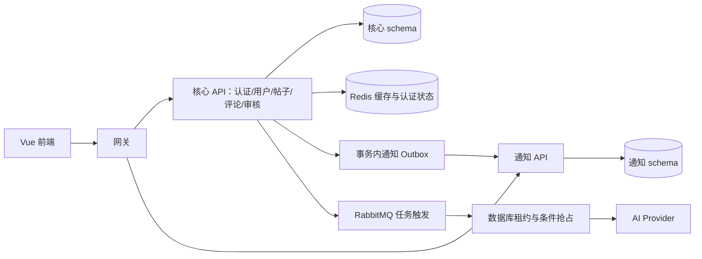

# 全仓代码健康与结构设计审查（2026-10-18）

## 结论与范围

现有目录和顶层架构合理，保留 Vue 前端、网关、按业务域组织的核心 API 和独立通知服务。当前没有需要推倒重建或再拆微服务的证据。本次优先修复可复现的权限、并发、事务、资源容量和前端生命周期问题，保留现有产品与目录身份。

审查覆盖生产源码清单、三个服务的配置、迁移、前端构建、CI、Python 测试树及运行脚本。静态扫描覆盖全部生产文件；人工审查沿关键调用链和分域阅读展开，不代表每行均经人工证明。第三方源码、运行产物和个人历史材料不计为业务源码。当前结论基于工程优化后的工作区；发布状态以 Git 提交及远端分支记录为准。

## 已收口的缺陷

| 原发现 | 修复后的边界 | 验证方式 |
| --- | --- | --- |
| P1 隐藏帖子可从旧列表缓存泄露 | 列表缓存命中后批量核对数据库实体存在、NORMAL 与更新时间；不符则整页回源，保留真实分页总数；数据库失败不回退不可信缓存 | 隐藏、失效失败、过期缓存、数据库异常回归 |
| 公共评论缓存覆盖个人 liked | 登录评论请求绕过匿名 DTO 缓存；匿名命中批量核验评论状态、归属与更新时间，父帖始终先查数据库 | 匿名预热后登录点赞状态、隐藏评论、数据库失败 |
| 评论提交前清缓存与跨域失效不一致 | 评论写入统一提交后失效评论列表、帖子详情与列表；事务回滚不失效；由 ThreadCacheInvalidator 提供独立接口 | 提交/回滚时序回归 |
| PROCESSING 崩溃后永久停留 | 数据库持有唯一 owner、180 秒租约、尝试次数；恢复器发现到期任务；完成/失败按 owner 条件写回，完成还核验租约与正文版本；5 次连续崩溃后 FAILED，可手动重试 | 真实 H2 到期接管、旧 owner 写回拒绝、源版本变化与次数上限 |
| 摘要读取/执行的可见性不一致 | GET、POST、消费者均先核对 NORMAL；状态以数据库为准；隐藏/删除淘汰缓存；队列投递失败保留持久 PENDING 意图 | 权限、重复消费、生成中隐藏/删除、队列故障 |
| 外部 AI 失败被当成功摘要 | 同步摘要请求设置真实 HTTP 截止时间；非成功 HTTP、空内容、超时抛失败，不持久化错误提示为 COMPLETED | 本机 HTTP 服务成功/失败/阻塞测试 |
| Markdown 本地缓存无界 | 最多 256 条、2,000,000 HTML 字符、5 分钟 TTL；LRU 淘汰，过大单项不缓存；解析在锁外；隐藏/删除时清理 | 容量、权重、TTL、并发版本与大项回归 |
| S3 写成功但私有桶无法展示 | 公共 CDN 显式配置时保留其 URL；否则返回稳定站内地址，读取时生成 5 分钟签名，避免在正文保存到期 URL；只允许签名本服务生成格式的图片 key | SDK 签名、私有 URL、CDN、自定义 endpoint、任意路径拒绝 |
| 编辑页离页后迟到导航 | load/save 固定 route、token、身份代次；离页/换目标/换身份清理定时器；持久写入的公共刷新事件固定原 ID，UI 与导航单独校验 | 延迟加载/保存、取消、切路由、卸载、换身份 |
| SSE/退出/账户表单规则分散 | Axios 与 fetch 建连 401 共用当前 token 失效桥；旧 401 不清新身份；退出依据 requiresAuth 元数据离开受保护页；邮箱手机号必填 | 旧 401、当前 401、受保护路由、空值提交 |
| QR scan/confirm/cancel 非原子 | Redis Lua、本地 compute 执行相同转换；SCANNED 归属固定；确认先核 owner；取消和过期不复活；兑换保持单次；Redis 故障 503 | 本地竞争、脚本契约和单次兑换 |
| 举报 HIDE/DISMISS 并发覆盖 | 同一事务先悲观锁定举报，再判断 PENDING、执行隐藏并保存结果；竞争者读取终态后冲突 | 两个独立 H2 事务竞争及目标/举报回读 |
| OAuth 建号、绑定、资料部分提交 | 统一独立事务覆盖三个写入；唯一约束冲突后先完整回滚，再在新事务读取并发获胜账号 | 中途绑定失败回滚、并发首次登录同一完整身份 |
| 邮箱 OTP 仅本机生成且未发信 | 删除未接通发送链路的本机 map；接入已有 Cognito EMAIL_OTP 发起和校验；缺配置/缺有效 challenge/未完成认证明确失败 | mock 外部 provider 契约、无认证结果禁止建号、资料失败完整回滚 |
| 点赞/关注先查再插产生重复冲突 | 同事务先锁交互目标再读写；关注按 User ID 升序锁定双方；锁前不建立普通读取快照；重复操作保持幂等 | 真实 H2 并发插入/删除及数据库回读 |
| 多实例误用本地状态或上传目录 | 非 local/test 缺 Redis bean 拒绝启动；显式多实例还要求 Redis 和 S3 或明确共享上传目录 | 启动配置组合测试 |
| 输入、认证与本地配置打包 | 正文统一 10,000 UTF-16 单元上限，旧超长草稿不截断；登录代次覆盖退出/竞争；Docker/Maven/JAR 排除私有配置；拒绝明显样例 JWT 密钥 | 输入、异步生命周期、包条目与配置回归 |

具体代码集中在 [ThreadService](../../backend/src/main/java/com/example/demo/threads/service/ThreadService.java)、[PostService](../../backend/src/main/java/com/example/demo/posts/service/PostService.java)、[ThreadRepository](../../backend/src/main/java/com/example/demo/threads/repo/ThreadRepository.java)、[AuthQrService](../../backend/src/main/java/com/example/demo/auth/service/qr/AuthQrService.java)、[OAuthUserProvisioningService](../../backend/src/main/java/com/example/demo/auth/service/oauth/common/OAuthUserProvisioningService.java)、[DeploymentSafetyConfiguration](../../backend/src/main/java/com/example/demo/config/DeploymentSafetyConfiguration.java)。

## 结构设计判断

合理之处：

- 前端 api、stores、pages、components 与页面专属子模块职责明确；后端按领域及 controller/service/repo/dto/entity 组织，测试、文档、工具与产物分离。
- 网关负责路由、超时与请求关联；核心服务自行鉴权。前端路由守卫负责交互体验，不能替代后端授权。
- 通知使用核心事务内 Outbox 与接收方幂等键；公共用户摘要与本人私人资料接口分开。
- Java 静态 import 图没有发现文件级强连通环。该结论不覆盖依赖注入、反射、JPQL 或运行时调用。

仍然存在可逐步改善的结构债务：

1. auth↔user、ai↔threads 等跨领域 repo/entity 访问较多。当前已将安全敏感状态收紧到原子数据库方法和缓存接口；后续可在真实复用点引入小型应用接口，避免为目录美观一次性制造大量抽象。
2. 帖子列表仍复用完整 DTO，包含正文；个人交互字段、列表预览、详情内容宜分开。当前没有把更换所有 API 响应格式混入安全修复。
3. JPA 与可选 MyBatis-Plus 两套读取实现、服务端与前端双重 Markdown 渲染有重复维护成本。MP 默认关闭；保留前先测收益及等价性，再决定删除哪条实现。
4. 部分标签/点赞/用户映射有逐项查询，缺少 SQL 数量与容量基准。可优先批量化；不能从静态查询扇出直接推导延迟或并发容量。
5. 前端请求代次和 window 事件仍有手写重复。已修复本次确认的生命周期漏洞；后续可提炼有类型的事件接口和小型取消/代次工具。根视图以 fullPath/身份重挂载仍可能重置输入。
6. Python 依赖仍含开放版本，容器镜像部分使用可变标签；没有本次可引用的覆盖率阈值、压测容量或长期运行证明。这些属于工程基线后续工作，不把“测试通过”解释成生产无缺陷。

`sections.visible` 明确定义为导航发现标记，**不提供私有分区授权**；内容可见性由帖子/评论状态约束。如未来要求私有分区，应新增成员/权限模型并贯穿所有派生查询，不可直接复用该导航字段。实体注释和本报告保持一致。

两个数据库 schema 当前仍在同一个 MySQL 实例，不构成物理故障隔离。当前不建议继续拆微服务；先用领域接口、批量读模型和可测量的性能证据收紧边界。

## 运行与配置契约

- 新增 [租约迁移](../../backend/src/main/resources/db/migration/mysql/V20261018__summary_processing_leases.sql)；不修改已发布的历史迁移。旧 PROCESSING 无租约记录可恢复。
- 恢复轮询默认 60 秒、最小创建年龄 60 秒、批量 20（1–100）；PENDING 的发布不等于执行完成。多实例可重复触发，数据库抢占去重。外部 AI 可能因崩溃被重复调用，不承诺外部恰好一次。
- 摘要 HTTP 超时最多 120 秒，租约 180 秒；5 次是崩溃接管的次数上限。正常返回失败立即 FAILED，允许用户重试。队列投递故障返回 503，但保留 PENDING，后台可恢复；客户端应按 GET 数据库状态展示。
- `APP_MULTI_INSTANCE=true` 表示运营者声明多实例部署。认证要求共享 Redis；图片使用 S3，或 `APP_STORAGE_LOCAL_SHARED=true` 且所有实例实际挂载同一目录。布尔配置不自动验证跨主机挂载，应由部署验收证明。
- Redis bean 存在但连接失败时，认证操作失败关闭，不切到本机 map；非 local/test 缺 bean 时启动拒绝。local/test 单实例允许本地测试状态。
- 站内图片为公开论坛资源；底层 S3 桶可保持私有。站内读取接口签发短期只读 URL，允许任何知道资源地址的访问者读取，不声称账号私有相册语义。公开 CDN 仍需配置正确策略、CORS 与地址。
- Cognito 必须实际开启 USER_AUTH 与 EMAIL_OTP/SMS_OTP，并具有有效用户和发送通道；服务不自动创建云端用户或开通云服务。参见 [InitiateAuth](https://docs.aws.amazon.com/cognito-user-identity-pools/latest/APIReference/API_InitiateAuth.html)、[RespondToAuthChallenge](https://docs.aws.amazon.com/cognito-user-identity-pools/latest/APIReference/API_RespondToAuthChallenge.html)。
- S3 临时读取使用 SDK 预签名机制，参见 [AWS SDK 说明](https://docs.aws.amazon.com/sdk-for-java/latest/developer-guide/examples-s3-presign.html)。上传归属、未引用文件回收与用户私有资源模型仍属后续产品设计，不在 URL 修复中暗中引入。
- 非安全的点赞数、排序、总数等允许短 TTL 陈旧；提交后失效不能完全排除旧读取晚回填。隐藏/删除的可见性独立核对数据库，不能依赖 TTL。
- 本地 Compose 是演示/验收配置，不能直接视为公网生产入口。旧包/镜像仍需重建；本轮保留用户私有配置源文件，没有自动轮换密钥。

## 验证记录

| 检查 | 最终工作区结果 |
| --- | --- |
| Java 根聚合干净构建 | `mvn clean package` 成功；backend 269、gateway 6、notification 23，共 **298** 项、81 个 JUnit 文件，失败/错误/跳过均为 0 |
| 前端 | **48 文件、186 项**通过，失败/错误/跳过均为 0；最终 lint、类型检查和生产构建通过 |
| 状态与事务 | H2 实际执行摘要租约接管/旧 owner 拒绝、OAuth 并发建号与中途失败回滚、OTP 资料写入失败回滚、举报竞争、重复点赞/关注等回归 |
| 二维码 Redis | 使用已有 WSL 内、项目目录中解包的临时 Redis **7.0.15**，直接从 Java 提取当前生产 Lua 执行：扫描唯一归属、过期/取消不复活、确认归属、单次兑换、坏时间字段失败关闭；临时进程已关闭。此证据不是当前 Compose 跨实例链路验收 |
| 依赖审计 | 官方生产审计 **0** 告警；完整依赖审计剩 **1 high**、0 critical/0 moderate/0 low，为已纳入本地补丁的 braces 3.0.3 版本匹配告警，详见下节 |
| CSS 兼容 | 选择器解析器升级及 braces 补丁前后，110,942 字节 CSS 逐字节一致，SHA-256 相同；不据此声称做过完整浏览器视觉验收 |
| 构建隔离 | 干净生成的后端 JAR 不包含 application-secrets.yml 或已删除的 InMemoryEmailOtpService.class；原本地私有配置保留 |
| 仓库与脚本 | 全仓结构与 Java 依赖边界扫描无错误，检查器自身 9 项通过；PowerShell/k6 语法和 Python 编译检查通过 |
| Python 自动化 | 在输出目录的隔离依赖环境完成 **83 项收集**；没有运行其 API/浏览器测试，不计为 83 项执行通过 |

### 依赖升级与剩余公告

最终使用 Axios 1.20.0、Vue 3.5.44、KaTeX 0.18.2（插件与样式统一）、PostCSS 8.5.30、Vite 6.4.4、Vue 插件 5.2.4、Vitest 4.1.12、Sharp 0.35.5，并刷新兼容的传递依赖。测试目录显式限定到 src，单进程运行；CI 已移除新版 Vitest 不支持的 minWorkers 参数，增加生产依赖高危门禁。

依据：[Axios 公告](https://github.com/axios/axios/security/advisories/GHSA-vh66-26gq-q6x8)、[Vue 公告](https://github.com/vuejs/core/security/advisories/GHSA-g2v6-rqmx-r4w6)、[KaTeX 公告](https://github.com/KaTeX/KaTeX/security/advisories/GHSA-238p-pmpm-9mq7)、[Vitest 迁移](https://v4.vitest.dev/guide/migration.html)、[Vite 迁移](https://v6.vite.dev/guide/migration)。

braces 3.0.4 在本次官方 npm 查询/安装时尚未发布，不能靠填写不存在的版本修复。已将最小解析深度补丁纳入 pnpm patchedDependencies、锁文件和正式回归，拒绝 4,000 层 brace/parenthesis 输入，正常路径展开通过。它只经 Tailwind 等开发工具进入构建树，生产依赖审计无此项。版本扫描仍识别 3.0.3，因此保留 1 条 high 公告，不隐藏、不声称完整审计为零；补丁后也不推导整个依赖绝对安全。上游发布等效修复后应移除此临时补丁，见 [补丁维护说明](../../frontend/patches/README.md) 与[上游问题](https://github.com/micromatch/braces/issues/70)。

提交前另修复前端 Docker 安装阶段漏复制依赖补丁的问题，并在仅含安装阶段输入文件的隔离目录验证冻结安装及补丁生效；此检查不等于实际镜像构建。性能栈的 API 健康检查也已改为实际管理端口 9090，避免 service_healthy 阻塞 Nginx；使用隔离随机验证凭据通过 Compose 配置解析，不据此宣称性能容器已启动。

二维码流程在创建时固定认证代次，创建、轮询、兑换全过程核对，防止旧二维码覆盖期间开始的密码登录。认证代次变化后停止旧轮询，需手动刷新二维码；补充创建期间登录、轮询期间登录/新认证尝试及正常扫码成功回归。

本轮证据保存在 `outputs/health-completion/`；提交前补充验证在 `outputs/prepush-2026-10-18/`；上一轮证据仍在 `outputs/code-health-optimization/`。旧缓存诊断探针用于复现错误，不再计为修复后的通过测试。

本地 Docker 引擎当前未运行。本轮不重置 Docker、不关闭用户应用。完整容器/浏览器验收、真实 MySQL 迁移、真实云端 Cognito/S3/AI 和生产长期容量，需相应运行环境与凭据；不能用 H2、SDK 签名或 mock provider 代替这些证明。
