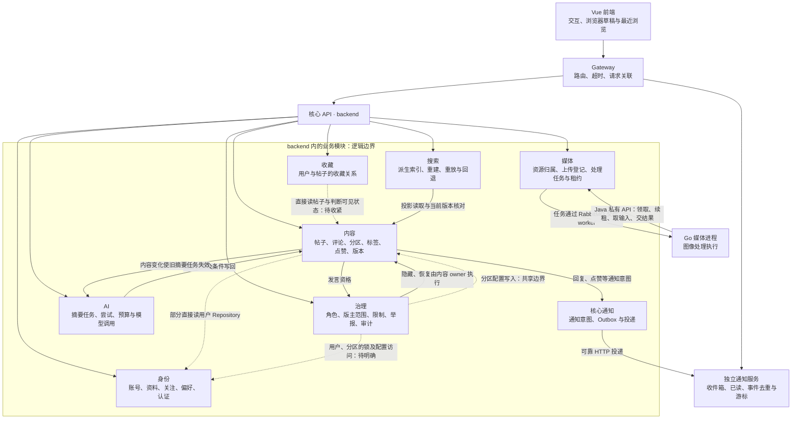

# BlueAlbum 职责与替换边界图（讨论稿）

核对日期：2026-10-21。工作区：`D:\Desktop\BlueAlbum`；代码基线：`9276bbe`。

本稿用于先确认数据归属、业务协作与技术替换范围，再讨论分层调整。它记录当前源码及候选边界，不代表重构已经实施、PostgreSQL 已受支持或新适配器已经通过运行验收。本轮仅新增本文档，不修改业务代码、数据库或已有工作区改动。

## 1. 如何读这张图

- **模块**是一块业务责任，不等于一个独立进程或 Maven 模块。
- **数据所有者**负责数据语义、写入规则与一致性；表放在同一个数据库中，不会消除所有权边界。
- **公开能力**可以是应用内 Service/DTO，也可以是 HTTP 或事件。当前可调用的 Service 不代表已形成稳定、完整的公共 API。
- **替换接点**表示可集中修改或扩展的位置；已有接口也不代表数据库、消息与失败处理的全部语义都可自由替换。
- 下图箭头表示主要业务协作或执行关系，不是完整 import 图、Spring 装配图或事务时序图。虚线表示已确认的内部访问或尚未完成的替换边界。

## 2. 当前职责与主要协作

图中的双向协作是现状，不表示未来必须保留双向源码依赖。尤其内容与治理、内容与 AI 的流程和事务位置，需要在后续分层讨论中决定，不能仅通过改文件夹或增加接口宣称循环已经消失。

媒体与内容之间没有在图中画出“已完成附件引用关系”的箭头：现有上传和编辑器使用 URL，不据此推断存在帖子附件归属、引用计数或自动回收闭环。

## 3. 每个模块拥有的数据与公开能力

以下表名用于定位已核对的主要数据，不是完整数据库字典；实体映射、迁移和当前业务调用优先于旧阶段文档。

| 模块与当前位置 | 主要权威数据 | 当前可调用能力/入口 | 当前边界及候选责任 |
| --- | --- | --- | --- |
| 身份：`auth`、`user` | `users`、`user_profiles`、`user_connected_accounts`、`user_follows`、`user_notification_settings`；认证会话和临时状态由其管理 | 登录/OAuth/验证码/二维码接口；用户摘要、资料、关注与设置服务；`ConnectedAccountsService` | 账号与认证归为同一业务域；其他域应获得最少的用户摘要或资格结果，避免依赖用户实体。现行治理授权通过治理表与用户关联，不将角色决策归给账号资料模块 |
| 内容：`threads`、`posts`、`sections`、`tags` | `threads`、`posts`、分区、标签及关联、帖子/评论点赞；内容版本、内容事件 `content_event_outbox`；帖子上的摘要结果与绑定状态 | `ThreadService`、`PostService`、分区/标签服务；`ThreadSearchProjectionService`；`ThreadSummaryContentPort` | 内容规则、可见性与内容写入由内容 owner 负责。分区导航数据在内容域，但治理目前参与分区配置写入；需确定最终命令入口 |
| 收藏：`bookmarks` | `thread_bookmarks` 收藏关系；收藏列表属于其查询职责 | `ThreadBookmarkService`；收藏/取消/状态和我的收藏列表 | 目前直接读帖子并判断 `NORMAL`，列表也关联内容数据。候选边界是内容提供可用性或读取能力，收藏保有关系管理；并发和列表过滤语义仍需明确 |
| 治理：`admin`、`moderation`、`governance` | `community_state`、`community_admin_role`、`community_moderator_scope`、`community_posting_restriction`、`community_audit`、`content_reports` | `GovernanceService`、`AdminAccessService`、`ContentReportService`；后台、举报与治理 HTTP 入口 | 隐藏/恢复帖子和评论已调用内容 owner；治理仍访问用户与分区 Repository 并参与锁和分区配置保存，举报范围查询也直接 JOIN 内容表。角色数据的业务 owner 是治理，用户账号主体仍归身份 |
| 媒体：`storage` | `media_asset`、`media_processing_job`、`media_request_outbox`；owner、对象位置、版本、租约、结果状态；原图及派生字节的管理职责 | 上传、owner 状态、取消/重试；worker 私有 API；`MediaUploadService`、`MediaJobService` | Java 决定权限、版本和结果接受；Go 负责受控执行。对象字节在本地/S3，不因此归 Go 所有；上传与后续读取/清理的替换范围尚不一致 |
| AI：`ai` | `ai_summary_task`、`ai_summary_attempt`、`ai_summary_request`、`ai_summary_budget`；调用、预算与重试状态，缓存/限额 | `SummaryTaskService`、`AiService`、`AiProvider`；摘要及流式对话 HTTP 入口 | AI 拥有执行账本，内容 owner 拥有帖子摘要字段。两边通过 `ThreadSummaryContentPort` 和 `SummaryContentLifecycle` 协作，当前仍有同库事务/锁与双向流程依赖 |
| 搜索：`search` + 内容域的投影/维护入口 | Elasticsearch 中的派生文档；`content_search_control` 当前代码归内容域维护包 | `ThreadSearchService`、重建/重放管理入口、`ContentSearchIndex` | 搜索不是内容权威来源；结果按内容当前版本/可见性核对，异常时走数据库回退。控制表归属与重建写闸门是横跨搜索流程和内容一致性的边界，暂不强行迁表 |
| 通知：核心 `notifications` + `notification-service` | 核心 `notification_outbox`；独立 `notifications` 表及其幂等键、`notification_stream_cursor`、`notification_stream_event` | 核心 `NotificationClient` / `NotificationService`（remote/mock）；独立通知列表、已读、SSE 与内部接收 HTTP | 两个进程分工，不把核心待投递记录画成收件箱。通知偏好由身份域管理；SSE 发送变化信号，持久化查询仍是结果读取入口 |

### 对外入口有三个不同含义

1. **浏览器入口**：Controller/HTTP API，负责协议与当前请求身份。
2. **业务模块入口**：应用内的公开业务能力，供其他模块使用。
3. **第三方实现入口**：存储、模型、索引等能力契约，供适配器实现。

三者不能混为一套“大公共 Service”。例如 `AiProvider` 是模型实现接点，`ThreadSummaryContentPort` 是内容 owner 的访问入口，两者用途不同。

HTTP 路径也不决定数据所有权：当前 `UserContentController` 在 `/users/.../threads`、`/users/.../posts` 下调用内容 Service，这是用户页面的组合查询，不表示帖子/评论由身份域拥有。内容 Repository 也存在关联用户/资料/关注的查询；后续应单独评估读模型，不能将全部关联查询一律改成逐条远程调用。

## 4. 技术实现与替换边界

状态含义：**已有接点**＝存在明确接口/协议；**部分隔离**＝只覆盖链路的一部分；**绑定当前实现**＝目前替换仍需修改技术相关调用/配置/迁移。均不等于新实现已经兼容。

| 技术能力 | 当前实现 | 隔离程度 | 别人改接时需要覆盖的范围 |
| --- | --- | --- | --- |
| 关系数据库 | 核心与通知服务当前 MySQL；JPA、部分 JDBC/原生 SQL、可选 MyBatis 读取及 Flyway MySQL 迁移 | 绑定当前实现 | 各域持久化、SQL/投影、迁移、JSON/排序/主键语义、唯一冲突、锁与事务；不能只改连接 URL。PostgreSQL 当前不是已交付选项 |
| Redis | 认证临时状态、限流、配额及缓存等，多处直接使用 Spring Redis API | 部分隔离 | 区分可丢缓存与不可放松的认证/原子状态；分别核对过期、原子操作和故障行为，不能统一替换为一个无语义的 KV 接口 |
| 外部认证与验证码 | Apple/GitHub/Google OAuth、Cognito OTP、Turnstile；已有各自 Client 接口与 HTTP 实现 | 已有局部接点，协议语义专用 | 如 `CognitoOtpClient`、`TurnstileVerifyClient`、各 OAuth Client；替换同协议 HTTP 实现较集中，更换认证产品/流程仍需匹配账号绑定、验证状态、单次兑换及安全规则，并非通用登录插件已完成 |
| 原图上传存储 | `ImageStorageProvider` → `LocalStorageService` / `S3StorageService`，由 `StorageService` 选择 | 已有接点，上传范围 | 实现准备/写入、可用性与选择规则；当前输入仍为 Spring `MultipartFile` |
| 媒体读回、派生写入、清理 | `MediaObjectStore` 直接持有 `S3StorageService` 并按 `local`/`s3` 分支；数据库限制 provider 取值 | 部分隔离 | 原图读取、派生对象写入/扫描/删除、URL、不可变对象与安全校验；若新增 provider 标识，还要迁移约束。仅增加上传 Provider 不够 |
| 消息投递 | 内容事件、媒体请求、摘要任务各自使用 RabbitMQ；核心通知 Outbox 则经 HTTP 投递 | 部分隔离 | 发布确认、重投、幂等、乱序、隔离、租约/恢复及消费者行为；不能把通知也标成当前 RabbitMQ 链路 |
| 搜索索引 | `ContentSearchIndex` → `ElasticsearchContentSearchIndex` | 已有接点 | 文档版本、墓碑、索引重建、刷新、别名切换和故障回退；接口目前仍体现索引/别名模型，不承诺任意引擎无代价接入 |
| AI 模型 | `AiProvider` → `MockAiProvider` / `RealAiProvider` | 已有接点 | 有界请求、取消、错误归类、输出、配额/尝试账本；更换模型实现不能绕过任务生命周期 |
| 媒体执行器 | Go 进程消费 RabbitMQ，通过 Java 私有 HTTP API 执行任务协议 | 已有协议，传输仍有绑定 | 可重写执行器，但必须满足领取、续租、输入、幂等结果、失败与 ACK 顺序；Go 不直接读取业务库或持有对象存储凭据 |
| 通知接收方/传输 | `NotificationService` 有 remote/mock 实现；生产语义为核心通知意图/Outbox → HTTP → 独立通知服务 | 已有接点，接收协议固定 | 内部鉴权、事件 ID、重放幂等、持久化后确认、账号隔离；默认兼容方法不保证自定义实现遵守事件幂等。进程已分开不代表任意通知产品可直接替换 |

## 5. 确认图时要守住的约束

- 帖子及其内容事件记录保持同事务；可靠事件记录不等于立即完成外部投递。
- 需要可靠通知的调用，核心通知 Outbox 加入调用方事务；收件箱在接收端持久化后确认。
- 外部对象写入与数据库提交无法直接组成普通本地事务；媒体上传已有意图、确认和恢复流程，不能在分层时丢失。
- AI 外部调用不放进长数据库事务；内容版本、任务租约和条件写回防止过期结果覆盖新内容。
- 搜索、缓存、SSE 不成为权限或内容状态的权威来源。
- 这些 owner 是逻辑写入责任，当前多域仍共享核心数据库和部分事务/锁；不能据此承诺可直接拆成独立服务或任意混用多种数据库。

## 6. 先确认的业务边界，不提前决定目录结构

建议确认以下责任基线：身份管账号、治理管授权与治理规则、内容管内容状态、收藏管收藏关系、媒体管资源与任务；AI 管执行账本、搜索管派生检索、通知管投递与收件箱。

仍需在后续讨论中明确的三处：

1. **分区**：分区主体/导航属于内容；归档、可写状态和版主范围属于治理决策。当前治理参与配置持久化，未来由谁提供最终修改命令、如何保留锁顺序，尚未决定。
2. **内容与 AI**：内容变更要使旧任务失效，AI 完成又要条件写回内容。先确认数据归属，再决定流程协调点；不能直接承诺全改异步或彻底分库。
3. **身份与治理**：用户主体和角色/限制不能被画成同一个业务所有者；治理当前锁用户行以保证并发安全，未来改入口必须保留原并发约束。

本稿确认后，再讨论应用用例、领域规则、技术适配器和装配如何分层；本稿不授权或记录这些代码调整已开始。

## 7. 源码证据与核对边界

### 已核对的关键入口

- [域映射与历史依赖白名单](../../config/java-domain-couplings.json)、[源码边界检查器](../../scripts/Check-JavaArchitecture.mjs)。
- [收藏服务](../../backend/src/main/java/com/example/demo/bookmarks/service/ThreadBookmarkService.java)、[帖子服务](../../backend/src/main/java/com/example/demo/threads/service/ThreadService.java)、[评论服务](../../backend/src/main/java/com/example/demo/posts/service/PostService.java)。
- [用户内容组合入口](../../backend/src/main/java/com/example/demo/user/controller/UserContentController.java)、[收藏列表关联查询](../../backend/src/main/java/com/example/demo/bookmarks/repo/ThreadBookmarkRepository.java)、[连接账号契约](../../backend/src/main/java/com/example/demo/user/connected/service/ConnectedAccountsService.java)、[Cognito 客户端契约](../../backend/src/main/java/com/example/demo/auth/service/otp/CognitoOtpClient.java)、[验证码校验契约](../../backend/src/main/java/com/example/demo/auth/service/otp/TurnstileVerifyClient.java)。
- [治理服务](../../backend/src/main/java/com/example/demo/governance/service/GovernanceService.java)、[举报服务](../../backend/src/main/java/com/example/demo/moderation/service/ContentReportService.java)。
- [上传流程](../../backend/src/main/java/com/example/demo/storage/service/MediaUploadService.java)、[上传 Provider](../../backend/src/main/java/com/example/demo/storage/service/ImageStorageProvider.java)、[后续对象操作](../../backend/src/main/java/com/example/demo/storage/service/MediaObjectStore.java)、[媒体库约束](../../backend/src/main/resources/db/migration/mysql/V20261019_3__media_registry.sql)。
- [AI Provider](../../backend/src/main/java/com/example/demo/ai/service/AiProvider.java)、[摘要用例](../../backend/src/main/java/com/example/demo/ai/summary/service/SummaryTaskService.java)、[内容摘要入口](../../backend/src/main/java/com/example/demo/threads/service/ThreadSummaryContentPort.java)、[旧任务作废](../../backend/src/main/java/com/example/demo/ai/summary/service/SummaryContentLifecycle.java)。
- [搜索索引接口](../../backend/src/main/java/com/example/demo/search/port/ContentSearchIndex.java)、[搜索查询与回退](../../backend/src/main/java/com/example/demo/search/service/ThreadSearchService.java)、[内容投影入口](../../backend/src/main/java/com/example/demo/threads/service/ThreadSearchProjectionService.java)、[内容写闸门](../../backend/src/main/java/com/example/demo/threads/maintenance/service/ContentWriteGateService.java)。
- [内容事件传输](../../backend/src/main/java/com/example/demo/threads/event/service/ContentEventPublisherTransport.java)、[媒体请求发布](../../backend/src/main/java/com/example/demo/storage/service/MediaRequestPublisher.java)、[摘要发布](../../backend/src/main/java/com/example/demo/ai/summary/service/SummaryTaskPublisher.java)。
- [核心通知调用](../../backend/src/main/java/com/example/demo/notifications/client/NotificationClient.java)、[通知应用契约](../../backend/src/main/java/com/example/demo/notifications/service/NotificationService.java)、[Outbox 派发](../../backend/src/main/java/com/example/demo/notifications/outbox/NotificationOutboxDispatcher.java)、[接收端持久化](../../notification-service/src/main/java/com/example/notification/service/PersistentNotificationService.java)、[Go worker 约定](../../services/media-service/README.md)。

### 证据范围

依据当前源码、实体映射、迁移、调用与配置进行静态核对；未启动服务、未连接数据库、未执行真实消息或第三方调用。现有 [模块契约](module-contracts.md) 作为历史基线使用，其中 AI Controller、旧摘要流程等描述已落后于当前实现，本文不沿用这些旧结论。

本轮 Java 边界检查：346 个生产源码文件、2624 个声明依赖，0 个现行规则违规。检查包含白名单，且不分析运行时装配和全部 SQL，所以不等于没有跨域耦合，也不等于本文已完成运行验收。

全仓目录/链接检查仍报告根目录两个已有崩溃日志 `hs_err_pid12132.log`、`hs_err_pid45444.log`；未为通过门禁而移动或删除它们。本稿的相对文件链接另行逐一核对。
